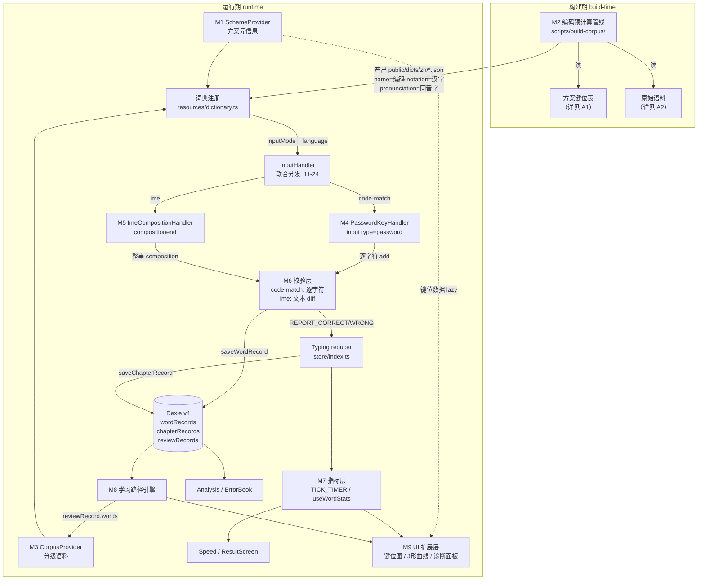

# 03 · 模块与架构设计

**日期**：2026-10-17
**负责成员**：代码探查（Explore）+ 方向明汇编
**代码基线**：本地 master，最近提交同步上游 PR #1111

---

## 0. 文档定位与阅读指引

本文档回答一个问题：**在 qwerty-learner 现有代码基线上实现「中文输入法打字练习」，哪些能直接用、哪些要改、哪些必须新写，改在哪一行。**

所有代码结论均附 `文件路径:行号`，可在基线上逐条复核。行号以本文档撰写时的本地 master 为准。

**路径简写约定（grep 友好，03/A3 两文档通用）**：正文引用深层文件时使用简写路径，完整路径对照如下——

| 简写 | 完整路径前缀 |
| --- | --- |
| `Word/index.tsx`、`InputHandler/index.tsx`、`KeyEventHandler/index.tsx`、`TextAreaHandler/index.tsx`、`Letter.tsx`、`Notation.tsx` | `src/pages/Typing/components/WordPanel/components/` 下同名目录（如 `Word/index.tsx` = `src/pages/Typing/components/WordPanel/components/Word/index.tsx`） |
| `ResultScreen/index.tsx`、`WordList/index.tsx`、`WordList/WordCard.tsx`、`PrevAndNextWord/index.tsx`、`StartButton/index.tsx`、`DictChapterButton/index.tsx`、`ShareButton/SharePicDialog.tsx`、`Speed/index.tsx`、`Setting/...` | `src/pages/Typing/components/` |
| `ErrorBook/hooks/useGetWord.ts`、`Analysis/hooks/useWordStats.ts`、`Gallery-N/...`、`Gallery/...` | `src/pages/` |
| `db/index.ts`、`db/record.ts` | `src/utils/db/` |

每份文档中关键文件首次出现处均给出一次完整路径。

交叉引用约定（避免与其他成员文档重复）：

| 主题 | 归属文档 |
| --- | --- |
| 指标口径（CPM / 码正确率 / 字正确率 / J 形曲线定义） | 详见 **05** |
| 键位映射表（全拼、小鹤双拼等方案的实际键位） | 详见 **A1** |
| 语料来源与许可 | 详见 **A2** |
| 技术验证任务拆解 | 详见 **A3** |

架构口径（已由 team-lead 拍板，本文档按此撰写，属硬性约束）：

- 双轨制：**对码轨（`inputMode: 'code-match'`）** 与 **实战轨（`inputMode: 'ime'`）**
- 分级映射：字 / 词 / 成语 → `code-match`；句子 / 诗句 / 文章 → `ime`
- 对码轨的编码在**离线构建期预计算**并烘进词典 JSON 的 `name` 字段，**运行时零拼音库依赖**
- 新增词典级字段 `inputMode`，在 `InputHandler` 处由 `language + inputMode` 联合分发

---

## 1. 现有架构盘点

### 1.1 打字核心链路

组件树（自顶向下）：

```
src/index.tsx                                    路由入口（/ = TypingPage）
└─ src/pages/Typing/index.tsx                    页面容器：reducer 持有者 + 计时器 + 全局启动键
   ├─ Header 内：DictChapterButton / PronunciationSwitcher / Switcher / StartButton / Skip
   ├─ WordPanel/index.tsx                        当前词编排：循环、跳词、翻译显隐、onFinish 流转
   │  ├─ PrevAndNextWord/index.tsx               上/下一词预览
   │  ├─ WordPanel/components/Word/index.tsx     ★ 逐字符校验核心（本文档最重要文件）
   │  │  ├─ InputHandler/index.tsx               ★ 输入策略分发（switch on language）
   │  │  │  ├─ KeyEventHandler/index.tsx         路线①：window keydown
   │  │  │  └─ TextAreaHandler/index.tsx         路线②：隐藏 textarea + input 事件
   │  │  ├─ Letter.tsx                           单字符渲染（normal/correct/wrong 三态）
   │  │  ├─ Notation.tsx                         ruby 注音（日语假名 / 山人码汉字）
   │  │  └─ TipAlert.tsx                         新手错误提示
   │  ├─ WordPanel/components/Phonetic/index.tsx 音标展示（仅 us/uk）
   │  ├─ WordPanel/components/Translation/index.tsx 释义展示
   │  └─ Progress/index.tsx                      章节进度条
   ├─ Speed/index.tsx                            实时 5 项指标条
   ├─ ResultScreen/index.tsx                     章节结算弹层
   └─ WordList/index.tsx + WordCard.tsx          本章词表抽屉
```

关键事实：

1. **计时器**在页面容器层，`src/pages/Typing/index.tsx:116-125`：`state.isTyping` 为真时 `setInterval(1000)` 派发 `TICK_TIMER`。语言无关，**零改动可复用**。
2. **"按任意键开始"**在 `src/pages/Typing/index.tsx:80-92`：非打字态挂 `window keydown`，`isLegal(e.key) || e.key === ' '` 且无修饰键时置 `isTyping=true`。IME 场景下 `e.key` 为 `'Process'`，不在 `bannedKeys`（`src/utils/index.ts:6-37`）黑名单内，会被误判为合法启动键 → **需处置**（见 4.3）。
3. **失焦暂停**在 `src/pages/Typing/index.tsx:65-74`（`window blur` → `isTyping=false`）。
4. **词间流转**在 `src/pages/Typing/components/WordPanel/index.tsx:54-91`：循环单词（`loopWordTimes`）→ `NEXT_WORD` → 章末 `FINISH_CHAPTER`；`106-122` 行 `Ctrl+Shift+←/→` 跳词。
5. **章节结算触发**在 `src/pages/Typing/index.tsx:106-114`：`isFinished && !isSavingRecord` 时上报 mixpanel 并 `saveChapterRecord(state)`。

### 1.2 双 handler 并存现状

`src/pages/Typing/components/WordPanel/components/InputHandler/index.tsx:11-24` 是唯一分发点：

```ts
switch (dictInfo.language) {
  case 'en':     return <KeyEventHandler updateInput={updateInput} />
  case 'de':     return <KeyEventHandler updateInput={updateInput} />
  case 'romaji': return <KeyEventHandler updateInput={updateInput} />
  case 'code':   return <TextAreaHandler updateInput={updateInput} />
  default:       return <TextAreaHandler updateInput={updateInput} />
}
```

| | KeyEventHandler | TextAreaHandler |
| --- | --- | --- |
| 文件 | `.../components/KeyEventHandler/index.tsx` | `.../components/TextAreaHandler/index.tsx` |
| 捕获方式 | `window.addEventListener('keydown')`（`:29`） | 隐藏 `<textarea>`（`:41-51`，`h-0 w-0 appearance-none`）+ React `onInput`（`:46`） |
| 取值 | `e.key`（`:12`） | `(e.nativeEvent as InputEvent).data`（`:22-24`） |
| 过滤 | `isChineseSymbol`（`:14`）+ `isLegal` + 修饰键（`:19`） | `!nativeEvent.isComposing && data !== null`（`:23`） |
| 焦点管理 | 无（全局监听） | `isTyping` 时 focus，否则 blur（`:11-19`）；`onBlur` 自动夺回焦点（`:32-38`） |
| 适用 language | `en` / `de` / `romaji` | `code` / default |
| IME 态度 | **主动 alert 拦截** | **主动 alert 拦截 + 丢弃 composition 输入** |

两者最终都调用同一个 `updateInput(updateAction)`（`src/pages/Typing/components/WordPanel/components/Word/index.tsx:74-97`，后文简写为 `Word/index.tsx`），且**都只发出 `type:'add'` 一种动作**。`WordDeleteAction`（`InputHandler/index.tsx:36-39`）与 `WordCompositionAction`（`:41-45`）已定义但**从未被 dispatch**——后者注释明写 `// composition api is not ready yet`。

**架构含义**：`InputHandler` 已经是标准的策略分发点，新增第三、第四个 handler **不需要改动 Word 组件的调用方**，只需扩展 switch 判据。这是本次改造最重要的架构有利条件。

### 1.3 状态层

#### 1.3.1 Typing 局部 reducer

`src/pages/Typing/store/index.ts`（reducer，`useImmerReducer` 持有于 `Typing/index.tsx:27`）+ `store/type.ts`（类型）。

State 形状（`store/type.ts:44-54`）：

```
TypingState
├─ chapterData (:4-19)      words / index / wordCount / correctCount / wrongCount
│                           userInputLogs[] / wordRecordIds[]
├─ timerData   (:29-33)     time(秒) / accuracy / wpm
├─ isTyping / isFinished / isShowSkip / isTransVisible
└─ isLoopSingleWord / isSavingRecord
```

`UserInputLog`（`store/type.ts:21-27`）：`{index, correctCount, wrongCount, LetterMistakes}` —— 每词一条，是 ResultScreen 导出与错题判定的数据源。

Action 枚举 `store/index.ts:39-62`，reducer 主体 `:92-224`。需重点关注的 4 个 case：

| Case | 行号 | 内容 | 双轨影响 |
| --- | --- | --- | --- |
| `SETUP_CHAPTER` | `:94-106` | 洗牌、初始化 `userInputLogs`、`initialIndex` 越界回 0 | 需补 `wordsOrigin`（见 §9.2） |
| `REPORT_CORRECT_WORD` | `:117-123` | `correctCount += 1`（章节级 + 词级） | **语义单位是"击键"**，对码轨=码元，实战轨=？需按 05 定义 |
| `REPORT_WRONG_WORD` | `:124-132` | `wrongCount += 1` + `mergeLetterMistake` | 同上；`LetterMistakes` 键为字符索引 |
| `TICK_TIMER` | `:191-203` | `accuracy = correctCount/inputSum`（`:200`）；`wpm = wordCount/time*60`（`:201`） | **必须参数化**，口径详见 05 |

`REPEAT_CHAPTER`（`:173-180`）与 `NEXT_CHAPTER`（`:181-187`）都 `structuredClone(initialState)` 重建，前者对 `state.chapterData.words` 再洗牌（`:177`）——**这是 §9.2 要修的 bug 源头**。

#### 1.3.2 全局 jotai atoms

`src/store/index.ts`，持久化经 `atomForConfig`（`src/store/atomForConfig.ts:8-44`，localStorage）与 `atomWithStorage`。

| Atom | 行号 | 默认值 | 与本次改造的关系 |
| --- | --- | --- | --- |
| `currentDictIdAtom` | `:19` | `'cet4'` | 中文词典需可被设为首页默认（见 §4） |
| `currentDictInfoAtom` | `:20-28` | 派生，兜底 `cet4` | **`inputMode` 经此透传到全树** |
| `currentChapterAtom` | `:30` | `0` | 自定义章节机制沿用 |
| `loopWordConfigAtom` | `:32-34` | `times:1` | 单字/单词循环，直接复用 |
| `keySoundsConfigAtom` | `:36-41` | 开启 | 键音，直接复用 |
| `hintSoundsConfigAtom` | `:43-50` | 开启 | 对/错音，直接复用 |
| `pronunciationConfigAtom` | `:52-61` | `type:'us'` | **`zh` 已在 `LANG_PRON_MAP` 中**（见 §2） |
| `fontSizeConfigAtom` | `:63` | `foreignFont:48 / translateFont:18` | 需增 `notationFont`（山人码实测 94） |
| `randomConfigAtom` | `:69-71` | `isOpen:false` | 章节乱序，直接复用 |
| `isShowPrevAndNextWordAtom` | `:73` | `true` | 需按 language 决定显示 `notation` 还是 `name` |
| `isIgnoreCaseAtom` | `:75` | `true` | 对码轨强相关（编码大小写） |
| `isShowAnswerOnHoverAtom` | `:77` | `true` | 复用 |
| `isTextSelectableAtom` | `:79` | `false` | 复用 |
| `phoneticConfigAtom` | `:87-90` | `type:'us'` | 需支持 `'zh'` 分支展示拼音/拆分 |
| `wordDictationConfigAtom` | `:105-109` | `type:'hideAll'` | **`hideVowel/hideConsonant` 对中文无意义**，需扩展类型 |
| `reviewModeInfoAtom` / `isReviewModeAtom` | `:81-85` | — | 错题复习，直接复用 |

`atomForConfig` 的实现（`atomForConfig.ts:26-35`）在检测到 localStorage 中缺属性时自动 `{...defaultValue, ...config}` 合并并回写 —— **这意味着给已有 config atom 增加新字段是向后兼容的，无需迁移代码**。这是 §8 迁移策略的重要前提。

### 1.4 词库加载与章节切分

- 加载：`src/utils/wordListFetcher.ts:3-9`，`fetch(URL_PREFIX + url)` → JSON，由 SWR 驱动（`useWordList.ts:29`，缓存键 = `currentDictInfo.url`）。
- 章节切分：`src/pages/Typing/hooks/useWordList.ts:38`
  ```ts
  newWords = wordList.slice(currentChapter * CHAPTER_LENGTH, (currentChapter + 1) * CHAPTER_LENGTH)
  ```
  `CHAPTER_LENGTH = 20`（`src/constants/index.ts:3`），章节数 `calcChapterCount = ceil(length / 20)`（`src/utils/index.ts:94-96`），在 `src/resources/dictionary.ts:4192-4195` 装配时计算。
- 越界重置：`useWordList.ts:23-26`（`currentChapter >= chapterCount` → 归 0）；`Typing/index.tsx:52-59`（`currentDictId` 不存在 → 回退 `cet4`）。
- 词条兜底：`useWordList.ts:44-58`，`trans` 非数组/null/object 统一收敛为 `string[]`，并附 `index`（原始序）成为 `WordWithIndex`。
- 硬编码首章：`useWordList.ts:28` + `:64-90`，`cet4` 第 0 章为写死的 20 个英文词（新手引导）。**新增中文词典时此逻辑不触发**（条件含 `currentDictInfo.id === 'cet4'`），但中文词典若也想要引导章，需另设分支。

`chapterCount` 的**全部消费点**（自定义章节机制必须同步修改，共 5 处）：

| 文件:行 | 用途 |
| --- | --- |
| `src/resources/dictionary.ts:4194` | 装配时计算 |
| `src/pages/Typing/hooks/useWordList.ts:24` | 越界重置 |
| `src/pages/Typing/components/ResultScreen/index.tsx:87` | `isLastChapter` 判定 |
| `src/pages/Typing/components/DictChapterButton/index.tsx:13,42` | 章节下拉列表 |
| `src/pages/Gallery-N/DictDetail/index.tsx:73,114` | 词典详情页章节网格 |
| `src/pages/Gallery-N/DictionaryWithoutCover.tsx:25,28-29` | 词典卡片进度百分比 |
| `src/pages/Gallery/ChapterGroup.tsx:10,14-32` | 旧版 Gallery 章节网格（每章词数标签） |

### 1.5 Dexie 记录层

`src/utils/db/index.ts:11-35` 定义 `RecordDB`，当前 schema **version 3**：

```
v1 (:21-24)  wordRecords / chapterRecords
v2 (:25-28)  wordRecords 索引 errorCount → wrongCount
v3 (:29-33)  新增 reviewRecords
```

表结构（`src/utils/db/record.ts`）：

| 表 | 接口:行 | 字段 | 双轨改造性质 |
| --- | --- | --- | --- |
| `wordRecords` | `IWordRecord` `:4-17` | `word / timeStamp / dict / chapter / timing:number[] / wrongCount / mistakes:LetterMistakes` | `timing` 语义（每字母击键间隔）在实战轨崩坏，见 §8 |
| — | `LetterMistakes` `:19-22` | `{[字符索引:number]: string[]}` | 键语义从"字母位"扩展为"字位/码位" |
| `chapterRecords` | `IChapterRecord` `:48-68` | `dict / chapter / timeStamp / time / correctCount / wrongCount / wordCount / correctWordIndexes / wordNumber / wordRecordIds` | 需增 `inputMode`，见 §8 |
| — | getters `:105-115` | `wpm = wordCount/time*60`；`inputAccuracy`（**注意 `:110` 有运算符优先级 bug**）；`wordAccuracy` | 详见 05；bug 见 §11 |
| `reviewRecords` | `IReviewRecord` `:118-129` | `dict / index / createTime / isFinished / words:Word[]` | 直接复用（`word` 为任意字符串，汉字兼容） |
| `revisionDictRecords` / `revisionWordRecords` | `:148-185` | 旧版复习机制 | 未在 v3 stores 中声明，属历史遗留 |

写入路径：

- `useSaveWordRecord`（`db/index.ts:80-122`）：由 `Word/index.tsx:265-270` 在 `isFinished` 时调用；`timing` 由 `letterTimeArray` **相邻差值**计算（`:99-103`）；写入后 dispatch `ADD_WORD_RECORD_ID` + `SET_IS_SAVING_RECORD:false`（`:113-116`）。
- `useSaveChapterRecord`（`db/index.ts:43-73`）：由 `Typing/index.tsx:110` 调用；`correctWordIndexes` = `correctCount>0 && wrongCount===0` 的词 index（`:54`）。
- 导入导出：`db/data-export.ts`，`importDatabase` 已开 `acceptVersionDiff:true`（`:51`）与 `clearTablesBeforeImport:true`（`:56`）—— **schema v4 升级后旧备份仍可导入**，见 §8。

### 1.6 Analysis / ErrorBook 消费路径

#### Analysis（`src/pages/Analysis/`）

数据源**仅 `wordRecords`**：`hooks/useWordStats.ts:61` `db.wordRecords.where('timeStamp').between(...)`。

| 图表 | 行号 | 计算式 | 双轨语义 |
| --- | --- | --- | --- |
| 练习次数热力图 | `:95-99` | 按天计数 | 通用 |
| 练习词数热力图 | `:101-105` | 按天去重词数 | 中文=去重字数/词数 |
| WPM 趋势 | `:107-110` | `words.length / (totalTime/1000/60)`，`totalTime = Σ timing`（`:87`） | **依赖 timing 语义**，实战轨需重定义 |
| 正确率趋势 | `:112-115` | `words.join('').length / (该长度 + wrongCount)` | 中文下"长度"=汉字数，公式仍成立但语义变为字级；口径详见 05 |
| 按键错误排行 | `:117-128` | `Object.values(mistakes).flat()` 大写化后计数，渲染到 QWERTY 键盘图（`components/KeyboardWithBarCharts.tsx:19-46`） | 对码轨键位含义完整保留；实战轨 mistakes 存的是汉字，键盘图失效 |

页面装配：`Analysis/index.tsx:38-41`（取近一年）+ `:56-68`（5 张图）。

#### ErrorBook（`src/pages/ErrorBook/`）

- 分组：`index.tsx:64-90`，`db.wordRecords.where('wrongCount').above(0)` 后按 `word + dict` 聚合，`wrongCount` 求和（`:81-86`）。
- 排序/分页：`:47-62`（`asc/desc` by wrongCount，`ITEM_PER_PAGE`）。
- 详情：`RowDetail/index.tsx:74-76` 用 `word.split('')` 逐字符渲染 `<Letter>`；`:82` `lang={dictInfo.language}` 传给发音组件；`:34-44` 计算平均耗时/对错次数。
- 反查词条：`hooks/useGetWord.ts:13` `wordList.find(w => w.name === name)` —— **依赖 `name` 唯一性**。对码轨下 `name` 是编码，同码不同字会冲突（见 §11 风险 R6）。
- 删除：`index.tsx:92-95` + `db/index.ts:124-135`（`where({word, dict}).delete()`）。

#### Gallery-N 错题复习

`hooks/useErrorWords.ts:30-45` 查询 → `:52-57` 按 `mistakes` 索引聚合 `errorLetters` → `db/review-record.ts:34-64` 以 `errorCount`（权重 0.6）+ `latestErrorTime`（权重 0.4）排名生成 `ReviewRecord`（`:46-47` 权重常量，`:60-62` 落库）。全链路字符串级操作，**汉字天然兼容，零改动**。

---

## 2. 可复用资产清单（三档）

复用度判断以「代码行数是否需改动」+「语义是否需重定义」双维度评估。

### 2.1 A 档 · 零改动可直接复用（约 55%）

| 资产 | 文件:行 | 说明 |
| --- | --- | --- |
| 计时器 | `Typing/index.tsx:116-125` | `setInterval` 1s → `TICK_TIMER`，语言无关 |
| 失焦暂停 | `Typing/index.tsx:65-74` | `window blur` |
| 章节进度条 | `Progress/index.tsx:16-21` | `index / words.length`，纯比例 |
| 词间流转 / 循环单词 | `WordPanel/index.tsx:54-91` | onFinish 状态机 |
| 跳词快捷键 | `WordPanel/index.tsx:106-122` | `Ctrl+Shift+←/→` |
| 章节乱序 | `store/index.ts:96` + `utils/shuffle.ts` | `SETUP_CHAPTER` 内洗牌 |
| 词库拉取 | `utils/wordListFetcher.ts:3-9` | SWR fetcher |
| Dexie 三表框架 | `utils/db/index.ts:11-41` | 表定义与 mapToClass |
| 词条记录写入 | `utils/db/index.ts:80-122` | `useSaveWordRecord` |
| 章节记录写入 | `utils/db/index.ts:43-73` | `useSaveChapterRecord` |
| 错题本分组/排序/分页 | `ErrorBook/index.tsx:47-90` | 字符串级聚合，汉字兼容 |
| 错题复习生成 | `utils/db/review-record.ts:34-64` | 加权排名算法 |
| 错题数据聚合 | `Gallery-N/hooks/useErrorWords.ts:22-70` | — |
| 数据导入导出 | `utils/db/data-export.ts` | pako gzip + dexie-export-import |
| 键音 / 提示音 | `hooks/useKeySounds.ts:10-50` | 三档音效开关 |
| **中文发音** | `hooks/usePronunciation.ts:21-22` + `resources/soundResource.ts:94-102` | `LANG_PRON_MAP.zh`（'普通话'）已存在；有道 `dictvoice?audio=X&le=zh` |
| 发音预取 | `hooks/usePronunciation.ts:75-103` | — |
| TTS 兜底 | `hooks/useSpeech.ts` | SpeechSynthesis 封装 |
| 结算彩带 | `Typing/hooks/useConfetti.ts` | — |
| 布局 / 暗色模式 / Tooltip / Drawer | `components/Layout.tsx`、`store/index.ts:92`、`components/Tooltip`、`components/Drawer` | — |
| 分享截图 | `Typing/components/ShareButton/*` | html-to-image |
| 词条反查 | `ErrorBook/hooks/useGetWord.ts` | 见 §11 R6（对码轨需注意 name 唯一性） |

### 2.2 B 档 · 小改动可复用（约 30%）

| 资产 | 文件:行 | 改动性质 | 量级 |
| --- | --- | --- | --- |
| 输入策略分发 | `InputHandler/index.tsx:11-24` | switch 判据 `language` → `language + inputMode` | ~10 行 |
| ruby 注音渲染 | `Word/index.tsx:290` | 渲染条件 `['romaji','hapin']` → 增 `'zh'` | **1 行** |
| ruby 注音组件 | `Word/Notation.tsx:13-41` | 加 `notationFont` 字号 + PUA 字体族 | ~10 行 |
| 单字符渲染 | `Word/Letter.tsx:27-39` | 中文字体/字距（现 `font-mono`） | ~5 行 CSS |
| 音标展示 | `WordPanel/components/Phonetic/index.tsx:19-20` | 增 `type==='zh'` 分支显示拼音/拆分 | ~5 行 |
| 默写模式类型 | `typings/index.ts:43` + `WordDictationSwitcher/index.tsx:12-29` | 增 `hideCode`/`hideSplit`/`hidePinyin`，按 language 过滤选项列表 | ~20 行 |
| 默写可见性判定 | `Word/index.tsx:137-166` | `vowelLetters`（`:32`）分支对中文无意义，需按 mode 分叉 | ~15 行 |
| 上/下词预览 | `PrevAndNextWord/index.tsx:30` | `['romaji','hapin']` → 增 `'zh'` | 1 行 |
| 词表卡片 | `WordList/WordCard.tsx:26` | 同上 | 1 行 |
| 语言 Tab | `Gallery-N/LanguageTabSwitcher.tsx:18-25` | options 增 `{id:'zh', name:'中文', flag}` | ~3 行 |
| 语言类型 | `typings/index.ts:5-6` | `LanguageType` 已含 `'zh'`；`LanguageCategoryType` **缺 `'zh'`** | 1 行 |
| 词典注册 | `resources/dictionary.ts:4163-4190` | 追加中文词典资源（此处有被注释的 `zhtest` 先例，见 §3.1） | 数据为主 |
| 章节切分 | `hooks/useWordList.ts:31-59` | 增 `chapterId` 过滤分支 | ~8 行 |
| 章节数计算 | `utils/index.ts:94-96` | `calcChapterCount(length, count?)` | ~3 行 |
| 词典元类型 | `typings/resource.ts:3-31` | 增 `inputMode` / `chapterName?` / `chapterNum?` | ~6 行 |
| 词条类型 | `typings/index.ts:22-28` | 增 `pronunciation?` / `split?` / `chapterId?` / `pinyin?`；`usphone/ukphone` 改可选 | ~6 行 |
| reducer 章节态 | `store/type.ts:4-19` + `store/index.ts:94-106,173-187` | 增 `wordsOrigin`（修 §9.2 bug） | ~8 行 |
| 指标计算 | `store/index.ts:191-203` | 按 `inputMode` 参数化 wpm/accuracy 公式（口径详见 05） | ~20 行 |
| 实时指标条 | `Speed/index.tsx:14-22` | 5 个 InfoBox 的 label/取值按 mode 切换 | ~15 行 |
| 结算页 | `ResultScreen/index.tsx:90-113,230-232` | 指标 label + 章节名展示 | ~20 行 |
| xlsx 导出 | `ResultScreen/index.tsx:51-77` | `wrongLetters` 取值 `wordName[Number(key)]`（`:62`）语义从字母变汉字，**代码不用改**，仅需列名文案 | ~3 行 |
| 按键错误键盘图 | `Analysis/components/KeyboardWithBarCharts.tsx` | 对码轨保留；实战轨需按 mode 隐藏或换图 | ~10 行 |
| 统计聚合 | `Analysis/hooks/useWordStats.ts:107-115` | WPM/正确率公式按 mode 分叉（口径详见 05） | ~20 行 |
| 全局启动键 | `Typing/index.tsx:80-92` | 排除 IME `'Process'` 键，避免误触发 | ~5 行 |
| 字号配置 | `constants/index.ts:15-18` + `Setting/ViewSetting.tsx` | 增 `notationFont` 滑块 | ~25 行 |
| 高级设置文案 | `Setting/AdvancedSetting.tsx:80-91` | 「忽略大小写」对中文需改说明或按 mode 隐藏 | ~5 行 |
| 发音图标取词 | `components/WordPronunciationIcon/index.tsx:11-23` | 增 `pronunciation` 优先分支（规避多音字，见 §3.2） | ~8 行 |
| 移动端提示 | `Typing/index.tsx:40-49` | alert → 非阻塞弹层（见 §3.3） | ~8 行 |

### 2.3 C 档 · 必须重写 / 全新（约 15%）

| 模块 | 现状 | 必须重写的理由（附行号证据） |
| --- | --- | --- |
| **实战轨输入捕获** | 无 | `TextAreaHandler/index.tsx:23` 丢弃 `isComposing` 输入；`:48-50` `onCompositionStart` 直接 alert；全仓无 `compositionupdate`/`compositionend` 监听（Grep `composition|isComposing` 仅 3 处命中，见 §3.3） |
| **实战轨校验层** | `Word/index.tsx:168-235` | `:180-181` 只取 `inputWord[inputLength-1]` 与 `displayWord[inputLength-1]` 比对，而 `:86-88` 是整串追加 → 一次上屏多字时**只校验最后一字**；`:190` 每次 add 仅 push 一个 `Date.now()` → 字级 timing 丢失 |
| **输错重打交互** | `Word/index.tsx:237-251` | `hasWrong` 后 300ms 清空 `inputWord` + 全部 `letterStates` 重置 → 句子/文章级打错一字整句重来，不可接受 |
| **方案层 SchemeProvider** | 无 | 项目无任何拼音/双拼数据；键位表详见 A1 |
| **编码预计算管线** | 无 | `scripts/` 目录仅有词典处理脚本，无拼音转换能力 |
| **语料层 CorpusProvider** | 仅 `public/dicts/*.json` 扁平词条 | 无「字→词→成语→句→诗→文」分级、无难度 tier、无长文本分片 |
| **学习路径引擎** | 无 | 现有只有线性章节 + 错题复习（`review-record.ts:34-64`），无韵母分组课表 / target-key 自适应 / 掌握度双门槛 |
| **键位图组件** | 无（Analysis 的 `KeyboardWithBarCharts.tsx` 是 echarts 地理图，非交互键位图） | 需全新组件 |
| **J 形曲线卡 / 诊断面板** | 无 | 全新 UI |
| **全角标点处置** | `utils/index.ts:44-47` `isChineseSymbol` + `KeyEventHandler/index.tsx:14-17` | 现逻辑「遇中文标点即 alert」，实战轨需**反转**为合法输入 |
| **IME 状态检测与提示** | 无 | Web 无 API 可程序化切换输入法态（见 A3 · S7） |

---

## 3. 关键先例：三个可直接抄的现成范式

### 3.1 上游未完成的中文尝试（`resources/dictionary.ts:4172-4189`）

代码中被完整注释掉的 `zhtest` / `jptest` 两个词典注册项：

```js
// {
//   id: 'zhtest',
//   name: '中文测试',
//   description: '中文测试词库',
//   category: '测试',
//   url: '/dicts/chinese_test.json',
//   length: 27,
//   language: 'zh',
// },
```

配套语料 `public/dicts/chinese_test.json` **实际存在**（27 词条，格式 `{name:"谢谢", trans:["thank you"]}`，无拼音字段）。

价值：证明 `language:'zh'` 的注册路径在类型层是通的（`LanguageType` 含 `'zh'`，`typings/index.ts:5`）；缺的是 `languageCategory`（当年该字段尚未引入）。**可作为 PoC 最小验证词典直接启用。**

### 3.2 ShanRenMa fork 的数据抽象（生产验证，引擎改动 < 30 行）

fork：`siuze/ShanRenMaLTS-Typing`（GPL-3.0，基于上游 `6809c36` / 2024-01-14 分叉，23 提交，最后推送 2025-05-21）。

其词典 JSON 实例（`public/dicts/字根主码入门.json`）：

```json
{ "name": "Zyi",            // 用户实际敲的键序列（编码）
  "notation": "乙",          // 展示用汉字
  "trans": ["乙", " yǐ 1画 一部 0002 天干之一…"],
  "split": "乙",             // 拆分提示（渲染在 Phonetic 位置）
  "pronunciation": "以",     // 朗读用字（同音常用字，规避多音字读错）
  "chapterId": 0 }           // 自定义章节归属
```

**决定性实证**：fork 的 `InputHandler/index.tsx` 与上游**逐行相同**（`language:'zh'` 走 `default:` → TextAreaHandler）；`Word/index.tsx` 的校验 useEffect（对应本仓 `:168-235`）**一行未动**；`store/index.ts` 的 `TICK_TIMER` 公式未动；`utils/db` 未动。

原因：`name` 存的是**拉丁字母编码**，用户敲的仍是英文字母，逐字符校验天然适用。**这与日语 romaji 词典（`name`=罗马音、`notation`=假名）是同一条数据抽象的第三次复用**（本仓 `Word/index.tsx:290` 的 `['romaji','hapin']` 判定即第二次）。

fork 对 `Word/index.tsx` 的全部逻辑改动仅 3 处：

1. `getLetterVisible`：`hideAll` 判定并入 `hideCode`
2. **Notation 渲染条件**：`currentLanguage === 'romaji'` → `(=== 'romaji' || === 'zh')`（对应本仓 `:290`）
3. `WordPronunciationIcon` 取词：按默写态在 `pronunciation` / `notation` / `name` 间择优（对应本仓 `:309`）

`pronunciation` 字段的巧思值得直接采纳：**TTS 不喂生僻字/多音字本身，而喂一个同音常用字**（"乙"→"以"）给有道 API。中文诗句语料的多音字问题可由此规避。

### 3.3 上游 PR #348 的失败复盘（详见 A3 附录）

`wetery/qwerty-learner:chinese`，2023-03-07 开、2023-05-15 关，`merged:false`。评论区**仅 vercel[bot] + stale[bot] 两条机器人发言，零条人类 review** → 死因是无人 review，非技术否决。

其思路（源码仅 5 处小改 + `Hanzi.json` 3000 字）：`isLegal` 白名单正则放宽以接受带声调拉丁字母 `āáǎàōóǒòēéěèīíǐìūúǔùǖǘǚǜ`；`Phonetic` 加 `japphone`/`chphone`；`Word` 加 `wordDict` prop 用于发音取词；`dictionary.ts` 加 `Hanzi001`。

**致命设计缺陷**：PR 描述写明依赖 AutoHotkey 脚本 `AhkForPinYinTone` 在系统层做字母→声调拼音转换，浏览器侧只是被动接受。普通用户不可用。

**patch 不可套用**：基于 2023-03 旧结构（`src/components/Word/`、`src/utils/utils.ts`、`store/AppState`），与当前代码（Word 已迁至 `WordPanel/components/Word/`、utils 拆分、jotai 化）完全不兼容。仅可作思路参考。

---

## 4. 三处主动阻断 IME 的现有逻辑清单

Grep `composition|isComposing`（全仓，含大小写不敏感）**仅 3 处命中**，全部在阻断方向：

| # | 文件:行 | 现有代码 | 性质 | 对码轨处置 | 实战轨处置 |
| --- | --- | --- | --- | --- | --- |
| ① | `WordPanel/components/KeyEventHandler/index.tsx:14-17` | `if (isChineseSymbol(char)) { alert('您正在使用输入法，请关闭输入法。'); return }` | 全角标点即拦截并弹原生 alert | **保留**，但 alert 需换非阻塞弹层（见下） | **不适用**（实战轨不走此 handler） |
| ② | `WordPanel/components/TextAreaHandler/index.tsx:48-50` | `onCompositionStart={() => { alert('您正在使用输入法，请关闭输入法。') }}` | composition 一起始就弹 alert | **保留语义**（提醒切英文态），换非阻塞弹层 + `type="password"` 后基本不触发 | **必须删除**，改为记录 composition 起始 |
| ③ | `WordPanel/components/TextAreaHandler/index.tsx:23` | `if (!nativeEvent.isComposing && nativeEvent.data !== null)` | 静默丢弃组合中输入 | 保留 | **必须改造**：不依赖 `input` 事件的 `isComposing` 时序，改由 `compositionend` 取 `e.data`（跨浏览器顺序差异见 A3 · S6） |

配套判定函数：

- `src/utils/index.ts:44-47` `isChineseSymbol`：正则覆盖 `。？！，、；：""''（）《》〈〉【】『』「」︃︄〔〕…—～️￥`。**实战轨需在 `zh + ime` 模式下反转该判定**（全角标点是合法输入目标）。
- `src/utils/index.ts:39-42` `isLegal`：黑名单式（`bannedKeys` 见 `:6-37`），排除 Enter/Backspace/Delete/Tab/CapsLock/Shift/Ctrl/Alt/Meta/Esc/Fn/方向键/音量键/End/PageUp/PageDown/Clear/Home。**未排除 `'Process'`**（IME 组合期 keydown 的 `e.key` 值），见 §4.3。

### 4.1 为什么必须把 `alert` 换成非阻塞弹层（Issue #744 的病因）

上游 Issue #744「规避中英文切换问题」报告的现象：中文输入态触发 alert，**关闭 alert 后在 Pause 界面按 Shift 无法切换中英文**，只有 Start 态或 alert 未关时才行。

病因诊断：**原生 `alert()` 阻塞 JS 事件循环**。阻塞期间 keydown 事件丢失、焦点状态错乱，导致后续 Shift 切换不被页面感知。

ShanRenMa fork 提交 `9376c37`（2024-01-21，3 文件约 20 行 + 引入 `sweetalert` 依赖）的完整修复：

```diff
- <textarea ... onCompositionStart={() => { alert('您的输入法当前是中文键盘…') }}></textarea>
+ <input ... type="password" onCompositionStart={() => { swal({title:'需要切换输入模式', …}) }}></input>
```

同步把 `KeyEventHandler/index.tsx:14` 与 `Typing/index.tsx:42-48`（移动端提示）的 alert 也换成 swal。

**两个改动缺一不可，机理不同**：
- `type="password"`：浏览器/OS 层对密码输入框**强制关闭 IME**（Windows IME / macOS 输入法 / Linux ibus 行为一致）。这是既成浏览器行为而非规范承诺 → 属"事实可用但无契约保证"，需 A3 · S1 验证。
- `alert → swal`：解除事件循环阻塞。sweetalert 是非阻塞 DOM 弹层，不破坏焦点与按键流。

**生产背书**：该方案自 2024-01-21 上线，至 2025-05-21 持续在用，服务山人码 LTS 社区，未见兼容性 issue 回报。

### 4.2 `type="password"` 的完整代价清单

| 代价 | 严重度 | 缓解手段 |
| --- | --- | --- |
| 密码管理器弹「是否保存密码」 | 中 | `autocomplete="new-password"`（比 `off` 更有效）+ 随机化 `name` 属性 |
| Edge 显示「显示密码」reveal 图标 | 低 | CSS `::-ms-reveal { display: none }` |
| Chrome/Safari 自动填充黄底 | 低 | `autocomplete="off"` + 覆盖 `:-webkit-autofill` 样式 |
| 屏幕阅读器播报为「密码编辑框」，语义错误 | 中（a11y） | `aria-label` 明确说明用途 + `aria-hidden` 权衡；**这是真实缺陷，无法完全消除** |
| 移动端密码框调出不同虚拟键盘 | 中 | 项目本就未适配移动端（`Typing/index.tsx:40-49` alert 提示），暂不阻塞 |
| 输入被掩码为圆点 | **已规避** | 元素是 `h-0 w-0 appearance-none` 的 0×0 隐藏元素（`TextAreaHandler/index.tsx:42`），视觉不可见 |
| **永久无法通过真 IME 输入汉字** | **致命（仅实战轨）** | 无解，password 与 IME 互斥 → **实战轨必须用普通 textarea** |
| Firefox 对 password 框的额外安全限制 | 低 | fork 上线 16 个月未见回报 |

**关键结论**：`type="password"` 只适用于对码轨。实战轨必须保留普通 `<textarea>`，因此两条路线的输入元素**物理上不能是同一个组件**——这正是 §5 双 handler 分离的根因。

`autocomplete="off"` **不能**强制英文态（它只管自动填充）。其他候选方案（`inputmode="latin"`、`lang` 属性、`inputmode="text"`）均**不能**可靠关闭 IME。所以 password 是对码轨的唯一可行解。三方案对比详见 A3 · S1。

### 4.3 全局启动键的 IME 冲突

`Typing/index.tsx:80-92` 在非打字态监听 `window keydown`，`isLegal(e.key) || e.key === ' '` 即启动练习。IME 组合期间 `keydown` 的 `e.key` 为 `'Process'`，该值**不在 `bannedKeys` 黑名单**（`utils/index.ts:6-37`）中 → 会被判为合法启动键，可能在用户尚未准备好时误启动。

处置：在 `isLegal` 或该处判定中显式排除 `'Process'`，并考虑排除 `e.isComposing === true` 的 keydown。

### 4.4 架构边界：`e.code` 物理键位 vs `e.data` 字符形态（裁定 X-A2-2 / 06 M-17）

**边界声明（team-lead 裁定，本条为引擎层普适约束）**：

> **`e.code` 物理键位架构的适用范围 = 对码轨的编码校验。凡涉及「字符的实际形态」（全角 / 半角、繁 / 简、异体字）的判定，一律走 ime 轨取 `compositionend` 的 `e.data`。**

**冲突来源**：竞析在 06 M-17 报告——L7 标点专项要判「全角 vs 半角分号」，但二者在 `event.code` 层面都是 `Semicolon`，物理键位无法区分（全角 / 半角是 IME 转换的结果，不是键位属性）。

**现有代码即为反证（验码确认）**：
- `src/pages/Typing/components/WordPanel/components/KeyEventHandler/index.tsx:12` 取的是 **`e.key`**（`const char = e.key`），**不是 `e.code`**；
- 该 `char` 交给 `src/utils/index.ts:44-47` 的 `isChineseSymbol` 正则，其中含 `\uff1b`（全角分号）等 30+ 全角码位；
- → 现有代码判「是否全角中文符号」**本来就靠字符值、不靠物理键位**。竞析的架构判断与既有实现一致，无需新机制。

**裁定：不做「方案层 × L7 互斥」**（竞析原建议被否），三条理由：
1. **L7 标点专项的 `inputMode` 恒为 `ime`**，取 `compositionend` 的 `e.data` 做 diff（05 已确认这是唯一 100% 可靠的形态来源）；
2. **微软双拼 `;`=ing 与标点分号的「语义重叠」不构成真实冲突**：`ing` 只存在于对码轨的编码校验语义中，L7 恒走 ime 轨、ime 轨不做编码校验 → 两者天然隔离，加互斥是不必要的复杂度；
3. **L7 与方案选择是正交维度**：标点专项测的是「IME 的标点输出行为」，双拼方案测的是「键位记忆」，互不影响。

**三个推论**：
- **① 对码轨用 `e.code` 是为布局无关**：Dvorak / AZERTY / Colemak 用户练习 QWERTY 双拼键位时，`e.code` 是物理键位、不随布局漂移（05 §4.3 已引用此结论）。这是 A1 §5.2 判定引擎选 `KeyboardEvent.code` 的核心理由，也顺带规避了微软双拼分号键在网页 / 远程桌面被拦截的风险（A1 §4.5）。
- **② 形态判定必须用 `e.data` 字符**：全角 / 半角、繁 / 简、异体字的区别只体现在 IME 转换后的字符值上，`e.code`（乃至 `e.key`，因组合期 `e.key === 'Process'`）都无法承载。凡 L7 标点专项、繁简练习等「形态敏感」判定，取 `compositionend` 的 `e.data` 是唯一可靠源。
- **③ 同一练习会话内两种捕获源并存是设计而非缺陷**：对码轨（`e.code` 物理键位）与 ime 轨（`e.data` 字符）本就服务不同判定语义。需在 `InputHandler` 分发层（§1.2 的唯一分发点，由 M4 / M5 落地，见 §6.1）按 `inputMode` 明确「何时用哪个捕获源」——这正是 §0 架构口径第 4 条「在 `InputHandler` 处由 `language + inputMode` 联合分发」的语义依据。

**与 A1 的职责交叉声明（引擎层 × 方案层边界，A1 §5.2 有对应句）**：

> **方案层 `{keyMap, zeroMap}`（A1）只管「编码映射」（音节 → 键位），不管「字符形态判定」（全角 / 半角 / 繁简）。** 形态判定是引擎层（本文档 M5 / M6 + ime 轨 `e.data`）的职责。A1 与 03 的职责边界据此不重叠：A1 产出「某音节该按哪些键」，03 产出「用户实际输入的字符 / 键位如何被捕获与校验」。

---

## 5. `inputMode` 贯穿点清单

### 5.1 字段定义

```ts
// src/typings/resource.ts —— 新增
export type InputMode = 'code-match' | 'ime'

export type DictionaryResource = {
  …
  language: LanguageType          // 已存在（:11）
  languageCategory: LanguageCategoryType  // 已存在（:12）
  inputMode?: InputMode           // ★ 新增，可选；缺省时由 language 推导
  chapterName?: string[]          // ★ 新增（见 §9）
  chapterNum?: number[]           // ★ 新增（见 §9）
}
```

**缺省推导规则**（保证 380 个现有英文/日语/Code 词典零改动）：

| language | 推导 inputMode | 依据 |
| --- | --- | --- |
| `en` / `de` / `romaji` | `code-match`（等价于现 KeyEventHandler 行为） | 现有逐字符校验即"对码" |
| `code` | `code-match`（等价于现 TextAreaHandler 行为） | 同上 |
| `zh` + 字/词/成语语料 | **必须显式声明 `code-match`** | 不可靠推导 |
| `zh` + 句/诗/文章语料 | **必须显式声明 `ime`** | 不可靠推导 |

推导函数集中在一处（新增 `src/utils/inputMode.ts`），避免各处重复判断：

```ts
export function resolveInputMode(dict: Dictionary): InputMode {
  return dict.inputMode ?? 'code-match'   // 现有全部词典落到 code-match，行为不变
}
```

**这是本方案向后兼容的核心保证**：`inputMode` 为可选字段 + 缺省 `code-match`，现有 380 个词典、现有全部用户练习行为、现有 Dexie 记录**语义完全不变**。

### 5.2 贯穿点全表（29 处）

「性质」列：**新增** = 全新代码；**扩展** = 在现有分支上加 case；**参数化** = 现有逻辑需按 mode 分叉；**文案** = 仅改文字。

| # | 文件:行 | 现状 | 改动内容 | 性质 |
| --- | --- | --- | --- | --- |
| 1 | `src/typings/resource.ts:3-15` | `DictionaryResource` | 增 `inputMode?` / `chapterName?` / `chapterNum?` | 新增 |
| 2 | `src/typings/resource.ts:17-31` | `Dictionary` | 同上三字段 | 新增 |
| 3 | `src/typings/index.ts:5` | `LanguageType` 已含 `'zh'` | 无需改动（确认） | — |
| 4 | `src/typings/index.ts:6` | `LanguageCategoryType = 'en'\|'ja'\|'de'\|'code'\|'kk'\|'id'` | **增 `'zh'`** | 扩展 |
| 5 | `src/typings/index.ts:22-28` | `Word` 类型 | 增 `pronunciation?` / `split?` / `pinyin?` / `chapterId?`；`usphone`/`ukphone` 由必填改**可选**（中文语料无此字段，现类型要求必填属历史债） | 扩展 |
| 6 | `src/typings/index.ts:43` | `WordDictationType = 'hideAll'\|'hideVowel'\|'hideConsonant'\|'randomHide'` | 增 `'hideCode' \| 'hideSplit' \| 'hidePinyin'` | 扩展 |
| 7 | `src/utils/inputMode.ts`（新文件） | 不存在 | `resolveInputMode(dict)` + `InputMode` 相关工具 | 新增 |
| 8 | `src/resources/dictionary.ts:4172-4189` | 被注释的 `zhtest`/`jptest` | 恢复并补 `languageCategory:'zh'` + `inputMode`；追加全拼/双拼/句/诗/文各词典 | 扩展 |
| 9 | `src/resources/dictionary.ts:4192-4195` | `chapterCount: calcChapterCount(resource.length)` | 改为 `calcChapterCount(length, chapterNum?.length)` | 参数化 |
| 10 | `src/utils/index.ts:94-96` | `calcChapterCount(length)` | 增第二参 `count?: number`，有则直接返回 | 扩展 |
| 11 | `src/utils/index.ts:6-37` | `bannedKeys` 黑名单 | **增 `'Process'`**（IME 组合期 keydown 的 `e.key`） | 扩展 |
| 12 | `src/utils/index.ts:44-47` | `isChineseSymbol` | 增参数或新增 `isChineseTargetChar`，`zh+ime` 模式下全角标点为合法目标 | 参数化 |
| 13 | `.../WordPanel/components/InputHandler/index.tsx:11-24` | `switch (dictInfo.language)` | **改为 `language + resolveInputMode(dictInfo)` 联合分发**：`zh+code-match` → `PasswordKeyHandler`；`zh+ime` → `ImeCompositionHandler`；其余保持原路由 | 参数化 |
| 14 | `.../components/PasswordKeyHandler/index.tsx`（新文件） | 不存在 | 对码轨：`<input type="password" autocomplete="new-password">` + `keydown` 原始按键捕获 + 非阻塞弹层提示切英文态 | 新增 |
| 15 | `.../components/ImeCompositionHandler/index.tsx`（新文件） | 不存在 | 实战轨：普通 `<textarea>` + `compositionstart/update/end`；**只信 `compositionend` 的 `e.data`**，不依赖 input 事件时序 | 新增 |
| 16 | `.../components/KeyEventHandler/index.tsx:14-17` | `alert(…)` | alert → 非阻塞弹层（见 §4.1） | 扩展 |
| 17 | `.../components/TextAreaHandler/index.tsx:41-51` | `<textarea>` + `onCompositionStart` alert | 供实战轨复用为基类，删除 alert，接入 composition 三事件 | 参数化 |
| 18 | `.../WordPanel/components/Word/index.tsx:74-97` | `updateInput` 只处理 `'add'` 且 `hasWrong` 时 return | 增 `'composition'` 分支（整串提交）；`WordDeleteAction` 若启用需实现 | 扩展 |
| 19 | `.../WordPanel/components/Word/index.tsx:168-235` | 校验 useEffect，`:180-181` 只比对末位字符 | **实战轨必须重写为遍历本次新增全部字符 + 文本 diff**；对码轨保持原逻辑 | 参数化 |
| 20 | `.../WordPanel/components/Word/index.tsx:190` | `letterTimeArray.push(Date.now())` | 实战轨需字级 timing 方案（整串上屏时按字符均摊或记录上屏时刻） | 参数化 |
| 21 | `.../WordPanel/components/Word/index.tsx:237-251` | 出错 300ms 清空整词重打 | 实战轨需可配置策略（只重置当前词 / 错误处续打），呼应 Issue #763 / #947 / #926 | 参数化 |
| 22 | `.../WordPanel/components/Word/index.tsx:32,137-166` | `vowelLetters` + `getLetterVisible` | `hideVowel`/`hideConsonant`/`randomHide` 对中文无意义；增 `hideCode`/`hideSplit`/`hidePinyin` 分支，并按 language 过滤可选项 | 参数化 |
| 23 | `.../WordPanel/components/Word/index.tsx:290` | `['romaji','hapin'].includes(currentLanguage)` | 增 `'zh'`（**山人码 fork 实证的关键一行**） | 扩展 |
| 24 | `.../WordPanel/components/Word/index.tsx:309` + `components/WordPronunciationIcon/index.tsx:11-23` | 发音取 `word.name` | 增 `pronunciation` 优先分支（规避多音字，见 §3.2） | 扩展 |
| 25 | `.../WordPanel/components/Phonetic/index.tsx:19-20` | 仅 `us`/`uk` 音标 | 增 `type==='zh'` 分支：显示拼音（`word.pinyin`）或拆分（`word.split`），受默写态控制 | 扩展 |
| 26 | `src/pages/Typing/store/type.ts:4-19` | `ChapterData` | 增 `wordsOrigin: WordWithIndex[]`（见 §9.2）；建议增 `inputMode` 快照以便结算页判读 | 扩展 |
| 27 | `src/pages/Typing/store/index.ts:9-30,94-106,173-187` | `initialState` / `SETUP_CHAPTER` / `REPEAT_CHAPTER` | 初始化与写入 `wordsOrigin`；`REPEAT_CHAPTER` 改从 `wordsOrigin` 洗牌 | 扩展 |
| 28 | `src/pages/Typing/store/index.ts:191-203` | `TICK_TIMER` 内 `accuracy`(`:200`) / `wpm`(`:201`) | 按 `inputMode` 参数化（口径详见 **05**） | 参数化 |
| 29 | `src/pages/Typing/hooks/useWordList.ts:31-59` | 固定 `slice(chapter*20, …)` | 增 `chapterId` 过滤分支（见 §9.1） | 扩展 |

### 5.3 展示层与统计层贯穿点（11 处）

| # | 文件:行 | 改动内容 | 性质 |
| --- | --- | --- | --- |
| 30 | `src/pages/Gallery-N/LanguageTabSwitcher.tsx:18-25` | options **增**（非替换）`{id:'zh', name:'中文', flag: zhFlag}`；需补 `src/assets/flags/zh.png` | 扩展 |
| 31 | `src/pages/Gallery-N/index.tsx:23-25` | `initialGalleryState.currentLanguageTab` 默认 `'en'`，保持；`:55-61` 会按当前词典 `languageCategory` 自动同步，**无需改动** | — |
| 32 | `src/pages/Gallery-N/Chapter/index.tsx:6-16,34-48` | `Chapter` 增 `name?: string` prop 并渲染；高度按有无章节名自适应 | 扩展 |
| 33 | `src/pages/Gallery-N/DictDetail/index.tsx:73,114-120` | 传 `name={dict.chapterName?.[index]}` | 扩展 |
| 34 | `src/pages/Gallery-N/DictionaryWithoutCover.tsx:25,28-29` | `chapterCount` 改用 `calcChapterCount(length, chapterNum?.length)` | 参数化 |
| 35 | `src/pages/Gallery/ChapterGroup.tsx:10,14-32` | 解构 `chapterNum`，有则按 `chapterNum[index]` 显示每章词数（旧版 Gallery，仍在路由中） | 参数化 |
| 36 | `src/pages/Typing/components/DictChapterButton/index.tsx:38,51` | 章节下拉显示 `第 N 章 {chapterName[N]}`；`index.css` 的 `.listbox-button` 宽度 `w-40 → w-60` | 文案 |
| 37 | `src/pages/Typing/components/Speed/index.tsx:14-22` | 5 个 InfoBox 的 label 与取值按 `inputMode` 切换（口径详见 **05**） | 参数化 |
| 38 | `src/pages/Typing/components/ResultScreen/index.tsx:90-113,230-232,51-77` | 指标 label、章节名、xlsx 列名文案 | 参数化 |
| 39 | `src/pages/Analysis/hooks/useWordStats.ts:107-115` | WPM(`:107-110`) / 正确率(`:112-115`) 公式按 mode 分叉（口径详见 **05**） | 参数化 |
| 40 | `src/pages/Analysis/components/KeyboardWithBarCharts.tsx:19-46` | 对码轨保留键位图；实战轨 `mistakes` 存汉字 → 键盘图无意义，需按 mode 隐藏或替换为"错字排行" | 参数化 |

### 5.4 贯穿点数量统计

| 分类 | 数量 |
| --- | --- |
| 类型层（typings） | 6（#1-#6） |
| 工具层（utils） | 4（#7, #10-#12） |
| 词库注册层（dictionary.ts） | 2（#8-#9） |
| **输入捕获层（Handler）** | 5（#13-#17） |
| **校验层（Word）** | 7（#18-#25，含 #24 发音取词、#25 Phonetic） |
| 状态层（store/reducer/hooks） | 4（#26-#29） |
| 展示与统计层 | 11（#30-#40） |
| **合计** | **39 个贯穿点**（编号 #3/#31 为"确认无需改动"，实际需动手 **37 处**） |
| 其中「新增文件」 | 3（#7 `utils/inputMode.ts`、#14 `PasswordKeyHandler`、#15 `ImeCompositionHandler`） |
| 其中「参数化」（工作量主要来源） | 12 |

### 5.5 一处必须注意的默认值耦合

`src/store/index.ts:19` `currentDictIdAtom` 默认 `'cet4'`，`:20-28` `currentDictInfoAtom` 兜底也是 `cet4`；`src/pages/Typing/index.tsx:52-59` 在 dictId 不存在时重置为 `'cet4'`。

若产品希望中文用户首次进入即落到中文词典，这 **3 处**需一并改动（ShanRenMa fork 正是改了 `store/index.ts:25` 与 `Typing/index.tsx:55` 两处指向 `ShanRenMaLTS001`）。建议做法：不改硬编码默认，而是引入「首次访问时按 `navigator.language` 判定」的一次性初始化，避免破坏英文用户既有 localStorage。

---

## 6. 新增模块划分与职责边界

### 6.1 模块总览（9 个新增模块）

| # | 模块 | 建议路径 | 运行期 | 职责 | 明确不负责 |
| --- | --- | --- | --- | --- | --- |
| M1 | **SchemeProvider**（方案层） | `src/resources/schemes/` | runtime | 提供输入法方案的元信息（id、名称、类型=全拼/双拼/音形、键位表引用）。**只读注册表**，不做编码计算 | 不含实际键位数据（详见 A1）；不做汉字→拼音转换 |
| M2 | **编码预计算管线** | `scripts/build-corpus/` | **build-time** | 汉字/词/句 → 目标方案编码串；多音字消歧；`pronunciation` 同音字生成；输出词典 JSON | **不进运行时产物**；不碰 UI |
| M3 | **CorpusProvider**（语料层） | `src/resources/corpus/` + `public/dicts/zh/` | runtime | 提供分级语料（字/词/成语/句/诗/文）与难度 tier、章节归属；长文本分片 | 不做编码计算（由 M2 离线完成） |
| M4 | **PasswordKeyHandler**（对码轨输入捕获） | `.../WordPanel/components/PasswordKeyHandler/` | runtime | `input type=password` 强制英文态；捕获原始 keydown；IME 误入检测与非阻塞提示 | 不做校验（交给 M6） |
| M5 | **ImeCompositionHandler**（实战轨输入捕获） | `.../WordPanel/components/ImeCompositionHandler/` | runtime | 普通 textarea；composition 三事件；**只信 `compositionend` 的 `e.data`**；上屏文本整串提交 | 不做校验（交给 M6） |
| M6 | **校验层** | `.../WordPanel/components/Word/` 内分叉 + `src/utils/verifier/` | runtime | `code-match`：逐字符比对（复用现有 `Word/index.tsx:168-235`）；`ime`：文本 diff（最长公共前缀 + 字级状态映射） | 不定义指标口径（详见 05） |
| M7 | **指标层** | `src/pages/Typing/store/` + `src/pages/Analysis/hooks/` | runtime | 双轨口径的实时/结算/历史指标计算与展示 | **口径定义不在本文档，详见 05** |
| M8 | **学习路径引擎** | `src/utils/learning-path/` | runtime | 韵母分组课表生成；target-key 自适应选词；掌握度双门槛判定；错题回流 | 不存储（复用 Dexie `reviewRecords`）；不渲染 UI |
| M9 | **UI 扩展层** | `src/components/KeyboardMap/`、`src/pages/Analysis/components/` | runtime | 交互键位图组件；J 形曲线卡；诊断面板 | 不含业务计算 |

### 6.2 职责边界的关键约定

**M2 与 M1/M3 的边界（最容易出错的地方）**：
- M1（方案层）在运行时只提供**元信息**，不提供键位表——因为对码轨的编码已在 M2 阶段烘进 `name` 字段，运行时无需再算。
- 唯一例外：M9 的键位图组件需要键位表做可视化。此时由 M1 提供**展示用**键位数据（可 lazy import，不进主 bundle）。
- **这样划分的收益**：运行时 bundle 不含任何拼音库，首屏体积不增；M1/M3 的方案与语料增删只改数据不改代码。

**M2 与 M6 的多编码收敛契约（team-lead 裁定，与 A3·S9 同步）**：
- 构建期的三种不确定性逻辑**保留、不合并**：`pinyinOverride`（A3·S4，多音字读音消歧——输入「词 + 语境」，输出「选定一个读音」）、`zeroMap` 多口径（A3·S5/S8，方案层零声母规则——输入「音节」，输出「α/β 两种键位表达」）、方案歧义处理。
- 三种不确定性在**构建管线（M2）末端统一收敛**为词条的「合法编码集合」，运行期（M6 校验层）只暴露一个接口：`acceptedCodes: string[]`；运行期引擎只有一种校验语义（前缀 trie / 线性 `some(startsWith)`，性能前提：集合 ≤3 项、编码长度 ≤6）。
- `acceptedCodes[0]` 恒为**主口径**（A3·S8 决策树中 α 在前）；主口径正确率只用 `acceptedCodes[0]` 计算，兼容口径命中记为 correct 但不计入主口径分子，单独落 `altCodeHit` 计数（指标口径详见 05，落库方式见 §8.2 第 6 条）。

**M6 与 M7 的边界**：
- M6 只输出**原子事实**：本次输入哪些字符对/错、错误位置、错误内容、时间戳。
- M7 负责把原子事实**聚合为指标**。口径变更（05 文档的产物）不应要求 M6 改动。
- 落到代码：M6 继续 dispatch `REPORT_CORRECT_WORD` / `REPORT_WRONG_WORD`（`store/index.ts:117-132`），M7 改的是 `TICK_TIMER`（`:191-203`）与 `useWordStats`（`:107-115`）。**两者天然解耦，这是现有架构的一个优点。**

**M8 与 M3 的边界**：
- M3 提供**静态**分级语料（预置章节）。
- M8 提供**动态**个性化序列（基于用户历史生成练习集）。
- 两者产出同一形状（`WordWithIndex[]`），经同一入口进 reducer：M3 → `useWordList`（`:31-59`）；M8 → 复用 `reviewModeInfoAtom.reviewRecord.words` 通道（`store/index.ts:81-85` + `useWordList.ts:35-36`）。**这意味着学习路径引擎可以完全借用现有错题复习的数据通路，无需新表。**

### 6.3 模块依赖关系图



ASCII 简化版（分层）：

```
构建期   [原始语料 + 方案键位表] ──M2──► public/dicts/zh/*.json
                                              │
运行期                                        ▼
        M1 SchemeProvider ─┐          M3 CorpusProvider
                           └──► 词典注册 dictionary.ts (inputMode)
                                        │
                                        ▼
                              InputHandler 联合分发
                                ┌───────┴───────┐
                     code-match ▼               ▼ ime
                       M4 PasswordKeyHandler   M5 ImeCompositionHandler
                                └───────┬───────┘
                                        ▼
                                  M6 校验层
                              ┌─────────┴─────────┐
                              ▼                   ▼
                        Typing reducer        Dexie v4
                              │                   │
                              ▼                   ├──► M8 学习路径引擎 ──┐
                          M7 指标层               │                      │
                              │                   ▼                      ▼
                              ▼            Analysis / ErrorBook    M3（回流）
                    Speed / ResultScreen / M9 UI 扩展层
```

---

## 7. 数据流时序

### 7.1 对码轨（`code-match`）一次击键的完整链路

以「目标字 = 中，全拼编码 = `vs`(假设小鹤双拼) / `zhong`(全拼)」为例，取全拼 `zhong`：

```
用户按下 'z'
  │
  ├─[1] PasswordKeyHandler: input 元素 keydown 触发
  │      · 若为 IME 误入（e.key === 'Process' 或 compositionstart）→ 弹非阻塞提示，return
  │      · 取 e.key = 'z'
  │
  ├─[2] 合法性过滤（沿用 utils/index.ts:39-42 isLegal）
  │      · bannedKeys 黑名单（已增 'Process'）
  │      · 修饰键判定 altKey/ctrlKey/metaKey（沿用 KeyEventHandler:19）
  │
  ├─[3] updateInput({type:'add', value:'z', event})
  │      → Word/index.tsx:74-97
  │      · hasWrong 为 true 时直接 return（:78，输入锁定）
  │      · state.inputWord += 'z'  （:86-88）
  │
  ├─[4] 校验 useEffect 触发（依赖 wordState.inputWord，:235）
  │      · inputChar = inputWord[len-1] = 'z'        (:180)
  │      · correctChar = displayWord[len-1] = 'z'    (:181)
  │      · isIgnoreCase ? 小写比对 : 严格比对          (:184，atom 见 store/index.ts:75)
  │
  ├─[5a] 命中正确分支（:187-209）
  │       · letterTimeArray.push(Date.now())          (:190)
  │       · correctCount += 1                         (:191)
  │       · len < displayWord.length → letterStates[len-1]='correct' (:203-205)
  │       · playKeySound()                            (:206，hooks/useKeySounds.ts)
  │       · dispatch REPORT_CORRECT_WORD              (:209 → store/index.ts:117-123)
  │
  ├─[5b] 命中错误分支（:210-233）
  │       · playBeepSound()                           (:212)
  │       · letterStates[len-1]='wrong'; hasWrong=true; wrongCount+=1  (:214-217)
  │       · letterTimeArray = []（清空，:218）
  │       · letterMistake[len-1].push(inputChar)      (:220-224)
  │       · dispatch REPORT_WRONG_WORD {letterMistake} (:227 → store/index.ts:124-132)
  │       · 300ms 后清空 inputWord + 重置 letterStates (:237-251) ← 整词重打
  │
  ├─[6] 末字符打完 → isFinished=true（:194-201）+ playHintSound()
  │
  ├─[7] 落库 useEffect（:253-275）
  │       · dispatch SET_IS_SAVING_RECORD:true        (:255)
  │       · saveWordRecord({word:'zhong', wrongCount, letterTimeArray, letterMistake})
  │         → db/index.ts:87-119
  │         · timing[i] = letterTimeArray[i] - letterTimeArray[i-1]  (:99-103)
  │         · new WordRecord(...) → db.wordRecords.add  (:105-109)
  │         · dispatch ADD_WORD_RECORD_ID + SET_IS_SAVING_RECORD:false (:113-116)
  │       · onFinish()                                (:272)
  │
  └─[8] WordPanel/index.tsx:54-91 onFinish
          · 未达循环次数 → LOOP_CURRENT_WORD + reloadCurrentWordComponent（:57-60）
          · 否则 → NEXT_WORD（:71）
          · 章末 → FINISH_CHAPTER（:76）→ Typing/index.tsx:106-114 触发 saveChapterRecord
```

**关键点**：整条链路中「汉字」只出现在展示层（`Notation.tsx` 的 ruby）与朗读层（`pronunciation` 字段），**校验与落库全程只处理拉丁编码**。这就是引擎零改动的原理。

### 7.2 实战轨（`ime`）一次上屏的完整链路

以「目标句 = `今天天气很好`，用户用系统拼音输入法输入」为例：

```
用户敲 j-i-n-t-i-a-n（IME 组合中）
  │
  ├─[1] ImeCompositionHandler: compositionstart 触发
  │      · 置内部 isComposing = true
  │      · ★ 不 alert、不 return（与现 TextAreaHandler:48-50 相反）
  │      · 可选：把当前拼音串以浅灰显示在目标文本下方（候选态提示）
  │
  ├─[2] compositionupdate 多次触发（每次按键）
  │      · e.data = 'j' → 'ji' → 'jin' → …
  │      · ★ 仅用于 UI 回显，不参与校验、不写 state
  │
  ├─[3] 用户选词，compositionend 触发
  │      · e.data = '今天'（本次上屏的完整文本）
  │      · ★ 唯一可信数据源。不依赖 input 事件的 isComposing 时序
  │        （Chrome 会在 compositionend 后补发 isComposing:false 的 input；
  │          Safari 的 compositionend 在最后一个 input 之后 → 见 A3·S6）
  │      · 清空 textarea.value（沿用 TextAreaHandler:26-28 的做法）
  │
  ├─[4] updateInput({type:'composition', value:'今天'})
  │      → Word/index.tsx:74-97 需新增 case（贯穿点 #18）
  │      · 类型已预留：InputHandler/index.tsx:41-45 WordCompositionAction
  │      · state.inputWord += '今天'（整串追加，非单字符）
  │      · ★ 同时需提交本串的时间戳数组（供字级 timing）
  │
  ├─[5] 校验（贯穿点 #19，必须重写）
  │      · 现逻辑 Word/index.tsx:180-181 只取 inputWord[len-1] 与 displayWord[len-1]
  │        → 上屏 '今天' 时只会拿 '天' 与 displayWord[1]='天' 比对，'今' 完全未校验（BUG）
  │      · 新逻辑：对本次新增的 substring [prevLen, newLen) 逐字符与 displayWord 同区间比对
  │        - 全部命中 → 该区间 letterStates 全置 'correct'
  │        - 首个不命中位 → 该位置 'wrong'，其后字符置 'normal'（未判定）
  │      · letterTimeArray（贯穿点 #20）：整串上屏无字级时间戳，方案二选一
  │        (a) 记录 compositionend 时刻，按字符数均摊
  │        (b) 只记录上屏粒度时间戳，DB timing 语义改为"每段上屏间隔"
  │        → 需在 05 文档定义 timing 口径后择一
  │
  ├─[6] 错误处置（贯穿点 #21，必须重设计）
  │      · 现逻辑 :237-251 出错 300ms 清空整词 → 句子级不可接受
  │      · 新策略（可配置，呼应 Issue #763/#947/#926）：
  │        - 'strict'   : 保持现状（清空当前条目重打）——适合字/词级
  │        - 'word'     : 只重置当前分词（按标点/空格切分的 token）
  │        - 'continue' : 不清空，标红错误位，允许继续打后续内容（结算时计入错误）
  │
  ├─[7] 条目打完 → isFinished → 落库（同 7.1 [7]）
  │      · word 字段存目标文本（可能是整句），mistakes 键为字位索引，值为错字
  │
  └─[8] 章末结算（同 7.1 [8]）
```

**全角标点旁路**（贯穿点 #12）：目标句含 `，`/`。` 时，用户用中文输入法上屏的标点即全角，`utils/index.ts:44-47` 的 `isChineseSymbol` 判定必须在 `zh+ime` 下**反转为合法**；反之在 `code-match` 下仍需拦截（提醒用户切英文态）。

**IME 状态不可控旁路**（见 A3·S7）：Web 无 API 可程序化切换用户输入法中英文态。若用户在实战轨处于英文态，敲字母会直接上屏 `jintian` 而非 `今天` → 校验层需识别"上屏内容为纯拉丁且目标为汉字"的情况，给出「请切换到中文输入法」的非阻塞提示，而非直接判错。

---

## 8. Dexie schema v4 迁移策略与向后兼容

### 8.1 现状

`src/utils/db/index.ts:11-35` 的 `RecordDB` 目前声明到 **version(3)**：

| 版本 | 变更 | 位置 |
|---|---|---|
| v1 | wordRecords / chapterRecords 建表 | `db/index.ts:21-24` |
| v2 | wordRecords 索引 `errorCount` → `wrongCount` | `db/index.ts:25-28` |
| v3 | 新增 reviewRecords 表 | `db/index.ts:29-33` |

记录结构（`src/utils/db/record.ts`）：

- `IWordRecord`（:4-17）：`word / timeStamp / dict / chapter / timing / wrongCount / mistakes`
- `LetterMistakes`（:19-22）：`{ [字母位索引]: 错误按键字符串数组 }`
- `IChapterRecord`（:48-68）：`dict / chapter / time / correctCount / wrongCount / wordCount / correctWordIndexes / wordNumber / wordRecordIds`
- `timing` 由 `db/index.ts:99-103` 对 `letterTimeArray` 做相邻差值生成

### 8.2 v4 变更方案

**原则：只增不改不删，旧记录零迁移成本。**

```ts
this.version(4).stores({
  wordRecords: '++id,word,timeStamp,dict,chapter,wrongCount,[dict+chapter],inputMode,scheme',
  chapterRecords: '++id,timeStamp,dict,chapter,time,[dict+chapter],inputMode',
})
```

1. **`inputMode?: 'code-match' | 'ime'`（可选字段 + 新索引）**
   - IndexedDB 对记录值本身是无模式的：不写该字段的旧记录照常存在，Dexie 读出时为 `undefined`。
   - 读取侧统一归一化：`record.inputMode ?? 'code-match'`——现有全部英文词典记录天然是对码语义（用户直接敲字母），**语义上完全成立，无需数据回填**。
   - 建索引的原因：Analysis 页（`src/pages/Analysis/hooks/useWordStats.ts:61` 按 `[dict+chapter]` 查询）后续要支持"按输入模式/方案筛选统计"，无索引则需全表扫描。
2. **`scheme?: string`（可选字段，wordRecords）**
   - 记录该条练习使用的编码方案（`quanpin` / `xiaohe` / …），供 A1 中多方案横向对比统计（如双拼 vs 全拼重码率）。详见 A1。
3. **`mistakes` 语义扩展（结构不变）**
   - `LetterMistakes` 的键仍是**目标文本字位索引**、值仍是**用户实际输入的字符串数组**。ime 轨下值可能是错上屏的汉字/字母串，结构与现英文轨完全同构，`mergeLetterMistake`（`src/utils/db/utils.ts`）无需改动。
4. **`word` 字段语义扩展**
   - ime 轨存整句目标文本（可达数十字）。字段本身是 `string` 无长度问题；但 `word` 上有索引（`db/index.ts:30`），IndexedDB 对长字符串键无实际限制，仅错题本按 `name` 回查（`src/pages/ErrorBook/hooks/useGetWord.ts:13`）时依赖其唯一性——中文语料需保证同词典内句子不重复，由 M2 构建管线去重兜底。
5. **`timing` 口径变更（需在 05 定义）**
   - code-match 轨：每字母时间差（现状）。
   - ime 轨：整串上屏无字级时间戳（见 7.2 [5]），timing 退化为"上屏段间隔"。两轨 timing 不可直接混算 WPM 类指标，指标口径详见 05。
6. **`inputCode?: string` + `altCodeHit?: number`（可选字段，wordRecords，多合法编码 / 形态差异场景）**
   - 对应 A3·S9 方案 A（`Word.acceptedCodes?: string[]`）与 team-lead 裁定：Dexie `word` 字段**恒存展示编码（主口径 = `acceptedCodes[0]`，即 `word.name`）**，用户实际输入的编码存 `inputCode`。
   - 由此回查键（`src/pages/ErrorBook/hooks/useGetWord.ts:13`）与聚合键（`src/pages/Analysis/hooks/useWordStats.ts:122`）恒为 `word`，从根上隔离「存用户实际输入导致回查断裂」的风险（A3·S9 降级方案 3）。
   - 兼容口径命中（`inputCode ≠ word` 且 `inputCode ∈ acceptedCodes`）：判 correct 但**不计入主口径正确率分子**，`altCodeHit` 计数 +1；主口径正确率只用 `acceptedCodes[0]` 计算（指标口径详见 05）。
   - **ime 轨情形（裁定 X-A2-2 验证了本设计的必要性）**：ime 轨下 `inputCode` 存的是 `compositionend` 的 `e.data` **实际字符**（汉字 / 全角标点等），而非编码。例如 L7 标点专项中用户打全角分号 `；`，`word` 仍存目标展示编码（= `acceptedCodes[0]` = `name`），`inputCode` 存 `；`——全角 / 半角的**形态差异落在 `inputCode`，不污染回查键 `word`**。这与多合法编码场景（`inputCode` 存兼容编码）是同一设计的两种用途：`word` 恒为回查 / 聚合键，`inputCode` 恒承载用户实际输入。
   - 两字段均不建索引（无需进入 stores 声明），旧记录读出为 `undefined`，零迁移零影响。

### 8.3 迁移与兼容保障清单

| 项 | 结论 | 证据 |
|---|---|---|
| 旧版本升级路径 | Dexie 自动逐级 upgrade，v1→v4 无需手写 `upgrade()`（只加索引不加数据变换） | `db/index.ts:21-33` 现有 v1→v3 即无 upgrade 函数 |
| 数据导出/导入 | `acceptVersionDiff: true` + `clearTablesBeforeImport: true`，旧备份可导入新版本；新版本导出的备份含 `inputMode` 字段，导回旧版本会被忽略（JSON 透传） | `src/utils/db/data-export.ts:51,56` |
| 复习模式 | reviewRecords 存的是 `Word[]` 快照（`record.ts:118-129`），Word 结构若加 `inputMode/scheme` 可选字段，旧快照读出为 undefined，走默认 code-match，不受影响 | `record.ts:128` |
| 现有 380 词典 | 词典资源不写 `inputMode` 字段 → `atomForConfig` 同款"缺省即默认"策略（见 5.1），全部保持英文对码行为 | `src/resources/dictionary.ts:4192-4195` |
| **顺手修复** | `record.ts:110` `inputAccuracy` 运算符优先级 bug：`Math.round((this.correctCount / this.correctCount + this.wrongCount) * 100)` 恒等于 100（除法先于加法）。正确写法 `(this.correctCount / (this.correctCount + this.wrongCount))`。v4 动 record 层时一并修复，属一行改动 | `record.ts:109-111` |

---

## 9. 自定义章节机制采纳 与 REPEAT_CHAPTER 顺序漂移 bug

### 9.1 现状：上游没有章节命名能力

本地 `src/` 全文检索 `chapterId / chapterName / chapterNum / wordsOrigin` **零命中**——章节在上游只是一个裸数字 `currentChapterAtom`，所有展示位都硬编码 `'第' + (currentChapter + 1) + '章'`：

- `src/pages/Typing/components/ResultScreen/index.tsx:72`（导出 xlsx 文件名）、`:223`（结算标题）
- `src/pages/Typing/components/WordList/index.tsx:19`
- `src/pages/Typing/components/DictChapterButton/index.tsx:38,51`（章节选择下拉）
- `src/pages/Typing/components/ShareButton/SharePicDialog.tsx:178`（分享图）
- `src/pages/Gallery-N/Chapter/index.tsx:40`（词典详情页章节卡片）

章节切分逻辑：`src/pages/Typing/hooks/useWordList.ts:38` 按 `CHAPTER_LENGTH = 20`（`src/constants/index.ts:3`）对词表做 `slice`，总章数由 `calcChapterCount(length, CHAPTER_LENGTH)`（`src/utils/index.ts:94-96`）从词典**手写的 `length` 字段**算出。

### 9.2 采纳 ShanRenMa fork 的 chapterId/chapterName/chapterNum 设计

中文语料（尤其学习路径 M8 生成的"常用字第 1-20 关"、"成语主题包"）需要**语义化章节名**。采纳方案：

1. **词典资源扩展**（`src/typings/resource.ts:3-15` `DictionaryResource` 增可选字段）：
   ```ts
   interface DictionaryResource {
     // ...现有字段
     chapters?: { chapterId: string; chapterName: string; chapterNum: number }[]  // 可选；缺省走 slice 均分
     inputMode?: 'code-match' | 'ime'   // 见 5.1
     scheme?: string                     // 见 A1
   }
   ```
   - `chapterId`：稳定字符串主键（如 `zh-char-L01`），用于 Dexie 记录关联与 URL 定位；
   - `chapterName`：展示名（如 `第 1 关 · 常用字 一~廿`）；
   - `chapterNum`：该章词条数（替代对全局 `CHAPTER_LENGTH` 的依赖——ime 轨一篇古文可能整篇即一章）。
2. **展示层收口**：新增 `utils` 函数 `getChapterDisplayName(dictInfo, chapterIndex): string`，替换 9.1 列出的全部 7 处硬编码。`dictInfo.chapters` 存在则取 `chapterName`，否则回落 `'第 N 章'`——现有英文词典零感知。
3. **chapterCount 消费者**（1.4 节清单）全部改读 `dictInfo.chapters?.length ?? calcChapterCount(...)`，逻辑集中在 M3 CorpusProvider 一处。

### 9.3 必须同步修复：REPEAT_CHAPTER 顺序漂移 bug

`src/pages/Typing/store/index.ts:173-180`：

```ts
case TypingStateActionType.REPEAT_CHAPTER: {
  const newState = structuredClone(initialState)
  newState.chapterData.userInputLogs = state.chapterData.words.map((_, index) => ({ ...structuredClone(initialUserInputLog), index }))  // :175 用【旧顺序】建 log
  newState.isTyping = true
  newState.chapterData.words = action.shouldShuffle ? shuffle(state.chapterData.words) : state.chapterData.words  // :177 之后才洗牌
  ...
}
```

**Bug 机理**：`userInputLogs[i].index = i` 按**洗牌前**的旧词序建立（:175），随后 `words` 数组才被洗牌重排（:177）。开启"随机章节顺序"（`randomConfig.isOpen`，触发点 `ResultScreen/index.tsx:128,137`、`StartButton/index.tsx:19`）重复本章时，log 索引与新词序错位：

- `ResultScreen/index.tsx:80-84` 的 `wrongWords` 用 `words[log.index]` 反查错词 → **结算页展示的错误单词张冠李戴**；
- `chapterRecord.correctWordIndexes`（`db/index.ts:54`）同样按错位索引落库 → **历史记录污染**。

对照组：`SETUP_CHAPTER`（:94-106）是**先洗牌（:96）再建 log（:103）**，顺序正确。

**修复**（一行搬移级）：REPEAT_CHAPTER 内先算 `const words = action.shouldShuffle ? shuffle(state.chapterData.words) : state.chapterData.words`，再以 `words` 为基准建 `userInputLogs`，最后赋值 `newState.chapterData.words = words`——与 SETUP_CHAPTER 对齐。

**与中文功能的关系**：对码轨字/词级练习大量依赖"重复本章"，ime 轨长文练习同理；若不修，中文结算页错字定位会同样漂移，且中文语料一旦启用自定义章节名，错位会更易被用户察觉。**列为 M6 校验层改造的前置修复项。**

---

## 10. ShanRenMa fork 三处组件移植可行性结论

> 前提（合规约束，详见 A2）：以下仅移植**设计思路与交互形态**，代码在本仓库重写，不复制 fork 源码/词库数据。fork 为 qwerty-learner 衍生仓库，其引擎改动模式可借鉴。

### 10.1 TranslateSwitcher（译文/释义显隐开关）——可行性：高

- **fork 形态**：为中文条目提供"显示/隐藏释义"的独立开关。
- **上游现成挂点**：`TypingState.isTransVisible` 已存在（`store/index.ts:27`），`TOGGLE_TRANS_VISIBLE` action（:54, :188-190）已接线，且 `REPEAT_CHAPTER/NEXT_CHAPTER` 会保留该状态（:178, :185）。目前仅 WordList 区域消费。
- **移植工作**：
  1. `Word` 类型（`src/typings/index.ts:22-28`）增可选 `trans?: string`（中文语料的释义/出处/注音说明，字段内容由 M2 管线注入，版权口径详见 A2）；
  2. Word 组件在 `isTransVisible && word.trans` 时渲染释义行——与现有 `notation` 渲染（`Word/index.tsx:290`）并列，模式完全一致；
  3. 快捷键沿用上游已有的 trans 切换逻辑，无需新增全局键位。
- **风险**：低。纯增量可选字段，英文词典 `trans` 为 undefined 不渲染。

### 10.2 Setting/Version（方案信息面板）——可行性：高（作为新组件落地）

- **fork 形态**：设置页内展示当前引擎/方案版本信息。
- **上游现状**：`src/components/Version/` **不存在**（Glob 零命中），无同类组件可改。
- **移植工作**：新建设置面板子项，展示"当前输入方案（全拼/小鹤双拼/…）、编码方案版本、语料库版本"。数据源为 M1 SchemeProvider 的元信息 + 词典资源的 `scheme` 字段（见 9.2）。
- **风险**：极低。自包含展示组件，不触碰打字核心链路。

### 10.3 ResultScreen 章节名适配——可行性：高（机械替换）

- **fork 形态**：结算页显示自定义章节名而非"第 N 章"。
- **移植工作**：即 9.2 第 2 条的 `getChapterDisplayName()` 收口，替换 9.1 列出的 7 处硬编码（含 `ResultScreen/index.tsx:72` 的导出文件名与 `:223` 标题）。
- **风险**：低，但**注意文件名场景**（:72 xlsx 导出）——中文章节名可能含 `/`、`·` 等字符，需做文件名安全化处理。

### 10.4 移植结论汇总

| 组件 | 上游挂点成熟度 | 工作量级 | 建议归属模块 |
|---|---|---|---|
| TranslateSwitcher | 高（isTransVisible 全链路已通） | 小（~2 处改动） | M9 UI 扩展 |
| Setting/Version | 无现成组件，需新建 | 小 | M9 UI 扩展 |
| ResultScreen 章节名 | 中（7 处硬编码需收口） | 小-中 | M9 UI 扩展 + M3 |

三者均**不阻塞**打字核心链路改造（M4/M5/M6），可并行排期，建议放在对码轨 MVP 之后、实战轨之前，用于中文词典的完整体验闭环。

---

## 11. 风险点与已知技术债

### R1（高）Word/index.tsx setState-in-render 警告 —— ime 轨会放大

`src/pages/Typing/components/WordPanel/components/Word/index.tsx:168-175` 有官方 TODO 注释：校验 useEffect 内向全局 store dispatch（:209 `REPORT_CORRECT_WORD`、:227 `REPORT_WRONG_WORD`）触发 React 警告 *"Cannot update a component (App) while rendering a different component (WordComponent)"*。上游判断"不影响生产环境"，但 **ime 轨一次 compositionend 会批量校验 N 个字符并可能连续 dispatch**（7.2 [5]），触发频率与批次数被放大。M6 重写校验层时应将 dispatch 移入 `queueMicrotask`/独立 effect，与 setWordState 解耦。**列为 M6 的验收项之一。**

### R2（高）词典 `length` 手写字段与 JSON 实际长度不一致的历史问题

`src/resources/dictionary.ts` 中每个词典的 `length` 为**人工维护**（如注释掉的 zhtest `length: 27`，:4172-4189），`chapterCount` 由它算出（`utils/index.ts:94-96`）。历史上多次出现 length 与 JSON 实际条数不符 → 末章 slice 出空数组/空白章节。中文语料由 M2 管线构建，**length/chapterNum 必须脚本生成，禁止手填**；并在 CI 中校验 `length === JSON 条数`。这是 M2 的验收项。

### R3（中）移动端 alert 文案与阻塞式弹窗

`src/pages/Typing/index.tsx:40-49` 移动端提示文案写死"提高键盘工作者的**英语**输入效率"，中文功能上线需改文案；且该 alert 与 KeyEventHandler/TextAreaHandler 的中文符号 alert（见 4.1）同属**阻塞式原生弹窗**，正是 Issue #744 根因的同款模式（阻塞 JS 事件循环）。M4/M5 落地时统一替换为非阻塞 toast/swal。

### R4（中）REPEAT_CHAPTER 顺序漂移 bug

见 9.3。开随机顺序重复本章时结算页错词展示与落库索引错位。**前置修复项**，一行搬移级改动，但需在 M6 之前合入并补回归用例（开/关 randomConfig 各重复一次，比对 wrongWords 与 correctWordIndexes）。

### R5（中）全局启动键对 IME 'Process' 的脆弱性

`src/pages/Typing/index.tsx:80-92` 的"任意合法键开始练习"依赖 `isLegal(e.key)`（`utils/index.ts:39-42`），而 `bannedKeys`（:6-37）**未包含 `'Process'`**。中文输入法激活时 keydown 的 `e.key === 'Process'`，既可能被误判启动练习，也可能在 ime 轨下无法用首字母启动。M5 需显式处理：ime 轨下 `'Process'` 视为合法启动信号，code-match 轨下维持拦截。详见 A3·S1 兼容矩阵。

### R6（低）useWordList 硬编码首章特例

`src/pages/Typing/hooks/useWordList.ts:64-90` 对 cet4 等词典硬编码了 `firstChapter` 覆盖逻辑。中文词典加载路径（M3）必须绕开该特例分支，避免首章被意外替换；建议 M3 实现时以 `dictInfo.chapters` 存在与否作为分流条件。

### R7（低）错题本按 `name` 精确回查的唯一性依赖

`src/pages/ErrorBook/hooks/useGetWord.ts:13` 以 `word.name` 在词典 JSON 中 `find`。中文语料若同词典内出现重复句子（如常见短句），错题回查会命中第一条。M2 管线需做词典内去重，或对重复条目追加不可见区分符（不推荐，污染展示）。跨词典重复无影响（回查范围限定当前词典）。

### R8（低）长文本渲染性能未验证

`Word/index.tsx:302-304` 对 `displayWord.split('')` 逐字符建 `<Letter>` 组件。20 字母的英文词无压力；ime 轨的千字段落（古文/文章）会产生数千个组件实例 + 同数量 letterStates。是否可接受**未经验证**，见 A3·S3 性能 Spike。

---

## 12. 附：inputMode 贯穿点统计口径

第 5 节共登记 **39 个贯穿点**（#1-#40，其中 #8 与 #9 合并计数）：
- **37 个**为对现有文件的改造点（含 12 个"参数化改造"——即函数签名/组件 props 增加 inputMode 或 scheme 入参）；
- **3 个**为全新文件（M4 PasswordKeyHandler、M5 ImeCompositionHandler、M6 校验层内部新模块）；
- 按层分布：类型/常量层 4、词典资源层 5、状态层（reducer/jotai）6、输入捕获层 7、校验层 6、记录层 4、UI 展示层 7。

> 交叉引用约定：指标口径 → 详见 05；编码方案映射表（keyMap/zeroMap）→ 详见 A1；语料版权与许可 → 详见 A2；各项技术验证 → 详见 A3。
