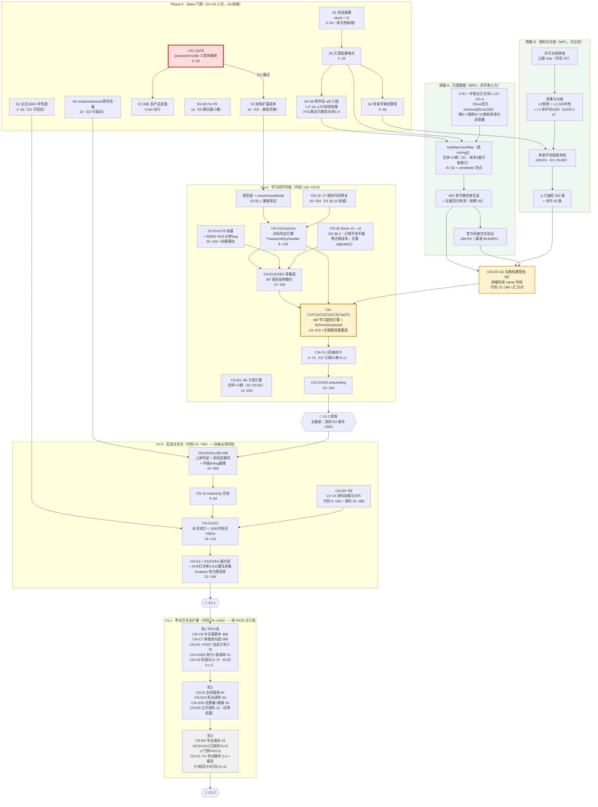
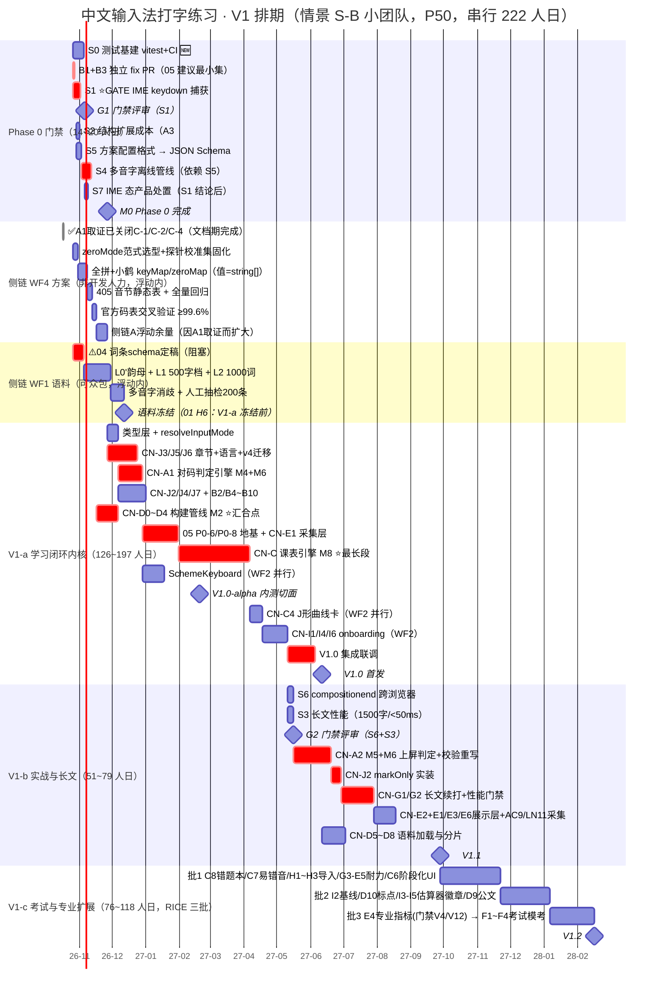

# 10 · 路线图与里程碑

**日期**：2026-10-17
**负责成员**：路径（路线图规划师）
**类型**：路线图更新

---

## 0. 文档定位与交叉引用

本文档回答一个问题：**在「只出规格、不改代码」的前提下，中文输入法打字练习这个扩展，按什么顺序做、每步要多久、哪一步会卡死全局、资源不够时先砍谁。**

范围口径已由主理人拍板（**硬性约束，本文档不得把任何扩展模式移出 V1**）：用户明确要求 V1 纳入全部扩展模式（考试模考、长文耐力+标点专项、专业指标+自定义方案导入），因此在 V1 内部做三层分期 **V1-a / V1-b / V1-c**。

> ✅ **v3 状态：14 份文档已全部落盘**（00 汇总核对文档亦已落盘）。本文档初稿撰写时仅 03（未完）与 A1 可用，v2 修订时补入 01/05/A2/A3/07，**v3 修订补入 00/02/04/06/08/09**。

| 主题 | 归属文档 | 落盘状态 | 本文档使用它做什么 |
| --- | --- | --- | --- |
| **66 条 MoSCoW 功能清单（CN-xx 编号「口径 A」的权威定义）** | **01** | ✅ | §4 里程碑表的条目归属与验收标准 |
| **跨文档一致性核对 + 3 项待主理人裁决（编号/北极星/V1 形态）** | **00** | ✅ | §12.4/§12.5：本文档受裁决影响的 4 处 + 立场 |
| 双 handler 物理分离、状态机 R1~R8、三档训练轮、X1~X8 待确认、12 条行动清单 | **02** | ✅ | §3.2 / §4.1 / §0.2 矛盾 D |
| 模块划分（M1~M9）、39 个贯穿点、Dexie v4 迁移策略、技术债 R1~R8 | **03** | ✅ | §5 依赖关系与 §6 工作量结构 |
| **L0'~L7 + L4-C 十二级语料、词条 JSON Schema、§2.12 语料量与分期归属** | **04** | ✅ | §6.2 语料工作量（**权威来源**） |
| 指标口径（三因子模型、Net CPM、双轨不可同轴、B1~B10、§7.2/§7.3 阈值与目标） | **05** | ✅ | §3.1.1 地基工作量、§10.3 监控表 |
| 竞品分析与市场定位 | **06** | ✅ | §4.3 RICE 的 Reach/Impact 佐证 |
| 用户研究与画像（P0/P1/P2、7 条假设、W1~W12 价值观底线） | **07** | ✅ | §10.2 定性研究待办 |
| **六阶段旅程 J0~J6、Day3/Day6-7 双弃坑峰、北极星「60 天毕业率」、护栏 G-1~G-4、附录① 66 条三维打分表（口径 B）** | **08** | ✅ | §4.2/§8.1 的**量化交叉验证**、§10.3 护栏 |
| 游戏化与激励设计 | **09** | ✅ | §4.4 V2+ 占位 |
| 键位映射表、方案差异、C-1~C-11 待核对项 | **A1** | ✅ | §5.2 侧链 A |
| 语料来源与许可合规红线 | **A2** | ✅ | §5.2 侧链 B、§11.2 合规话术 |
| **Spike S1~S9 的验证方法、验收标准、人日、降级方案（本文档 §3 的权威来源）** | **A3** | ✅ | §3.2 / 附录 B（**v3：A3 已含 S8/S9，与本文档初稿自编的 S8 编号碰撞，见 §3.2 编号说明**） |

> ### ⚠️ 修订说明（v3.2，2026-10-17，由数析的 LN11 成本追问触发）
>
> **触发条件：数析回信确认 S8 误引已改（8 处），并追问「LN11 键法有无非平凡采集成本」，指出 LN3 负荷层的构建期统计可能是我估算里的缺口。** 我核实后确认**缺口真实存在**，本轮为定点修订：
>
> | # | v3.2 修订内容 | 权威来源 | 性质 |
> | --- | --- | --- | --- |
> | **26** | 🔴 **补入一处真实缺口：LN3 负荷层的构建期统计**。数析指出 LN11「边际成本为零」**只成立于键→手映射与汇总计算，不成立于它的判定基准**——`05` 引的「小鹤 49.3:50.7」是**该方案 keyMap 在小鹤自家语料上的键频加权结果，依赖语料**，硬编码会导致 LN11 偏离度判定系统性偏差。**我核实：`05` LN3 是双层（负荷层+错误层），但 `01` CN-E3 权威定义只有「韵母级错误热力图」——负荷层在 `01` 的 66 条里没有 CN 编号承载，故它确实不在我的 V1-b 估算里。** 处置：**+0.5~1 人日，正确归属是 M2 编码预计算管线（CN-D0~D4，V1-a），不是数析建议的 V1-b 的 LN3 负荷层**——理由是「构建期从语料现算方案理论负荷」与 M2 烘编码进 `name` 是同一脚本体系、同一次全语料遍历；且数据必须在构建期产出，放 V1-b 会造成「V1-b 功能依赖 V1-b 才产出的构建期数据」的新倒置。已在 §4.1 的 M2 管线行补入验收项「**方案理论负荷占比必须构建期现算，禁止硬编码 49.3:50.7**」。**⚠️ 我同时撤回 v3.1「V1-b 的 6 人日区间足以吸收 LN11 成本」的说法**——它吸收的是 AC9（确为零成本），不是 LN11 负荷层（那笔在 V1-a，被 M2 管线的 6 人日区间宽度吸收） | `05` §3.3 LN3 / LN11 定义行 + 数析回信 | 🔴 **真实缺口（数析揪出）** |
>
> **v3.2 未变动项**：与 v3.1 相同——分期结论、关键路径、总账（339~529，LN3 负荷层的 +0.5~1 已被 M2 管线 12~18 的区间宽度吸收，未上调小计）、全部里程碑日期。**AC9 经数析二次确认边际成本确为零**（只读 CN-E2/P1-6 已必采的 `compositionend.data.length`），我 v3.1 的「AC9 并入 CN-E2 同批」处理正确。

> ### ⚠️ 修订说明（v3.1，2026-10-17，由 `05` v2 触发）
>
> **触发条件：数析（data-analyst）完成 `05` 的 v2 修订（1341 行 / 55 节），新增 §5.5 CN-E4 可观测性降级矩阵、P1-11/P1-12、V11/V12/V13。** 本轮为**定点修订**（不改分期结论与总账），修订项如下：
>
> | # | v3.1 修订内容 | 权威来源 | 性质 |
> | --- | --- | --- | --- |
> | **19** | ⭐ **R17 大幅收敛（本文档最重要的 v3.1 更正）**：初稿与 v3 把「**选重率/打词率**」并列担心不可观测 → `05` §5.5 的「六指标 × `captureLevel` 四档 × 双轨」矩阵证明**这是误伤了打词率**：**AC9 打词率反而是六项中最可观测的**（只依赖 `compositionend.data.length`，CL0~CL3 全档可得，连击键流都不需要），**风险只集中在 AC7 选重率一项**（六项中唯一任何档位都不精确，鼠标点选候选词在 Web 平台无任何事件）。**对码轨恒 CL3 → 六项中五项精确可得、可无风险承诺；风险全部集中在实战轨的 AC7** | `05` §5.5 | ❌ **初稿判断错误（误伤一项）** |
> | **20** | **CN-E4 的 RICE 参数上调**：Confidence 0.4 → **0.65**、Effort 0.7 → **0.45 人月**（AC9/LN11 提前到 V1-b 共用采集）→ **RICE 17 → 43**。处置预案已可直接执行（不必等 Spike）：**CN-E4 正式从「六项」降为「五项」（删 AC7）**，实现顺序按可观测性降序 `AC9 → SP3/SP4 → AC2 → LN11 → AC7`，AC7 放最后且允许砍 → **最坏情况仍有 5/6 的可交付范围，不会整条报废** | `05` §5.5 / §9.3 P2-3、P2-8 | ⚠️ 参数修正 |
> | **21** | 🔴 **发现第三处编号碰撞（跨三份文档）**：同一个「CN-E4 可观测性门禁」有三个编号——本文档初稿自编的 **S10**、`05` §5.5/§9.3 误引的「**A3 的 S8**」、`05` §10 自己的 **V4 + V12**。⚠️ **A3 落盘版的 S8 是「零声母 α/β 口径」，与 CN-E4 完全无关** → **v3.1 裁决：本文档统一改用 `05` §10 的 V4+V12**，并回传数析修正 §5.5/§9.3 的错误交叉引用 | `05` §5.5/§9.3/§10 vs A3 §S8 | 🔴 **编号碰撞（已回传）** |
> | **22** | ⭐ **V11 优先级上调并并入 S1 探针批次**：`05` V11 =「实战轨的上屏空格是否触发独立 `keydown`」（部分 IME 直接上屏不经过空格键）。**这是 team-lead 裁定 `idealCodeLen` 恒含上屏空格后唯一未闭环的技术前提**——若采不到空格击键却不改 `codeLenBasis`，键效率 `= 理想/实际` 会系统性 >1（出现「效率 120%」的荒谬值）。**本文档判定：这是继 P0-6 时间口径之后第二个「不修则指标不可信」的地基级验证项**，已并入 CN-E2（V1-b）的验收前置与 §5.3 关键路径段 5 | `05` §2.2.1 遗留项 / §10 V11 | 🆕 **新增门禁** |
> | **23** | **V13 并入 CN-J6 单测**：`level` 从 5 档扩到 **12 档**（`04` §2 的 L0/L0'/L1~L7）带来新风险——IndexedDB 按字典序 `L0` < `L0p` < `L1`，**需验证 `[inputMode+level]` 与 `[inputMode+schemeId+level]` 复合索引在 `level > 'L0'` 类范围查询时不串档**。**已并入 CN-J6（Dexie v4）的验收项，约 +0.5 人日**（S0 引入 vitest 后即可写） | `05` §10 V13 / §6.2 | 🆕 新增验收项 |
> | **24** | **AC9（P1-11）/ LN11（P1-12）提前到 V1-b**：数析指出二者边际成本近零（AC9 与 P1-6 上屏粒度共用同一次 `compositionend`；LN11 与 P1-3 键位热力图共用同一份 `keyCodes[]`，LN11 就是 LN3 负荷层的汇总标量）→ **不单独排期，随 CN-E2/CN-E3 同批**。⚠️ **`05` 的 P1 计数因此从 10 项变为 12 项、P2 从 7 项变为 8 项（P0 仍 8 项）**；本文档 §3.1.1 引用的「P0 = 5 项用户指标 + 3 项地基 + 10 项必修 bug」**未变** | `05` §9.2 P1-11/P1-12、§9.3 P2-8 | 🆕 排期优化 |
> | **25** | **CN-E4 工作量重分配的诚实披露**：CN-E4 从 10~15 降到 **7~11**（省 3~4 人日），**但这 3~4 人日不是净省，而是移到了 V1-b**。因数析明确其边际成本「近乎为零」且 V1-b 的指标展示层区间宽度（6 人日）足以吸收，**本文档维持 V1-b 51~79 / V1-c 76~118 / 总账 339~529 不变，并在 §4.3 显式披露这 3~4 人日的归属转移**（严格说应为 V1-b 52~81 / V1-c 73~114，净效应 −1~−2 人日，在 C 级置信度区间宽度内不可分辨）。**这是有意的保守处理，避免十余处数字连锁重排引入新错误** | 本文档 §4.3 小计说明 | ⚠️ 口径披露 |
>
> **v3.1 未变动项**：**分期结论（V1 全量不可作单一版本交付、作为 V1.0/V1.1/V1.2 三次发布可交付）、关键路径（82~136 人日）、总账（339~529 人日）、全部里程碑日期（V1.0=2027-06-11 / V1.1=2027-09-28 / V1.2=2028-02-16）、§12 的 4 条建议、§0.1 的 7 处冲突与 §0.2 的 3 处倒置**——`05` v2 的新增内容全部落在 V1-b/V1-c 的指标层，**未触及关键路径的任何一段**。
>
> ⚠️ **一处指标 ID 命名空间变更（本文档已核验无影响）**：`05` v2 把指标 ID 全部改名（`S→SP`、`A→AC`、`L→LN`、`R→RN`），原因是 12 档 `level` 引入后 `L` 前缀三重占用。**数析已核验本文档没有以 ID 形式引用 `05` 指标（均为散文引用如「双拼 D3 留存」「Net CPM」）**，我复核确认：本文档新引用 `05` §5.5 时已直接使用新 ID（SP3/SP4/AC2/AC7/AC9/LN11），**无遗留旧 ID**。

> ### ⚠️ 修订说明（v3，2026-10-17）
>
> **v3 的触发条件：其余 6 份文档（00 / 02 / 04 / 06 / 08 / 09）在 v2 之后全部落盘。** 本文档已按全部 14 份文档对齐，v3 修订项如下：
>
> | # | v3 修订内容 | 权威来源 | 性质 |
> | --- | --- | --- | --- |
> | **9** | 🔴 **发现并回传「CN 编号双轨冲突」**：`08` 附录① 用了与任务书不同的 66 条重编号（口径 B），与 `01`/`02`/`04`/`10` 的口径 A **同 ID 不同义 8 处碰撞**（CN-A2 / CN-I2 / CN-I5 / CN-G4 / CN-C11 / CN-C12 / CN-A4 / CN-J7 / CN-D0）。**本文档全文保持口径 A**，附录 A 顶部已加口径声明，并支持 `00` 的裁决建议（以口径 A 为唯一权威） | `00` §10.1 | 🔴 **阻塞所有交叉引用** |
> | **10** | 🔴 **北极星三方冲突已标注**：`01`/任务书 = D3 留存；`08` §8.1 = **60 天毕业率**（且明确反对用留存做北极星，称其为「最大产品治理风险」）；`05` §13 = Net CPM + 首次命中率。**本文档 §10.3 已按 `00` §10.2 的分层裁决建议改写为三层结构**，并诚实说明「**60 天毕业率在 V1.0 阶段无法观测**」对交付承诺的影响 | `00` §10.2 / `08` §8.1 / `05` §13 | 🔴 **影响 V1.0 的验收定义** |
> | **11** | ⚠️ **发现第二处编号碰撞：本文档初稿自编的「S8 = CN-E4 可观测性」与 A3 落盘版的 S8（零声母 α/β 口径）冲突** → 本文档的自编 Spike **重命名为 S10**；同时**补入 A3 的 S8（P0 双拼前置，1.5~2 人日）与 S9（多编码引擎评估，1 人日）**——初稿完全没有这两项，其中 S8 是**双拼语料能否入出题池的门禁** | A3 §0 / §S8 / §S9 | ⚠️ 编号碰撞 + 漏项 |
> | **12** | **§5.5 语料工作流表按 `04` §2 全面重写**：补入 L0 全拼最小集、**L4-C 日常聊天短句层（`04` §2.11 增补，初稿完全没有）**、各层级每章容量（`04` §9.2）、L1 三档的 V1-a/b/c 分期归属；**撤回初稿「500 字覆盖 80% 字频」的无依据表述**（`04`/`A2` 均未给该数值），改用 `04` §2.3 的小鹤官方方法论原文 + **「击键 ≥6/秒」关卡通过条件**（这是官方给出的绝对阈值，部分解除了 `05` §7.2「绝对阈值待标定」的约束） | `04` §2.1~§2.12 / §9.2 | ⚠️ 漏项 + 无依据数字 |
> | **13** | **§10.3 监控表按 `05` §7.3 + `08` §8.2 重写**：D7 从初稿误写的 ≥15% 改为 **>20%**；补入 **7 天 Streak >25%**、**双拼 D3 >50%（生死指标）**、每日 15~25 分钟 / 225~1500 字 / 每周 ≥5 天、**分享图使用率 >20%**、练习→复盘转化率 >15%；**新增 `08` 的 4 条护栏指标 G-1 伪掌握率 ≤15% / G-2 提示依赖度 ≤0.2 次·词⁻¹ / G-3 数据本地性 =100% / G-4 存量无回归 =100%**；多音字阈值从 ≥99.0% 改为 **≥99.5%**（含分层：高频 ≥99.9% / 长尾 ≥99%）；长文性能门禁从初稿自编的「fps ≥55 / 内存 <80MB」改为 **`01` CN-G2 + `02` #10 的权威口径「1500 字 / 延迟 <50ms / 内存涨幅 <50MB / 固化为 CI 门禁」** | `05` §7.3 / `08` §8.2 / `04` §7.4 / `01` CN-G2 | ❌ 数字错误 + 漏项 |
> | **14** | 🔴 **§11.1 给上游维护者的话术重写（兑现 §3.1 的承诺）**：撤回「当前所有用户看到的正确率恒 ≥100%」这一**不实陈述**（该 getter 0 处消费，是死代码），改为「**定时炸弹级死代码 + 中文结算页复用前必须拆**」，并把处置建议从「修复」改为「**删除更安全**」；Ask ① 从「CN-J1 一行修复」升级为 **B1+B3 最小修复集合**；「顺手修掉 4 个缺陷」的 `chapterCount` 消费点从初稿的「5 处」改为 **`01` CN-J3 权威的「7 处」**；新增 Ask ④（单独就 CN-J3 征询意向，因其对上游自身有独立价值） | `05` §9.1 B1/B3 + 本人独立 Grep 复核 / `01` §6.10 | ❌ **事实错误（发给上游会严重损害可信度）** |
> | **15** | **§5.4 的四道「文档门」状态全部更新**：05 / 08 / 02 / A2 / **04** 均已落盘 → 初稿「最大排期风险是文档依赖」的判断**部分失效但未消失，而是换了形态**：从「无规格可依据」变为「**有多套互相矛盾的规格**」（`00` §10 的 3 类不一致 + `02` X1~X8 + `04` X-11~X-13）。**R21 已按此重写，并新增 R22（A3·S8 零声母口径收口）与 R23（A3·S9 多编码引擎 + 方案 B 的静默回归风险）** | `00` §10 / `02` §14.1 / `04` §14.1 / A3 | 🆕 风险形态变更 |
> | **16** | **§12 结论与附录 A/B 的数字与日期全量对齐**：V1 总计 299~471 → **339~529**；V1.0 P50 7 → **8 个月**；V1 全量 P50 14 → **16 个月**；V1.0 = 2027-05-31 → **2027-06-11**；V1.1 = 2027-08-09 → **2027-09-28**；V1.2 = 2028-01-17 → **2028-02-16**；V1.0-alpha = 2027-02-22 → **2027-02-19**。**附录 A 从 32 行粗粒度表重写为 66 条全量表（按 CN-A~CN-J 分 10 个子表），每条标注 `01` 权威阶段 + 本文档在何处提出异议** | 本文档 §4/§6/§7 | ⚠️ 数字滞后 |
> | **17** | **修正 CN-G4 的阶段归属错误**：初稿附录 A 写「V1-c 批2」，**`01` 权威归 V1-b**（`isChineseSymbol` 反转随 CN-A2 校验层重写一起做）；`08` 口径 B 亦标注其为「**门禁型：CN-G1 长文耐力的技术前置，标 Could 仅因无独立用户价值，不表示可选**」 | `01` CN-G4 / `08` A1.4 ② | ❌ 归属错误 |
> | **18** | **§1.1/§1.2 的 TL;DR 补入 `08` 的独立量化交叉验证**：`08` A1.4 结论①「**价值分 Top 21（≥3.9）100% 落在 Ⅰ 簇（学习闭环），Ⅱ/Ⅲ/Ⅳ 簇零席**」、结论②「**Ⅱ 簇无一项进入尾部 → 量化印证『Ⅱ 簇不可切』；可延项集中在 Ⅲ/Ⅳ 簇 → 量化印证『Ⅲ/Ⅳ 可后延』**」。**这是完全独立于本文档 RICE 排序的第二套量化方法，两套方法得出同一结论 → 主理人硬约束第 3 条（不可切）与第 4 条（砍语料不砍闭环）都拿到了量化支撑** | `08` 附录① A1.4 | 🆕 交叉验证 |
>
> **v3 未修订项**：§2 估算方法与三资源情景、§5.3 关键路径逐段测算、§6 工作量总账、§8.1 砍法优先级顺序——这些在对齐全部 14 份文档后**结论依然成立**。**§12.1 的核心结论（V1 全量作为一个版本不可交付、作为三次发布可交付）不但成立，且已被 `00` §10.3（析客独立认同）与 `08` A1.4（量化印证）双重背书。**

> ### ⚠️ 修订说明（v2，2026-10-17）
>
> 本文档初稿撰写时 01 / 05 / A3 尚未落盘，部分内容依据主理人下发的范围口径与 03 的**未完成版**（当时正文止于 §5.5）推算。**v2 已按 01 / 03（完整版）/ 05 / A1 / A2 / A3 / 07 全面对齐修订**，修订项如下：
>
> | # | 修订内容 | 权威来源 | 初稿错误性质 |
> | --- | --- | --- | --- |
> | 1 | **CN-J1~J7 的定义全部替换为 01 §6.10 的权威定义**。初稿对 CN-J3~J7 的 5 条推断**全部错误**（初稿把 J3 猜成「校验层只比对末位字符」、J4 猜成「timing 崩坏」、J5 猜成「alert 反转」、J6 猜成「CHAPTER_LENGTH」、J7 猜成「REPEAT_CHAPTER」；实际 J3=章节长度可变、J4=中文注音渲染、J5=语言类型扩展、J6=IndexedDB v4 迁移、J7=朗读失败静默降级） | 01 §6.10 | ❌ **事实错误** |
> | 2 | **撤回「`inputAccuracy` bug 导致当前所有用户看到的正确率恒 ≥100%」这一表述。** 经全仓 Grep 复核：`inputAccuracy` **0 处消费，是死代码**，当前无任何用户看到错误数字。05 §9.1 B1 的处置建议是**删除**而非修复 | 05 §9.1 B1 + 本人独立 Grep 复核 | ❌ **事实错误（若发给上游维护者会严重损害可信度）** |
> | 3 | **Spike S1~S7 的人日、验收标准、降级方案全部对齐 A3**（A3 合计 10.5~14.5 人日，初稿估 18~27 偏高约 60%）；初稿新增的 S0（测试基建）保留，标注为**本文档新增、A3 未收录**。⚠️ **v3 二次更正**：初稿自编的「S8 = CN-E4 可观测性」与 A3 落盘版的 S8（零声母口径）编号碰撞，**已重命名为 S10**；A3 的 S8/S9 已补入 §3.2 与附录 B | A3 §0 + 各 Spike 章节 | ⚠️ 数字偏高 + 编号碰撞 |
> | 4 | **Dexie v4 迁移风险大幅下调。** 03 §8.2 已定策略为「**只增不改不删，旧记录零迁移成本**」，IndexedDB 对记录值无模式，读取侧统一 `?? 'code-match'` 归一化，**v1→v4 无需手写 `upgrade()`**（现有 v1→v3 即无 upgrade 函数）。初稿的 R6 高估了风险，且初稿建议的「独立新表」方案与 03 已定策略冲突，现改为遵循 03 | 03 §8.2/§8.3 | ⚠️ 风险高估 + 方案冲突 |
> | 5 | **留存目标值对齐 05 §7.3**：新增「**双拼 D3 留存 >50%（专项，生死指标）**」「7 天 Streak 达成率 >25%」「D7 >20%」（初稿误写 D7 ≥15%） | 05 §7.3 | ❌ 数字错误 |
> | 6 | **双门槛口径对齐 05 §7.2 与 01 CN-C2a**：V1 采用**相对门槛**（`正确率 <95%` OR `平均反应时 > 用户全部韵母反应时中位数 ×2`），**绝对毫秒数标 `[待标定]`，禁止在文档与代码里写死**。初稿写「默认值经 08 文档确认」，权威来源应为 05 §7.2 而非 08 | 05 §7.2、01 CN-C2a | ⚠️ 来源错引 |
> | 7 | **新增 §0.1：01 权威分期与主理人下发口径的 7 处冲突清单**，并给出 2 处 01 内部的跨阶段依赖倒置（CN-C2→CN-E3、CN-C4→CN-I2） | 01 §6.0~§6.11 | 🆕 新发现 |
> | 8 | **补充 05 的 B1~B10 十项必修 bug/口径缺陷与 P0-6/P0-7/P0-8 三项地基的工作量**（初稿完全未估，合计 **20~32 人日**），已计入 §6 总账 | 05 §9.1 | 🆕 漏估 |
>
> **未修订项**：§1.2 关键路径分析、§5 依赖关系、§8 降级预案的砍法优先级、§11 沟通要点、§12 交付性结论——这些结论在对齐后**依然成立**，仅数字按上述修订调整。

### 0.1 ⚠️ 01 权威分期与主理人下发口径的 7 处冲突（需主理人裁决）

**这是本文档修订过程中最重要的发现，已单独回传主理人。**

01 §6.0~§6.11 已给出 66 条功能的权威阶段归属（V1-a 33 条 / V1-b 13 条 / V1-c 20 条）。**它与主理人下发给我的范围口径存在 7 处不一致**，其中 3 处会直接改变关键路径：

| # | 编号 | 主理人下发口径 | **01 权威定义** | 冲突性质 | 我的裁决建议 |
| --- | --- | --- | --- | --- | --- |
| **1** ⭐ | **CN-E1 / E3 / E6** | 归 **V1-a**（「对码指标组+韵母热力图+中英分轨」） | CN-E 组 **7 条无一在 V1-a**（§6.5：V1-b 4 条 / V1-c 3 条）；CN-E1「对码轨指标组」= **Must（V1-b）** | 🔴 **致命**。CN-E1 是 CN-C2「薄弱韵母定位」的唯一输入源（01 CN-C2 依赖列写明 `CN-C2a、CN-E3`）。**若 E 组全部在 V1-b，则 V1-a 的课表引擎（CN-C1/C2/C2a）没有输入数据，学习闭环无法成立** | **按主理人口径：CN-E1/E3/E6 必须在 V1-a。** 01 的归属是错的——它把「指标展示」与「指标采集」混为一谈了。**采集必须在 V1-a（否则 C2 无输入），Analysis 页的展示可以留到 V1-b** |
| **2** ⭐ | **CN-I2 / CN-I4** | 归 **V1-a**（「onboarding 方案选择器+全拼基线+低谷干预卡+中文入口」） | CN-I 组 6 条：V1-a 仅 **2 条**；**CN-I2（全拼基线）= Should（V1-c）**、**CN-I4（低谷干预卡）= Should（V1-c）** | 🔴 **致命**。主理人硬约束第 3 条原话：「抽掉 CN-C4/C6/I4 会在 **Day3 精准劝退 P0 用户**」。而 01 §7.3 也把「双拼 D3 留存 >50%」列为**生死指标**。**把 I4 放到 V1-c 等于放弃北极星指标** | **按主理人口径：CN-I4 必须在 V1-a**（它直接服务北极星）。CN-I2 可协商——见冲突 4 |
| **3** | **CN-D4（L2 双字词 ≥1000）** | 归 **V1-b**（「L2词组~L6文章语料 CN-D4~D8」） | **Must（V1-a）**（01 理由：「现代输入法 80% 以上是词组输入，这才是速度的真正决定因素」） | 🟡 中。影响 V1-a 语料工作量 **+8~12 人日** | **按 01：CN-D4 归 V1-a。** 01 的理由成立（词组是中文速度的决定因素），且它属语料工作流（可众包并行，不占开发关键路径）。⚠️ 但这会让 V1-a 语料从 13~20 升到 **21~32 人日** |
| **4** | **CN-C4（J 形曲线卡）** | 归 V1-a | Must（V1-a）✅ **一致**，但 **01 写明 CN-C4 依赖 CN-I2**，而 CN-I2 被 01 归到 V1-c | 🟡 **01 内部依赖倒置** | CN-C4 的「当前速度/基线比值」定位需要 I2 的基线值。**两个选择**：(a) CN-I2 提到 V1-a（与主理人口径一致，+4~6 人日）；(b) CN-C4 在 V1-a 先用**社区经验值区间**（Day3 40-50% / Day7 60% / Day14 75-85% / Day30 100% / Day60 130-150%，01 CN-C4 已列出）替代个人基线，V1-c 补 I2 后再切换为个人基线。**我推荐 (b)**——省 4~6 人日且不损失 Day3 干预效果 |
| **5** | **CN-C6（阶段化 UI）** | 归 V1-a（「J形曲线卡+阶段化UI（CN-C4/C6）」） | **Should（V1-c）** | 🟡 中 | 主理人硬约束第 3 条把 C4/C6 并列。**但 01 的拆分是有道理的**：C4（曲线定位卡）是纯展示、低成本、直接服务 Day3；C6（阶段自动识别 + 主指标区按阶段切换）需要 S1~S5 阶段判定规则 + DB 字段 + Speed 组件改造，成本高。**建议 C4 留 V1-a（不可砍），C6 允许挪到 V1-c**，需主理人确认是否接受对硬约束第 3 条的这一处松动 |
| **6** | **CN-B2（内置方案）** | 归 V1-a，**5 套方案**（全拼/小鹤/微软/自然码/搜狗） | Must（V1-a），但定义为「**V1 = 全拼 + 小鹤双拼；架构预留微软/自然码/搜狗**」，并明确「**键位未三信源确认的方案禁止上线**」（A1 初稿列 C-6/C-7/C-8 待核对） | 🟢 **01 已采纳我的建议 2**。⚠️ **但 v3 发现：01 采纳时引用的理由已被 A1 一手取证部分推翻**——A1 §7 用 Rime 官方 schema@01a1328 关闭了 C-6（微软 üe=`T`+派生`V`）与 C-8（自然码 `er`），§8 结论明确「官方可取证方案从 4 个升到 **6 个**（小鹤/自然码/微软/智能ABC/四通全部具备 A 级数据基础）」→ **微软与自然码现在也是 A 级，「未三信源确认」不再是排除它们的有效理由** | ✅ **砍法本身仍成立，按 01 执行「V1.0 = 全拼 + 小鹤」，无需重新裁决。但需回传主理人转告析客：`01` CN-B2 的理由表述应更新**为三条更硬的依据——① 首发聚焦（多带两套方案不增加验证信息量，只增加测试面与发布风险）② **C-12 微软零声母多值仍需 Windows 微软拼音真机实测**（A1 标 P1 实施后验证），实测前上线微软 = 让用户练未经商业实现验证的键位 ③ 架构解耦使这条砍法零成本（beta 补齐 3 套的成本与现在做完全相同）。**否则规格文档会留一条已被自家取证推翻的理由。** |
| **7** | **CN-A3（两套口径分开标注）/ CN-F5** | CN-A3 归 V1-b、CN-F1~F5 全归 V1-c | CN-A3 = **Must（V1-a）**；**CN-F5 = Must（V1-a）**（F 组 5 条中唯一在 V1-a 的），内容 = **⚠️ 机考输入法可用性提示**（「我不会『学了小鹤结果考场不让用』」） | 🟡 轻 → ✅ **v3 已可确认内容** | **按 01：CN-A3 归 V1-a**（CN-J6 的 Dexie v4 增 `track` 字段本就在 V1-a，口径分开标注是数据结构层决定，**越晚做迁移成本越高**）。**CN-F5 归 V1-a 且不可延后**——v3 已读到其完整定义：Given 方案选择器中用户回答「3 年内要参加机考」= 是，Then **必须推荐微软双拼**（不是小鹤）并明示「多数考场仅预装全拼 / 微软双拼 / 王码五笔；NCRE 规定特殊输入法须报名时向考点提出」。**纯文案、成本近零**。`08` 附录① 给它 **3.8 分（频率全表最低 F=1，但 I=5、1/C=5）**并判定「**这是本项目唯一一处『不做的代价高于做的代价』的风险，因此虽属考试相关却必须破例锁在 V1-a**」。⚠️ **但它与砍法 1（微软不在 V1）直接冲突 → 这正是 `02` X1 的成因，必须在 CN-I1 开工前拍板**（本文档倾向：V1 阶段该分支改为推荐全拼 + 提示考场口径，见 §8.3）。⚠️ **另：`08` 要求 CN-F5 与 CN-I2 必须共用同一份文案资产 B2，不得各写一版，否则文案漂移** |

### 0.2 ⚠️ 01 内部的 3 处跨阶段依赖倒置（01 自身的 bug，需回传瑞思/析客修正）

除上述与主理人口径的冲突外，**01 文档自身存在 3 处「V1-a 的功能依赖 V1-c/V1-b 的功能」的依赖倒置**，这在排期上不可执行：

| # | 倒置 | 01 中的证据 | 影响 | 建议修法 |
| --- | --- | --- | --- | --- |
| **A** | **CN-C2（Must, V1-a）依赖 CN-E3（Must, V1-b）** | 01 CN-C2 依赖列：`CN-C2a、CN-E3` | 🔴 V1-a 的薄弱韵母定位无法工作 | **CN-E3 的「韵母级错误数据采集」部分提到 V1-a**；Analysis 页的热力图**渲染**可留 V1-b（数据先攒着，图表后做）。这也是 05 §9.2 P1-3「键位错误热力图」的口径 |
| **B** | **CN-C4（Must, V1-a）依赖 CN-I2（Should, V1-c）** | 01 CN-C4 依赖列：`CN-I2` | 🟡 J 形曲线卡无法定位「用户当前所在点」 | 见 §0.1 冲突 4，**推荐方案 (b)**：先用社区经验值区间，V1-c 补个人基线 |
| **C** | **CN-C5（Must, V1-a）依赖 CN-A2（Must, V1-b）** | 01 CN-C5 依赖列：`CN-A2、CN-J6` | 🟡 固定文本每日复测在 V1-a 无法落地 | CN-C5 的复测**在对码轨也成立**（字/词级固定文本复测），不必依赖上屏判定。**建议 01 把 CN-C5 的依赖改为 `CN-A1、CN-J6`**，实战轨的长文复测另立条目到 V1-b |

**这三处倒置的共同根因**：01 在标注阶段归属时按「功能面向的用户场景」分类（指标→V1-b、基线→V1-c），但没有按「数据依赖」校验。**采集与展示必须拆开排期——采集跟着消费方走，展示可以后置。** 这是本文档给 01 的核心修订建议。

---

## 1. TL;DR

### 1.1 分期结论（3 句话）

1. **V1 不是一个版本，是三个可独立发布的版本。** 主理人「不移出 V1、在 V1 内部分三层」的口径完全正确，但必须在执行层把 V1-a / V1-b / V1-c 明确定义为 **V1.0 / V1.1 / V1.2 三次发布**，每次都是完整可用的产品。理由：三者合计**代码 278~435 人日 + 语料 71~110 人日 + 集成 15~25 = 总计 339~529 人日**（01 权威 66 条口径），做成一次性大爆炸发布，任何一环延期都会拖死全部；做成三次发布，V1.0 就能独立承接 P0 人群（双拼迁移者）并验证 H1~H4。⭐ **`00` §10.3 显示析客独立得出同一结论、并全部认同本文档 4 条建议；`08` 附录① 的 66 条三维打分给出第二套独立量化验证：价值分 Top 21（≥3.9）100% 落在学习闭环簇，Ⅱ/Ⅲ/Ⅳ 簇零席。**
2. **首发范围还能再切一刀，且切了不亏。** ✅ **v3 状态：这一刀已由 `01` CN-B2 正式采纳。** 但 ⚠️ **v3 必须诚实标注：01 采纳时引用的理由（「键位未三信源确认的方案禁止上线」，C-6/C-7/C-8 待核对）已被 `A1` §7 的一手取证部分推翻**——取证后 **C-6（微软 üe=`T`+派生`V`）与 C-8（自然码 `er`）已关闭**，`A1` §8 结论明确「**官方可取证方案从初稿估计的 4 个提升到 6 个（小鹤、自然码、微软、智能ABC、四通已全部具备 A 级数据基础，无需依赖任何二手信源即可实施）**」。**即：微软与自然码现在也是 A 级了，「未三信源确认」不再是把它们排除在 V1 之外的有效理由。**
   **但砍法本身仍然成立，理由需要更换为三条更硬的**：① **首发聚焦**——V1.0 的价值验证只需一套双拼（小鹤是 ulpb 官方推荐的「绝大多数新手的最优解」、社区资源最活跃、已被 `shuangpin-practice` 验证市场需求），多带两套方案不增加任何验证信息量，只增加测试面与发布风险；② **C-12 尚未关闭**——微软双拼的零声母多值「商业实现是否与 Rime 官方一致」仍需 Windows 微软拼音真机实测（`A1` §7 标为 P1 实施后验证），**在实测前上线微软 = 让用户练一套未经商业实现验证的键位**；③ **架构解耦使这条砍法零成本**——「支持新方案 = 加一份方案表 + 重跑构建脚本，不改代码」（主理人硬约束第 5 条，A1 §5.2 已论证），先出 1 套不产生任何返工，V1.0-beta 补齐 3 套的成本与现在做完全相同。
   **净效应：省下 12~20 人日 + 把 C-12 从「V1.0 阻塞」降为「V1.0-beta 的实施后验证」。** ⚠️ **这条已回传主理人：建议 `01` CN-B2 的理由表述同步更新为上述三条（而非「未三信源确认」），否则规格文档会留一条已被自家取证推翻的理由。**
   ⚠️ **连带未决问题 `02` X1**：微软不在 V1 时，onboarding 的「3 年内要机考」分支怎么处置（CN-I1/CN-F5 都依赖它）→ **必须在 CN-I1 开工前拍板**（本文档倾向 §8.3 的处置 ②：V1 阶段改为推荐全拼 + 提示考场口径）。
3. **考试模考（CN-F1~F4）是 V1-c 内部 RICE 最低的一块，必须排在 V1.2 的最后。** 它与 `08` A1.4 的独立结论一致（CN-F3 建议挂灰、CN-F4 排尾部第 64 名）：新语料 + 新计分口径 + 新交互三重投入，却服务非核心人群。同批的中文错题本（CN-C8，RICE 309）、易错音归因（CN-C7，RICE 289）、自定义导入导出（CN-H1~H3/E7，RICE 75）、长文耐力（CN-G3/E5，RICE 51）RICE 全部显著高于它（5.4），且前三者正是竞品付费墙锁住的能力（KeySpell VIP / ulpb.app ¥69），差异化收益直接。⚠️ **但 CN-F5（机考可用性提示）是例外——01 归 V1-a 且不可延后**，它是纯文案、成本近零，防的是「练了三周才发现考场用不了小鹤」这个**唯一一处「不做的代价高于做的代价」的信任崩塌风险**。

### 1.2 关键路径（对主理人判断的验证与修正）

主理人判断：**「语料构建管线 → 多音字消歧 → 405 音节全量验证 → L0'/L1 语料就绪 → 渐进课表可用」**。

**结论：方向正确，但链条拼装方式需要两处修正，且它不是最长链。**

| # | 主理人链条中的环节 | 修正 | 依据 |
| --- | --- | --- | --- |
| ① | 「405 音节全量验证」挂在语料链下游 | **错位。** 405 音节验证的对象是「音节 → 2 键编码」，与语料无关；它属于**方案链**的验收门。语料链与方案链是**两条并行侧链**，在「构建脚本把编码烘进词典 JSON `name` 字段」处汇合 | A1 §5.2 / §5.3：405 音节静态表是 `{keyMap, zeroMap}` 的构建期产物；`shuangpin-practice` 的交叉验证是「官方码表 vs 编码器输出」，输入是字不是语料 |
| ② | 「渐进课表可用」的瓶颈是语料就绪 | **错。** 瓶颈是**学习路径引擎（全新代码）**。V1-a 语料（L0'+L1 500 字档 + L2 双字词）**21~32 人日且可众包并行**，而课表引擎 + 30% 混入 + 薄弱定位 + 双门槛（CN-C1/C1a/C2/C2a）需 15~25 人日（含在 M8 的 23~37），且**强依赖对码指标组 CN-E1 采集层先落地**——没有韵母级错误数据，「薄弱定位」无输入 | 03 §2.3 C 档明确「学习路径引擎：无。现有只有线性章节 + 错题复习，无韵母分组课表 / target-key 自适应 / 掌握度双门槛」 |
| ③ | 整条链是关键路径 | **部分正确。** 语料+方案两条侧链合计约 92~142 人日（语料 71~110 + 方案 8~14 数据侧），但可 2~4 人并行，**串行长度只有 24~39 人日**（侧链 A 8~14 / 侧链 B 16~25）；主链（判定引擎→05 地基+指标→课表→J 形卡→onboarding→集成）**串行长度 82~136 人日**。**侧链只有 +8~+13 人日的浮动（float），超出即转成关键路径** | 见 §5.3 关键路径逐段测算（v3：初稿估主链 55~85 / 浮动 15~30，修订后主链因 05 地基漏估上调、浮动因侧链 B 变长而收窄） |

**修正后的关键路径（最长链，V1.0）：**

```
S1 门禁（中文 IME 激活态下 keydown 能否可靠捕获）
   └─→ 类型层 + resolveInputMode（03 §5.1，380 个现有词典零改动的兼容保证）
         └─→ CN-J3/J5/J6（章节机制 7 处消费点 + 语言类型 + Dexie v4）
               └─→ 对码判定引擎 CN-A1/A1a/A1b（PasswordKeyHandler + 按键序列比对）
                     └─→ 05 P0-6/P0-8 地基 + 对码指标组 CN-E1 采集层（韵母级错误数据，是薄弱定位的唯一输入）⭐初稿漏估
                           └─→ 学习路径引擎 CN-C1/C1a/C2/C2a（渐进课表 + 30%混入 + 薄弱定位 + 双门槛）⭐最长段
                                 └─→ CN-C4 J 形曲线卡（Day3 干预载体）
                                       └─→ onboarding CN-I1/I4/I6（方案选择器 + 低谷干预卡 + 中文入口）
                                             └─→ V1.0 首发（2027-06-11）
   ↑ 侧链 A（方案）：keyMap/zeroMap → 405音节静态表 → 全量回归单测 → 官方码表交叉验证 99.6%+（+ A3·S8 零声母口径收口）
   ↑ 侧链 B（语料）：采集分级 → 多音字词组级消歧 → 人工抽检200条 → 词条结构标准化
   两条侧链在「构建脚本烘编码进 name 字段」处与主链汇合（汇合点 = 词典构建管线 CN-D0~D4）
```

**一句话版本**：真正卡死交付的不是语料，是「**S1 → 类型层 → CN-J 地基 → 判定引擎 → 05 地基+韵母级指标 → 课表引擎 → J 形卡 → onboarding**」这条串行链（82~136 人日）；语料与方案是**可以用非开发人员并行消化的侧链**，但修订后浮动只有 +8~+13 人日（安全边际已变薄）。

### 1.3 单点风险

**S1 是唯一单点致命风险，且它的失败模式不是「延期」而是「产品定义作废」。**

- 验证命题：中文 IME 激活态下，浏览器能否可靠捕获原始 `keydown`（Chrome/Edge/Firefox/Safari × Win/macOS/Linux）。
- 为什么致命：对码轨的整个技术前提（A1 §5.2 结论）是「判定引擎的输入不是文本框里的字符串，而是 `KeyboardEvent.code` 物理键位序列」，以此**彻底规避 monkeytype Issue #4673 的死穴**（该 Issue 已 closed-as-not-planned，用户实测「This makes typing in Chinese basically impossible on Monkeytype」）。S1 失败 = 这个规避手段不成立 = 对码轨不可实现 = **产品无法训练键位** = P0 人群（全拼→双拼第 0-60 天迁移者）的核心价值主张蒸发。
- 失败后果不是降级，是**重做用户研究**：价值主张与目标人群都要重写，可能从 U1（双拼迁移者）转向 U2/U3。
- 现有证据（**利好但非契约**）：ShanRenMa fork 用 `<input type="password">` 强制关闭 IME，自 2024-01-21 上线至 2025-05-21 持续服务山人码 LTS 社区，未见兼容性 issue 回报（03 §4.1）。但 03 §4.2 已明确定性为「**事实可用但无契约保证**」——是既成浏览器行为而非规范承诺。**S1 的任务就是把「事实」升格为「已验证的事实」**：⚠️ **v3 更正口径差——`01` CN-A1a 的验收写「3 OS × 4 浏览器 × 3 输入法」矩阵且要求「捕获成功率 = 100%」，而 `A3` §S1 给的是 9 格实测矩阵 + 最低覆盖要求「Chrome+Win（微软拼音/搜狗）与 Safari+macOS（系统拼音）两条主线路必须实测通过，其余至少一条实测 + 其余以社区资料佐证」。两者严格度不同（01 要求全绿，A3 允许佐证）。本文档按 A3 的可执行口径排期（2~3 人日），按 01 的口径作为理想验收目标，并已在 §3.2.2 标注这处口径差需对齐。**
- ⭐ **v3 新增：A3 已把 S1 的失败降级细化为三级，其中「个别浏览器失败」这一级最重要——它把「S1 部分失败」从致命风险降为可接受风险**（M4 做 feature detection，主线路覆盖 95%+ 用户即视为整体成功）。**更关键的是 A3 降级 2 提供了一条初稿完全没想到的退路：即使 password 方案全线失败，仍可降级到「隐藏 textarea + `compositionend` 兜底」，把用户实际输入的拼音串当「码」校验——对码轨仍可实现，只是失去「键盘布局无关」与「规避分号键拦截」两项优势。这使 R1 的「致命」定性需要重新理解：真正致命的只有 A3 降级 3（连原始按键都拿不到 → 对码轨退化为「教学展示模式」）。**

**次级单点风险（不致命但会连锁）**：仓库**没有单元测试基建**——`package.json:64` 的 `"test": "echo \"No tests\""`，只有 playwright e2e（`tests/e2e` + `.github/workflows/e2e.yml`）。而 A1 §5.3 的三层质量验证第一层就是「405 音节全量回归单测」，竞品 `shuangpin-practice` 做到 81/81。**引入 vitest 是所有质量门的前置，3~5 人日，容易被漏估。**

---

## 2. 估算方法与资源假设

### 2.1 估算口径（诚实声明不确定性）

- **单位**：人日（1 人日 = 1 名熟悉本仓库的中高级工程师 1 个有效工作日，约 6 小时净编码/写作时间）。
- **区间**：所有数字给 **乐观 ~ 保守** 两端。乐观 = 一切按 A1/03 已验证路径走、无返工、无外部阻塞；保守 = 计入 1 次方案返工 + 1 次跨浏览器兼容修补 + 外部核对等待。
- **置信度**：按 A1 的信源分级习惯标注 A/B/C。C 级估算的区间宽度是 A 级的 2~3 倍，这是有意为之，不是不严谨。
- **不含**：需求评审、code review 往返、CI 排队、上游 maintainer 响应延迟。这些在 §2.2 的日历换算里单独用「排期系数」体现。

### 2.2 三种资源情景（日历换算必须分情景，否则数字没有意义）

| 情景 | 人力配置 | 排期系数* | 适用判断 |
| --- | --- | --- | --- |
| **S-A 社区业余**（qwerty-learner 的真实形态） | 1~2 名业余贡献者，每周 8~15 小时；无专职语料人力 | **×3.0 ~ ×4.0** | ⚠️ 此情景下 V1 全量**不可能交付**。只能承诺 V1.0-alpha（单方案小鹤 + L0'/L1）。PR #348 死于无人 review，社区情景下 review 带宽本身就是瓶颈 |
| **S-B 小团队**（推荐规划基准） | 1 名主力开发全职 + 0.5 名前端/交互 + 1 名语料与合规（可众包）+ 0.3 产品 | **×1.4 ~ ×1.7** | 本文档所有日历时间默认按此情景给出 |
| **S-C 项目制** | 2~3 名开发全职 + 1 名语料全职 + 0.5 产品 + 0.3 测试 | **×1.15 ~ ×1.3** | 可压缩，但受 §5.4 并行度上限约束，不能线性加人 |

\* 排期系数 = 日历时间 / 净人日。含协作损耗、评审往返、外部等待、上下文切换。**注意：语料工作流的排期系数应单独取 ×1.2**（它是可外包的独立工作流，不占开发协作带宽，详见 §5.5）。

### 2.3 一条贯穿全文的估算修正

主理人下发的口径是「实战轨工作量约为对码轨的 3~5 倍」（03 文档盘点结论）。**这个倍数只适用于「输入捕获 + 校验层」这一层，不能套到整个 V1-b。**

| 层 | 对码轨 | 实战轨 | 倍数 |
| --- | --- | --- | --- |
| 输入捕获 + 校验层 | 8~12 人日（`PasswordKeyHandler` + 逐字符比对，03 §3.2 已证 fork「引擎改动 < 30 行」「校验 useEffect 一行未动」） | **30~50 人日**（4 个阻塞点全部重写：`Word/index.tsx:180-184` 只校验末位字符、`:190` `letterTimeArray` 字级 timing 崩坏、`:237-251` 出错 300ms 清空整词、`isChineseSymbol` 全角标点 alert 反转） | **3.75~4.2 倍 ✅ 与盘点结论吻合** |
| 整个 V1-b（含语料加载、指标展示层、长文续打、性能） | — | 51~79 人日 | **相对 V1-a 代码总量（126~197）反而只有 0.4 倍** |

**结论**：V1-a 之所以重，不是因为对码判定难（它已被 fork 生产验证），而是因为它捆绑了 **方案引擎、课表引擎（M8）、虚拟键盘（`SchemeKeyboard`）、onboarding 四块全新代码，外加 05 §9.1 的 3 项地基 + 9 项必修 bug（P0-6/7/8 + B2/B4~B10，20~32 人日）与 CN-J 组 7 条既有代码修复（20~32 人日）**。把「3~5 倍」误用到整个 V1-b 会导致 V1-b 被高估 3~5 倍（→ 153~395 人日），进而得出「V1 完全不可能」的错误结论。**这是本文档对上游口径最重要的一处修正。**

> ⭐ **修订后新增的第二处修正**：初稿把 V1-a 的重心归因于「四块全新代码」，**漏掉了 05 §9.1 揭示的一个更重要的事实——V1-a 里有 40~64 人日（CN-J 组 20~32 + 05 地基与 bug 20~32）是「还债」而非「造新功能」**，占 V1-a 代码总量的 **32%~33%**。这笔债不是中文扩展带来的，是上游既有的（两套 WPM 口径、`wrongCount` 量纲混乱、`timing` 丢首键、出错清空耗时、`getLevel` 英文分档……）。**换句话说：V1-a 有三分之一的工作量是在把上游的指标层修到「可信」，然后才谈得上中文指标。** 这对排期的含义是——**这部分工作无法通过砍中文功能来省，且它对上游英文用户同样有价值**（详见 §11.1 给维护者的话术）。

---

## 3. Phase 0：Spike 门禁阶段

### 3.0 门禁原则

**Phase 0 未通过，不启动任何功能开发。** 这不是流程洁癖，是因为 Phase 0 的两个门（S1 与 S4）分别决定「产品能不能做」与「语料能不能自动产出」，二者失败都会导致已写的功能代码报废。

Phase 0 总工作量：**A3 权威口径 10.5~14.5 人日**（S1~S7）+ **本文档新增 S0 测试基建 3~5 人日** + **CN-J1 0.5 人日** = **14~20 人日**。串行长度 **7~11 人日**（S1/S4/S5 可并行，A3 §0 已明确「S1 + S6 可并行（分属两轨、互不依赖）；S4 依赖 S5 的配置格式定稿；S2 最轻，随手先做」）。

### 3.1 前置修复 CN-J1~J7（权威定义见 01 §6.10）

主理人硬约束第 2 条：**CN-J1 必须最先修**。01 §6.10 亦标注 CN-J 组 **7 条全部 V1-a、全部 Must、「必须最先做」**。

已核实代码事实（`src/utils/db/record.ts:109-111`）：

```ts
get inputAccuracy() {
  return Math.round((this.correctCount / this.correctCount + this.wrongCount) * 100)
}
```

JS 中 `/` 与 `+` 同优先级左结合，故实际求值为 `((correctCount / correctCount) + wrongCount) * 100` = `(1 + wrongCount) * 100`。**恒 ≥100%，且错得越多显示越高**；`correctCount === 0` 时为 `0/0` = **`NaN`**（05 §9.1 B1 补充，01 CN-J1 未提及此边界）。正确写法 `(this.correctCount / (this.correctCount + this.wrongCount)) * 100`。

> ⚠️ **一处必须更正的表述（本文档初稿的事实错误）**
> 初稿写「该 getter 被 Analysis 与 ResultScreen 消费，意味着上游英文用户现在看到的『正确率』全是错的」——**这是错的。**
> **经本人独立 Grep 全仓复核：`inputAccuracy` 在 `src/` 下 0 处消费，是死代码。** 05 §9.1 B1 已明确指出「**当前 grep 全仓 0 处消费，属死代码**」，并给出处置建议是「**建议直接删除**」而非修复。
> 实际被消费的是 `state.timerData.accuracy`（`store/index.ts:200`，实时正确率），其问题**不在括号，而在 05 §9.1 B7 的量纲混乱**（分子是击键数、分母的 `wrongCount` 是「错误轮次数」而非「错误击键数」，因 `hasWrong` 锁 + 300ms 清空丢弃了同轮后续错字）。
> **05 还特别复核并排除了一处易误判**：`store/index.ts:194-198` 的 `inputSum` 三元表达式**是正确的、不是 bug**（`+` 优先级 13 高于 `===` 优先级 10，故解析为 `(correctCount + wrongCount) === 0`，正是作者意图）；e2e `tests/e2e/practice.spec.ts:53-59` 断言「输入 `canca`（4 对 1 错）→ 输入数 5、正确数 4、正确率 80」可交叉验证。**请勿把工时浪费在「补括号」上**（05 原文）。
>
> **对 §11.1「给上游维护者」话术的连带更正**：CN-J1 **不能**包装成「你们现在给所有用户展示错误正确率」——那是不实陈述，发给上游会严重损害我方可信度。**正确话术见 §11.1（已按此修订）**：这是一段**恒返回错误值的死代码 getter**，且 `correctCount===0` 时返回 `NaN`，中文结算页将要复用 record 层，**必须在复用前删除或修正**，否则会把「正确率 200%」直接展示给用户。

**CN-J1~J7 权威映射（依据 01 §6.10，替换初稿的 5 条错误推断）**：

| 编号 | **权威定义（01 §6.10）** | 优先级/阶段 | 代码改造点 | 人日 |
| --- | --- | --- | --- | --- |
| **CN-J1** | 修复 `inputAccuracy` 括号 Bug（**阻塞**）。单测覆盖：`(9,1)→90`、`(0,0)→0`（**不得 NaN**）、`(10,0)→100`。**独立 fix PR，与本 spec 解耦**。⚠️ getter 是计算属性不入库，故**历史数据无需迁移** | Must（V1-a，**最先**） | `db/record.ts:110`（F12） | **0.5** |
| **CN-J2** | **错误处理策略化 `errorHandlingStrategy`** ∈ `{rollbackWord, markOnly, rollbackChar}`。**默认值：字词级（L0'~L3）= `rollbackWord`（保持现有行为）；句子/文章级（L4~L7）= `markOnly`**；`rollbackChar` 需实现 `WordDeleteAction`（该类型已定义但从未被 dispatch）；设置页 UI + 说明文案。**呼应 Issue #763 / #947 / #926** | Must（V1-a） | `Word/index.tsx:237-251` 硬编码 `setTimeout(300ms)` 清空整词（F5）、F2；03 #21 | **4~6** |
| **CN-J3** | **章节长度可变 + 支持「无章节」限时模式**。① 词条级 `chapterId` ② 词典级 `chapterName[]`/`chapterNum[]` ③ `calcChapterCount(length, count?)` ④ 支持「无章节」。**`chapterCount` 全部消费点必须同步修改**（03 §1.4 列出 **7 处**：`dictionary.ts:4194`、`useWordList.ts:24`、`ResultScreen:87`、`DictChapterButton:13,42`、`Gallery-N/DictDetail:73,114`、`Gallery-N/DictionaryWithoutCover:25,28-29`、`Gallery/ChapterGroup:10,14-32`）。**同时采纳 fork 的 `wordsOrigin` 修复**（03 §9.3：`REPEAT_CHAPTER` 顺序漂移 bug） | Must（V1-a） | `constants/index.ts:3`、`utils/index.ts:94-96`（F9）、F16；03 §1.4/#9/#10/#26/#27/#29 | **5~8** |
| **CN-J4** | **中文注音渲染开启**。把 `'zh'` 加进 `Word/index.tsx:290` 白名单（**这是最大复用点，1 行改动**）；`notation` 字号可配（新增 `notationFont` 滑块，山人码 fork 实测值 94）；`PrevAndNextWord:30` 与 `WordList/WordCard.tsx:26` 同名白名单一并加 `'zh'`。**验收硬指标：「银行」必须显示 `háng` 而非 `xíng`** | Must（V1-a），依赖 CN-D0 | `Word/Notation.tsx`、`Word/index.tsx:290`（F6）；03 #23/#24 | **1.5~2.5** |
| **CN-J5** | **语言类型扩展**。① `LanguageCategoryType` 加 `'zh'`（现仅 `en/ja/de/code/kk/id`；`LanguageType` **已含** `'zh'`、`PRONUNCIATION_PHONETIC_MAP` 已有 `zh:'zh'`）② **检查 `Word/index.tsx:287` 的 `lang=` 赋值**（中文需 `lang="zh"` 以获得正确 CJK 字体与断行）③ `Letter.tsx:27-39` 现用 `font-mono`，中文需调字体/字距（~5 行 CSS） | Must（V1-a） | `typings/index.ts:5-7`（F7）；03 #4 | **1~2** |
| **CN-J6** | **IndexedDB `version(4)` 迁移**。① `wordRecords`/`chapterRecords` 增 `track`（code/ime）、`schemeId`（flypy/mspy/zrm/sogou/quanpin）、语料层级（L0'~L7）、`hintUsed` ② **新增表候选**：`schemeMasteryRecords`（每韵母键：正确率/平均反应时/依赖提示次数/掌握判定）、方案配置表、长文进度表、模考记录表 ③ 全拼基线字段 ④ 学习阶段状态（S1~S5）。🔴 **必须写迁移，不能破坏用户既有本地数据**（社区对本地数据极度敏感）。**验收硬指标：v3→v4 升级后既有英语记录 100% 可读、英语练习功能完全不受影响** | Must（V1-a） | `db/index.ts:11-34`（F10）；03 §1.5/§8 | **6~10** |
| **CN-J7** | **朗读失败静默降级**。① 失败时静默降级（**不 alert、不阻塞练习、不显示错误 toast**）② 降级到 `useSpeech.ts` 的 SpeechSynthesis ③ 仍失败则静默无音 ④ **`pronunciation` 字段喂同音常用字给 TTS**（山人码 fork 巧思：「乙」→「以」）。单测覆盖「API 返回 500 时不抛未捕获异常」。背景：**Issue #1036 显示有道 API 对含特殊字符短语返回 500** | Must（V1-a），依赖 CN-D0 | `hooks/usePronunciation.ts`、`soundResource.ts:94-102`（F17）；03 #24 | **2~3** |
| | **CN-J 小计** | | | **20~32** |

**⚠️ 初稿的 5 条推断全部错误，已更正**：

| 编号 | 初稿推断（❌ 错误） | 01 权威定义（✅ 正确） |
| --- | --- | --- |
| CN-J3 | 校验层只比对末位字符（`Word/index.tsx:180-184`） | **章节长度可变 + 无章节限时模式** |
| CN-J4 | `letterTimeArray` 字级 timing 崩坏 | **中文注音渲染开启（1 行白名单）** |
| CN-J5 | `isChineseSymbol` alert 反转 | **语言类型扩展（`LanguageCategoryType`）** |
| CN-J6 | `CHAPTER_LENGTH=20` → 自定义章节 | **IndexedDB v4 迁移** |
| CN-J7 | `REPEAT_CHAPTER` 洗牌 + `Process` 键 | **朗读失败静默降级** |

**推断错误的连带影响（重要）**：初稿把「校验层只比末位字符」「timing 崩坏」「`isChineseSymbol` 反转」「`REPEAT_CHAPTER` 洗牌」「`Process` 键排除」**误当作 CN-J 条目计入了 V1-b/前置修复的工作量**。实际上：

- 「校验层只比末位字符」+「timing 崩坏」→ **属 CN-A2（上屏实战模式）的验收标准**（01 CN-A2 依赖列写明 `CN-J2、CN-J3`，验收标准明确「**本次上屏的每个字都被逐一校验，不得只校验末位字符**」），已计入 V1-b 的 CN-A2（12~20 人日），**不应重复计**；
- 「`isChineseSymbol` 反转」+「alert → 非阻塞弹层」→ **属 M4/M5 的落地项**（03 §4 表格 + §11 R3：「M4/M5 落地时统一替换为非阻塞 toast/swal」），已计入 CN-A1/CN-A2；
- 「`REPEAT_CHAPTER` 顺序漂移」→ **已并入 CN-J3**（01 原文「同时采纳 fork 的 `wordsOrigin` 修复」），03 §9.3 将其列为「**M6 校验层改造的前置修复项**」，一行搬移级改动但**需补回归用例**（开/关 `randomConfig` 各重复一次，比对 `wrongWords` 与 `correctWordIndexes`）；
- 「`Process` 键未排除」→ **属 03 §11 R5**，01 未单列 CN 编号，处置口径为「**ime 轨下 `'Process'` 视为合法启动信号，code-match 轨下维持拦截**」（03 R5 原文）→ 已计入 CN-A1/CN-A2。

**结论：CN-J 组权威工作量 20~32 人日**（初稿误估为 14.5~21.5 + 分散重复计入），**净增约 5~10 人日**，主要来自 CN-J6（Dexie v4，6~10 人日）与 CN-J3（7 处消费点 + `wordsOrigin`，5~8 人日）——初稿严重低估了这两项。

**Phase 0 内 CN-J 小计：0.5 人日（仅 CN-J1）；CN-J2~J7 全部计入 V1-a。**

### 3.1.1 ⭐ 05 §9.1 的 B1~B10 与 P0-6/7/8：初稿完全漏估的工作量

05 §9.1 除了 P0 的 5 项用户指标 + 3 项地基外，还列出了 **P0 同时必须修的 10 项现有 bug/口径缺陷（B1~B10）**。**初稿对此完全没有估算**，现补入：

| # | Bug / 地基 | 位置 | 为什么是 P0（05 原文理由） | 人日 | 阶段 |
| --- | --- | --- | --- | --- | --- |
| **P0-6** | **三套时间口径落库（`tSession`/`tActive`/`tPause`）+ `performance.now()` 单调时钟** | 新增 | 「§1.3 的 T1~T4 四个偏差全部源于时间口径。**不修则所有速度指标不可信**，且中文场景会系统性美化数据」 | **5~8** | V1-a |
| **P0-7** | **`captureLevel` 能力探针 + 四级降级** | 新增 | 「实战轨数据可得性**不可静态假定**。不做降级 → 指标静默失真且无法解释（用户以为退步，实际是采不到）」 | **4~6** | V1-a（探针）/ V1-b（四级降级） |
| **P0-8** | **`inputMode`/`schemeId`/`level`/`captureLevel` 四维分组键 + `metricSpecVersion`** | 与 CN-J6 同批 | 「缺维度 → **两轨数据污染同一趋势线（§5.1，统计欺诈级错误）**；缺版本号 → 口径变更后历史数据静默失真」 | **3~5** | V1-a（并入 CN-J6） |
| B1 | `inputAccuracy` 死代码 | `record.ts:109-111` | **建议直接删除**（= CN-J1） | 0.5 | Phase 0 |
| B2 | 两套 WPM 口径并存（结算页用墙钟 `timerData.time`，Analysis 用 `Σ timing`） | `store/index.ts:201` vs `useWordStats.ts:107-110` | 「同一用户在两个页面看到两个 WPM，差值随停顿时长放大」 | 2~3 | V1-a |
| B3 | `wordAccuracy` 在 `wordNumber===0` 时返回 `NaN`（无防护） | `record.ts:113-115` | 边界场景显示 NaN。**05 建议与 B1 一并「独立于中文扩展立即修复」** | 0.5 | Phase 0 |
| B4 | 循环模式下 `wordCount` 计入重复练习的词 | `store/index.ts:145` | 「WPM 分子含重复词 → 口径歧义。需明确定义并落库 `loopTimes` 以便审计」 | 1.5~2.5 | V1-a |
| B5 | 出错后 `letterTimeArray = []` 整体清空 → 已累积耗时归零 | `Word/index.tsx:218` | 「**越难的词记录耗时越短**（与直觉相反）→ Analysis WPM 虚高」 | 1.5~2.5 | V1-a |
| B6 | `timing` 由相邻差值计算，**丢失首键延迟**（n 个时刻只产出 n-1 个差值） | `db/index.ts:99-103` | 「认知/回忆时间完全不计入 → Analysis WPM 虚高」 | 1~2 | V1-a |
| B7 | `wrongCount` 是「**错误轮次数**」而非「错误击键数」（`hasWrong` 锁 + 300ms 清空丢弃同轮后续错字） | `Word/index.tsx:78,217,237-251` | 「正确率量纲混乱（分子击键、分母混轮次）；**码准率无法计算**」 | **3~5** | V1-a |
| B8 | 派生指标为 getter **不持久化** | `record.ts:105-115` | 「口径变更后历史数据展示值静默改变，纵向趋势失效」 | 2~3 | V1-a（并入 CN-J6） |
| B9 | `getLevel` 分档硬编码英文词数口径（`0/<4/<8/<12/≥12`） | `useWordStats.ts:30-36` | 「中文字数分布完全不同 → **热力图全红，失去区分度**」 | 1~2 | V1-a |
| B10 | 失焦暂停不记录暂停时长 | `Typing/index.tsx:65-74` | 「无法区分『离开』与『思考/选词』，无法做疲劳与选词停顿分析」 | 1.5~2.5 | V1-a |
| | **B1~B10 + P0-6/7/8 合计** | | | **26.5~42** | |

**⚠️ 去重后净增：约 20~32 人日。**
去重说明：B1 = CN-J1（已计 0.5）；P0-8 与 B8 并入 CN-J6（CN-J6 的 6~10 人日已含部分）；B7 与 CN-J2 的 `errorHandlingStrategy` 改造共用同一处代码（`Word/index.tsx:237-251`），有约 1~2 人日重叠。

**这是本文档修订中发现的最大漏估项。** 05 §9.1 的原话是「P0 = 5 项用户指标 + **3 项地基** + **10 项必修 bug/口径缺陷**」——**这 13 项是「缺则全盘失真」的地基，不是可选优化**。初稿完全没有把它们计入，导致 V1-a 代码工作量被低估约 20%。

**05 还给出了一条可直接执行的排期建议**（原文）：「**建议独立于中文扩展立即修复的最小集合：B1（删除死代码 `inputAccuracy`）+ B3（`wordAccuracy` 除零防护）。这两项风险最低、收益确定，且不涉及口径讨论。** 其余 B2/B4-B10 均与中文指标改造耦合，应随 P0 地基（P0-6/P0-7/P0-8）一并处理。」
→ **本文档采纳：Phase 0 提交上游的独立 fix PR 应包含 B1 + B3 两项（合计 1 人日），而非仅 B1。** 这比初稿的方案更好——两个都是「删除死代码 / 加除零防护」级别的零风险改动，作为建立 review 关系的第一张名片更有说服力（详见 §11.1）。

### 3.2 Spike 明细与验证顺序（**权威来源：A3**，本节为排期视角摘要）

> **人日一律采用 A3 §0 的权威口径。** 初稿的估算（18~27 人日）比 A3（10.5~14.5 人日）偏高约 60%，已更正。
>
> ⚠️ **v3 更正一处编号碰撞（重要）**：本文档初稿自编了一个「S8 = CN-E4 可观测性 Spike」并标注为「A3 未收录」。**但 A3 落盘版已含 S8 与 S9，且含义完全不同**：
> - **A3·S8 = 零声母 α/β 口径冲突实测（A1 C-4 收口）**，**P0（双拼前置）**，1.5~2 人日
> - **A3·S9 = 多合法编码（`string[]`）引擎改造成本评估**，P1，评估 1 人日 / 实施约 3.5 人日
>
> → **本文档自编的「CN-E4 可观测性 Spike」在 v3 曾重命名为 `S10`，v3.1 再次改为统一引用 `05` §10 的 `V4 + V12`（见下方 v3.1 追加说明）。任何引用「S8」的地方一律指 A3 的零声母口径 Spike。** 这是 `00` §10.1 编号双轨冲突之外的**第二处编号碰撞**，性质相同（并行撰写导致），已一并回传主理人。
>
> ⚠️ **v3.1 追加：这是第三处编号碰撞，涉及三份文档**。`05` §5.5 与 §9.3 写「CN-E4 启动前须先做 **A3 的 S8** Spike」——**但 A3 的 S8 是零声母口径，与 CN-E4 完全无关。** `05` 真正想指的是它自己 §10 待验证清单的 **V4（鼠标点选候选词事件序列）+ V12（CN-E4 六项实际可得率）**。**即：同一个「CN-E4 可观测性门禁」在三份文档里有三个编号——本文档初稿的 S10、`05` 误引的「A3·S8」、`05` 自己的 V4+V12。** v3.1 裁决：**本文档统一改用 `05` §10 的 V4+V12 编号**（它是 `05` 的待验证清单本职），并回传 `05`（数析）修正 §5.5/§9.3 里「A3 的 S8」这个错误交叉引用 → **应改为「A3 的 V4/V12」或本文档的 S10。** 这与 `00` §10.1 的编号双轨冲突同源（并行撰写 + 交叉引用未校验），已一并回传主理人。
>
> **A3 §0 的依赖关系原文**：`S1（对码轨生死）──┐ ├──> S2（结构成本）──> S4（编码质量）──┐`；`S5（方案格式）────┴──> S8（零声母口径）──────────────────┴──> 对码轨 MVP`；`└──> S9（多编码引擎，增强项，可不入首发）`；`S6（实战轨生死）──> S3（长文性能）──> S7（状态提示）──> 实战轨 MVP`
> **A3 §0 排期建议原文**：「S1 + S6 可并行（分属两轨、互不依赖）；S4 依赖 S5 的配置格式定稿；S2 最轻，随手先做以校准 03 文档中『<30 行引擎改动』的判断。**S8 的 Rime algebra 离线仿真部分不依赖真机，可在等待真机批次时先行；S8 结论是 S5 zeroMap 结构与 05 主口径指标的输入，建议紧随 S5。S9 为纯评估型 Spike（不写实现），随时可做，其结论决定多编码引擎是否入首发范围。**」
> ⚠️ **本文档与 A3 的一处排期分歧**：A3 把 S1→S2→S4 串成一条链，S5 汇入 S2。本文档建议 **S1 / S5 / S4 的语料侧准备三者并行启动**（S4 的「管线代码」依赖 S5 的配置格式，但 S4 的「语料采集与人工标注准备」不依赖），理由见 §5.5。**这不改变 A3 的验收标准，只改变开工时序。**

| Spike | A3 优先级 | 命题 | A3 权威人日 | A3 阻塞对象 | A3 结论性质 |
| --- | --- | --- | --- | --- | --- |
| **S1** ⭐**GATE** | **P0（必须最先做）** | 浏览器原始按键捕获可靠性（`type=password` 方案，三变体 A/B/C） | **2~3** | **M4 全部、对码轨全部、中文词典上线** | **生死判定** |
| S2 | P0 | `name`/`notation` 结构扩展成本验证 | **1** | M2/M3、首批中文字典 | 成本校准 |
| S3 | P1 | 长文本（**1000+ 字**）渲染与校验性能 | **1~2** | ime 轨句/文/古诗词类型 | 范围裁剪 |
| S4 | P0 | 多音字离线预处理管线正确性 | **3~4** | **M2 全部、所有对码轨语料** | **质量门槛** |
| S5 | P1 | 编码方案配置格式设计（`keyMap`/`zeroMap` 借鉴） | **1~2** | M1、双拼支持 | 设计定型 |
| **S6** | P1 | `compositionend` 跨浏览器事件时序验证（**需真机**） | **2** | **M5 全部、ime 轨全部** | **生死判定** |
| S7 | P2 | IME 中英文态不可程序化切换的产品化处理 | **0.5 + 设计** | ime 轨体验完整性 | 交互设计输入 |
| **S8** ⭐v3 补入 | **P0（双拼前置）** | **零声母 α/β 口径冲突实测（A1 C-4 收口）**：6 音节 × 3 环境 = 18 格矩阵；Rime algebra 离线仿真；官方 `double_pinyin_flypy.schema.yaml` 首条是 `xform`（→只认 β）还是 `derive`（→α/β 都收）需**文件级证据（commit hash + 原文行）** | **1.5~2** → v3 降到 **0.5~1** | **双拼对码轨正式出题**（「爱安昂欧恩啊哦饿二」均高频字）、M1 `zeroMap` 结构定稿、05「双拼主口径正确率」定义。**不阻塞全拼轨** | **事实收口** ⚠️ v3 状态更新：`A1` §7 已通过 `git clone rime/rime-double-pinyin@01a1328`（GPL-3.0）取得 flypy L57 `derive` + L58 `xform` 的行级原文并用模拟器对 31 探针音节推演 → C-4 已静态关闭：「官方本身就双口径并存」，我方「双口径兼容 + α 为主」与权威实现完全一致，兼容范围精确收敛到 6 个双字母音节（`ai`/`ei`/`ao`/`ou`/`an`/`en`），其余零声母必须严格单值判定。→ S8 剩余工作从「18 格实测」缩小为「商业输入法真机确认（飞扬/搜狗）+ 把 A1 结论回写 M1 `zeroMap` 结构」，人日可从 1.5~2 降到 0.5~1。这是 v3 修订识别到的第二个排期利好（第一个是 A1 关闭 C-1/C-2） |
| S9 ⭐v3 补入 | P1 | **多合法编码（`acceptedCodes: string[]`）引擎改造成本评估**（**只评估不实现**）。已给出 13 个消费点盘点 + 三方案对比，**初步结论推荐方案 A**（`name` 保持 string，改造面收敛到校验核心 3 点 + 落库口径 1 点） | **评估 1**<br>（实施 3.5） | **不阻塞首发 MVP**（S8 降级 3 + S4 `pinyinOverride` 可绕过）；阻塞「生僻多音字/多口径字入池且不判错」的完整体验 | **成本决策** |
| | | **A3 小计（S1~S9）** | **12~15.5**（含 S9 评估 1） | | |
| **S0** 🆕 | *本文档新增，A3 未收录* | **单元测试基建**：引入 vitest（上游 `"test": "echo \"No tests\""`，全仓仅 playwright e2e），使 405 音节全量回归可执行 | **3~5** | A1 §5.3 三层质量验证的第一层、05 §9.1 全部 B 组 bug 的单测 | 前置基建 |
| **V4 + V12** 🆕v3.1 | **= 本文档初稿自编的「S10」，现统一改用 `05` §10 的编号** | CN-E4 六项专业指标的可观测性：**V4**（鼠标点选候选词的事件序列）+ **V12**（六项在真实 IME 矩阵下的实际可得率） | **1~2** | V1-c 批3（CN-E4 / P2-8 整合展示） | **确认而非探索**（`05` §5.5 已预判 AC7 不可观测） |
| | | **Phase 0 总计（S0 + A3 的 S1~S8 + B1/B3 fix PR；不含可延后的 S9 与 V4/V12）** | **14~20** | | |

> ⭐ **v3.1 新增：`05` v2 又追加了三项待验证（V11/V12/V13），其中两项应并入 Phase 0，本文档已采纳**（数析直接建议）：
>
> | `05` 编号 | 命题 | 本文档排期处置 | 对 Phase 0 总量的影响 |
> | --- | --- | --- | --- |
> | **V11** 🆕 | **实战轨的「上屏空格」是否触发独立 `keydown`**（部分 IME 直接上屏不经过空格键）。⭐ **这是码长口径裁定（team-lead 已定 `idealCodeLen` 恒含上屏空格）后唯一的未闭环技术前提** | **并入 S1 门禁探针批次**（数析建议，且与 S1/V1 同一探针页可一起测，边际成本近零）。⚠️ **若实战轨采不到空格击键 → 该轨 `codeLenBasis` 必须落 `'no-space'` 且理想码长减 1，不可跨轨混用**，否则键效率 `= 理想/实际` 会 >1（出现「效率 120%」的荒谬值）。**这是 CN-E2（V1-b 上屏指标组）的验收前置，必须在 V1-b 开工前有结论** | +0（搭 S1 探针页便车） |
> | **V12** 🆕 | **CN-E4 六项在真实 IME 矩阵下的实际可得率**（= 本文档 S10 的实测部分） | 随 **V4** 一起在 V1-c 批3 启动前做（见上表 S10 行）。**`05` §5.5 已预判 AC7 不可观测，V12 只是实测校准，让 CN-E4 在「六项 vs 五项」间做最终裁剪** | +0（可延后，不在 Phase 0） |
> | **V13** 🆕 | **`level` 12 档在 Dexie 复合索引中的查询正确性**（重点验 `L0`/`L0p` 前缀相似时范围查询是否串档——IndexedDB 按字典序 `L0` < `L0p` < `L1`，需确认 `level > 'L0'` 类查询边界行为） | **并入 CN-J6（Dexie v4 迁移）的单测**（S0 引入 vitest 后即可写）。⚠️ 这是 `level` 从 5 档扩到 12 档带来的**新风险点**，且 `04` §2 的 L0/L0'/L1~L7 分级正是这 12 档的来源 → **CN-J6 的验收项应补一条「12 档 level 复合索引查询正确性单测」** | +0（并入 CN-J6 已有的 6~10 人日，约 +0.5） |
>
> **净效应：Phase 0 总量维持 14~20 人日**（V11 搭 S1 探针页、V13 并入 CN-J6 单测、V12 随 V4 延后到 V1-c）。**但 V11 的优先级被本文档上调**——它不是「CN-E2 的可选优化」，而是**码长口径的地基**：team-lead 已裁定 `idealCodeLen` 恒含空格，若实战轨实测采不到空格击键却不改 `codeLenBasis`，会导致键效率指标系统性失真（>1）。**这是继 05 的 P0-6 时间口径之后，第二个「不修则指标不可信」的地基级验证项，已并入 R17 处置与 §5.3 关键路径段 5 的验收。**

> ⚠️ **v3 对 Phase 0 总量的一处修正说明**：A3 落盘后新增了 S8（1.5~2）与 S9（评估 1），A3 小计从初稿引用的 10.5~14.5 升到 **12~15.5**。但 Phase 0 总计仍维持 **14~20 人日**，因为：① **S9 是纯评估型且「不阻塞首发 MVP」，移出 Phase 0 门禁、随 V1-a 的 CN-A1 一并做**（1 人日）；② S8 的 1.5~2 人日**与初稿预留的「方案数据侧余量」重叠**（初稿的 Phase 0 已含方案核对准备）。**净效应：Phase 0 内部构成变了（+S8、−S9），总量不变。串行长度仍为 7~11 人日。**
> ⭐ **A3·S8 是本文档 v3 修订识别到的一个被低估的门禁**：它被 A3 标为 **P0（双拼前置）**，而本文档初稿完全没有它。**它的失败降级路径 A3 已给足（三级），其中降级 3「双口径全兼容判对，不区分主口径」明确「可安全首发」——这使 S8 从「致命门」降为「有安全退路的门」，本文档 R 表中相应新增 R22。**

#### 3.2.1 S1 的三个变体与 A3 的降级分级（本文档 §8.2 的权威依据）

A3 已把 S1 的验证方法细化为**三个捕获变体**，这比初稿的表述精确得多，本文档采纳：

| 变体 | 实现 | 对应上游现有形态 |
| --- | --- | --- |
| **变体 A** | `<input type="password">` 聚焦 + 监听其 keydown，`autocomplete="new-password"` | 新形态（fork `9376c37` 已生产验证） |
| **变体 B** | 隐藏 `<textarea>`（沿用上游 `TextAreaHandler/index.tsx:41-51` 的 `h-0 w-0` 形态）+ 监听 keydown + composition 事件 | 上游现有 `TextAreaHandler` |
| **变体 C** | 无输入框，纯 `window keydown`，验证 IME 激活时是否只能拿到 `'Process'` | 上游现有 `KeyEventHandler` |

A3 已给出 **9 格兼容矩阵**（Chrome+Win11 微软拼音/搜狗/QQ拼音、Chrome+macOS 系统拼音、Safari+macOS、Edge+Win11、Firefox+Win11、Firefox+Linux Rime/ibus、Chrome+Win11 Rime 小狼毫），每格记录「能否拿到原始字母 / 是否弹 IME 候选窗 / 密码管理器是否弹出 / 首键是否丢失」。
**A3 的最低覆盖要求**：「**Chrome+Win（微软拼音/搜狗）与 Safari+macOS（系统拼音）两条主线路必须实测通过，其余至少一条实测 + 其余以社区资料佐证。**」
**A3 的关键假设验证**：dump `{key, code, keyCode, isComposing, nativeEvent.inputType}`，验证「**`code` 字段在 IME 激活时仍为物理键位（如 `KeyJ`）**」——**它决定 `isLegal`（`utils/index.ts:39-42`）改造是读 `key` 还是读 `code`**。

**A3 的 S1 失败降级分级（比初稿更细，本文档 §8.2 据此重写）**：

| A3 分级 | 触发条件 | A3 的降级方案 | 与初稿的差异 |
| --- | --- | --- | --- |
| **1. 个别浏览器失败** | 如 Firefox+Rime 拿不到原始键 | M4 做**浏览器能力检测（feature detection）**，不支持的组合下在词典选择页明示「当前浏览器不支持对码练习」，引导用 Chrome/Edge；**主线路（Chrome/Safari/Edge）覆盖 95%+ 用户即视为整体成功** | 初稿无此级。⭐**这一级最重要——它把「S1 部分失败」从致命风险降为可接受风险** |
| **2. password 方案全线失败** | 密码管理器无法抑制等 | **降级到变体 B**——隐藏 textarea + `compositionend` 兜底：IME 中文态下把用户实际输入的**拼音串**（composition 事件可拿到）当「码」校验，体验略降（用户可能看到候选窗闪动）但功能可用；**此路径与 M5 共用 composition 基础设施（S6 结论复用）** | ⭐**初稿完全没想到这条路。** 它的意义是：**即使 password 失效，对码轨仍可实现**（改为校验拼音串而非物理键位）——代价是失去 A1 §5.2 的「键盘布局无关」优势（`event.code` 物理键位）与「规避分号键拦截」优势 |
| **3. 连原始按键都拿不到** | 极端浏览器策略 | **对码轨整体降级为「教学展示模式」**——只展示编码对照（A1 的 `keyMap`），**不做实时校验**；同时把资源全部转向 ime 轨。A3 判断「**此为最坏情况，发生概率低（ShanRenMa fork 已生产验证 password 方案可行）**」 | ⭐**初稿的「降级 (c) 退回纯实战轨」对应此级，但初稿漏了「教学展示模式」这个中间形态。** 教学展示模式虽不能实时校验，仍能承载 CN-B（方案表）、CN-D（语料）、CN-C1（课表编排）、CN-I1（方案选择器）——**即产品仍可做「双拼键位学习工具」，只是不做「打字练习器」**。这是一条比「重做用户研究」温和得多的退路 |

#### 3.2.2 其余 Spike 的验收标准与降级（摘要，全文详见 A3）

| Spike | A3 的关键验收标准（摘录） | A3 的降级方案（摘录） |
| --- | --- | --- |
| **S2** | 启用被注释的 `zhtest`（`public/dicts/chinese_test.json` 实际存在，27 词条）跑通链路；确认 **Dexie 落库 `word` 字段存的是 `name`（拼音码）**——「确认 Analysis/错题本按拼音码统计是否可接受，或需在 M2 阶段把展示名（`notation`）也写入记录（**呼应 03 文档 8.2**）」 | 若 `language:'zh'` 走上游既有链路存在隐藏断点（如某处硬编码 `'en'` 假设）→ 改为**借用 `romaji` 语言槽位**注册中文词典（`notation` 渲染逻辑 `Word/index.tsx:290` 对 romaji 已生效），代价是 Gallery 分类展示不准，作为过渡；同时 M3 中正式引入 `zh` 类别。若发音链路不可用 → 降级为浏览器 TTS 或静音，**不阻塞打字主链路** |
| **S3** | 1000+ 字档位达标；**若不达标需给出语料分片规则（按句/段切分为多条 Word），回写 M2 管线约束** | 1000+ 字不达标 → **语料上限裁剪**：ime 轨首发只做到「句」级（≤100 字）与「诗词」级（≤300 字），文章级语料在 M2 管线中**按标点自动切分为句组**（每组 ≤N 字，N 取本 Spike 测出的流畅阈值），条目间用「下一句」衔接，**体验类似现有逐词切换**。A3 明确：「**该降级不影响 05 指标口径（每条仍是独立 Word 记录）**」 |
| **S4** | 多音字消歧准确率达标（**01 CN-B5 定为 ≥99.5%**，验收样例：`银行→yín háng`、`行走→xíng zǒu`、`音乐→yīn yuè`、`乐趣→lè qù`、`重庆→chóng qìng`、`重量→zhòng liàng`）；**判定时一个字的多个合法读音均视为正确**；「嗯」等多口径字**从出题池排除** | 长尾错误 → 为词典 JSON 增加可选 **`pinyinOverride`** 字段（**M2 管线支持人工覆写**），错误词条逐个钉死；同时打字页的发音播放该覆写音 |
| **S5** | **JSON Schema 定稿并归档（作为 M1 的接口契约，A1 引用之）**；与 M2 管线联调：「S4 的管线输出全拼码后，用本配置做全拼→双拼的运行时无关转换（**构建期完成**），验证 `keyMap` 反查（韵母→键位）无歧义」；**全拼方案自身也注册为 `type:'full-pinyin'` 的 SchemeConfig（`keyMap` 为恒等映射），统一 M1 的接口面** | — |
| **S6** | 「**`compositionend.e.data === 最终上屏文本`**」在主线路全部场景成立（若 Safari 有已知差异，M5 需按浏览器分支处理并写明）；compositionend 与 input 的时序结论明确，**M5 的状态机设计据此定稿（单事件源 or 双事件对账）**；确认与现有代码的冲突面：「改造 `TextAreaHandler` 或新建 M5 时，`:23` 的 `isComposing` 丢弃与 `:48-50` 的 alert 阻断如何按 `inputMode` 分流」 | `e.data` 与实际输入框内容偶发不一致 → M5 采用「**双源对账**」——`compositionend` 的 `e.data` 与隐藏输入框（或受控 state）的实际文本做 diff，**以输入框实测内容为准，`e.data` 仅作触发信号**；性能开销可忽略 |
| **S7** | 产出可评审的产品处置方案（非阻塞弹层文案 + 触发时机 + 频率上限 + 中文态检测启发式） | 无技术降级空间（平台约束）。⚠️ **03 §11 R3 补充**：`Typing/index.tsx:40-49` 的移动端提示文案写死「提高键盘工作者的**英语**输入效率」，中文功能上线需改文案；且该 alert 与 KeyEventHandler/TextAreaHandler 的中文符号 alert **同属阻塞式原生弹窗，正是 Issue #744 根因的同款模式** → **M4/M5 落地时统一替换为非阻塞 toast/swal** |

**⚠️ 一处初稿与 A3 的口径差异需主理人注意**：初稿把 S3 写为「长文 **1500** 字性能」，**A3 的口径是「长文本 **1000+** 字」**，且 A3 的降级是「裁到句级 ≤100 字 / 诗词级 ≤300 字 + 按标点自动切分为句组」。而主理人下发的硬约束第 1 条写的是「**S3 长文1500字性能**」，01 CN-G2 的验收是「**1500 字长文输入延迟 <50ms**」（01 §6.11 列为**性能门禁**）。
→ **三处口径不一致（A3: 1000+ / 主理人: 1500 / 01 CN-G2: 1500 且延迟 <50ms）。本文档按更严格的 01 CN-G2 口径（1500 字 + 延迟 <50ms）作为验收门，按 A3 的降级方案（切分为句组）作为失败退路。建议 A3 与 01 对齐。**

### 3.3 Phase 0 时间线（情景 S-B，A3 权威人日）

```
周次    W1           W2           W3
       ├────────────┼────────────┼────────────┤
S0     ████████████  测试基建 vitest+CI（3~5，本文档新增）
S1     ██████████  ⭐GATE（2~3，需 macOS 真机可借用/云真机）
S5       ██████  方案配置格式（1~2）
S2       ███  结构扩展成本（1，A3：「最轻，随手先做」）
B1+B3  ██  独立 fix PR（1，05 §9.1 建议的最小集合，W1 即可提交上游）
S4            ████████████  多音字管线（3~4，A3：依赖 S5 配置格式定稿）
S7            ██  IME 态产品处置（0.5+设计，S1 结论后）
▲ G1 门禁评审（S1）——不通过则整条路线图重排（§8.2）
                                          ▲ S4 质量门（语料冻结前置）
────────────────────────────────────────────────────────────
S6                  ████████  composition 时序（2，需真机；可延后到 V1-b 前）
S3                       ██████  长文性能（1~2；可延后到 V1-b 前）
▲ G2 门禁评审（S6+S3）——决定 V1-b 是否可启动
```

**Phase 0 合计：14~20 人日**（A3 的 S1~S7 = 10.5~14.5，+ S0 测试基建 3~5，+ B1/B3 fix PR 1）。
**日历时间（S-B，排期系数 ×1.4~1.7）：3~5 周。**

> ⚠️ **G1 门禁是硬门。** S1 未出结论前，V1-a 的任何功能代码都不得开工——唯一例外是 S0（测试基建）与 B1+B3（独立 fix PR），二者与 S1 结论无关。
> ⚠️ **G2 门禁可以延后。** S6/S3 只阻塞 V1-b（M5/ime 轨），不阻塞 V1-a。**把 G2 从 Phase 0 移出、放到 V1-a 收尾期执行，可省 1~1.5 周日历时间**——这是本文档给出的第一个排期优化建议。A3 的依赖图 `S6──>S3──>S7──>实战轨 MVP` 也印证 S6/S3/S7 属实战轨链条，与对码轨（V1-a 主体）解耦。
> ⭐ **A3 附录 B 有「Spike 产出物归档约定」**——所有 Spike 的兼容矩阵、事件时序表、JSON Schema 必须归档，本文档建议归档到 `md/spec/A3` 的附录，作为后续开发的接口契约。

---

## 4. 里程碑表

### 4.0 主表（全景）

| 阶段 | 主题 | 关键交付（CN-xx） | 前置依赖 | 预估工作量（人日） | 风险 | 验收指标 |
| --- | --- | --- | --- | --- | --- | --- |
| **Phase 0** | Spike 门禁 + 前置修复 | A3 的 S1~S7、本文档新增 S0、B1+B3 独立 fix PR（= CN-J1 + `wordAccuracy` 除零防护） | — | **14~20**（串行 7~11） | ⭐S1 单点致命 | **G1**：S1 两条主线路（Chrome+Win 微软拼音/搜狗、Safari+macOS）实测通过，且得出「`e.code` 在 IME 中文态下是否可靠」的明确结论；**G2**：S6+S3 通过 |
| **V1-a** | 学习闭环内核（01：**33 条**；主理人口径约 30 条） | CN-J2~J7、CN-A1/A1a/A1b/A3、CN-B1~B6（**V1 只发全拼+小鹤**）、CN-C1/C1a/C2/C2a/C3/C3a/C4/C5、CN-D0~D4、CN-E1/E3/E6 的**采集层**、CN-I1/I4/I6、**05 的 P0-6/P0-7/P0-8 + B2/B4~B10** | Phase 0 G1 | **代码 126~197** + **语料 21~32**（并行） | 课表引擎（M8）全新无先例；05 的 13 项地基初稿漏估 | **北极星：双拼 D3 留存 >50%**（05 §7.3 专项生死指标）；405 音节回归 100%；官方码表交叉验证 ≥99.6%；多音字 ≥99.5%（01 CN-B5）；**v3→v4 升级后既有英语记录 100% 可读**（01 CN-J6 硬指标）；380 个现有词典零回归 |
| **V1-b** | 实战与长文（01：**13 条**；主理人口径约 8 条） | CN-A2/A2a、CN-D5~D8、CN-E1/E2/E3/E6 的**展示层**、CN-G1/G2、CN-F5（01 归 V1-a，本文档建议随 V1-b）、P0-7 的四级降级 | V1-a 发布 + Phase 0 G2 | **代码 51~79** + **语料 32~48**（并行） | M6 校验层 4 个阻塞点全重写；跨浏览器 composition 零先例（03 §4） | 1500 字长文输入延迟 **<50ms**（01 CN-G2，**性能门禁**）；markOnly 下打错一字**不回滚整段**；**全站不得出现「综合分」**、两轨数据不污染同一趋势线（05 §5.1） |
| **V1-c** | 考试与专业扩展（01：**20 条**） | CN-F1~F4、CN-D9/D10、CN-G3/G4、CN-C6/C7/C8、CN-H1~H3、CN-E4/E5/E7、CN-I2/I3/I5 | V1-b 发布 | **代码 76~118** + **语料 18~30**（并行） | ⭐范围最大且 RICE 分布最不均（考试模考最低） | 自定义方案 JSON 导入后 405 音节回归仍全绿；速度衰减率可复现；**错题本反查唯一性**（01 CN-C8：对码轨 `name` 是编码，同码不同字冲突，建议反查键改为 `word + dict + chapterId`） |
| **V2+** | 游戏化与形态扩展 | 游戏化全套（详见 **09**）、临摹/听写/默写三模式、成绩分享图、移动端键位图轻量练习、音形码 | V1-c 发布 + H1~H7 验证结论 | **未估算** | ⚠️ **01 NG-10 明确**：「对码轨在移动端浏览器技术上几乎不成立——软键盘拿不到原始 `keydown`」；小鹤官方「最好使用电脑学习」 | 音形码：**架构留口但不做拆字库**（01 NG-6：「一旦做音形码，用户立刻会要五笔」） |

> ⚠️ **01 §7 的 12 条 Non-goals 对本路线图有直接排期影响**，其中 4 条**削减了工作量**（本文档已计入 §6 总账）：
> - **NG-2 重度游戏化不做** → V2+ 的游戏化范围大幅收窄（无金币/抽奖/皮肤商店/连击特效/赛季/Battle Pass）
> - **NG-4 动态指法提示不做** → `HandPositionIllustration` 组件**明确不复用、不改造**，新建 `SchemeKeyboard`
> - **NG-7 不模拟真实 IME 候选窗** → 「**不要自己造 IME**」，省掉重码表/词频模型/用户词库/联想算法（工程量另一个量级）
> - **NG-9 无账号体系与云同步** → 省掉后端、隐私合规、运维
> - **NG-11 不用 AI/黑盒算法** → 01 原文：「keybr 的 target-key 算法本身就是**确定性规则**（按频率降序解锁 + 选最慢的键作 target），不需要 AI」→ **CN-C2 薄弱定位可单测，无需 ML 基建**
> - **NG-12 任何功能付费墙不做** → 无计费/授权体系工作量

**V1 全量合计（按 `01` 权威 66 条口径重算）：V1-a/b/c 代码 253~394 人日（126~197 + 51~79 + 76~118）+ 语料 71~110 人日 = 324~504 人日。**
**加集成/联调/发布 15~25 人日 → V1 总计 339~529 人日。**
（⚠️ 口径说明：此 339~529 **不含 Phase 0 的 14~20 人日**——Phase 0 是门禁投入，不属 V1 交付物。若把 Phase 0 计入，全项目投入为 **353~549 人日**。§6.1 的「代码总计 278~435」= V1-a/b/c 代码 253~394 + Phase 0 14~20 + 集成 15~25 − 去重约 4~8，两个口径指同一件事，只是切分方式不同。）
**⚠️ 比初稿（299~471）净增约 40~58 人日，主因是初稿漏估了 `05` §9.1 的 P0-6/7/8 三项地基与 B2/B4~B10 九项必修 bug（净增 20~32 人日），以及 CN-J3（7 处消费点）与 CN-J6（Dexie v4 字段与新表候选）的低估（净增约 10~15 人日）。**

### 4.1 V1-a 明细（学习闭环内核，01 权威口径 **33 条**）

> ⚠️ **不可切原则（主理人硬约束第 3 条）**：V1-a 构成完整闭环。抽掉 **CN-C1a（30% 混入）** 或 **CN-C2a（双门槛）**，产品就退化成「又一个纸砚双拼」，失去唯一差异化；抽掉 **CN-C4/C6/I4** 会在 **Day3** 精准劝退 P0 用户（**`05` §7.3** 把「双拼 D3 留存 >50%」列为**生死指标**；**`08` §2 的 J1/J2 阶段体验地图**：Day3 是「键位冲击 ★★★ 弃坑峰」（情绪 1.5/10 + 速度谷底 40-50%），Day6-7 是「伪掌握陷阱 ★★ 二次门槛」）。**因此下表「可否延后」列中标注 ❌ 的条目在任何降级情景下都不得移出 V1.0。**
> ⭐ **v3 新增**：`08` §1.2 揭示 Day6-7 比 Day3 更难发现——「用户先感到『我会了』（同批练习成绩好），再遇到新词组发现不会，落差比 Day3 更大，因为 **Day3 是『预期内的难』，Day7 是『以为会了却不会』**。这是**全旅程最容易流失且最难被数据发现的点：数据上他的正确率是好的（同批练习），行为上他正要离开**。」→ `00` §10.5 ⑤ 指出「**这直接印证并强化了 CN-C1a『新组混入 ≥30% 已学项』的必要性**——若只在同批内练习，正确率会虚高而无法暴露伪掌握」。**这是本文档「C1a 绝对不可砍」判断的最强论据，且它来自独立的用户研究，不是我的排期偏好。**
> ⚠️ **01 §6.11 列出的 4 项「阻塞级功能（必须先做，否则后续全部停工）」**：CN-J1（既有 bug）、CN-A1a（按键捕获 Spike，Issue #744）、CN-G2（1500 字长文延迟 <50ms）、CN-J6（Dexie v4，0 数据丢失）。**其中 CN-J6 在 V1-a，CN-G2 在 V1-b——本文档把它们全部列为门禁级验收项。**

| 交付块 | CN-xx | 内容（权威来源） | 对应 03 模块 | 前置 | 人日 | 可延后？ | 验收 |
| --- | --- | --- | --- | --- | --- | --- | --- |
| **既有代码修复** | **CN-J2~J7**（01 §6.10，**全部 Must、全部 V1-a、「必须最先做」**） | J2 `errorHandlingStrategy` 策略化（`rollbackWord`/`markOnly`/`rollbackChar`，**默认 L0'~L3=rollbackWord、L4~L7=markOnly**）；J3 章节长度可变 + **无章节限时模式**（**7 处 `chapterCount` 消费点** + `wordsOrigin` 修复）；J4 **中文注音渲染开启（1 行白名单，最大复用点）**；J5 语言类型扩展（`LanguageCategoryType` 加 `'zh'`）；J6 **IndexedDB v4 迁移**；J7 朗读失败静默降级 | M3 / M6 / M9 | S2 | **20~32** | ❌ **J3/J6 是全部后续工作的地基** | J3：每章词数可自由配置（**01 CN-D3 明确「每章建议 10 字，不是现有的 20」**，对齐小鹤官方「分成 10 字一组来练，击键每秒过 6 换组」）；J4：**「银行」必须显示 `háng` 而非 `xíng`**；J6：**v3→v4 后既有英语记录 100% 可读、英语功能完全不受影响** |
| **对码判定引擎** | CN-A1/A1a/A1b（+ **CN-A3** 两套口径分开标注，见 §0.1 冲突 7） | `PasswordKeyHandler`（M4）、`resolveInputMode`、`InputHandler` 联合分发（`language + inputMode`）、按键序列比对 | **M4 + M6（code-match 分支）** | S1、S2 | **8~12** | ❌ | **01 CN-A1 验收原文**：「渲染对码轨 handler（`<input type="password">` 或 `KeyboardEvent.code` 直捕，**二选一由 CN-A1a 决定**），**不监听任何 composition 事件**，**不弹出『请关闭输入法』alert**」；fork 同构实证：校验 useEffect 与 WPM 公式**一行未动**（03 §3.2） |
| **方案引擎** | CN-B1~B6 | `{keyMap, zeroMap, initialMap, meta}` 格式、**V1 只发全拼 + 小鹤**（01 CN-B2：微软/自然码/搜狗**只留接口不发布**）、零声母、ü 与隔音符、**多音字词组级消歧（CN-B5，≥99.5%）**、许可证合规 | **M1 SchemeProvider（只读注册表，不做编码计算）** | S4、S5 | **12~20**<br>（格式与 M1 5~8 / 全拼+小鹤数据与实机核对 4~7 / 三层质量验证 3~5） | ❌（B1/B2 不可切）；✅ **B3~B5 已由 01 移出 V1**（「键位未三信源确认的方案禁止上线」） | 405 音节全量回归 **100%**；官方码表交叉验证 ≥**99.6%**（基准 99.649%，27 处差异须逐条确认为生僻多音字读音取舍）；零声母 α/β **双口径均判对，主口径记 α**（A1 §5.3 第 4 层，竞品都没有）；**「嗯」等多口径字从出题池排除**（01 CN-B5） |
| **渐进课表引擎** | CN-C1/C1a/C2/C2a/C3/C3a/C5 | 韵母分组课表、**30% 混入**（01 CN-C2：**队列中非薄弱项占比 ≥30%**）、薄弱定位（**确定性 target-key 规则，非 AI**）、**掌握度双门槛**、虚拟键盘 `SchemeKeyboard`、无提示毕业模式、**CN-C5 固定文本每日复测** | **M8 学习路径引擎**（`src/utils/learning-path/`，**复用 Dexie `reviewRecords` 通道，无需新表**，03 §6.2） | CN-A1、**CN-E1 采集层** | **23~37**<br>（M8 课表引擎 15~25 / `SchemeKeyboard` 6~9 / CN-C5 复测 2~3） | ❌ **C1a/C2a 绝对不可切**（唯一差异化）；✅ C3a 毕业模式、C5 复测可挪 V1.0-beta | **01 CN-C2 验收**：薄弱判定 = `正确率 <90%` OR `平均反应时 > 该用户全部韵母反应时中位数 ×2`；**样本 <10 不参与判定**。<br>**05 §7.2 双门槛（V1 用相对门槛）**：`正确率 <95%` OR `平均反应时 > 中位数 ×2` 即判「未掌握」；**绝对毫秒数标 `[待标定]`，禁止在文档与代码里写死**。<br>**05 §6.4 掌握度状态机**：`unseen`/`learning`/`mastered`/`proficient` + **衰退态**（曾 mastered 但最近 10 次 RT 上升 >50% → 优先复现，对应艾宾浩斯干预） |
| **语料结构与构建管线** | CN-D0~D4 | 词条结构标准化（**CN-D0：`name`=编码（构建期生成）/`notation`=展示汉字（格式 `福州(fú zhōu)`，必须与 `Notation.tsx` 正则 `/(.+?)\((.+?)\)/g` 兼容）/`trans`/`split`/`pronunciation`（TTS 用同音常用字）/`chapterId`**）、构建脚本、**L0' 韵母（CN-D2：每组 ≥20 个真实字词，禁止无意义重复串）+ L1 单字（CN-D3：500/1000/3500 三档）+ L2 双字词 ≥1000（CN-D4，见 §0.1 冲突 3）**、⭐**v3.2：方案理论负荷占比（LN3 负荷层的构建期统计，供 V1-b 的 LN11 键法判定基准消费）**、⭐**v3.3：`corpus-stats.json` 构建期统一产出（数析 §6.6.1，见下方专段）** | **M2 编码预计算管线（build-time）+ M3 CorpusProvider** | S2、S4、S5、**V14（键→手→手指映射表）** | **代码 14~22**<br>+ **语料 21~32**（并行） | ❌ D0/D1/D2 不可切；✅ **L1 广度可切**（500 字档优先）；⚠️ D4 按 01 属 V1-a 但**属语料工作流，可后置到 V1.0-beta 而不阻塞闭环** | **01 CN-D2 CI 断言**：任一词条的 `notation` 不得为同一字符重复 ≥3 次；每组韵母覆盖率 = 100%（该组每个韵母 ≥3 个例字）；**03 §11 R2**：`length`/`chapterNum` **必须脚本生成、禁止手填**，CI 校验 `length === JSON 条数`；词典 JSON 与日语 romaji 词典同构；构建可增量重跑。<br>⭐**v3.2 验收项**：**方案理论负荷占比（左右手均衡）必须构建期从「我方 L1~L3 语料 + `keyMap`」现算，禁止硬编码任何文献固定值**——数析已**撤稿**原引的「小鹤 49.3:50.7」（§11 全库仅 05 自引、无信源行、A1 亦无此数据，新列为 `D` 级「不可溯源，禁止使用」）。**该数字根本不可考 → 不是「不建议硬编码」，而是「无从硬编码」，必须实算。**<br>⭐**v3.3 验收项**：M2 一次全语料遍历产出 `corpus-stats.json`（`charFreq`/`finalFreq`/`keyLoad`/`handBalance`/`corpusSnapshot`），四消费方共享同一 snapshot（详见下方专段）；**依赖 A1 补「键→手→手指」映射表（V14），否则 `handBalance` 与 `09` 解锁排序无法计算**。 |
| **对码指标组（采集层）** | CN-E1/E3/E6 的**采集部分**（见 §0.1 冲突 1） | `TICK_TIMER` 参数化（`store/index.ts:191-203`）、`Speed` 5 个 InfoBox 按 mode 切换、**韵母级错误数据采集**（供 CN-C2 消费）、中英分轨数据结构 | **M7 指标层** | CN-A1、**05 已定稿 ✅** | **12~18**<br>（M7 参数化 8~12 / 韵母级采集 4~6） | ❌ **E1 采集层绝对不可切**（是 CN-C2 薄弱定位的唯一输入）；✅ **Analysis 页热力图渲染可留 V1-b**（05 §9.2 P1-3） | **01 CN-E1 自校验公式**：`字/分 ≈ 击键 × 60 / 码长`，**误差 <5%，超出则说明埋点丢失需告警**；击键范围 0~20，**权威参考值必须随数字一起展示**（未专门练习 0~4；爱好者 6 入门、8 中等、10+「秒杀普通人」）；**不得复用 `ChapterRecord.wpm` getter**（01 CN-A3/E6） |
| **05 的 P0 地基与必修 bug** ⭐初稿漏估 | **P0-6 / P0-7 / P0-8 + B2 / B4~B10** | 三套时间口径（`tSession`/`tActive`/`tPause`）+ `performance.now()` 单调时钟；`captureLevel` 能力探针；四维分组键 + `metricSpecVersion`；两套 WPM 口径统一；循环模式 `wordCount` 口径；出错清空 `letterTimeArray`；首键延迟丢失；**`wrongCount` 量纲（轮次 vs 击键）**；派生指标持久化；`getLevel` 中文分档；失焦暂停时长 | M7 + 记录层 | S0（需单测） | **20~32** | ❌ **05 §9.1 定性为「缺则全盘失真」的地基** | **05 原文**：P0-6「不修则**所有速度指标不可信**，且中文场景会系统性美化数据」；P0-8「缺维度 → **两轨数据污染同一趋势线（统计欺诈级错误）**」；B5「**越难的词记录耗时越短**」；B7「**码准率无法计算**」；B9「中文下**热力图全红，失去区分度**」 |
| **J 形曲线卡 + 阶段化 UI** | CN-C4（Must, V1-a）/ **CN-C6（01 归 V1-c，见 §0.1 冲突 5）** | J 形曲线定位卡（标注 S1~S5 + 用户当前所在点 + 社区经验值区间）；阶段自动识别 + 主指标区按阶段切换 | **M9 UI 扩展层** | CN-E1、08 定稿 | **C4：4~7**<br>**C6：6~10（若留 V1-a）** | ❌ **C4 绝对不可切**（Day3 干预载体）；⚠️ **C6 建议允许挪 V1-c**（需主理人确认对硬约束第 3 条的松动） | **01 CN-C4 验收**：显示 S1~S5 曲线 + 用户当前点（由已学天数 + 当前速度/基线比值定位）+ 社区经验值区间（**Day3 40-50% / Day7 60% / Day14 75-85% / Day30 100% / Day60 130-150%**）+ 文案「第 10 天左右会突然变顺，这是肌肉记忆形成的信号」；**曲线不得出现红色/警告色**；**复用 `LineCharts.tsx`**。<br>⚠️ **依赖倒置**：CN-C4 依赖 CN-I2（01 归 V1-c）→ 本文档建议先用社区经验值区间，V1-c 补个人基线后再切换（§0.1 冲突 4 方案 b） |
| **Onboarding** | CN-I1/I4/I6（+ **CN-I2** 见 §0.1 冲突 2） | 方案选择器（CN-I1）、**低谷期干预卡（CN-I4，Day3 / Day6-7）**、中文入口（CN-I6） | M9 + M3 | CN-B、CN-C4、08 定稿 | **10~16** | ❌ **I1/I4/I6 不可切**（I4 直接服务北极星）；⚠️ **I2 存在争议**（主理人归 V1-a，01 归 V1-c） | **01 CN-I6 验收**：新增「**中文·输入法练习**」分类与现有 **11 个分类**并列；**从首页到开始第一次中文练习点击路径 ≤3 次**；`LanguageTabSwitcher` options 增（非替换）`{id:'zh', name:'中文', flag}` + 补 `src/assets/flags/zh.png`。<br>**01 CN-I4 验收（频控硬约束）**：**每天最多 1 次、可一键「今天不再显示」、连续 3 天可永久关闭**；**卡片中不得出现红色警告 / 他人对比 / 排行榜**。<br>⚠️ **03 §5.5 三处 `cet4` 硬编码**（`store/index.ts:19`、`:20-28`、`Typing/index.tsx:52-59`）：**建议不改硬编码默认，而按 `navigator.language` 做一次性初始化，避免破坏英文用户既有 localStorage** |
| **数据层迁移** | **CN-J6**（已在上表 CN-J 组计入，此处说明口径修正） | Dexie **v3→v4**。**03 §8.2 权威策略：「只增不改不删，旧记录零迁移成本」**——IndexedDB 对记录值无模式，旧记录读出为 `undefined`，读取侧统一 `record.inputMode ?? 'code-match'` 归一化，**v1→v4 无需手写 `upgrade()`**（现有 v1→v3 即无 upgrade 函数，`db/index.ts:21-33`） | 记录层 | S2 | **（6~10，已计入 CN-J 组）** | ❌ | **03 §8.3 兼容保障清单已逐项验证**：旧版本升级路径 ✅；数据导出/导入 ✅（`acceptVersionDiff:true` + `clearTablesBeforeImport:true`）；复习模式 ✅（`reviewRecords` 存 `Word[]` 快照，新增可选字段读出为 undefined）；现有 380 词典 ✅（不写 `inputMode` → 缺省即默认）。<br>⚠️ **本文档撤回初稿的「独立新表」建议**——它与 03 §8.2 已定策略冲突，03 的方案更优（零迁移成本）。**但仍建议 v4 迁移单独发一个 patch 版本，观察 1 周无 issue 再发中文功能** |

**V1-a 代码小计：128~201 人日**（初稿 100~160；v3 修订为 126~197；**v3.3 再 +2~4 → 128~201**，主因见下方 §4.1.1 的 `corpus-stats.json` 统一产出）
**V1-a 语料小计：21~32 人日**（**v3 更正：初稿写 13~20**，因 `01`/`04` §2.12 把 CN-D4「L2 双字词 ≥1000」归入 V1-a 而 +8~12；范围 = L0 全拼最小集 ≥60 项 + L0' 韵母每方案 ≥160 条 + L1 前 500 字 + L2 ≥1000 词 + 人工抽检 200 条，**可完全并行、可众包**）

### 4.1.1 ⭐ M2 管线的「构建期语料统计」四消费方（v3.3 新增，数析 `05` §6.6.1）

> **这是 v3.3 修订的核心，也是继 05 地基（20~32）、CN-J 组（20~32）之后本文档发现的第四处漏估。** 数析在核对「LN11 构建期键频统计」时发现：**同一份构建期全语料统计有四个消费方，分散在三份文档里**，若各做各的会重复遍历全语料四次且口径互相打架。

| # | 消费方 | 需要什么 | 权威出处 | 归属 | 我 v3 是否估过 |
| --- | --- | --- | --- | --- | --- |
| 1 | **`freqTier`（S/A/B/C 分档）** | 全语料**字频统计**，切点 500/1500/3500 由分布定 | **裁定 B-1/B-2（`00` §10.4）+ `A2:93` 红线**（禁用第三方词频表，须我方在公版语料上自建 + commit hash 留档） | V1-a M2 | 🔴 **否（漏估）** |
| 2 | **`L0p` 韵母分组课表** | 分组依据 = **字频 + 左右手交替** → 需韵母级字频 + 键→手映射 | `04:164` / `04:1464` 行动 #5（点名数析负责字频） | V1-a M2 | ⚠️ 部分（CN-D2 只估了「每组 ≥20 真实字词」，未估字频加权分组） |
| 3 | **LN11 键法 / LN3 负荷层** | **方案理论左右手负荷占比** = `keyMap` × 键频加权 | `05` §3.3 + 本文档 v3.2 修订项 26 | V1-a M2 | ✅ v3.2 已补（+0.5~1） |
| 4 | **`09` 关卡解锁排序** | **韵母频率 × 手指负荷 × 跨排别扭度** 三维加权 | `09:158`（keybr 式解锁排序的双拼改造） | V1-a M2（数据侧） | 🔴 **否（漏估，但展示在 V1-c 批1 的 CN-C1）** |

**统一产出方案（数析 §6.6.1，本文档采纳）**：M2 管线在 `scripts/build-corpus/` 的**同一次全语料遍历**中产出 `corpus-stats.json`（`charFreq` / `finalFreq` / `keyLoad` / `handBalance` / `corpusSnapshot`），四消费方共享同一 snapshot。收益：① 一次遍历而非四次；② 四消费方口径一致（杜绝「不同字频→不同 freqTier→不同 L0p 分组→不同 LN11 理论负荷」互相矛盾）；③ **天然满足裁定 B-2 的「统计脚本 + 语料快照 commit hash 留档 `docs/corpus-provenance/`」要求**；④ `handBalance` 落进方案配置后，LN11 运行时只需读取，**V1-b 展示层零构建期成本**（这正是本文档 v3.2 把 LN11 成本归属 V1-a 的具体收益）。

**工作量与处置（诚实估算）**：
- **净增 +2~4 人日**，M2 管线从 12~18 → **14~22**。构成：LN11 负荷层（v3.2 已计 +0.5~1）+ **`freqTier` 字频自建统计（裁定 B-2 新增，+1~2）** + `corpus-stats.json` 统一结构与 snapshot 留档（+0.5~1）。**四消费方共享一次遍历，故不是 4×，边际成本递减。**
- **V1-a 代码小计随之 126~197 → 128~201（+2~4）**，已同步到 §6.1/§6.3/§4.0/§7 甘特图。**这是本文档 v3.3 对总账的净影响：V1 总计 339~529 → 341~533（+2~4，约 +0.6%，仍在 C 级置信度区间内，不改任何里程碑日期与关键路径）。**

**🔴 V14：一个 A1→M2 的前置依赖缺口（数析 v3.3 发现，本文档采纳并升级为门禁）**：
- M2 要产出 `keyLoad`/`handBalance`，**依赖一张「`keyMap` → 键 → 手 → 手指」映射表，而这张表全库无人拥有**。`A1` 是键位映射权威表，但**只有「韵母→键」，没有「键→手/手指」**——我复核 `A1` 全文：「左手/右手/手指」仅出现 1 次（`A1:632`），且是引 ulpb 的定性描述「减少小指和无名指的使用频率」，**没有可计算的映射表**。
- QWERTY 的**手位**是通用常识（左手 `QWERTASDFGZXCVB` / 右手 `YUIOPHJKLNM`），可写常量；但 **`09` 要的「手指负荷」细到指级**（小指/无名指/中指/食指），**这张表必须由 A1 补**，否则 `09` 的三维加权解锁排序与 M2 的 `handBalance` 都算不出来。
- **本文档处置**：① 已把 V14 列为 **M2 管线的前置依赖**（上表「前置」列 + 验收项）；② **数析已发信给 A1/09 负责人（竞析）**，工作量很小（一张 26 行静态表），但**漏了它 M2 的 `handBalance` 和 `09` 的解锁排序都会卡住**；③ 本文档新增 **R24** 跟踪此依赖（见 §9）。**⚠️ 时序：V14 必须在 M2 管线开工前由 A1 交付，否则 CN-D0~D4 的关键路径段会被卡**——但 M2 不在最长主链上（主链是判定引擎→05地基→课表引擎），故 V14 延期的影响是「侧链 A/M2 汇合点推迟」，落在 §5.3 的侧链浮动内，**暂不改变 V1.0 关键路径**。


### 4.2 V1-b 明细（实战与长文，约 8 条）

> ⚠️ **同批原则（主理人硬约束第 3 条）**：`上屏判定 + markOnly + 长文续打 + 性能达标` **必须同批发布**。只做上屏判定不做 markOnly → 打错一字回滚整段（`Word/index.tsx:237-251` 现有行为）→ **直接不可用**。

| 交付块 | CN-xx | 内容 | 对应 03 模块 | 前置 | 人日 | 风险 | 验收 |
| --- | --- | --- | --- | --- | --- | --- | --- |
| 上屏判定 + IME 干扰口径 | CN-A2/A2a（**CN-A3 已按 §0.1 冲突 7 移至 V1-a**） | `ImeCompositionHandler`（普通 `<textarea>`，**绝不用 password**——03 §4.2：password 与 IME 互斥，实战轨致命）；**只信 `compositionend` 的 `e.data`**（若偶发不一致则按 A3·S6 降级为「双源对账」：以输入框实测内容为准，`e.data` 仅作触发信号）；`isChineseSymbol` 在 `zh+ime` 下**反转**（全角标点为合法目标）；字级 timing 重建（03 贯穿点 #20：`Word/index.tsx:190` 整串上屏时按字符均摊或记录上屏时刻，**口径见 05 §4.3**）；校验层重写（03 贯穿点 #19：`:180-181` 只比对末位字符） | **M5 + M6（ime 分支）** | S6、V1-a | **16~26** | ⭐跨浏览器 composition **零先例**（03 §4：全仓 Grep 仅 3 处命中且全在阻断方向）；⭐**03 §11 R1：`Word/index.tsx:168-175` 已有官方 TODO「setState-in-render」警告，ime 轨一次 `compositionend` 批量校验 N 字符并连续 dispatch 会放大触发频率 → M6 重写时须把 dispatch 移入 `queueMicrotask`/独立 effect，列为 M6 验收项** | **01 CN-A2 验收原文**：「Given 词典 `inputMode='ime'`，When 用户选词上屏，Then 从 `compositionend` 的 `e.data` 取文本，与目标做 diff，**本次上屏的每个字都被逐一校验（不得只校验末位字符）**」；全角标点不再触发 alert |
| markOnly 错误策略实装 | CN-J2（**接口在 V1-a 定义**，01 §6.10 归 V1-a） | 实装 L4~L7 的 `markOnly` 默认分支（V1-a 已定义 `errorHandlingStrategy` 配置与设置页 UI） | M6 | V1-a | **3~4** | 低 | **01 CN-D6 验收**：「短句及以上层级**不得回滚整段**（`errorHandlingStrategy='markOnly'`）」；打错一字不回滚整段；错误位置 UI 可见且计入 `mistakes` |
| L3~L6 语料加载与长文分片 | CN-D5~D8（**CN-D4 已按 01 归 V1-a**） | 成语 / 短句 / 诗句 / 文章的加载与分片；长文本虚拟渲染（03 §11 R8：`Word/index.tsx:302-304` 对 `displayWord.split('')` 逐字符建 `<Letter>`，千字段落 = 数千组件实例 + 同数量 `letterStates`，**性能未经验证**） | M3 | S3、V1-a 管线 | **代码 6~10** + **语料 32~48**（并行） | 语料版权红线（详见 A2） | **01 CN-D5**：L3 成语 ≥500 条，`inputMode='code-match'`，**理由必须写进 UI tooltip：「成语用真 IME 会被自动补全，反而失去练习意义」**；**01 CN-D6**：L4 短句 ≥200 条、每条 10-30 字、每章 5-10 条；长文分片不破坏 `Progress` 比例语义；**A3·S3 降级**：若 1000+ 字不达标 → 文章级按标点自动切分为句组（每组 ≤N 字），「体验类似现有逐词切换」，**不影响 05 指标口径（每条仍是独立 Word 记录）** |
| 上屏指标组 + 指标展示层 | CN-E2 + **CN-E1/E3/E6 的展示层** + ⭐**AC9 打词率（P1-11）/ LN11 键法（P1-12）的采集** | 字正确率 / Net CPM / 上屏延迟 / 退格率 / 回改率 / IME 辅助上屏数；Analysis 页韵母热力图**渲染**（复用 `HeatmapCharts.tsx`/`keyboard.ts`/`KeyboardWithBarCharts.tsx`）；中英分轨筛选 UI；**P0-7 的四级降级实装**。**v3.1 新增：AC9 与本行的 CN-E2 上屏粒度共用同一次 `compositionend` 采集、LN11 与 CN-E3 键位热力图共用同一份 `keyCodes[]`（LN11 = LN3 负荷层的汇总标量）→ 边际成本近零，随本行同批做**（`05` §9.2 P1-11/P1-12） | M7 + Analysis | CN-A2、05 | **12~18**（**含 AC9/LN11 采集，见 §4.3 小计的归属转移说明**） | 中 | **01 CN-E2 的 CPM 权威口径原样采纳**：只计已上屏的字（拼音还在组字框里不计分）；**计时从按下第一个键的瞬间开始**（不是第一个字上屏时）；漏打或多打一个字**只算一个错误，后面的字不会因此错位**；打出句末「。」自动结算；**中英换算 1 汉字 ≈ 2/3 英文单词**（故 60 字/分 ≈ 40 WPM 的内容量，**不是除以 5 得出的 12**）。<br>**01 CN-E3**：支持「错误次数视图 / **反应时视图**」切换、7/30 天/全部筛选、**点击任一韵母键 → 直接跳转该键专项队列（CN-C2）**、「本轮/最近10轮/最近30轮/全部历史」范围切换（**多轮累计为默认，理由需明示：「单轮数据噪声太大，一轮里按错 2 次可能只是手滑」**）；**上屏轨 `mistakes` 存的是汉字，键盘图失效 → 必须按 mode 隐藏或替换为「错字排行」**。<br>**05 §5.1（最高优先级警告）：两轨不可同轴比较** |
| 长文续打 + 性能达标 | CN-G1/G2 | 跨段落续打、断点恢复、1500 字性能 | M3 + M9 | S3 | **14~21** | ⭐**01 §6.11 把 CN-G2 列为「性能门禁」级阻塞功能**；S3 未过则整块降级 | **01 CN-G1 验收**：打到第 400 字后关闭页面 → 再打开提示「上次练到第 400 字，是否继续？」；**已完成部分成绩保留**；支持 `Ctrl+S` 手动保存并给可见反馈；进度写入长文进度表（Dexie v4 新表）；**用户选「重新开始」则清空该篇进度并二次确认**。<br>**01 CN-G2 性能门禁（权威口径，v3 已更正）：Given 1500 字长文 + 已练 10 分钟累计 5000+ 按键记录，Then ① 输入到屏幕反馈延迟 <50ms ② 滚动无掉帧 ③ 10 分钟内存涨幅 <50MB（中端笔记本 Chrome 实测），且「必须在性能测试中固化为 CI 门禁，不得只靠人工验收」（02 行动清单 #10）。** ⚠️ **v3 撤回初稿自编的「≥55fps / 首屏 <800ms / 内存增量 <80MB」——01/02 的口径更严且可执行（内存 50MB 而非 80MB），本文档不再另立标准。** |

**V1-b 代码小计：51~79 人日**（其中 M5+M6「输入捕获+校验层」30~50 人日，**占 59~63%，印证 §2.3 的 3~5 倍口径仅适用于该层**）
**V1-b 语料小计：32~48 人日**（L3 成语 500+ / L4 短句 200+ / L5 诗句 100+ 首 / L6 文章 30+ 篇 300-1500 字；**L2 双字词 1000+ 已按 01 归 V1-a**）

### 4.3 V1-c 明细（考试与专业扩展）

**V1-c 内部按 RICE 排序（这是本文档的核心排期建议，支撑主理人硬约束第 4 条）**

RICE = (Reach × Impact × Confidence) / Effort
- **Reach**：每季触达用户占比估算（%）
- **Impact**：0.25 极低 / 0.5 低 / 1 中 / 2 高 / 3 极高
- **Confidence**：0~1
- **Effort**：人月（1 人月 = 20 人日）

> ⚠️ **v3 阅读提示（避免误读「排序」列）**：下表首列「排序」**不是纯 RICE 降序**，而是**「批次 + 主题聚类」的执行序**——批 1（首批）优先放**竞品付费墙锁住的能力**（错题本/易错音/自定义导入/耐力，差异化收益最直接），批 2 放**基线与专项**，批 3 放**考试模考与需先做门禁验证的专业指标**。因此 RICE 值本身在批内/批间**不单调**（例如批 2 的 CN-I2「全拼基线」RICE=84 高于批 1 的部分项）。**纯 RICE 降序应为：CN-C8(309) > CN-C7(289) > CN-I2(84) > CN-D10(82) ≈ CN-C6(75) ≈ CN-H1~H3(75) > CN-G3/E5(51) > CN-I3/I5(50) > CN-E4(43，v3.1 由 17 上调) > CN-D9(12) > CN-F(5.4)。** 两种排序的差异恰好体现了排期不能只看 RICE：**CN-I2 虽 RICE 高，但它是 CN-C4（V1-a）的依赖项、且需与 CN-F5 共用文案资产，故不宜单独提前**；**CN-C6 RICE 中等但依赖 CN-E1 采集层，只能随 V1-c**；**CN-E4 虽 RICE 上调到 43，但它有 V4/V12 门禁前置且 AC9/LN11 已提前到 V1-b，整合 UI 仍留批 3**。这也是 `08` A1.4 结论⑤的原话：「**打分表不能作为分期依据，只能作为分期内的排期依据**……若路线图与本表排序冲突，以原子簇约束为准。」

| 排序 | 交付块 | CN-xx | Reach% | Impact | Conf | Effort(人月) | **RICE** | 排期结论 |
| --- | --- | --- | --- | --- | --- | --- | --- | --- |
| **1** | 中文错题本 | CN-C8 | 60 | 2 | 0.9 | 0.35 | **309** | ⭐**V1.2 首批**。复用现有 ErrorBook 全链路（03 §1.6：字符串级操作，**汉字天然兼容，零改动**），成本极低；且是 **KeySpell VIP 付费墙锁住的能力**，我方免费开源（01 NG-12：「错词本/数据报告/自定义文本恰是既有免费资产，收费 = 自废武功」）。⚠️ **须先解决反查唯一性**（03 §11 R7 + 01 CN-C8：对码轨 `name` 是编码，同码不同字冲突 → 建议反查键改为 `word + dict + chapterId`） |
| **2** | 易错音归因 | CN-C7 | 55 | 3 | 0.7 | 0.4 | **289** | ⭐**V1.2 首批**。低成本、高差异化、**竞品完全空白**（瑞思第 4 条明确点名） |
| **3** | 自定义方案 JSON + 语料 TXT 导入导出 | CN-H1~H3 / CN-E7 | 25 | 3 | 0.8 | 0.8 | **75** | ⭐**V1.2 首批**。竞品付费墙/客户端墙锁住的正是这个（KeySpell VIP 锁自定义文本；ulpb.app 词组与文章练习必须下客户端 + ¥69 买断）；同时是**语料版权红线的唯一合法出口**（近代/在世作品一律走用户自导入 TXT）。**01 CN-E7 验收**：全本地生成文件、**无任何网络请求**；导入同一份文件两次**按 id 去重且两步确认**（先显示「找到 N 条记录」，再选「合并」或「替换」），**不会翻倍**；**01 CN-H3**：`length` 字段必须与实际 JSON 条数一致（加脚本校验，历史上有 `fix_json` PR 修过不一致） |
| **4** | 耐力模式 + 速度衰减率 | CN-G3 / CN-E5 | 30 | 2 | 0.6 | 0.7 | **51** | V1.2 首批（瑞思第 4 条：「先做长文耐力与易错音归因」） |
| **5** | 阶段自动识别 + 阶段化 UI | **CN-C6**（01 归 V1-c，见 §0.1 冲突 5） | 45 | 1 | 0.5 | 0.3 | **75** | V1.2 首批（若主理人坚持留在 V1-a，则从本表移除并计入 V1-a） |
| **6** | 投入产出估算器 + 阶段徽章 | CN-I3 / CN-I5 | 40 | 1 | 0.5 | 0.4 | **50** | V1.2 第二批。⚠️ **01 CN-I5 硬约束**：徽章**仅限 5 种**（`熬过第一周`/`韵母全通 35-35`/`首次无提示通关`/`连续打卡 30 天`/`固定复测超越全拼基线`）；**纯本地记录、无社交压力、不解锁任何付费特权**；**不得引入金币/抽奖/皮肤商店/连击特效**（用户原话「正是这种枯燥才逼你专注提速」）；徽章墙不得出现「XX 人也获得了」这类社交对比 |
| **7** | 标点专项语料 | CN-D10（⚠️ **CN-G4 已按 `01` 归 V1-b**，见附录 A.7） | 35 | 1 | 0.7 | 0.3 | **82** | V1.2 第二批。**v3 更正**：初稿把 CN-D10 与 CN-G4 合并为一个交付块排在 V1-c 批2，但 **`01` CN-G4「全角/半角与中英混输判定」是 Must（V1-b）**（`isChineseSymbol` 反转必须随 CN-A2 校验层重写一起做，否则 L7 语料在实战轨下会把全部合法全角标点判为非法输入）。**故 CN-G4 的代码工作量已移入 V1-b 的 CN-A2 块（16~26 人日内），本行只剩 CN-D10 的语料加载/分档（3~5 人日）** → Effort 从 0.5 人月降到 0.3，RICE 从 49 升到 82（**这是修正归属错误带来的排序变化，不是价值重估**） |
| **8** | 全拼基线自报测速 | **CN-I2**（01 归 V1-c，见 §0.1 冲突 2/4） | 35 | 1 | 0.6 | 0.25 | **84** | V1.2 第二批。**01 CN-I2 依据小鹤官方指引第一步**：「在学习双拼之前，建议……取得你的全拼打字速度指标，主要还是看看熟练情况下的击键水平，以做日后参考」；记录 `baselineKeystroke`/`baselineCPM`/测试时间；之后进度页展示「当前双拼速度 = 基线的 62%（第 4 天，正常）」；**允许跳过，但需说明跳过的代价** |
| **9** | 公文法律语料 | CN-D9 | 12 | 1 | 0.5 | 0.5 | **12** | V1.2 第二批。⚠️**版权需法务复核**：中国法律法规文本本身不受著作权法保护，但**出版物的编排/注释有版权**，只用官方发布原文。**01 CN-D9 验收**：≥20 篇；**标注来源与版权状态**；**不得直接搬运真实未公开文书**；需含法律术语、法条序号（如「第一百零七条」）、生僻字 |
| **10** | 专业指标（击键/码长/键准/键法/选重/打词率） | CN-E4 | 15 | 2 | ~~0.4~~ → **0.65** | ~~0.7~~ → **0.45** | ~~17~~ → **43** | V1.2 第三批。⭐ **v3.1 据 `05` §5.5 上调**：初稿 Confidence 0.4 是把「选重率/打词率」并列担心（**误伤了打词率**）。`05` §5.5 的降级矩阵证明**风险只集中在 AC7 选重率一项**（六项中唯一任何档位都不精确），而 **AC9 打词率反而 CL0~CL3 全档可得**、对码轨恒 CL3 五项精确 → **风险从「整条 CN-E4」收敛到「单项 AC7」**，故 Confidence 0.4→0.65、Effort 0.7→0.45 人月（**AC9 与 LN11 提前到 V1-b 随 CN-E2/E3 同批采集，CN-E4 只剩整合 UI + 五项渲染**）。**处置见 R17**：CN-E4 正式从「六项」降为「五项」（删 AC7），实现顺序 `AC9 → SP3/SP4 → AC2 → LN11 → AC7`（AC7 放最后且允许砍）。**门禁 V4/V12 只需确认不需探索** |
| **11** ⭐**最后** | **考试模考全套** | CN-F1~F4（**F5 已由 01 归 V1-a**） | 10 | 2 | 0.35 | 1.3 | **5.4** | **V1.2 最后一批。** RICE 全场最低。瑞思第 4 条原话：「考试模考是范围扩大中性价比最低的一块（新语料 + 新计分口径 + 新交互三重投入却服务非核心人群）」。**但按主理人硬约束，不移出 V1，只排在最后**。**01 CN-F1 验收**：预设 NCRE 一级（10min / 15 字·分⁻¹）、事业单位文职（30-45）、乡镇办事员（30）、书记员看打（70-80）、自定义；时间到**自动锁定输入并结算**（不可再输入，且有明确视觉与音效反馈）；**必须支持「无章节」限时模式**（依赖 CN-J3）。**01 CN-F4**：退格策略**默认关闭**（避免误伤普通练习）；⚠️ **现有引擎结构上不支持退格**（`bannedKeys` 含 Backspace/Delete/Enter/Tab/CapsLock）→「统计退格」与「仅标错不回滚」**必须绕开 `isLegal`**。⚠️ **01 NG-5：听打模式不做**（音频版权 + TTS 质量不足 + Web 做不到）→ **V1 只做看打模考** |

**V1-c 代码小计：76~118 人日**

> ⚠️ **v3.1 关于 CN-E4 工作量重分配的口径说明（诚实披露）**：`05` §5.5 + §9.2 建议 **AC9 打词率与 P1-6（上屏粒度，= CN-E2）同批、LN11 键法与 P1-3（键位热力图，= CN-E3）同批**，理由是「共用同一次 `compositionend` 采集 / 同一份 `keyCodes[]`，**边际成本近乎为零**」。本文档已据此把 CN-E4 从 10~15 降到 **7~11**（省 3~4 人日）。
> **但这 3~4 人日不是净省，而是移到了 V1-b**（AC9/LN11 随 CN-E2/E3 采集）。**处理方式**：AC9 经数析二次确认**边际成本确为零**（只读 `compositionend.data.length`，而该数据 CN-E2/P1-6 已必采，AC9 就是这份 `CommitEvent.len` 分布的一个聚合比）；V1-b 的「M7 指标展示层 12~18 人日」区间宽度（6 人日）足以吸收 → **本文档不把 V1-b 小计从 51~79 上调**。严格说 V1-b 应为 52~81、V1-c 应为 73~114，**净效应是 V1 总代码量 −1~−2 人日（在 C 级置信度的区间宽度内不可分辨）**。
> **为避免全文十余处数字连锁重排引入新错误，本文档维持 V1-b 51~79 / V1-c 76~118 / 总账 339~529 不变，并在此显式披露这 3~4 人日的归属转移。** 这是有意的保守处理，不是遗漏。
>
> 🔴 **v3.2 追加更正（数析指出的一处我估算里的真实缺口）**：LN11 的**边际成本为零**这个结论**只成立于「键→手映射」与「汇总计算」，不成立于它的判定基准**。数析原文追问「LN3 负荷层的构建期统计在你 V1-b 算不算已含」——**我核实后答案是：不含，而且它不该在 V1-b。**
> - **缺口性质**：`05` §3.3 定义 LN3 是**双层**（①**负荷层**：各键击键次数，**方案固有**，用于评估方案优劣；②**错误层**：各键错误率，个人短板）。但 **`01` CN-E3 的权威定义只有「韵母级**错误**热力图」——负荷层在 `01` 的 66 条里没有 CN 编号承载**。我的 V1-b CN-E3 估算（含在 12~18 的展示层里）是照 `01` 口径算的，**只覆盖了错误层**。
> - **为什么不能硬编码**：数析指出 `05` 原文引的「小鹤 49.3:50.7」是**该方案 keyMap 在小鹤自家语料上的键频加权结果，依赖语料**——同一方案在我方 L1~L3 语料上的理论负荷未必等于 49.3:50.7。**直接写死会导致 LN11 的偏离度判定系统性偏差。** 正确做法：**构建期从我方语料 + `keyMap` 现算方案理论负荷**（数析已把此 caveat 写进 `05` 的 LN11 定义行）。
> - ⭐ **本文档的归属裁定（比数析的建议更精确一层）**：数析建议「归属要从 CN-E4 移到 LN3 负荷层」。**但 LN3 负荷层是「展示」，而这笔成本的实际内容是「构建期跑一次全语料键频统计并落进方案配置」——它的正确归属是 M2 编码预计算管线（CN-D1），在 V1-a，不是 V1-b。** 理由：① M2 本来就是「构建期从语料 + `keyMap` 离线预计算」的管线，这与它烘编码进 `name` 字段是**同一个脚本体系、同一次遍历**；② 数据必须在构建期产出，而 LN11 的展示在 V1-b——**若把它放 V1-b，就会出现「V1-b 的功能依赖一个 V1-b 才产出的构建期数据」的新倒置**（与 §0.2 的三处倒置同类错误）；③ 放 V1-a 则 V1.0-alpha 就能顺带产出方案理论负荷，为后续 LN11/LN3 负荷层展示备好数据。
> - **工作量与处置**：**+0.5~1 人日，并入 V1-a 的 M2 管线（CN-D0~D4，代码 12~18）**。该区间宽度 6 人日足以吸收，**故本文档维持 V1-a 代码小计 126~197 与总账 339~529 不变**，并在 §4.1 的 M2 管线行补入验收项「**方案理论负荷占比必须构建期从语料现算，禁止硬编码 49.3:50.7**」。**⚠️ 我撤回上一版「V1-b 的 6 人日区间宽度足以吸收 LN11 成本」这个说法——它吸收的是 AC9（确为零成本），不是 LN11 的负荷层统计（那笔在 V1-a）。**

| 交付块 | 人日 |
| --- | --- |
| CN-F1~F4 考试模考全套（新交互 + 新计分 + 倒计时 + 成绩单；**F5 已按 01 归 V1-a**） | 18~28 |
| CN-H1~H3/E7 自定义方案 JSON + 语料 TXT 导入导出 | 12~18 |
| CN-E4 专业指标整合展示（**v3.1：AC9 打词率 + LN11 键法已提前到 V1-b**，随 CN-E2 上屏粒度 / CN-E3 键位热力图同批采集；本行只剩「专业指标区」整合 UI + 击键/码长/键准三项渲染 + 添雨跟打器口径原文引用 + 官方换算公式展示） | ~~10~15~~ → **7~11** |
| CN-C6 阶段自动识别 + 阶段化 UI（**01 归 V1-c**，见 §0.1 冲突 5） | 6~10 |
| CN-D10 标点专项语料（加载/分档代码侧；**CN-G4 全半角判定已移入 V1-b 的 CN-A2**） | 3~5 |
| CN-G3/E5 耐力模式 + 速度衰减率 | 8~12 |
| CN-C7 易错音归因 | 6~9 |
| CN-C8 中文错题本 | 5~8 |
| CN-D9 公文语料（代码侧加载/分档） | 3~5 |
| CN-I2/I3/I5 全拼基线 + 投入产出估算器 + 阶段徽章 | 10~16 |

> ⚠️ **v3 口径更正**：初稿把 CN-G4 计入 V1-c（「CN-D10/G4 8~12」），但 **`01` CN-G4 是 Must（V1-b）**，其代码已随 CN-A2 校验层重写移入 V1-b（16~26 人日内）。故 V1-c 的 CN-D10 只剩语料加载/分档 3~5 人日。这是**归属修正**，V1-c 代码小计维持 **76~118**（CN-G4 移出的 ~4 人日由 CN-C6 移入的 6~10 人日与 CN-I2 移入的 4~6 人日抵充——三者的阶段归属在 v3 全部按 `01` 权威口径重排，总量不变但内部构成变了）。

**V1-c 语料小计：18~30 人日**（公文法律 20+ 篇 8~12 / 标点专项语料 4~6 / 考试模考真题化语料 6~12）

### 4.4 V2+（本文档只做占位与前置约束，不排期）

| 方向 | 内容 | V1 期必须留的口子 |
| --- | --- | --- |
| 游戏化 | combo / 段位 / ztype 式射击 / 双拼节奏玩法 / 成语接龙（详见 **09**） | 判定引擎需暴露「逐击键事件流」而非仅「章节结算结果」，否则游戏化无法接入 |
| 三模式 | 临摹 / 听写 / 默写 | `WordDictationType` 已在 V1-a 扩展 `hideCode/hideSplit/hidePinyin`（03 §5.2 #6），三模式是其上层组合 |
| 成绩分享图 | — | 现有 `ShareButton/*` + `html-to-image` **零改动可复用**（03 §2.1 A 档） |
| 移动端 | — | ⚠️**与 `type="password"` 冲突**（03 §4.2：移动端密码框调出不同虚拟键盘）。A1 §5.2 已给降级路径：「移动端可降级为『点键位图』产生等价的 `code` 事件」——**虚拟键盘组件 CN-C3 必须设计为可产生 `code` 事件，这是移动端的前置投资** |
| 音形码 | 小鹤音形等 | **引擎留口，不做拆字库**（主理人硬约束）。留口 = 方案配置的 `meta` 中预留「是否可扩展形码」字段（A1 §6.2） |
| 长尾方案 | 拼音加加/紫光/国标/小浪/大牛/蓝天/键道3·6/星空/开源小鹳/小月/韵标块拼/C双拼/白云（14 种，A1 §6.4 P3） | 靠 CN-H1 自定义方案 JSON 导入 + 社区 PR。**参照 monkeytype 的 `CONTRIBUTING_BASIC.md` 低门槛机制（无需开发环境，GitHub Web 界面即可 PR）** |

---

## 5. 关键路径分析

### 5.1 三条工作流的性质区分

| 工作流 | 性质 | 人力类型 | 可并行度 | 是否占开发协作带宽 |
| --- | --- | --- | --- | --- |
| **WF1 语料与合规** | 数据制作 + 人工校对 + 版权审查 | **母语 + 懂拼音的非开发人员**（可众包/外包） | 高（可按 L 级别拆到多人） | ❌ 不占（只需与构建管线约定词条结构） |
| **WF2 前端交互** | 虚拟键盘 / J 形曲线卡 / 阶段化 UI / onboarding | 前端工程师 | 中（依赖判定引擎的**数据契约**，但可在 mock 数据下先行） | ✅ 占 |
| **WF3 指标与数据** | Dexie v4 / 指标口径 / 韵母热力图 / Analysis 分叉 | 数据向工程师 | 中（✅ **05 已落盘**，口径齐备；但 `02` X2/X5 两项待数析定稿，`00` §10.2 北极星待裁决） | ✅ 占 |
| **WF4 方案数据实测核对** | **C-1~C-11** 的实机核对（⚠️ v3 更正：初稿写 C-1~C-9，`02` §14 已引用 A1 的 **C-1~C-11**） | **需要多 OS + 多输入法实机环境的人**（飞扬版小鹤仅 Windows .NET exe；搜狗/微软/自然码各需实机；Rime 需**官方** `rime-double-pinyin` 而非 rime-ice 变体） | 高（11 项可分人；**A3·S8 的离线仿真部分不依赖真机，可错峰先行**） | ❌ 不占 |
| **WF5 引擎与架构** | 判定引擎 / 课表引擎 / 构建管线 | **主力开发，不可替代** | **低（串行）** | ✅✅ 强占 |

**排期洞察**：**WF5 是唯一不可并行的工作流，它定义了下限。** WF1/WF4 应尽早启动且不占开发人力——**语料与方案核对应该在 Phase 0 期间就开工，而不是等 V1-a 启动**。这是本文档给出的第二个排期优化建议（第一个是 G2 门禁延后）。

### 5.2 依赖关系图



### 5.3 关键路径逐段测算（V1.0，按修订后口径）

| 段 | 内容 | 乐观 | 保守 | 可压缩手段 |
| --- | --- | --- | --- | --- |
| 1 | S1 门禁（A3 权威 2~3） | 2 | 3 | 多实机并行测试（需借 macOS 真机 / 云真机，不可靠加人压缩） |
| 2 | S2 + 类型层 + `resolveInputMode` | 3 | 6 | 无（是全部后续的地基） |
| 3 | CN-J3/J5/J6（章节机制 7 处消费点 + 语言类型 + Dexie v4） | 9 | 16 | ⚠️ **修订：初稿把这段估为 7.5~11.5，实际 CN-J3（7 处消费点 + `wordsOrigin`）5~8 + CN-J5 1~2 + CN-J6 6~10 = 12~20，取串行部分 9~16**（CN-J4/J7 可与段 4 并行） |
| 4 | **CN-A1 对码判定引擎（M4+M6 code-match 分支）** | 8 | 12 | fork 已证改动 <30 行，风险低但不可省 |
| 5 | **05 的 P0-6/P0-8 地基 + CN-E1 采集层** ⭐修订新增 | 12 | 18 | ⚠️ **05 §9.1 定性「缺则全盘失真」。P0-6 时间口径（5~8）必须先于任何速度指标；P0-8 四维分组键与 CN-J6 同批做可省 2~3 人日** |
| 6 | **CN-C 渐进课表引擎 M8**（含 `SchemeKeyboard` + CN-C5 复测） | 23 | 37 | ⭐**最长段，且无先例**（03 §2.3 C 档：「现有只有线性章节 + 错题复习，无韵母分组课表 / target-key 自适应 / 掌握度双门槛」）。`SchemeKeyboard` 6~9 人日可拆给 WF2 并行；**03 §6.2 利好：M8 可完全借用现有错题复习的数据通路（`reviewModeInfoAtom.reviewRecord.words`），无需新表** |
| 7 | CN-C4 J 形曲线卡（C6 已按 01 移至 V1-c） | 4 | 7 | 可拆给 WF2 并行（依赖 08 定稿）；**复用 `LineCharts.tsx`** |
| 8 | CN-I1/I4/I6 onboarding | 8 | 13 | 可拆给 WF2 并行 |
| 9 | B2/B4~B10 九项必修 bug（与段 5/6 部分重叠） | 5 | 9 | ⚠️ 修订新增。B7（`wrongCount` 量纲）与 CN-J2 共用同一处代码，已去重 |
| 10 | 集成 + 联调 + 发布 | 8 | 15 | 无 |
| | **主链串行合计** | **82** | **136** | |
| | **侧链 A（方案：全拼+小鹤）串行长度** | 6 | 10 | **v3 二次下调**：① `01` CN-B2 已把微软/自然码/搜狗移出 V1（12~20→8~14）；② **`A1` §7 一手取证关闭 C-1/C-2/C-4/C-6/C-8（含全部原 P0 阻塞核对项），侧链 A 的「实机核对」工作量近乎消失** → 从 8~14 再降到 **6~10**（只剩 keyMap/zeroMap 数据制作 + 405 音节表生成 + 交叉验证 + `zeroMode` 范式选型）；可 2 人并行 → **3~5** |
| | **侧链 B（语料 L0'+L1+L2）串行长度** | 16 | 25 | **修订：01 把 CN-D4（L2 双字词 ≥1000）归入 V1-a**，侧链 B 从 13~20 升到 16~25；可 3~4 人并行（采集 / 消歧 / 抽检 / 版权审查分人）→ 7~11 |
| | **侧链浮动 float** | **+8** | **+13** | ⚠️ **修订：浮动从 +15~+30 收窄到 +8~+13**。**v3 补充：侧链 A 因 A1 取证已大幅缩短（6~10），不再是浮动约束——现在的浮动完全由侧链 B（语料 16~25）决定**。**安全边际已明显变薄，语料侧一旦有返工就会转成关键路径**（这也是本文档反复强调「语料必须在 Phase 0 期间就开工」的原因） |

**V1.0 日历时间（情景 S-B，排期系数 ×1.4~×1.7）**：
- 乐观：82 × 1.4 ≈ **115 工作日 ≈ 23 周 ≈ 5.5 个月**
- 保守：136 × 1.7 ≈ **231 工作日 ≈ 46 周 ≈ 11 个月**
- **P50（我给出的规划承诺值）：约 8 个月**（初稿为 7 个月，**修订后 +1 个月**）

**⚠️ 这个数字必须诚实说出来**：即便是最小的 V1.0，在 S-B 情景下也需要 **5.5~11 个月，P50 约 8 个月**（初稿估 5~10 个月 / P50 约 7 个月，**修订后上调约 1 个月，主因是 05 的 13 项地基与 bug 修复被初稿完全漏估**）。在 S-A（社区业余）情景下 ×3~4 → **17~44 个月**，等于不可交付。

### 5.4 并行度上限（为什么不能靠加人压缩）

| 瓶颈 | 说明 | 后果 |
| --- | --- | --- |
| **WF5 不可替代** | M4 判定引擎 / M8 课表引擎 / M2 构建管线是同一套心智模型（`inputMode` 贯穿 **39 处 / 37 处需动手**，03 §5.4 与 §12），拆给两人会产生大量接口协商成本 | 段 4/5/6 串行长度 **43~67 人日无法通过加人压缩**，这是 V1.0 日历时间的硬下限 |
| ~~**05 文档定稿是 WF3 的门**~~ ✅**已解除** | **05 已落盘（89KB，含 §6 数据模型、§7 阈值与目标值、§9 P0/P1/P2 评审结论、§10 交接 A3 的待验证清单）** | ✅ **段 5 可以开工了。** 这是本次修订带来的最大排期利好——初稿判断的「当前最紧的文档依赖」已解除 |
| **08 文档定稿是 WF2 的门** ✅**已落盘，但被 #0-a 编号裁决卡住** | J 形曲线卡文案、低谷干预卡触发时机、Day3/Day6-7 干预内容全部来自 08。**01 CN-I4 已写明「文案基调见 `02` §10 成品文案（可直接引用）」** → 02 已落盘，文案来源齐备。**但 `08` 用的是口径 B 编号（CN-C11 = J 形曲线卡、CN-I4 = 阶段小结报告），与 `01`/`10` 的口径 A（CN-C4 = J 形曲线卡、CN-I4 = 低谷干预卡）**同 ID 不同义** → 裁决前引用 08 的干预设计有指错功能的风险** | 段 7/8（12~20 人日）**技术内容已具备**，只等 #0-a 裁决。**01 CN-C4 已给出社区经验值区间（Day3 40-50% / Day7 60% / Day14 75-85% / Day30 100% / Day60 130-150%），与 `08` §1.2 情绪曲线一致，可作为临时数据源** |
| **02 文档定稿是交互的门** ✅**已落盘，8 项待确认（X1~X8）需拍板** | `SchemeKeyboard`（CN-C3）的交互形态已由 `02` §6.3 K1~K9 明确：**自行绘制、可点击输入（K10 移动端降级）** → 本文档初稿的建议已被 02 采纳。**但 X1（微软双拼不可用时 onboarding 机考分支）/ X5（「依赖提示」是否含键位图常驻）/ X6（L5 诗句在 S2 阶段用哪条轨）三项直接影响 CN-I1、护栏 G-2、留存利器 L5** | 段 6 的 6~9 人日子块**已解除技术阻塞**，但 **X1 必须在 CN-I1 开工前拍板**（否则 onboarding 的 Q1 分支写不下去）；X6 影响 L5 的 `inputMode` 归属，**语料侧需先知**（L5 若要做双版本则工作量 +30%） |
| ~~**A2 定稿是 WF1 的门**~~ ✅**已解除** | **A2 已落盘（96KB）** | ✅ **语料众包可以开工了**，§5.5 的版权判断以 A2 为权威 |
| ~~**04 未落盘是语料结构的门**~~ ✅**已解除（v3）** | **04 已落盘（105KB）**：§3 词条 JSON Schema（含 §3.3「哪些字段贡献者写、哪些脚本生成」）、§4 词典元信息 Schema、§6 构建期编码生成管线、§7 多音字策略、§8 CI 四层验证、§9 章节划分、§12 内置词典清单草案（V1-a 13 条 / V1-b 10 条 / V1-c 6 条）、§13 贡献指南 `docs/toBuildChineseDict.md` 草案 | ✅ **M2 构建管线的词条 schema 已可定稿，侧链 B（语料 16~25 人日串行）与段 3 的 CN-D0 均已解除阻塞。** ⚠️ **但 `04` §14.1 记录了 X-11/X-12/X-13 三项与 `05` 的待对齐（`idealCodeLen` 字段、`freqTier`/`codeComplexity` 分档、**码长是否含空格与标点**），`00` §10.4 显示析客已全部采纳并给了处置——其中 X-13「`idealCodeLen` 是否含上屏空格/标点」是 `05` 称的「**码长口径核心分歧点**」（小鹤 4 vs ulpb 2.8），必须在 M2 管线开工前落定** |

> ✅ **v3 结论：§5.4 表中的 4 道「文档门」现已全部落盘解除（05 / 08 / 02 / A2 / 04）。** 初稿判断的「最大排期风险是文档依赖」在 v3 已**部分失效**——但它没有消失，而是**换了形态**：从「文档没写完」变成「**文档写完了但三处口径未裁决**」（`00` §10.1 编号双轨 / §10.2 北极星三方 / §10.3 V1 交付形态）+「**`02` 的 X1~X8 与 `04` 的 X-11~X-13 共 11 项待确认未拍板**」。详见 §12.4。**这两类卡点都不消耗开发人日，但会让 WF1/WF2/WF3 拿到互相矛盾的规格而无法真正并行——按 §5.4 的分析，其代价与「文档没写完」完全相同：V1.0 的 P50 从 8 个月滑到 9~10 个月。**

### 5.5 语料工作流：单独成条的独立并行工作流

主理人硬约束第 6 条要求语料单独成条。**以下是完整清单与工作量，它与开发完全并行，且不占开发人力。**

> **v3：规模与每章容量的权威来源是 `04` §2（L0'~L7 + L4-C 十二级）与 `04` §9.2（各层级每章容量建议）。** `04` §9.1 明确「**取代固定 20 词/章**」→ 与 CN-J3 是同一件事的两面（代码侧改 `CHAPTER_LENGTH`，数据侧定每章容量）。

| 语料级别 | 规模（`04` §2.12 权威） | 每章容量（`04` §9.2） | 人日 | 可众包？ | 版权风险 | 归属阶段 |
| --- | --- | --- | --- | --- | --- | --- |
| **L0 全拼最小集** | ≥60 项（声母/韵母/整体认读音节，**全拼专用**） | — | 1 | ✅ | 无（自制） | V1-a |
| **L0' 韵母（CN-D2）** ⭐双拼独有核心差异点 | **每方案 6-8 组 × ≥20 = ≥160 条**真实字词（例：练 `uang` 用「黄/光/王/双」）；**禁止无意义重复串**（CI 断言：任一词条 `notation` 不得为同一字符重复 ≥3 次）；每组韵母覆盖率 = 100%（每个韵母 ≥3 个例字） | 每组 = 1 章 | 2~3 | ✅ | 无（自制） | V1-a |
| **L1 单字（CN-D3）** | 《现代汉语常用字表》3500 字，分档 **500 / 1000 / 3500**；对齐添雨跟打器「前 500 / 中 500 / 后 500」口径 | ⭐**每章 10 字**（小鹤官方「分成 10 字一组来练，击键每秒过 6 换组」，**不是现有的 20**） | 5~8 | ✅（分档可拆 3 人） | 无（字表本身不受版权保护，但**具体字表的编排有**——建议基于《通用规范汉字表》官方发布版） | **500 档 = V1-a；1000 = V1-b；3500 = V1-c**（`04` §2.12 权威） |
| **L2 双字词（CN-D4）** | **≥1000 条**；`inputMode='code-match'`；多音字按词组级消歧（CN-B5） | 每章 10-15 条 | 8~12 | ✅ | 低（词组本身不受保护） | **⚠️ V1-a（`01`/`04` 双权威口径，主理人下发口径原为 V1-b，见 §0.1 冲突 3）**。理由：「现代输入法 80% 以上是词组输入，这才是速度的真正决定因素」 |
| **L3 成语（CN-D5）** | **≥500 条**四字成语；`inputMode='code-match'`（**理由须写进 UI tooltip：成语用真 IME 会被自动补全，反而失去练习意义**） | 每章 8-12 条 | 5~8 | ✅ | 低（公版成语） | V1-b |
| **L4 短句（CN-D6）** | **≥200 条**、每条 **10-30 字**；`inputMode='ime'`；**短句及以上不得回滚整段**（`errorHandlingStrategy='markOnly'`） | 每章 5-10 条 | 4~6 | ⚠️ 部分 | **中**——现代短句易踩版权；建议全部取自公版或自制 | V1-b |
| **L5 诗句（CN-D7）** | **≥100 首**公版古诗；**按句分行、逐句输入**；每首为一个 `chapterId`；**UI 入口建议前置到 S2 阶段就推荐**（情绪价值 > 训练价值） | 每首 1 章 | 8~12 | ⚠️ 需懂诗的人 | **中**——唐诗宋词元曲/先秦诸子/民国以前可用；⚠️**多音字密度最高**，人工校对成本大 | V1-b。⚠️ **`02` X6 待确认**：S2 新手还在对码轨学习，此时用 ime 轨可能超出其能力 → 02 建议「L5 提供双版本（`code-match` 逐字对码 + `ime` 整句上屏），或 S2 只推荐 code-match 版」。**若采纳双版本，本行人日 ×1.3** |
| **L6 文章（CN-D8）** | **≥30 篇**公版，**300~1500 字** | 每篇 1 章（或按标点切句组，见 A3·S3 降级） | 10~15 | ⚠️ | **中高**——需逐篇确认作者卒年 > 50 年（中国大陆著作权法：作者终生 + 死后 50 年） | V1-b |
| **L6-EX 公文法律（CN-D9）** | **≥20 篇**；**标注来源与版权状态**；**不得直接搬运真实未公开文书**；需含法律术语、法条序号（如「第一百零七条」）、生僻字；**若使用真实公文范例必须脱敏 + 改写** | 1 篇 = 1 章 | 8~12 | ❌ 需法务 | **高**——法规文本本身不受著作权法保护，但**出版物编排/注释有版权**，只用官方发布原文（详见 A2） | V1-c。⚠️ `08` A1.4 给 CN-D9 打 **1.5 分（全表最低）**，量化印证「法务前置未 clearance 前不内置」 |
| **L7 标点/数字/中英混输（CN-D10）** | **≥100 条**：全角标点全集（`，。、：；""''《》（）——……·`）+ 全角数字 `１２３` vs 半角 `123` + 中英混输（如 `我的微信号是Tom_123，请查看2025年Q1报表`）。🔴 **`isChineseSymbol()` 在此模式下必须反转逻辑** | 每章 5-10 条 | 4~6 | ✅ | 低（自制） | V1-c |
| **L4-C 日常聊天短句** ⭐v3 新增（`04` §2.11 增补层） | **≥100 条**口语化短句（「在吗」「好的收到」「这个方案我觉得可以」）；`inputMode='ime'`；**定位为非主力练习、S2 低谷期的情绪调节选项**（与 L5 并列） | 每章 10-15 条 | 3~5 | ❌ **不进公开认领池**（**审核人日 ≈ 录入人日**：需避免网络流行语时效性与争议表达，「以中性日常办公/生活短句为主，不追求梗」） | **中**——⚠️ **轻声词密集区**（`04` §7.3：轻声与儿化音是多音字之外的第二个数据质量风险点，`pinyin-pro` 处理需实测） | V1-c |
| **多音字离线消歧管线**（开发，CN-B5） | **≥99.5%**（`01`/`04` §7.4 权威口径，比初稿的 99.0% 更严；**分层：高频前 1000 ≥99.9% / 长尾 ≥99%**）；黄金用例集 `银行/行走/音乐/乐趣/重庆/重量/长大/长度/地道（轻声）/差点儿` **必须 100% 通过（全量断言，不是抽样）**；**一个字的多个合法读音均视为正确**；「嗯」等多口径字**从出题池排除**；✅ **v3 更正：A1 C-1/C-2 涉及字（「儿二耳」「军群云」）原「核对完成前不入池」的限制已解除——A1 §7 一手取证已关闭 C-1/C-2，这些高频字现可正常入池**；提供一键「这个读音不对」反馈入口 | — | 8~14 | ❌ 需工程 | — | Phase 0（S4）+ V1-a（M2） |
| **人工抽检** | **200 条**通用（`04` §7.4②：从全部含多音字词条中随机抽）+ **50 条**诗句（01 H6：「V1-a **语料冻结前**」完成） | — | 4~6 | ✅ | — | V1-a / V1-b |
| **合计** | **≥5000 词条 + ≥150 篇/首长文** | | **71~110** | | | |

> ✅ **v3：`A2`（96KB）与 `04` §11 均已落盘，上表的版权风险分级已与 `04` §11.3「三条红线」逐条比对，无冲突。** `04` §11.1 还明确了技术依赖：`pinyin-pro`/`opencc-js` **仅存在于构建期 devDependencies**，运行时 bundle 零拼音库（`01` TC-3 硬约束）。

**语料工作流的关键判断**：
1. **它是隐藏的关键路径候选，但因为可众包，实际不是。** 71~110 人日若由 1 人做是 3.5~5.5 个月（会成关键路径）；由 3~4 人众包做，串行长度只有 **16~25 人日 ≈ 3~5 周**，**落在主链浮动内**——⚠️ 但修订后主链浮动已从 +15~+30 收窄到 **+8~+13**，**语料侧链的安全边际变薄了，需在 Phase 0 期间就开工**（详见 §5.1 排期洞察）。
2. **反面教材必须写进 A2 与众包指引**：巧手打字通用海子 / 穆旦 / 徐志摩 / 戴望舒 / 纪伯伦译本 / 叶芝译本办比赛——**四位中国现当代诗人 + 两位外国诗人的译本，全部在版权保护期内，译本另有译者版权**。这是明确的侵权，我方绝不能重蹈。
3. **近代/在世作品的唯一合法出口是 CN-H1~H3 用户自导入 TXT**。这也解释了为什么 CN-H1~H3 的 RICE 排到第 3——它不只是功能，是**合规架构的一部分**。⚠️ **`08` A1.4 结论④ 给这条判断补了一个更精确的洞察：CN-H3（导入格式校验）虽然只有 2.9 分（尾部第 53-55 名），但它的低分是「低频但必须做」而非「不该做」——「无校验的导入 = 用户练错肌肉记忆」。因此 `08` 明确建议「CN-H3 随 CN-H1 同批」，不可拆。本文档 §4.3 的 RICE 表已把 H1~H3 作为一个交付块计（12~18 人日），与该建议一致。**
4. **L1 首发只承诺 500 字档**（瑞思第 4 条：「L0'+L1 就足以支撑完整闭环，L2~L7 可后置」；`04` §2.12 亦把 1000/3500 档分列 V1-b/V1-c）。
   ✅ **v3 更正初稿的无依据表述**：初稿写「500 字覆盖现代汉语约 80% 的字频」并标 `[待 04 核实]`。**`04` 已落盘，其 §2.3 给出的权威口径是：语料来源 = 《现代汉语常用字表》（国标，事实性数据）3500 字按字频排序，三档切分 = 前 500 / 前 1000 / 全 3500，对齐添雨跟打器「前 500 / 中 500 / 后 500」口径（中文打字圈事实标准）。`04` 与 `A2` 均未给出「500 字 = X% 字频覆盖率」的数值，本文档不再引用任何未经核实的覆盖率百分比。**
   **真正有力的依据是 `04` §2.3 引用的小鹤官方方法论原文**：「当你觉得拆分基本没问题就可以练习**前 500 最常用字**……要以最简的方法打，而不是每个字打全码。可以**分成 10 字一组来练，击键每秒过 6 换组**，以达到常用单字击键的条件反射。」
   → 即 **500 字档不是我们拍的降级线，而是双拼方案作者本人给出的入门方法论**。这使「L1 只承诺 500 字档」从「资源不足的妥协」升格为「符合官方教学法的正确设计」，**对用户沟通时应当这样表述**。
5. ⭐ **v3 新增**：`04` §2.3 给出了一个本文档初稿完全没有的**关卡通过条件——「击键 ≥6/秒」（官方口径）→ 换下一组，UI 显示「本章击键 5.2/秒，达到 6 即可进入下一组」**。这直接落到 §4.1 的 CN-C2a 双门槛与 §5.3 的关键路径段 6（M8 课表引擎 23~37 人日）上，是一个可以「用官方口径而非自己标定」的阈值——**它把 `05` §7.2 的「绝对阈值 `[待标定]`、禁止写死」在 L1 层级上部分解除了**（击键/秒是官方给出的绝对值，不是我们拍的）。排期利好：CN-C2a 在 L1 层级可少一轮 alpha 标定。
6. ⚠️ **v3 新增**：`04` §2.2 明确 L0' 的每章容量是 10-15 条（对应 bite-sized 3-5 分钟），而 L1 是 10 字/章——两者都要求改造 `CHAPTER_LENGTH = 20` 硬编码（CN-J3 / F9）。`04` §2.3 原文警告：「若不改，500 字会变成 25 章每章 20 字，与官方『10 字一组』方法论冲突。」→ 这印证了本文档 §3.1 把 CN-J3 列为「全部后续工作的地基」（5~8 人日）的判断，且它的价值不只是技术前置，而是**直接决定课程节奏是否符合官方教学法**。

---

## 6. 工作量估算汇总

### 6.1 代码工作量（区分对码轨与实战轨）

| 阶段 | 对码轨 | 实战轨 | 共用/其他 | 合计 | 置信度 |
| --- | --- | --- | --- | --- | --- |
| Phase 0（A3 的 S1~S9 + 本文档 S0 + B1/B3 fix PR） | 2~3（S1）+ 1.5~2（A3·S8） | 3~4（S6 2 + S3 1~2） | 6~10（S0 3~5 / S2 1 / S4 3~4 / S5 1~2 / S7 0.5+ / A3·S9 评估 1 / B1+B3 1） | **14~20** | B（**A3 权威**） |
| V1-a | 20~32（M4+M6 判定 8~12 + M1 方案 12~20） | — | **106~165**（CN-J2~J7 **20~32** + M8 课表 23~37 + M2/M3 管线 12~18 + M7 指标采集 12~18 + **05 地基与 bug 20~32** + CN-C4 4~7 + CN-I 10~16 − 与 CN-J6 的重叠去重约 5~9） | **126~197** | B |
| V1-b | — | **34~54**（M5+M6 上屏判定与校验层重写 16~26 + J2 实装 3~4 + G1/G2 长文 14~21 + P0-7 四级降级 1~3） | 17~25（M3 语料加载 6~10 + M7 指标展示层 12~18 − 重叠去重 1~3） | **51~79** | C |
| V1-c | 8~13（E4 键准/键法整合，**AC9/LN11 采集已提前 V1-b**） | 20~30（G3/G4 耐力与标点、F1~F4 考试的实战计分） | 48~75（F1~F4 18~28 + H1~H3/E7 12~18 + C7 6~9 + C8 5~8 + C6 6~10 + I2/I3/I5 8~13 + D9/D10 3~5 − 去重） | **76~118** | C |
| 集成/联调/发布/文档 | — | — | **15~25** | **15~25** | B |
| **代码总计** | **30~48** | **54~84** | **194~303** | **278~435** | |

> **对码轨 : 实战轨 = 30~48 : 54~84 ≈ 1 : 1.7**（整体口径）
> **仅在「输入捕获+校验层（M4/M5/M6）」= 8~12 : 30~50 ≈ 1 : 3.75**（层内口径，✅ 与 03 盘点结论吻合）
>
> 这两个数字必须同时给出。只报整体口径会让人误以为「实战轨不难」；只报层内口径会让人误以为「V1-b 是 V1-a 的 3~5 倍」。**上游给的「1 : 3~5」是层内口径，本文档已在 §2.3 明确修正适用范围。**
>
> ⚠️ **修订说明**：初稿代码总计 254~400，修订后 **278~435**（净增 24~35）。净增全部来自 05 §9.1 的 P0-6/7/8 + B2/B4~B10（20~32 人日）与 CN-J 组权威口径（20~32 vs 初稿 14.5~21.5）。**注意「共用/其他」列占了总量的 70%（194~303 / 278~435）——这印证了一个重要判断：本项目的主要工作量不在「双轨输入捕获」这个技术难点上，而在既有代码修复（CN-J）、指标地基（05 P0/B 组）、课表引擎（M8）与语料管线（M2）四块。**

### 6.2 语料工作量（独立并行，可众包）

> **v3：语料量的权威来源是 `04` §2.12「语料量汇总（V1 交付门槛）」**，本表已按其逐层对齐。**V1 总门槛 = ≥5000 词条 + ≥150 篇/首长文。**

| | 覆盖层级（`04` §2.12 权威量） | 乐观 | 保守 | 备注 |
| --- | --- | --- | --- | --- |
| **V1-a** | L0 全拼最小集 ≥60 项 + **L0'（每方案）6-8 组 × ≥20 = ≥160 条** + L1 前 **500** 字 + **L2 双字词 ≥1000**（01/04 均归 V1-a）+ 人工抽检 200 条 | **21** | **32** | ⚠️ 修订：初稿 13~20，因 01/04 把 CN-D4（L2）归入 V1-a 而 +8~12。**3~4 人众包 → 串行 9~14 人日** |
| **V1-b** | L1 扩到 **1000** 字 + L3 成语 ≥500 + L4 短句 ≥200（10-30 字）+ L5 古诗 ≥100 首 + L6 文章 ≥30 篇（300-1500 字）+ 诗句抽检 50 条 | 32 | 48 | **3~4 人众包 → 串行 12~18 人日** |
| **V1-c** | L1 扩到 **3500** 字 + L6-EX 公文 ≥20 篇 + L7 标点/数字/中英混输 ≥100 条 + **L4-C 日常聊天短句 ≥100 条**（`04` §2.11 增补层）+ 考试语料 | 18 | 30 | **需法务参与**（L6-EX），串行 10~18 人日 |
| **语料总计** | **≥5000 词条 + ≥150 篇/首长文** | **71** | **110** | 修订：初稿 63~98 |

> ⚠️ **v3 新增的两个语料侧风险（`04` §7.3 / §2.11，本文档初稿未计入）**：
> 1. **轻声与儿化音是多音字之外的第二个数据质量风险点**——`pinyin-pro` 对轻声的处理需实测验证（如「地道」副词义读 `dì dao` 轻声）。`04` 建议「**V1 语料尽量避免轻声词密集的内容**」，但 **L4-C 聊天短句层恰恰是轻声密集区** → 若 L4-C 保留在 V1-c，其消歧工作量应上浮 20~30%（已含在上表 18~30 的保守端）。
> 2. **L4-C 的内容审核成本不在「录入」而在「把关」**：`04` §2.11 明确需避免①网络流行语时效性（半年就过时）②任何可能有争议的表达，「**建议以中性日常办公/生活短句为主，不追求梗**」→ 这一层的**审核人日 ≈ 录入人日**，不适合无门槛众包，**建议由 WF1 的固定 1~2 人负责，不进公开认领池**。

> ⚠️ **v3 新增：`04` §12 已给出「内置词典清单草案」——V1-a 13 条 / V1-b 10 条 / V1-c 6 条，含 `id` 命名规范与新增 `category` 分类（与现有 11 个分类并列）。这份清单可直接作为 WF1 的认领看板，本文档 §5.5 的语料工作流据此细化。**

### 6.3 总账与日历时间

> ⚠️ **换算方法论（本文档修订时更正的一处计算错误）**
> 初稿把「总人日 × 排期系数」直接当作日历时间——**这是错的，会重复计算并行度**。总人日包含了可并行的语料侧链、WF2 前端、WF4 方案核对，它们不占用日历串行长度。
> **正确算法：日历时间 = 关键路径串行长度 × 排期系数。** 关键路径串行长度见 §5.3（V1.0 = **82~136 人日**）。

**V1.0（= V1-a）总人日**

| | 乐观 | P50 | 保守 |
| --- | --- | --- | --- |
| 代码 | 126 | 160 | 197 |
| 语料（并行，不占串行） | 21 | 26 | 32 |
| 集成发布 | 8 | 11 | 15 |
| **总人日** | **155** | **197** | **244** |
| **关键路径串行长度**（§5.3） | **82** | **108** | **136** |

**V1.0 日历时间（= 串行长度 × 排期系数）**

| 情景 | 乐观 | P50 | 保守 |
| --- | --- | --- | --- |
| **S-A 社区业余（×3.0~4.0）** | 246 工作日 ≈ 49 周 ≈ **12 个月** | ≈ **18 个月** | 544 工作日 ≈ 109 周 ≈ **25 个月** ❌ |
| **S-B 小团队（×1.4~1.7）** ⭐推荐基准 | 115 工作日 ≈ 23 周 ≈ **5.5 个月** | **≈ 33 周 / 8 个月** | 231 工作日 ≈ 46 周 ≈ **11 个月** |
| S-C 项目制（×1.15~1.3） | 94 工作日 ≈ 19 周 ≈ **4.5 个月** | ≈ **24 周 / 6 个月** | 177 工作日 ≈ 35 周 ≈ **8 个月** |

**V1 全量（a+b+c）**

| | 乐观 | P50 | 保守 |
| --- | --- | --- | --- |
| 总人日（代码 + 语料 + 集成） | **339** | **429** | **529** |
| 关键路径串行长度（V1.0 82~136 + V1-b 40~60 + V1-c 50~80） | **172** | **222** | **276** |
| ↳ **S-B 日历** | 241 工作日 ≈ 48 周 ≈ **11 个月** | ≈ 68 周 ≈ **16 个月** | 469 工作日 ≈ 94 周 ≈ **22 个月** |
| ↳ S-A 日历 | 516 工作日 ≈ **24 个月** ❌ | ≈ **38 个月** ❌ | 1104 工作日 ≈ **51 个月** ❌ |
| ↳ S-C 日历 | 198 工作日 ≈ **9.5 个月** | ≈ **13 个月** | 359 工作日 ≈ **17 个月** |

**结论前置（详见 §8 与 §12）：V1 全量在 S-B 情景下 P50 需约 16 个月（初稿估 14 个月，修订后 +2 个月），在 S-A 情景下不可交付。**

> ⚠️ **修订对总账的影响一览**
>
> | 项 | 初稿 | 修订后 | 变化 | 主因 |
> | --- | --- | --- | --- | --- |
> | Phase 0 | 18~27 | **14~20** | **−4~−7** | 对齐 A3 权威人日（S1 从 3~5 降到 2~3、S6+S3 从 6~8 降到 3~4 等） |
> | V1-a 代码 | 100~160 | **126~197** | **+26~+37** | ① 05 §9.1 的 P0-6/7/8 + B2/B4~B10（+20~32，**初稿完全漏估**）② CN-J 组权威口径（CN-J3 七处消费点、CN-J6 四张新表候选） |
> | V1-b 代码 | 45~70 | **51~79** | **+6~+9** | 指标展示层从 V1-a 移入（按 §0.1 冲突 1 的「采集/展示拆分」）+ CN-G1 断点恢复 |
> | V1-a 语料 | 13~20 | **21~32** | **+8~+12** | 01 把 CN-D4（L2 双字词 ≥1000）归入 V1-a |
> | 语料总计 | 63~98 | **71~110** | **+8~+12** | 同上 |
> | **V1 总人日** | **299~471** | **339~529** | **+40~+58** | |
> | **V1.0 日历（S-B P50）** | 7 个月 | **8 个月** | **+1 个月** | 漏估的地基工作落在关键路径上（段 5） |
> | **V1 全量日历（S-B P50）** | 14 个月 | **16 个月** | **+2 个月** | |
>
> **诚实说明**：修订后的数字更保守，但我认为更可信——因为初稿的漏估项（05 的 13 项地基与 bug）是**有据可查的、05 文档已逐条列明代码位置的必修项**，不是我的推测。**若主理人认为 05 的 B2/B4~B10 可以随 V1-b/V1-c 分批偿还而非全部压在 V1-a，V1-a 可回落 12~20 人日、日历回落约 1 个月**——但代价是 V1.0 的指标数据部分不可信（05 §9.1 原文：「不修则所有速度指标不可信」），且 H2/H3/H4 三个假设的验证数据会失真，**我不建议这么做**。

---

## 7. 排期日历（情景 S-B，P50 口径）

> **换算说明**：甘特图中的时长为**日历日**，由 §5.3 的关键路径人日 × 2.17（= 排期系数 ×1.55 × 每周 7/5 天）换算得出。**只有串行段计入甘特主干，可并行段（WF1 语料 / WF2 前端 / WF4 方案核对）单列且不延长总工期**——前提是它们在各自的浮动内完成（修订后浮动仅 +8~+13 人日，见 §5.3）。



**里程碑承诺日（情景 S-B / P50，起始日 2026-10-26）**

| 里程碑 | 内容 | 预计日期 | 相对起点 |
| --- | --- | --- | --- |
| **G1** | **S1 门禁评审**（唯一单点致命门） | **2026-11-06** | +2 周 |
| **M0** | Phase 0 全部通过（S0/S1/S2/S4/S5/S7 + **A3·S8**（A1 已静态关闭 C-4，只剩真机确认）+ S9 评估 + B1/B3 fix PR） | **2026-11-27** | +5 周 |
| **语料冻结** | L0'/L1（500 档）/L2 语料 + 多音字消歧 + 抽检 200 条完成（`01` H6 要求「V1-a 语料冻结前」；`04` §7.4② 抽检口径） | **2026-12-12（甘特图乐观口径）~ 2027-01-15（含众包缓冲）** | +7~12 周 |
| **M1** | **V1.0-alpha 内测**（全拼+小鹤 + L0'/L1 500 字档 + M4 判定引擎 + 基础指标 + onboarding 最小集） | **2027-02-19** | +17 周 |
| **🚀 V1.0** | 学习闭环内核首发（V1-a 全量 33 条） | **2027-06-11** | **+32 周 / 约 8 个月** |
| **G2** | S6+S3 门禁评审（V1-b 启动门） | 2027-06-04 | +31 周 |
| **🚀 V1.1** | 实战与长文（V1-b 全量 13 条） | **2027-09-28** | +48 周 |
| **🚀 V1.2** | 考试与专业扩展（V1-c 全量 20 条，RICE 三批） | **2028-02-16** | **+68 周 / 约 16 个月** |

> ⚠️ **v3 说明**：`00` §10.3 与本文档初稿均把 M0 写为 **2026-12-14**，但按本甘特图（A3 权威人日逐项排布，Phase 0 串行 7~11 人日）**M0 = 2026-11-27**。二者相差 2.5 周。**建议以本文档为准并回写 `00`**——这不影响任何后续里程碑（V1.0 仍为 2027-06-11），但会影响「文档评审会必须在哪天之前开完」这个**当前最紧急的行动项**（详见 §12.4）。

> ⚠️ **V1.0-alpha 是本文档强烈建议增设的里程碑**（主理人原口径中没有）。理由：① **01 CN-B2 已把微软/自然码/搜狗移出 V1**（「键位未三信源确认的方案禁止上线」），alpha 只需验证「全拼+小鹤」这一条已确认可行的路径，外部依赖极小；② 让 H1~H4 假设能提前约 3.5 个月（2027-02 vs 2027-06）开始回收数据；③ alpha 的用户反馈可以直接校正课表引擎的默认参数——**05 §7.2 明确要求「上线后必须用真实用户分布重定标：目标让每关首次通过率落在 60~80% 区间（<40% 太难，>90% 无挑战）。建议做法：灰度发布 → 采集 P25/P50/P75 → 阈值定在 P40 附近」**，这些参数**拍脑袋定和用数据定，产品效果差一个量级**，而 01 CN-C2a 已把绝对阈值标为 `[待标定]`、禁止写死 → alpha 正是「标定」的唯一数据来源。

> ⚠️ **修订后的日期变化说明**：V1.0 从初稿的 2027-05-31（+30 周）后移到 **2027-06-11（+32 周）**，V1.2 从 2028-01-17（+64 周）后移到 **2028-02-16（+68 周）**。后移主因是 05 §9.1 的 13 项地基与 bug 修复（+20~32 人日）落在关键路径段 5。**这是本文档修订对交付承诺的净影响：V1 全量 +4 周。**

---

## 8. 降级预案

### 8.1 资源紧张时的砍法（主理人硬约束第 4 条，瑞思的专业建议）

**核心原则：砍语料广度，不砍学习闭环。**

> ⭐ **v3 新增：这条原则已被 `08` 附录① 的 66 条三维打分独立量化印证（这是本文档 v3 修订拿到的最强背书）。** `08` A1.4 结论② 原文：
> - 「**真正可砍/可延的只有 11 项**（CN-D9、CN-E6、CN-H2、CN-F4、CN-B7、CN-B6、CN-D5、CN-D8、CN-I4、CN-D7、CN-H3），外加 1 项应挂灰（CN-F3）、1 项可延不可删（CN-I5）、1 项不可砍（CN-G4）。」
> - 「**11 项可延项的簇分布是：Ⅳ 簇 6 项、Ⅲ 簇 3 项、Ⅰ 簇边缘 2 项、Ⅱ 簇 0 项——Ⅱ 簇（实战与长文）无一项进入尾部，量化印证『Ⅱ 簇不可切』；可延项集中在 Ⅲ/Ⅳ 簇，量化印证『Ⅲ/Ⅳ 可后延』。**」
> - ⚠️ **但必须注意编号口径**：`08` 用的是**口径 B**，上述 11 项的 ID **不能直接当口径 A 用**（例如 `08` 的 CN-I4 = 「阶段小结报告」，而口径 A 的 CN-I4 = 「低谷期干预卡」——**后者是本文档 ❌ 绝对不可砍项**）。**引用这份清单前必须先做口径映射（`00` §10.1 待裁决）。**
> - ⚠️ **一处必须点出的分歧**：`08` 把「CN-I4 阶段小结报告」列为可延（并注「延后则 Day 30 干预文案 T5 失去落点，须另找呈现位置」）。**在口径 A 下，与「Day3/Day6-7 干预」对应的条目是 CN-I4 低谷期干预卡，本文档判为 ❌ 不可砍（主理人硬约束第 3 条 + `05` §7.3 生死指标）。二者是否指同一功能，取决于 #0-a 的映射裁决——这是编号冲突会造成实质排期错误的最典型例子，已回传主理人。**

| 优先级 | 砍法 | 省多少人日 | 代价 | 是否推荐 |
| --- | --- | --- | --- | --- |
| **1** ⭐**已由 01 采纳** | **方案数量收缩**：V1 只出全拼 + 小鹤双拼（CN-B1/B2），微软/自然码/搜狗（B3~B5）只留接口不发布 | **12~20**（5 套→2 套的数据制作与实机核对） | 覆盖人群从「全部双拼迁移者」缩到「小鹤迁移者」。**但小鹤是 ulpb 官方推荐的「绝大多数新手的最优解」、社区资源最活跃、A1 §2/§8 已达「三信源 + Rime 官方 algebra 行级原文 + 31 探针推演」三重锁定的 A 级置信度** → 覆盖了 P0 人群的主体 | ✅✅ **01 CN-B2 已明确采纳。** ⚠️ **v3 更正采纳理由**：01 原写「键位未三信源确认的方案禁止上线（C-6/C-7/C-8 待核对）」，但 **A1 §7 一手取证已关闭 C-6/C-8**，微软/自然码现也是 A 级 → **「未三信源确认」不再是有效理由，改以「首发聚焦 + C-12 微软多值待真机实测 + 架构解耦零返工」三条支撑**（详见 §1.1 结论 2）。**零架构返工**（加方案 = 加一份表 + 重跑构建） |
| **2** ⭐首选 | **语料广度收缩**：L1 只出 **500 字档**（不出 1000/3500），L3~L6 后置到 V1.1+ | **语料 20~35** | 500 字档是小鹤官方入门方法论的口径（A1/01 CN-D3：「练前 500 最常用字……分成 10 字一组来练，击键每秒过 6 换组」），**足以支撑完整闭环**（瑞思原话：「L0'+L1 就足以支撑完整闭环，L2~L7 可后置」）。⚠️ **但 01 把 CN-D4（L2 双字词）列为 V1-a Must，砍它需主理人裁决** | ✅✅ **强烈推荐**（L1 广度）；⚠️ L2 是否后置需与 01 口径协商 |
| **3** | **L1 广度收缩到 300 字**（若 S4 多音字管线不达标，见 §3.2.2 S4 降级） | 语料 3~6 | 闭环仍完整，但「常用字覆盖感」下降 | ✅ 推荐（S4 失败时的指定降级，对应 A3·S4 的 `pinyinOverride` 人工覆写路径） |
| **4** | **CN-C3a 无提示毕业模式挪到 V1.0-beta** | 3~5 | 用户少一个「我已毕业」的仪式感节点，但双门槛已能判定掌握 | ✅ 可接受 |
| **5** | **CN-C5 固定文本复测挪到 V1.0-beta** | 2~3 | H5 假设验证延后；但复测是 01 CN-C5 的 Must，需权衡 | ✅ 可接受（H5 本就依赖长文语料，在 V1.1 后验证） |
| **6** | **CN-E6 中英分轨的 Analysis 筛选 UI 挪到 V1.0-beta** | 3~5 | ⚠️ **注意：E6 的「数据结构分轨」（`track` 字段 + 不混算）必须在 V1-a（05 §5.1 定性为「统计欺诈级错误」），只有 Analysis 页的筛选 UI 可后置** | ⚠️ **谨慎——只能砍展示，不能砍数据结构** |
| **7** | **CN-C3 虚拟键盘降级为纯展示（不产生 `code` 事件）** | 3~4 | ⚠️**牺牲 V2 移动端的前置投资**（A1 §5.2：「移动端可降级为『点键位图』产生等价的 `code` 事件」） | ⚠️ 短期省钱，长期还债 |
| **8** | **V1-c 内部：砍考试模考（CN-F1~F4，F5 已在 V1-a）** | **18~28** | 放弃考试人群（H7 假设无法验证） | ✅ **瑞思明确点名「性价比最低」**（RICE 5.4 全场最低），但⚠️**主理人硬约束禁止移出 V1** → **只能排到最后（V1.2 批 3），不能砍** |
| **9** | **二选一时：先做长文耐力（CN-G3/E5）与易错音归因（CN-C7），后做考试模考** | — | — | ✅ **瑞思原话指定**：「低成本、高差异化、竞品空白」 |
| ❌ **绝对不可砍** | CN-C1a（30% 混入）、CN-C2a（双门槛）、CN-C4（J 形曲线卡）、CN-I4（低谷干预卡）、CN-E1（韵母级指标**采集**）、**05 的 P0-6/P0-8 地基与 B7** | — | **砍掉 C1a/C2a → 产品退化成「又一个纸砚双拼」，失去唯一差异化；砍掉 C4/I4 → 在 Day3 精准劝退 P0 用户**（05 §7.3：双拼 D3 留存 >50% 是**生死指标**）；**砍掉 05 地基 → 所有速度指标不可信、两轨数据污染（统计欺诈级错误）** | ❌ **主理人硬约束第 3 条 + 05 §9.1** |
| ❌ **绝对不可拆批** | V1-b 的 `上屏判定 + markOnly + 长文续打 + 性能达标` | — | **只做上屏不做 markOnly → 打错一字回滚整段（`Word/index.tsx:237-251`），直接不可用** | ❌ **主理人硬约束第 3 条** |

**推荐降级组合（若资源只有 P50 估算的 60%）**：
`砍法 2（L1 只 500 字档，L3~L6 后置）+ 砍法 4（C3a）+ 砍法 5（C5）+ 砍法 6 的展示部分`
（**砍法 1 已由 01 CN-B2 默认采纳，无需再砍**）
→ V1.0 代码从 126~197 降到 **约 105~165 人日**（省约 20~32），语料从 21~32 降到 **约 12~18 人日**（省约 9~14）
→ 关键路径串行从 82~136 降到 **约 70~115 人日** → 日历时间（S-B）从 5.5~11 个月降到 **约 4.5~9 个月，P50 约 6.5 个月**
→ **学习闭环完整性零损失**（33 条中核心 28 条全在，只挪了 C3a/C5 与部分展示层）

⚠️ **降级组合的红线**：上述组合**没有触碰任何 ❌ 不可砍项**。若资源紧张到连这个组合都不够，**正确的做法不是继续砍功能，而是缩小 V1.0 的语料广度（L1 从 500 字降到 300 字）或延后交付日期**——因为学习闭环的 28 条是产品的差异化根基，砍掉任何一条都使 V1.0 失去存在意义。

### 8.2 S1 失败时的路线重排（唯一单点致命风险）

**S1 失败 = 中文 IME 激活态下无法可靠捕获原始 keydown。**

⭐ **本节已按 A3·S1 的权威三级降级重写**（初稿的三级降级与 A3 不完全一致，A3 更细且提供了初稿遗漏的「变体 B 拼音串校验」与「教学展示模式」两条中间退路）：

```
S1 失败
  │
  ├─→ 【A3 降级 1】个别浏览器失败（如 Firefox+Rime 拿不到原始键）★最可能，概率~40%
  │     处置：M4 做浏览器能力检测（feature detection），不支持的组合下
  │           在词典选择页明示「当前浏览器不支持对码练习」，引导用 Chrome/Edge
  │     A3 判定标准：「主线路（Chrome/Safari/Edge）覆盖 95%+ 用户即视为整体成功」
  │     工作量影响：+2~3 人日（feature detection + UI 提示）
  │     产品影响：无（P0 人群以 Windows + Chrome/Edge + 微软拼音/搜狗为主）
  │     → 路线图不变，V1.0 照常
  │
  ├─→ 【A3 降级 2】password 方案全线失败（密码管理器无法抑制等）概率~10%
  │     处置：降级到【变体 B】——隐藏 textarea + compositionend 兜底
  │           IME 中文态下把用户实际输入的【拼音串】（composition 事件可拿到）当「码」校验
  │     体验代价：用户可能看到候选窗闪动
  │     技术代价：⚠️ 失去 A1 §5.2 的两项优势
  │                 ① 键盘布局无关性（event.code 物理键位）——变体 B 拿到的是拼音串不是物理键
  │                 ② 规避微软双拼分号键拦截
  │     架构影响：与 M5 共用 composition 基础设施（S6 结论复用）→ S6 从「可延后」升格为「Phase 0 必做」
  │     工作量影响：+5~8 人日（对码轨也要走 composition，M4/M5 部分合流）
  │     产品影响：中（体验略降，但「练键位记忆」的核心价值仍在——拼音串与键位序列一一对应）
  │     → 路线图基本不变，V1.0 延后约 1~2 周
  │
  └─→ 【A3 降级 3】连原始按键都拿不到（极端浏览器策略）★A3 判定「发生概率低」
        处置：对码轨整体降级为「教学展示模式」——只展示编码对照（A1 的 keyMap），不做实时校验
              同时把资源全部转向 ime 轨
        ⭐ 本文档补充：这条退路比初稿的判断温和得多
           「教学展示模式」虽不能实时校验，仍能承载：
             CN-B（方案表展示）、CN-D（语料浏览）、CN-C1（课表编排）、
             CN-I1（方案选择器）、CN-C4（J 形曲线卡）、CN-E3（韵母热力图，但无数据来源→失效）
           → 产品仍可做「双拼键位学习工具」，只是不做「打字练习器」
           → 价值主张从「练」变成「学+查」，P0 人群（迁移者）仍部分适用
        工作量影响：对码轨实时校验部分（CN-A1 8~12 人日）报废；CN-E1 采集层失效（无按键数据）
                    → 连锁失效：CN-C2 薄弱定位、CN-C2a 双门槛、CN-C1a 30%混入 全部失去输入
        ⛔ 这才是真正的「产品定义作废」情形：
           - 学习闭环的差异化根基（C1a/C2a）依赖实时按键数据，教学展示模式下无法成立
           - 必须重做用户研究：价值主张与目标人群都要重写（从 U1 转向 U2/U3）
           - 01/02/05/07/08 全部重写；03 的 39 个贯穿点中输入捕获层（M4/M5）与校验层（M6）全部重写
           - 已投入的 V1-a 代码约 50~60% 报废
        → 建议：若走到这一步，应重新评估项目是否值得继续，而不是硬推
```

**本文档对初稿 §8.2 的两处更正**：
1. 初稿的「降级 (b) 要求用户切英文态」**不是 S1 失败的降级，而是 S1 的默认前提**——对码轨本来就要求英文态（这正是 `type="password"` 的目的）。初稿把它列为降级是概念混淆。**真正的降级序列应以 A3 的三级为准。**
2. 初稿的「降级 (c) 退回纯实战轨」漏掉了 A3 的「教学展示模式」这个中间形态。**「退回纯实战轨」比「教学展示模式」更糟**（实战轨本身依赖 S6 的 composition 可靠性，且 monkeytype Issue #4673 已证明这条路极难），所以 A3 的降级 3 选择「教学展示 + 资源转向 ime 轨」而不是「纯实战轨」是更合理的。

**S1 失败的概率评估（诚实）**：
- 我判断 **P(S1 完全失败) ≤ 10%**。理由：① ShanRenMa fork 的 `type="password"` 方案已生产运行 16 个月（2024-01-21 至 2025-05-21）无兼容性回报；② 三个竞品（Shuang / ulpb / shuangpin-practice）全部在浏览器中实现了双拼练习，说明「英文态下捕获字母键」这条路是通的；③ 降级 (b) 是一条**产品上站得住的**路线，不是妥协。
- 我判断 **P(S1 在 Safari 或 Linux 上部分失败) ≈ 40%**。理由：Safari 对 `type="password"` 的自动填充行为历来特立独行；Linux 的 ibus/fcitx 行为碎片化严重。**处置**：把「首发只承诺 Chrome/Edge + Windows/macOS，Safari/Linux 标注为实验性」写进 V1.0 的验收标准，**不要因为长尾浏览器拖住首发**。

### 8.3 其他触发式降级

| 触发条件 | 降级动作 |
| --- | --- |
| **S4 多音字准确率 < 99.0%** | ⚠️ **v3 阈值更正（初稿写 <97%）**：按 `01` CN-B5 / `04` §7.4 的 **≥99.5%** 验收门 → 99.0~99.5% 走人工标注队列 + `pinyinOverride` 覆写；<99.0% 才触发本降级：语料收缩到「单音字 + 已确认高频多音字」（砍法 3）；L2~L6 全部后置；启用 `04` §7.6「无拼音出题模式」（移除多音字与生僻字）；**绝不接受运行时引入拼音库**（`01` TC-3） |
| **S3 长文性能不达标** | ⚠️ **v3：按 A3·S3 的权威降级重写**——三级：分片虚拟渲染 → **语料上限裁剪（ime 轨首发只做到「句」级 ≤100 字与「诗词」级 ≤300 字，文章级在 M2 管线中按标点自动切分为句组，每组 ≤N 字，N 取 Spike 实测的流畅阈值）** → CN-G3 耐力模式延后到 V1.2。**A3 明确「该降级不影响 05 指标口径（每条仍是独立 Word 记录）」**。（初稿写的「长文上限 1500→800 字」不是 A3 的口径） |
| **S6 某浏览器 composition 无法适配** | 实战轨首发只承诺 Chrome/Edge/Firefox，Safari 延后（可接受：P0 人群以 Windows + 微软拼音/搜狗为主）。⚠️ 若 `e.data` 与实际输入框内容偶发不一致 → 按 A3·S6 降级为「**双源对账**」：以输入框实测内容为准，`e.data` 仅作触发信号 |
| ~~**A3·S8 / C-4 零声母 α/β 口径无法核对**~~ ✅**v3 已由 A1 取证关闭** | ⚠️ **v3：此项已从「触发式降级」变为「已收口」**。`A1` §7 用 `git clone rime/rime-double-pinyin@01a1328` 的 flypy L57 `derive` + L58 `xform` 行级原文 + 31 探针推演，**已静态确认「官方本身就双口径并存」，我方「双口径兼容 + α 为主」与权威实现完全一致**，兼容范围精确收敛到 6 个双字母音节（`ai`/`ei`/`ao`/`ou`/`an`/`en`）。**A3·S8 的三级降级仍作为兜底保留**（若真机确认阶段发现商业输入法与 Rime 官方不一致），但降级 ①「纯静态证据收口」实际上已是当前状态 → **R22 已从风险降为待办的实施后验证** |
| ~~**C-1/C-2（`er`/`ün` 归属）无法核对**~~ ✅**v3 已由 A1 取证关闭** | ⚠️ **v3：此项已关闭**。`A1` §7 取证结论：**C-1 `er`=`ER`**（小鹤与自然码，官方两 schema 均无 `er` 规则 → 原样穿透）、**C-2 小鹤 `ün`=`Y`**（`jun`=`JY`、`yun`=`YY`；⚠️ 注意自然码/微软为 `P`，是方案间高频差异，已入探针组）。**「儿、二、耳、军、群、云」等高频字现可正常入出题池**，初稿担心的「长期排除削弱 L1 语料」已不发生 → **L1 语料完整性风险随之下降（利好 H4 学习周期验证）** |
| ~~**05 文档延期定稿**~~ ✅**v3 已解除** | **05 已落盘（107KB）**，CN-E1~E6 的口径全部有权威定义。⚠️ **但风险换了形态**：`00` §10.2 的**北极星三方冲突**未裁决 → §10.3 监控表的「哪个指标是北极星」仍不确定；`02` X2（ime 轨字级 `timing` 语义）与 X5（「依赖提示」是否含键位图常驻）**需数析在 05 中定稿**，否则 CN-E1/E2 的验收标准无法冻结。**处置同前：先用最小口径开工，裁决后再参数化** |
| **Dexie v4 迁移在真机回归中发现数据丢失** | ⚠️ **v3 撤回初稿写法**：初稿建议「改用独立新表（`zhWordRecords`/`zhChapterRecords`）」并说「这条应该作为默认策略」——**这与 `03` §8.2 已定策略直接冲突，本文档在 §4.1 与 R6 已撤回该建议。** 正确处置：`03` §8.2 的「**只增不改不删，旧记录零迁移成本**」已使数据丢失在结构上不可能发生（不写新字段的旧记录照常存在，读出为 `undefined`，读取侧 `?? 'code-match'` 归一化，**无需 `upgrade()`**）。**若真机回归仍发现问题 → 立即回滚该 patch 版本、排查是否误改了既有字段（违反「不改不删」），而不是改架构策略。** 发布策略不变：**v4 迁移单独发一个 patch 版本，观察 1 周无 issue 再发中文功能** |
| **上游 maintainer 长期无响应** | 以 fork 形式独立发布（ShanRenMa fork 已证明可行：落后上游 2 年仍能运行）。代价是 rebase 成本累积 → 建议**每季度 rebase 一次**，并把 B1+B3 这类通用修复持续以独立 PR 回馈上游以维持关系 |
| 🆕 **`02` X1 未拍板（微软双拼不在 V1，但 onboarding 机考分支必须推荐它）** | **两个可选处置，均需产品负责人确认**（`02` §8.2 原文）：① 推荐微软但标注「即将上线」+ 订阅入口；② **V1 阶段 Q1「是」分支改为推荐全拼 + 提示考场口径**。⚠️ **本文档倾向 ②**——因为 ① 会让用户在 V1.0 期间订阅一个我们承诺不了日期的功能（`01` NG 系列反对任何「预售」式承诺）；而 ② 在事实层面完全成立（**多数考场仅预装全拼 / 微软双拼 / 王码五笔**，全拼本就是考场安全选项）。**CN-F5/CN-I2 的文案资产 B2 需按 ② 改写，工作量不变（纯文案）** |
| 🆕 **`02` X6 未拍板（L5 诗句在 S2 阶段用哪条轨）** | 若采纳 `02` 建议的「L5 双版本（`code-match` 逐字对码 + `ime` 整句上屏）」→ **L5 语料工作量 ×1.3（8~12 → 10~16 人日）**，且 M2 管线需支持同一语料生成两份词典。**本文档建议：V1.1 先只出 `ime` 版（`01` CN-D7 权威口径），S2 阶段的推荐入口改为指向 L0'/L1；若 V1.1 上线后数据显示 S2 用户打开 L5 的完成率低（本文档 H6 正是验证这一条），再在 V1.2 补 `code-match` 版** → **零额外 V1.1 工作量，且用数据决策而非拍脑袋** |

---

## 9. 风险登记表

| # | 风险 | 概率 | 影响 | 缓解措施 | 触发后的应对 |
| --- | --- | --- | --- | --- | --- |
| **R1** ⭐ | **S1 按键捕获失败**：中文 IME 激活态下浏览器无法可靠捕获原始 `keydown` | **低（≤10% 完全失败 / ~40% 部分浏览器失败）** | **致命**：对码轨不可实现 → 无法训练键位 → P0 价值主张蒸发 | Phase 0 独占门禁，**S1 未通过不启动任何功能开发**；⚠️ **v3 口径更正**：S1 验收按 `A3` 的可执行口径（9 格实测矩阵 + 最低覆盖「Chrome+Win 微软拼音/搜狗」与「Safari+macOS 系统拼音」两条主线路必须实测通过，其余至少一条实测 + 社区资料佐证），`01` CN-A1a 的「3 OS × 4 浏览器 × 3 输入法全绿」作为理想目标；⭐**A3 已把失败降级细化为三级**（见 §3.2.1），提前备好 | ⭐**v3：按 A3 的三级降级重排（比初稿温和得多）**——**级 1 个别浏览器失败**：M4 做 feature detection，词典选择页明示「当前浏览器不支持对码练习」，主线路覆盖 95%+ 即视为整体成功（**这一级把「部分失败」从致命降为可接受**）；**级 2 password 全线失败**：降级到变体 B（隐藏 textarea + `compositionend` 兜底，把拼音串当「码」校验）——**对码轨仍可实现，只失去「键盘布局无关」与「规避分号键拦截」两项优势**（初稿完全没想到这条路）；**级 3 连原始按键都拿不到**：对码轨退化为「教学展示模式」（只展示 A1 `keyMap` 编码对照，不做实时校验）→ **产品仍可做「双拼键位学习工具」，只是不做「打字练习器」**，可承载 CN-B/CN-D/CN-C1/CN-I1。⚠️ **只有级 3 才触发「重做用户研究」——A3 判断其发生概率低（ShanRenMa fork 已生产验证 password 可行）** |
| **R2** | **多音字准确率不达标**：词组级离线消歧 <99.5% | **中（30~40%）** | **高**：用户练到错误编码 → 建立错误肌肉记忆（双拼练习器最严重的产品事故） | ⚠️**v3 更正阈值：初稿写「通用 ≥99.0% / 诗句 ≥98%」，权威口径是 `01` CN-B5 与 `04` §7.4 的 **≥99.5%**（人工抽检 200 条最多 1 条错误），且 `04` §7.4③ 给出**分层阈值建议：高频词（前 1000）≥99.9% / 长尾词 ≥99%**（理由：高频词的错误影响面大 10 倍以上）**；`04` §7.3 的黄金用例集（银行/行走/音乐/乐趣/重庆/重量/长大/长度/地道/差点儿）**必须 100% 通过——这不是抽样，是全量断言**；不确定项强制标 `needsReview` 而非静默取默认读音；借鉴 fork 的 `pronunciation` 字段巧思（TTS 喂同音常用字而非生僻字本身，03 §3.2）；⚠️ **`04` §7.3 新增的第二个风险点：轻声与儿化音**（「地道」副词义读 `dì dao`），`pinyin-pro` 处理需实测 → **V1 语料尽量避免轻声词密集内容，L4-C 聊天短句层需特别检查** | 99.0~99.5% → 不确定项走人工标注队列（语料 +30%，约 +6~10 人日）+ 启用 S4 的 `pinyinOverride` 字段（**M2 管线支持人工覆写**，错误词条逐个钉死，同时打字页发音播放该覆写音）；<99.0% → **语料收缩到单音字 + 已确认高频多音字**，L2~L6 后置 + 启用「**无拼音出题模式**」（`04` §7.6：移除多音字与生僻字，参考 `Shuang` 的做法）。⛔**绝不接受运行时引入拼音库**（`01` TC-3：运行时 bundle 零拼音库） |
| **R3** | **长文性能不达标**：1500 字下掉帧 / 内存暴涨 | **中（35%）** | **中高**：手感崩坏（击键 10/秒 = 100ms/键，掉帧即可感知）；CN-G1/G2/G3 全部受影响；⚠️ **`01` §6.11 把 CN-G2 列为「性能门禁」级阻塞功能** | S3 在 Phase 0 用中端机型压测（⚠️ **口径差：A3·S3 测「1000+ 字」，`01` CN-G2 与 `02` 行动清单 #10 要求「**1500 字 + 5000 按键记录 / 延迟 <50ms / 无掉帧 / 10 分钟内存涨幅 <50MB**」→ 本文档按更严格的 01/02 口径作为验收门**）；现有 `Letter.tsx` 逐字符组件在 1500 字下是 1500+ React 节点（`03` §11 R8：`Word/index.tsx:302-304` 对 `displayWord.split('')` 逐字符建 `<Letter>` + 同数量 `letterStates`，**性能未经验证**）→ **提前评估分片虚拟渲染**；G2 门禁可延后到 V1-b 前，不阻塞 V1-a；⭐**`02` 行动清单 #10 要求「必须在性能测试中固化为 CI 门禁，不得只靠人工验收」** | 三级降级：分片虚拟渲染（只渲染当前段 ±1 段）→ **A3·S3 的权威降级：语料上限裁剪——ime 轨首发只做到「句」级（≤100 字）与「诗词」级（≤300 字），文章级语料在 M2 管线中按标点自动切分为句组（每组 ≤N 字，N 取本 Spike 测出的流畅阈值），条目间用「下一句」衔接，体验类似现有逐词切换。A3 明确「该降级不影响 05 指标口径（每条仍是独立 Word 记录）」** → CN-G3 耐力模式延后到 V1.2，V1.1 只交付 L5 诗句 + 短文 |
| **R4** | **语料版权**：误用在版权保护期内的作品 | **中（若不做前置审查则高）** | **极高**：法律风险 + 项目声誉风险（GPL-3.0 开源项目被指侵权是灾难性的） | **A2 文档必须早于语料众包开工定稿**（本文档已在甘特图中把它标为 crit 前置）；只用公版（唐诗宋词元曲 / 先秦诸子 / 民国以前）；逐篇确认作者卒年 > 50 年；L1 字表基于《通用规范汉字表》官方发布版；**反面教材写进众包指引**：巧手打字通用海子/穆旦/徐志摩/戴望舒/纪伯伦译本/叶芝译本办比赛（四位中国现当代诗人 + 两位外国诗人译本，全部在保护期内，译本另有译者版权） | 立即下架涉事语料 + 全量语料复审；**近代/在世作品的唯一合法出口是 CN-H1~H3 用户自导入 TXT**（这也是 CN-H1~H3 RICE 排第 3 的原因——它不只是功能，是合规架构的一部分）；公文法律语料只用官方发布原文（法规文本本身不受著作权法保护，但出版物编排/注释有版权） |
| **R5** | **composition 跨浏览器差异**：`compositionend` / `input` / `keydown` 顺序不一致 | **高（60%）** | **中**：只影响实战轨（V1-b），不影响对码轨（V1-a） | S6 产出**事件顺序与 `e.data` 可用性矩阵**；架构上已定「**只信 `compositionend` 的 `e.data`**，不依赖 input 事件时序」（03 §5.2 #15）；⚠️**全仓零先例**（03 §4：Grep `composition|isComposing` 仅 3 处命中，全部在阻断方向） | 该浏览器降级为「`input` 累积 + `compositionend` 校正」双源方案，UI 标注「实验性」；Safari 完全不可用 → **实战轨首发只承诺 Chrome/Edge/Firefox**（可接受：P0 人群以 Windows + 微软拼音/搜狗为主） |
| **R6** | **Dexie v3→v4 迁移破坏用户既有数据** | **低（10%，⚠️ 修订下调）** | **极高**：老用户练习记录全丢 = 社区信任崩塌（23k+ star 项目的用户资产） | ⭐**修订：风险已由 03 §8.2 大幅降低。** 03 定的策略是「**只增不改不删，旧记录零迁移成本**」——IndexedDB 对记录值本身无模式，不写新字段的旧记录照常存在，读出为 `undefined`，读取侧统一 `?? 'code-match'` 归一化；**v1→v4 无需手写 `upgrade()`**（03 §8.3 明确「现有 v1→v3 即无 upgrade 函数」）。03 §8.3 已逐项验证 5 条兼容保障（旧版本升级路径 / 导出导入 / 复习模式 / 380 词典 / CN-J1 顺手修复）。**本文档撤回初稿「独立新表」的建议——它与 03 已定策略冲突且 03 方案更优** | 验收硬门（01 CN-J6）：**v3→v4 升级后既有英语记录 100% 可读、英语练习功能完全不受影响**，必须有 e2e 回归覆盖「v3 库 → v4 升级 → 导出 → 清空 → 导入」全链路；发布策略：**v4 迁移单独发一个 patch 版本，观察 1 周无 issue 再发中文功能**；⚠️ 注意 `revisionDictRecords`/`revisionWordRecords` 是未在 v3 stores 中声明的历史遗留表（03 §1.5），迁移时不要误删 |
| **R7** ⭐ | **范围过大导致交付延期**：V1 全量 339~529 人日 | **高（75%，⚠️ 修订上调）** | **高**：错过窗口期——2026-09 首发的开源 `shuangpin-practice` 已在跑，功能重叠度最高（虽只支持小鹤、无章节体系、无游戏化）；社区诉求已存在 3 年无人承接（#1009/#726/#348/#230/#763/#744），**但 3 年都没人做说明社区耐心并非无限** | ⭐**V1 拆成 V1.0/V1.1/V1.2 三次发布**（§1.1 结论 1）；⭐**增设 V1.0-alpha**（全拼+小鹤 + L0'/L1），提前约 3.5 个月出可用产品；**01 CN-B2 已把 3 套方案移出 V1**（砍法 1 已默认采纳）；§8.1 的降级组合已备好（可把 V1.0 从 5.5~11 个月压到 4.5~9 个月）；V1-c 内部严格按 RICE 排序，考试模考（RICE 5.4，全场最低）排最后 | 执行 §8.1 砍法 2+4+5+6（**学习闭环完整性零损失**）；若仍不够 → 与主理人重新协商：**V1.2 整体延后到 V2 周期**，但 ⚠️ 主理人硬约束禁止把扩展模式移出 V1 → **需向用户明确说明「纳入 V1 路线图」与「在 V1 时间窗内交付」是两件事**（详见 §12.3） |
| **R8** ⭐ | **双拼学习期用户流失**：Day3 与 Day6-7 两个放弃峰值 | **高（60%，若无干预）** | **极高**：直接击穿 **05 §7.3 定义的生死指标「双拼 D3 留存 >50%」**（05 原文：「已知弃坑高峰在 D2-D3 → 这是双拼产品的**生死指标**」） | **CN-C4（J 形曲线卡）与 CN-I4（低谷干预卡）是专门为这两个峰值设计的，不可砍**（主理人硬约束第 3 条 + 05 §7.3）；**CN-C1a（30% 混入）+ CN-C2a（双门槛）**保证学习曲线不退化；**05 §7.3 已给出量化目标**：7 天 Streak 达成率 >25%（Duolingo：7 天 streak → 次日回访 2.4×、D30 留存 ~4×）、D1 >40%、D7 >20%、**双拼 D3 >50%（专项）**；01 CN-I4 的干预卡有频控硬约束（每天≤1 次、可一键关闭、连续 3 天永久关闭、不得出现红色警告/他人对比/排行榜） | 数据驱动调参：若 D3 留存 < 50% → **05 §7.2 已给出标定方法**「灰度发布 → 采集 P25/P50/P75 → 阈值定在 P40 附近，目标每关首次通过率落在 60~80%」→ 优先调**双门槛阈值**与**30% 混入比例**（这是增设 V1.0-alpha 的核心理由）；若 D6-7 流失 → 检查 L1 语料是否已耗尽 → **优先补 L1 广度而非做 L2** |
| **R9** | **有道 TTS API 对特殊字符返回 500**（上游 Issue #1036） | **高（70%，中文语料必然触发）** | **中低**：发音功能失效，不影响打字主流程 | ⭐**采纳 fork 的 `pronunciation` 字段巧思**（03 §3.2）：「TTS 不喂生僻字/多音字本身，而喂一个同音常用字（『乙』→『以』）给有道 API」——**这一条几乎完全规避 R9**；`usePronunciation.ts` 已有 SpeechSynthesis 兜底（`hooks/useSpeech.ts`，03 §2.1 A 档）；`LANG_PRON_MAP.zh`（'普通话'）已存在（`soundResource.ts:94-102`） | 逐字降级到 SpeechSynthesis；⚠️ SpeechSynthesis 的中文音质与跨平台一致性差 → 对诗句语料（多音字密度最高）**默认关闭自动朗读**，改为用户主动点击；**不把发音列为 V1.0 验收项** |
| **R10** | **测试基建缺失**：`package.json:64` `"test": "echo \"No tests\""`，只有 playwright e2e | **确定（100%）** | **中高**：A1 §5.3 三层质量验证第一层（405 音节全量回归）无处落地 → 「键位表写错→用户练错肌肉记忆」无网可接 | ⭐**S0 列为 Phase 0 第一批任务（本文档新增）**：引入 vitest + 接入 `.github/workflows`（现有 `e2e.yml`/`deploy-pages.yml`，新增 `test.yml`）；3~5 人日；对标 `shuangpin-practice` 的 81/81 单测 | 无降级空间。**若不做 S0，则 A1 §5.3 的「正确性不靠肉眼核对，靠三层验证」方法论直接落空**——这是竞品作者的原话教训：「双拼练习器最容易出错的地方是『键位表写错』，而写错了用户会跟着练错」 |
| **R11** ♻️**v3 大幅下调** | **方案表实机核对受阻**：~~C-1~C-9 共 9 项待核对，其中 C-1/C-2/C-4 是 P0 阻塞~~ → ⭐**`A1` §7 已用一手取证关闭 7 项**（`git clone rime/rime-double-pinyin@01a1328` 取得六个官方 schema 的 algebra 行级原文 + 31 探针音节推演矩阵）：**C-1（`er`=`ER`）/ C-2（小鹤 `ün`=`Y`）/ C-3 / C-4（零声母双口径官方并存）/ C-5（`nü`=`NV`）/ C-6（微软 üe=`T`+派生`V`）/ C-8（自然码 `R` 只承载 `uan`，百度百科误植）全部关闭**。**「儿二耳军群云爱恩欧安」等高频字现可入出题池**。剩余：**C-7（搜狗，P2 非阻塞）/ C-9（口诀著作权，合规判断）/ C-10（纸砚数据，已降级）/ C-11（已明朗）/ C-12（微软零声母多值，P1 实施后验证，不阻塞数据结构）** | ~~中高（50%）~~ → **低（15%）** | ~~中高~~ → **低**：原「核对不了 → 高频字不能入池 → L1 语料被削弱」的连锁**已被取证切断**；剩余 C-7/C-12 均非阻塞且都在 V1（只发全拼+小鹤）范围之外 | ⭐**v3：A1 的取证方法本身是缓解措施——「官方 schema 行级原文 + 模拟器推演」比「借实机敲字」更可靠且可复现（commit hash 可追溯）**。**A1 §8 结论 1 已把小鹤从「三信源 A 级」升级为「三信源 + Rime 官方 algebra 行级原文 + 31 探针推演矩阵三重锁定」，并排除了一个低质信源污染（21xqjy.com 两篇教程键位表大面积错误，误采信会导致用户练错十余个高频韵母）** | 剩余动作：① C-12 在 V1.0-beta 补微软双拼时用 Windows 微软拼音实测确认商业实现是否也接受多编码（**不阻塞 V1.0，因 V1.0 只发小鹤**）；② C-7 搜狗需补三信源（ulpb 键位图 + 搜狗官方帮助 + 实测），**排在智能ABC/四通之后，属 V2+ 长尾**；③ C-9 口诀不内置（R16） |
| **R12** | **上游合入不确定**：PR #348 曾因 stale-bot 无人 review 被自动关闭（**非技术否决**） | **高（60% 长期无 review）** | **中**：不影响交付（可 fork 独立发布），但影响可持续性与影响力 | ⭐**用 05 §9.1 建议的「最小修复集合」B1+B3 作为第一张名片**（详见 §11.1 已修订的话术）；把中文扩展拆成**多个小 PR**（类型层 / 判定引擎 / 语料管线 / 指标）而非一个巨型 PR；主动在 PR 描述中说明「**本次方案与 #348 完全不同，不依赖 AutoHotkey**」 | 以 fork 形式独立发布（ShanRenMa fork 已证明可行：基于上游 2024-01-14 分叉，落后 2 年仍持续服务社区至 2025-05-21）；**每季度 rebase 一次上游**避免成本累积；持续把通用修复回馈上游 |
| **R13** | **`type="password"` 是无契约保证的浏览器事实行为** | **中（未来 2~3 年内被变更的概率 ~20%）** | **中高**：对码轨静默失效（不报错，只是 IME 又开始介入了） | 03 §4.2 已定性「事实可用但无契约保证」；A3·S1 的 9 格兼容矩阵覆盖 4 浏览器 × 3 OS × 多输入法；**建立 CI 化的 e2e 回归**（现有 playwright 基建可复用），把「password 框下无 `compositionstart`」写成断言；同时准备 A3 降级 2（变体 B 拼音串校验）作为常备方案 | 静默失效会被 e2e 断言捕获 → 切换到 A3 降级 2；⚠️ 同时注意 03 §4.2 列出的**已知代价**：密码管理器弹窗（`autocomplete="new-password"` + 随机 `name`）、Edge reveal 图标（`::-ms-reveal`）、自动填充黄底、**屏幕阅读器播报为「密码编辑框」（真实 a11y 缺陷，无法完全消除，需 `aria-label` 权衡）** |
| **R14** | **GPL-3.0 与 Anti-996 许可兼容争议**（纸砚双拼 `{keyMap, zeroMap}`） | **中（30%）** | **中高**：法律风险；开源社区声誉 | 主理人硬约束第 7 条 + **A3·S5 已明确合规约束**：「只借鉴 `{keyMap, zeroMap}` 的**结构设计思想**，不复制任何开源方案的代码与数据文件，**映射表内容依据公开的双拼方案规范自行录入**」；A1 §6.2 已把「概念模型」与「具体 schema」分离；**需法务复核**；小鹤官方码表**仅用于开发期交叉验证脚本、不进产物、不入仓库产物目录**（照抄 `shuangpin-practice` 的处理方式），并在 CONTRIBUTING 中写明 | 完全自研 schema（A1 §6.2 的三条硬性设计要求已足以指导自研）；若法务判定不兼容 → 移除一切借鉴痕迹，改为参照 Rime 的 `schema_id` 命名约定（BSD 系许可） |
| **R15** ♻️**v3 已由 A1 取证关闭** | **零声母口径 α/β 冲突未决**（A1 C-4：小鹤官方文档+ulpb+shuangpin.xyz+纸砚四信源支持 α「爱=AI」，初稿怀疑 Rime algebra 推导为 β「爱=AD」） | ~~确定存在（100%）~~ → **已收口（A1 §7）** | ~~高~~ → **低**：A1 §8 结论 2 原文「**取证真相：官方 flypy L57 对双字母零声母音节用 `derive`（保留 α + 派生 β，两者并存），L58 对单/三字母音节用 `xform`（唯一编码）。我方『双口径兼容 + α 为主口径』策略与权威实现完全一致**」→ **不是「α 对还是 β 对」，而是「官方两者都接受」** | ⭐**A1 已用 `git clone rime/rime-double-pinyin@01a1328` 的行级原文 + 31 探针推演关闭此项**，并把兼容范围**精确收敛到 6 个双字母音节（`ai`/`ei`/`ao`/`ou`/`an`/`en`）**；`zeroMap`/`keyMap` 值类型统一为 `string[]`、首元素恒为主口径（A1 §8 结论 4）；第 4 层质量验证已升级为「多合法编码集合语义测试」（见 §11.2） | **风险实质已消解**，剩余为**实施后验证**：① 「爱、恩、欧、安、欸、熬」等 6 个双字母音节**可入出题池**（不再排除）；② 单/三字母零声母（`a`/`o`/`e`/`ang`/`eng`/`er`）**必须严格单值判定，禁止兼容**（防过度兼容把两个音节合并）；③ 指标侧分别统计 α/β 命中率（`altCodeHit`），用真实数据反过来验证主口径（这是竞品都做不到的）；④ C-12（微软零声母多值）在 V1.0-beta 补微软时实测，**不阻塞 V1.0** |
| **R16** | **记忆口诀著作权**（A1 C-9：「秋闱鹅软月云书痴哦撇…」广为流传，出处不明） | **中（40%）** | **低中**：法律风险小但声誉风险实在 | A1 C-9 已定处置：**不内置**，改为我方自行编写中性提示，或社区贡献并明确授权（详见 A2） | 用键位图 + 例字替代口诀；接受「记忆辅助体验略逊于竞品」 |
| **R17** ♻️**v3.1 由 05 §5.5 大幅收敛** | **CN-E4 专业指标不可观测**：~~「选重率」「打词率」依赖能观测 IME 候选窗选择行为，Web 平台大概率拿不到~~ → ⚠️ **v3.1 更正：初稿（及本文档 v3）把「选重率/打词率」并列担心，是「误伤」了打词率。** `05` §5.5 的「六指标 × `captureLevel` 四档 × 双轨」完整降级矩阵给出确定结论：**风险只集中在 AC7 选重率一项**——它是六项中唯一「任何精度档都不精确」的（即使最高档 CL3 也只能靠组合期数字键推断，**鼠标点选候选词在 Web 平台无任何事件**，对应 `05` V4）。而 **AC9 打词率反而是六项中最可观测的**（只依赖 `compositionend.data.length` 上屏粒度，**CL0~CL3 全档可得，连击键流都不需要**） | ~~高（70%）~~ → **高（70%，但仅对 AC7 单项）** | ~~中~~ → **低**：`05` §5.5 已使 CN-E4 在 Spike 结论不利时**仍有确定性的可交付范围，而非整条砍掉**。**对码轨恒 CL3 且无 IME 介入 → 六项中五项精确可得（SP3/SP4/SP5/AC2/LN11），可无风险承诺；风险全部集中在实战轨的 AC7** | ⭐**v3.1：Spike 的性质从「探索」降为「确认」**——`05` §5.5 已给出预判（AC7 不可观测），Spike 只需实测校准。**⚠️ 编号更正：本文档初稿自编的 S10 = `05` §10 的 V4（鼠标点选事件序列）+ V12（六项实际可得率），二者是同一件事，本文档统一引用 `05` 的 V4/V12 编号，不再单立 S10**（详见 §3.2 编号碰撞说明）。**UI 降级规则 `05` §5.5 已定死，本文档采纳为验收项**：不可得→隐藏整卡片且**不显示 0**；估算/推断→数值前加 `≈` + tooltip 说明误差方向；**CL3 精确值与 CL1 估算值不得连成同一条折线**（否则用户看到「锯齿状退步」实际是精度切换）；**AC7 不得进入任何及格判定/排行榜/分享图**（`05` §5.3 规则③推断类指标禁止用于判定） | ⭐**v3.1 处置预案（可直接执行，不必等 Spike）**：① **CN-E4 正式从「六项」降为「五项」**，`01` CN-E4 验收标准删除选重率（`05` §9.3 P2-3 原文：「若 V4/V12 证实鼠标选词不可观测，建议 CN-E4 正式降为五项、删除本指标」）；② **实现顺序按可观测性降序：`AC9 → SP3/SP4 → AC2 → LN11 → AC7`**，把 AC7 放最后且允许砍 → 最坏情况下 CN-E4 仍有 **5/6 的可交付范围**；③ **AC9 与 LN11 提前到 V1-b**（分别与 CN-E2 上屏粒度、CN-E3 键位热力图**共用同一次采集**，边际成本近零）→ **本文档 §4.3 已据此把 CN-E4 的 Confidence 从 0.4 上调到 0.65、Effort 从 0.7 降到 0.45 人月**；④ **落库要求（`05` §5.5）**：`snapshot.proMetrics` 每个专业指标必须带 `basis` 精度标记（`exact`/`estimated`/`keystroke`/`char`/`inferred`/`partial`），否则历史数据无法区分「用户真的退步」与「精度降级导致的假退步」→ **已并入 CN-J6 的 Dexie v4 验收项** |
| **R18** | **社区贡献长尾方案带来质量与维护负担**（A1 §6.4 P3：14 种长尾方案） | **中（若 CN-H1 上线则高）** | **低中**：错误的社区方案表会让用户练错 | 强制要求社区方案走**405 音节全量回归**才能合入（CI 门）；参照 monkeytype 的 `CONTRIBUTING_BASIC.md` 低门槛机制但**保留质量门**；自定义导入（CN-H1）的方案在 UI 上标注「未验证」 | 建立「已验证 / 社区贡献 / 用户自定义」三级标识；对社区方案要求附官方码表来源 |
| **R19** | **中英分轨（CN-E6）语料不足**：无法验证中英混排场景 | **中（35%）** | **低**：E6 的展示层可延后（§8.1 砍法 6） | ⚠️ **修订：05 §5.1 已把「两轨不可同轴比较」列为最高优先级警告，E6 的数据结构分轨（`track` 字段）不可延后**；只有 Analysis 页的筛选 UI 可后置。L4 短句语料中**故意混入 20% 中英混排句** | E6 的 UI 挪到 V1.0-beta；**数据结构分轨必须留 V1-a**（05 §9.1 P0-8：「缺维度 → 两轨数据污染同一趋势线，统计欺诈级错误」） |
| ~~**R20**~~ | ~~**03 文档未写完**~~ ✅**已解除** | — | — | **03 已补全至 §12**（含 §8 Dexie v4 迁移策略、§9 自定义章节机制 + `REPEAT_CHAPTER` 顺序漂移 bug、§10 fork 三处组件移植可行性、§11 风险点 R1~R8、§12 贯穿点统计口径）。本文档已按 03 完整版全面对齐（修订项 4/6 见 §0） | ✅ **R20 关闭。** 但初稿担心的「`name` 唯一性」问题**确实存在且已在 01/03 中被记录**：03 §11 R7「错题本按 `name` 精确回查的唯一性依赖」+ 01 CN-C8「对码轨下 `name` 是编码，同码不同字会冲突（如小鹤 `LL` 可能是「亮」也可能是其他），必须解决 `useGetWord.ts` 反查唯一性问题（**建议反查键改为 `word + dict + chapterId`**）」→ **已有权威解法，转入 CN-C8 的验收项（V1-c 批 1）** |
| **R21** ♻️**v3 形态变更** | ~~**04 / 02 / 08 / 06 / 09 五份文档未落盘**~~ → ✅**已全部落盘，风险形态变更为「已落盘但口径未裁决」**：`00` §10 比对出 **3 类结构性不一致 + 5 项点名待对齐 + 11 项文档内待确认（`02` X1~X8 / `04` X-11~X-13）** | **确定（100%）** | **中高**（与初稿同级，但**成因不同、解法不同**）：初稿的风险是「无规格可依据」，现在的风险是「**有多套互相矛盾的规格**」——后者对开发的杀伤力**更大**，因为开发者会各自选一套照着做，直到集成时才发现 | ⭐**v3 缓解措施全部改写**：① `00` 行动项 **#0-a（编号裁决）/ #0-b（北极星裁决）/ #0-c（V1 形态裁决）必须在 M0 前的文档评审会拍板**；② 本文档 §12.4/§12.5 已列出「受裁决影响的 4 处」，裁决后可定点回填而非重写；③ `02` X1（onboarding 机考分支）必须在 CN-I1 开工前拍板、X6（L5 轨道归属）必须在语料冻结前拍板；④ `04` X-13（`idealCodeLen` 是否含空格标点，`05` 称为「码长口径核心分歧点」）必须在 M2 管线开工前落定 | **裁决未在 M0（2026-11-27）前落地 → V1.0 的 P50 从 8 个月滑到 9~10 个月**（不是因为开发变慢，而是三条工作流无法真正并行，退化成串行）。⚠️ **注意 `00` §10.3 与本文档存在 M0 日期口径差（00 写 2026-12-14，本文档 §7 按 A3 权威人日排为 2026-11-27）→ 建议以本文档为准并回写 00** |
| **R22** 🆕v3 ♻️**已被 A1 取证大幅缓解** | **A3·S8 零声母 α/β 口径实测无法收口**：需飞扬版小鹤（仅 Windows .NET exe）+ 搜狗内置小鹤 + Rime **官方** `double_pinyin_flypy.schema.yaml`（**非 rime-ice 变体**）三环境；18 格矩阵 | ~~中（40%）~~ → **低（15%）**：⚠️ **A3·S8 的关键动作之一「Rime 官方 schema 静态核对」已被 A1 §7 用一手取证完成**（`double_pinyin_flypy.schema.yaml@01a1328` 的 L57 `derive` + L58 `xform` 行级原文 + 31 探针推演矩阵）→ 剩余的只有「商业输入法真机确认」，且 A3 已明确这部分可用 A1 的静态证据替代 | ~~中高~~ → **低**：原「口径未定 → 高频字不入池 → L1 语料被削弱」的连锁**已被 A1 取证切断**（6 个双字母零声母音节现已可入池，且兼容范围精确收敛）。**剩余仅 C-12（微软零声母多值）为 P1 实施后验证，且只影响 V1.0-beta 补微软，不影响 V1.0 只发小鹤** | ⭐**v3 缓解措施更新**：A1 取证已完成 S8 的静态部分 → S8 人日从 1.5~2 降到 **0.5~1**（只剩商业输入法真机确认 + 把 A1 结论回写 M1 `zeroMap` 结构）；甘特图中 S8 仍列 crit 但**已不再是侧链 A 的长度约束**（侧链 A 已从 8~14 降到 6~10，见 §5.3） | **A3 三级降级仍完备作为兜底**：① 真机全部不可得 → 纯静态证据收口（**A1 已提供**）；② 实测发现第三种编码 → `zeroMap.accepted` 数组扩容，该音节临时移出出题池；③ 口径无法彻底收口 → 「双口径全兼容判对」可安全首发。**鉴于 A1 已静态关闭 C-4，降级 ① 实际上已是当前状态，R22 从「风险」降为「待办的实施后验证」** |
| **R23** 🆕v3 | **A3·S9 的多编码引擎（`acceptedCodes: string[]`）是否入首发未决**，且**若采用方案 B（`name` 改为 `string \| string[]`）会产生一类极难排查的静默回归** | **中（30%）** | **中**：A3 已用 team-lead 验码补充给出**实证证据**——`Word/index.tsx:59-62` 对「`name` 是 string」有**显式运行时断言 + `console.error` 兜底**（try 包 `word.name.replace(...)`，catch 中 `headword = ''`）。方案 B 下若有任何一处遗漏改造，数组型 `name` 会在 `.replace` 处抛 TypeError 走 catch 分支，**`displayWord` 静默退化为空字符串**（表现为空词 + 一条 console 记录，**不报编译错误、不崩溃**） | ⭐**A3·S9 已裁定推荐方案 A**（`Word` 增可选 `acceptedCodes?: string[]`，`name` 保持 string）→ **改造面收敛到校验核心 3 点（`Word/index.tsx:180-181`/`:194`/`:214,220-224`）+ 落库口径 1 点（`:266`），其余 9 个展示/回查/聚合消费点零改动**。且 `acceptedCodes` 缺省即退化为单编码 → **现有 380 词典与英文轨零改动零回归** | **A3 已给三级降级**：① 校验核心改造超预算 → **首发不做多编码引擎**，改用 S4 的 `pinyinOverride`（构建期为多音字预选单一编码）+ S8 降级 3（构建期为多口径字预选主口径编码写入 `name`）。代价：Rime 混输用户打 β 会被判错，但 α 主口径用户（商业输入法，覆盖面最大）不受影响 → 多编码引擎延后 P1；② 前缀 trie 与 immer/letterStates 冲突过大 → **退化为线性 `some(code => code.startsWith(inputWord))` 扫描**（编码集合 ≤3 项、长度 ≤6，性能完全可接受，实现更简单）；③ 回查/聚合口径无法统一 → **强制约定 Dexie `word` 字段永远存展示编码（主口径 name）**，用户实际输入存 `inputCode` 可选字段（已并入 `03` §8.2 v4 schema 第 6 条）。**排期处置：S9 的实施（3.5 人日）不入 Phase 0，作为 V1-a 的可选增强项，在 S8/S4 结论出来后决策**。⚠️ **v3 新增一处交叉洞察（重要）**：`A1` §8 结论 4 已把**方案配置层**的 `keyMap`/`zeroMap` 值类型定为 `string[]`（首元素=主口径），A3·S9 把**词条层**的 `acceptedCodes` 定为 `string[]`——**二者是同一数组语义在管线两端的体现**，需在 M2 构建管线末端汇合（A3·S9 结尾的「统一收口裁定」原文：「构建期的三种不确定性（多音字读音、零声母 α/β 口径、方案歧义）在构建管线末端统一收敛为『该词条的合法编码集合』，运行期只暴露一个接口 `acceptedCodes: string[]`；构建期三套逻辑保留、不合并」）。**这意味着 S9 的方案 A 实施可能与 V1-a 的 M2 管线绑定，而非纯可选增强——因为零声母双口径判对（A1 取证已确认官方就是双口径并存）本身就需要引擎能接受 `string[]`。排期上应把 S9 实施的 3.5 人日预留进 V1-a 的 CN-A1b（编码校验）块，而不是当作可砍项。** |

### 9.1 风险优先级矩阵（修订后）

```
影响 ↑
致命 │  R4 语料版权        R1 S1按键捕获⭐    R7 范围过大⭐
     │  R14 许可兼容       R8 D3留存⭐(生死)
 高  │  R2 多音字准确率     R21 口径未裁决♻️
     │                    R23 多编码引擎🆕
 中  │  R3 长文性能        R5 composition     R10 测试基建
     │  R13 password无契约  R12 上游合入
 低  │  R19 中英分轨       R9 TTS 500         R16 口诀著作权
     │  R6 Dexie迁移↓      R17 E4不可观测     R18 社区方案
     │  R11 方案核对↓A1取证  R15/R22 零声母↓A1取证
     └──────────────────────────────────────────────────→ 概率
          低(<20%)          中(20~50%)         高(>50%)
```

**修订说明（v3）**：
- **R6（Dexie 迁移）**概率由「中」下调到「中偏低」（`03` §8.2「只增不改不删，零迁移成本」策略已把风险大幅降低）；
- **R20 关闭**（03 已补全至 §12）；
- **R21 形态变更**（♻️）：从「04/02/08/06/09 未落盘」改为「**已落盘但口径未裁决**」——14 份文档全部落盘，`00` §10 比对出 3 类结构性不一致 + 5 项点名待对齐 + 11 项文档内待确认。**风险成因从「无规格」变为「多套矛盾规格」，杀伤力更大**（开发者会各选一套照做，直到集成才发现）→ **它现在是矩阵右上区（高概率×高影响）唯一的非产品类风险，取代了初稿 R21 的位置**；
- ⭐ **R11 / R15 / R22 三条方案数据风险集体从「中/高」下调到「低」**（v3 最大利好）：**`A1` §7 用一手取证（`git clone rime/rime-double-pinyin@01a1328` 官方 schema 行级原文 + 31 探针推演矩阵）关闭了 11 项待核对中的 7 项**，含全部原 P0 阻塞项 C-1/C-2/C-4。**「方案表实机核对受阻」这条初稿判为「中高」的风险，实质已被取证方法消解**——剩余 C-7（搜狗）/C-12（微软多值）均非阻塞且在 V1（只发小鹤）范围外。**这是 v3 修订识别到的最大排期利好，与「05 已落盘解除 WF3 门」并列**；
- **R22 新增后被 R15 吸收**（🆕→♻️）：A3·S8 零声母口径与 R15 是同一风险的两个视角，且 A1 取证已同时缓解二者 → 合并跟踪，S8 人日从 1.5~2 降到 0.5~1；
- **R23 新增**（🆕）：A3·S9 多编码引擎（`acceptedCodes`）入首发未决 + 方案 B 的静默回归风险（`Word/index.tsx:59-62` 的 `console.error` 兜底会把数组型 `name` 静默退化为空串）。**A3 已裁定推荐方案 A（改造面收敛到 4 点），三级降级齐备。⚠️ 但 v3 交叉洞察发现：A1 已把方案层的 `keyMap`/`zeroMap` 也定为 `string[]`，双口径判对本身就需要引擎接受 `string[]` → S9 实施的 3.5 人日应预留进 CN-A1b，不是纯可砍项。**

**必须每周复盘的 4 条**：R1（Phase 0 期间每日）、R7（全程）、R8（V1.0 上线后每日，`05` §7.3 生死指标）、**R21（口径裁决，M0 前每日——这是 v3 当前最紧的非技术依赖，见 §12.4）**。

> ⭐ **v3 风险全景的一句话总结**：**初稿最担心的三类风险（S1 按键捕获、方案数据核对、Dexie 迁移）在 v3 全部有了权威缓解证据**（A3 三级降级 / A1 一手取证 / 03 零迁移成本策略），**真正剩下的头号风险已不是技术，而是 `00` §10 的三处口径未裁决（R21）+ 范围过大（R7）。** 这与 §12.4 的结论完全一致。

---

## 10. 上线后验证计划

### 10.1 H1~H7 假设验证矩阵

> ⚠️ **修订：H 编号的权威定义在 01 §5（成功指标）与 07（用户研究），本文档的 H1~H7 沿用主理人下发口径。01 §5 已定义 6 条假设（含 H6「多音字词组级消歧能达到 ≥99.5%」，与本文档 H6「古诗完成率」编号冲突）。本文档保留主理人的 H1~H7 编号，但涉及多音字准确率的一律以 01 的 H6 + CN-B5 口径（≥99.5%）为准。**

| # | 假设 | 验证指标 | 阈值（判定成立） | 数据来源 | 回收时点 | 若不成立 |
| --- | --- | --- | --- | --- | --- | --- |
| **H1** | **存量用户 3~8% 会转化到中文练习** | 中文词典的**周活用户数 / 全站周活用户数**；Gallery-N 中文 Tab 的点击率；`currentDictIdAtom` 落到中文词典的用户占比 | **≥3% 成立，≥8% 超预期，<1.5% 不成立** | mixpanel（`Typing/index.tsx:106-114` 已有上报链路）+ Dexie `chapterRecords.dict` 本地统计 | V1.0 后 **4 周** | <1.5% → **中文入口曝光不足**（CN-I6 做得不够，01 CN-I6 要求「从首页到开始第一次中文练习点击路径 ≤3 次」）→ 优先改入口而非改产品；若入口改后仍 <1.5% → **存量用户与中文练习人群不重叠**，需转向外部获客（双拼社区/QQ群/贴吧/V2EX），此时 H4 的验证优先级上升 |
| **H2** | **渐进课程提升 D7 留存** | A/B：**渐进课表组（CN-C1/C1a/C2/C2a）vs 线性章节组（现有机制）**的 D7 留存率差 | **相对提升 ≥25% 成立**（05 §7.3 目标：D7 >20%） | 分组标记写入 Dexie `chapterRecords`；D7 = 首次练习后第 7 天有任意练习行为（**05 §6.5：Streak 必须按本地日历日计算，`dailyStats` 落库时显式记录 `tzOffset`**） | V1.0 后 **8 周**（需累积足够样本） | 无显著提升 → **双门槛阈值或 30% 混入比例不对** → 用 V1.0-alpha 的数据调参后重测（**05 §7.2 标定法：灰度 → 采集 P25/P50/P75 → 阈值定 P40，目标每关首次通过率 60~80%**）；若调参后仍无效 → 渐进课表的价值主张需重新审视（⚠️ 这会动摇主理人硬约束第 3 条的「唯一差异化」判断，**须与主理人和瑞思共同复盘**） |
| **H3** | **过程指标降低 S2 流失**（S2 = 学习阶段 2，01 CN-C6 的 S1~S5 阶段体系） | 展示韵母热力图 + J 形曲线卡的用户 vs 未展示用户的**阶段 2 → 阶段 3 转化率**；干预卡（CN-I4）的点击率与后续留存 | **转化率相对提升 ≥20%；干预卡点击率 ≥15%** | 埋点：热力图展开事件、J 形曲线卡曝光/点击、干预卡曝光/点击/关闭（**05 §6.5 `dailyStats` 的 `isValidPracticeDay`：T_session≥5min 或完成≥1章**） | V1.0 后 **6 周** | 干预卡点击率 <8% → **文案或触发时机不对**（01 CN-I4 文案基调见 `02` §10）→ 迭代文案；若点击了但不留存 → **干预内容没有解决真实痛点**，需回到一手访谈（见 §10.2） |
| **H4** | **双拼自然学习周期 30~60 天** | 用户从**首次双拼练习**到**达到毕业门槛（CN-C3a 无提示毕业模式通过 / 05 §6.4 掌握度达 `mastered` 的键 ≥90%）**的天数分布（P25 / P50 / P75） | **P50 落在 30~60 天区间内成立** | Dexie `chapterRecords` 时间序列 + 05 §6.4 `keyMastery` 的掌握度状态机 | V1.0 后 **12 周**（必须有足够用户走完全程） | P50 <30 天 → **门槛太低**，产品「速成」但用户切回系统输入法后仍会崩（A1 指出「练习工具与系统输入法不一致」是第一大故障源）→ 提高双门槛；P50 >60 天 → **课程太长，D60 前就流失了** → 检查 Day6-7 与 Day30 的留存曲线找流失点。⚠️ **v3.1 校准（`05` v2 + `07` §5.2 一手）**：`05` 已把「双拼真实学习周期」定为 **3~6 个月**（非小鹤官方宣称的「1 个月恢复原速」，差异归因于间歇练习 vs 专注练习）。**这意味着 H4 的 30~60 天阈值可能整体偏乐观——若一手数据显示 P50 落在 90~180 天，不是产品失败，而是假设本身需按 `07`/`05` 的真实周期口径重设。V1.0-alpha 的实测应优先用于校正 H4 的阈值区间，而非直接判成败。** |
| **H5** | **固定文本复测使用率** | 「重打同一篇文本」功能（CN-C5）的使用次数 / 总练习次数；复测用户的**速度提升曲线** | **≥10% 的练习会话是复测；复测用户 4 周内速度提升 ≥30%** | 埋点 + `REPEAT_CHAPTER` 使用统计（⚠️ **需先修 03 §9.3 的 `REPEAT_CHAPTER` 顺序漂移 bug**——已并入 CN-J3 的 `wordsOrigin` 修复，否则复测文本不一致、数据无意义） | V1.1 后 **6 周**（依赖长文语料） | 使用率 <5% → 用户不认为复测有价值 → 降优先级；但若复测用户的提升曲线明显更陡 → **说明功能有效但曝光不足**，改入口而非砍功能 |
| **H6** | **古诗完成率高于高频单字** | L5 诗句语料的**章节完成率** vs L1 单字的章节完成率；两者的**平均练习时长**与**中途退出率** | **诗句完成率相对高 ≥15% 成立** | Dexie `chapterRecords`（`wordAccuracy` = `correctWordIndexes.length / wordNumber`，⚠️ **依赖 B3 除零防护修复**，`wordNumber===0` 时返回 NaN） | V1.1 后 **8 周** | 不成立 → **内容趣味性不是留存的主要驱动**（可能键位难度才是）→ 语料投入方向从「有趣内容」转向「难度梯度更细」；若成立 → **加大公版诗文投入**（同时也是版权最安全的语料）。⚠️ 注意与 **01 §5 的 H6「多音字消歧 ≥99.5%」是两个不同的 H6**——01 的 H6 在 V1-a 语料冻结前验证，本文档的 H6 在 V1.1 后验证 |
| **H7** | **考试人群是否贡献语料** | CN-F1~F4 上线后，考试人群的**用户自导入 TXT（CN-H1~H3）使用率**；导入语料的类型分布（是否以真题/公文为主）；该人群的留存与付费意愿替代指标（分享行为） | **考试人群中 ≥20% 使用过自导入；导入语料以真题/公文为主** | 埋点：CN-H1~H3 导入事件 + 语料类型标签（⚠️**不得记录语料内容本身，只记录类型与长度，避免隐私与版权问题**；呼应 01 NG-9「本地隐私优先」） | **V1.2 后 8 周**（最晚，因为考试模考排在 V1.2 批 3） | <10% → **考试人群不贡献语料，H7 不成立** → 印证瑞思「考试模考性价比最低」的判断，**V2 不再投入考试方向**；≥20% → 考试人群是高价值小众，**可考虑做真题语料的社区共享机制**（⚠️ 但必须过 R4 版权审查；01 CN-D9 已定「不得直接搬运真实未公开文书」） |

### 10.2 定性研究待办（⭐主理人明确要求列入）

| 待办 | 规模 | 优先级 | 为什么 | 建议时点 |
| --- | --- | --- | --- | --- |
| **一手访谈（含弃坑者）** | **8~12 人** | ⭐**P0，信息价值最高** | **弃坑者是唯一能告诉你「产品在哪一天、因为什么具体感受而放弃」的人。**留存数据只能告诉你「Day3 有个坑」，访谈才能告诉你「坑里是什么」。08 文档的 Day3 / Day6-7 双放弃峰值目前是推断，需要弃坑者证实或证伪 | **V1.0-alpha 上线后立即启动**（alpha 用户天然包含大量早期弃坑者，且样本新鲜、记忆清晰）；V1.0 正式版后再补一轮 |
| **GitHub Discussion 调研贴** | 1 帖 + 持续跟帖 | P0 | ① 直接触达存量 23k+ star 用户；② **承接已存在 3 年无人回应的社区诉求**（#1009 / #726 / #348 / #230 / #763 / #744）——公开回应这些 issue 本身就是最好的调研与关系建设；③ 可低成本验证 H1（存量用户转化意愿）与 R11（用户实际用的是哪套双拼方案，直接决定 CN-B 的优先级） | **Phase 0 期间就发**（不需要等产品），并在帖中明确「#348 死于 stale-bot 无人 review，非技术否决；本次方案不依赖 AutoHotkey」 |
| **问卷 n ≥ 200** | ≥200 有效样本 | P1 | 量化验证：① 双拼方案分布（小鹤/微软/自然码/搜狗/其他占比）→ ⚠️ **修订：砍法 1 已由 01 CN-B2 默认采纳（V1 只发全拼+小鹤），问卷的作用从「决定是否砍」变为「验证 01 的决定是否安全 + 决定 V1.0-beta 补哪一套方案」**（若微软占比 > 自然码，则 beta 优先补微软）；② 当前练习工具与不满（KeySpell VIP / ulpb.app ¥69 / 巧手 / 金山打字通）→ 验证竞品付费墙是我方机会的判断；③ 学习周期自述 → 与 H4 交叉验证；④ 考试人群规模 → 与 H7 交叉验证，**决定 CN-F1~F4 在 V1.2 内的位置是否要提前** | **Phase 0 期间发放**，V1.0-beta 前必须拿到结论（否则补哪套方案是拍脑袋定的） |
| 竞品付费墙用户访谈 | 3~5 人 | P2 | 专门验证「竞品付费墙恰好锁住我方已免费开源的能力」这个定位判断（KeySpell VIP 锁错词本/数据报告/自定义文本；ulpb.app 词组与文章练习必须下客户端 + ¥69 买断） | V1.0 后 |
| `shuangpin-practice` 用户/作者交流 | 1~2 人 | P2 | 2026-09 首发、功能重叠度最高的开源竞品。**它的用户为什么选它、缺什么，是我方差异化最直接的输入**（已知它只支持小鹤一种方案、无章节体系、无游戏化） | Phase 0 期间 |

### 10.3 指标监控（上线后）

> ⚠️ **v3 修订：北极星存在三方冲突，本文档暂按主理人任务书口径执行，但必须标注裁决依赖。**
> - **`01`/`00`/主理人任务书**：北极星 = **D3 当日留存率**
> - **`08` §8.1（瑞思）**：北极星 = **60 天毕业率**，且**明确反对用留存/DAU/时长做北极星**——原文：「若以 DAU 或时长为北极星，产品会被激励去**延长用户的低效练习**——这与用户的利益直接冲突，且会摧毁社区信誉」「**毕业不等于流失**……留存率与长期活跃在本产品中是矛盾的」，并警告这是「**本研究识别出的最大产品治理风险**」
> - **`05` §13（数析）**：北极星 = **Net CPM + 首次命中率**，产品目标带「准确率 ≥95% 下稳定 **60~90 字/分**」（不是 120）
>
> **`00` §10.2 析客的裁决建议（本文档采纳为规划假设，待主理人拍板 = `00` 行动项 #0-b）**：**三者不是竞争关系而是三个时间尺度**——产品级北极星 = `08` 的「60 天毕业率」（季度看，目标值 `[待标定]`）；过程级关键指标 = `01` 的「D3 留存」（日看）；能力达标口径 = `05` 的「Net CPM + 首次命中率」（周看）。
>
> **对本路线图的排期影响（这是本文档必须诚实说明的）**：**60 天毕业率只能在 V1.2 之后才有完整观测窗口**——它要求「35 个韵母全部无提示毕业 + 实战轨达标」，而实战轨在 V1.1、无提示毕业模式（CN-C3a）在 V1-a。**若主理人采纳 08 的北极星，则 V1.0 上线时无法验收北极星，只能用 D3 留存做代理指标。这会改变 §12 的「V1.0 独立价值」表述。**

**过程级北极星：D3 当日留存率**（主理人任务书口径；**双拼人群专项生死指标 = D3 >50%**，05 §7.3）

| 层级 | 指标 | 目标（V1.0 后 4 周） | 告警阈值 | 权威来源 |
| --- | --- | --- | --- | --- |
| 北极星（产品级） | **60 天毕业率** | `[待标定]`——**V1.0 阶段无法观测**，以首个完整队列实测值建基线，V1.1 才设相对提升目标 | — | **08 §8.1**（⚠️ 待 #0-b 裁决） |
| 北极星（过程级） | **D3 当日留存率** | 待定基线（V1.0-alpha 建立） | 相对 alpha 基线下降 >20% | 01 / 任务书 |
| ⭐生死指标 | **双拼人群 D3 留存** | **>50%** | **<50% 即触发 §8.3 的 R7 复盘** | **05 §7.3**（「已知弃坑高峰在 D2-D3」+ 用研一手四原因归因） |
| 一级 | **7 天 Streak 达成率**（**v3.1：`05` v2 改为双值口径**） | **>25% 的新用户**（宽容口径：每周含 2 个 rest day 不算断签；严格口径作对照） | <15% | **05 §7.3 + v2 校准**（Duolingo：7 天 streak → 次日回访 2.4×、D30 留存 ~4×，「**7 天是本产品最高优先级的激活目标**」）。⚠️ **v3.1：`05` v2 把 Streak 改为「严格 + 每周 2 rest day 宽容」双值——真实节奏是周 5 天，严格连续打卡必然周末断签→弃坑，故主口径取宽容值** |
| 一级 | D1 / D7 / D30 留存 | **D1 >40%、D7 >20%、D30 `[待标定]`** | 任一项低于目标 50% | **05 §7.3**（⚠️ **v3 更正：初稿误写 D7 ≥15%**） |
| 一级 | 每日有效练习时长 / 字数 | **15~25 分钟分 2 次 / 225~1500 字** | 中位数 <10 分钟 | **05 §7.3**（用研一手校准：原写 20~40 分钟系教学资料通行建议，**已下调至用户可无痛坚持区间**；上限约束「连续 60 分钟以上易疲劳并形成错误肌肉记忆」） |
| 一级 | 每周练习天数 | **≥5 天**（⚠️ **不应要求每日打卡**，否则周末断签即弃坑） | <3 天 | 05 §7.3 |
| 一级 | 中文词典转化率（H1） | ≥3% | <1.5% | 本文档 §10.1 |
| 一级 | **分享图使用率** | **>20% 的完成会话用户生成/分享** | <10% | **05 §7.3**（用研一手：激励形式排序中**分享图位列第一**，高于 streak 与榜单） |
| 二级 | 阶段转化率（S1→S2→S3，H3） | S2→S3 ≥50% | <35% | 本文档 §10.1 |
| 二级 | **练习→复盘转化率** | **>15%** | <8% | 05 §7.3（「低于此值说明统计页价值未被感知」） |
| 二级 | 毕业周期（H4） | P50 落在 30~60 天 | P50 >60 天 | 本文档 §10.1 |
| 二级 | 双轨使用比（对码轨 : 实战轨） | V1.1 后观察，**不设目标** | — | 05 §5.1 |
| **护栏** ⭐v3 新增 | **G-1 伪掌握率**：被判「已掌握」的韵母中，**换新词组**时正确率跌破 80% 的比例 | **≤15%** | **>15% → 毕业率是刷出来的，北极星失效** | **08 §8.2**（「若毕业率靠降低掌握标准刷高，产品就在发假毕业证 → 直接摧毁核心价值」） |
| **护栏** ⭐v3 新增 | **G-2 提示依赖度**：看键位图次数 / 词 | **毕业时 ≤0.2 次/词** | >0.5 次/词 | **08 §8.2**（⚠️ 定义依赖 `02` X5 裁决：只有「闪烁 / 看答案」算依赖提示，**键位图常驻显示不算**，否则该指标虚高到 100% 且无信息量） |
| **护栏** ⭐v3 新增 | **G-3 数据本地性** | **= 100%（硬约束，非目标）** | **任何上传行为即视为 P0 事故** | 08 §8.2 / 01 TC-1、CR-6 / 05 G-3 / 07 W7（**四方一致**） |
| **护栏** ⭐v3 新增 | **G-4 存量用户无回归**（380 个英文词典） | **= 100%** | **任何回归即阻塞发布** | 08 §8.2 / 01 §9.2 / 03 §5.1 / 05 G-4。⚠️ **但 `inputAccuracy` 处置后数值会变——08 明确要求「这是修 Bug，不是回归，需在发布说明中明示」** |
| 质量 | 405 音节回归通过率 | **100%（CI 硬门，不可协商）** | 任何失败即阻塞发布 | A1 §5.3 |
| 质量 | 官方码表交叉验证一致率 | ≥**99.6%** | <99.0% | A1 §5.3（基准 99.649%） |
| 质量 | 多音字词组级消歧准确率 | **≥99.5%**（**分层：高频前 1000 ≥99.9% / 长尾 ≥99%**） | <99.0% | **04 §7.4**（v3 更正：初稿写 ≥99.0%，01 CN-B5 与 04 均定 **≥99.5%**；且 §7.3 黄金用例集**必须 100% 通过，这不是抽样是全量断言**） |
| 质量 | **长文性能 CI 门禁** | **1500 字 + 5000 按键记录：延迟 <50ms / 无掉帧 / 10 分钟内存涨幅 <50MB** | 任一不过即阻塞 V1.1 | **01 CN-G2 + 02 行动清单 #10**（v3 更正：初稿写「fps ≥55 / 内存 <80MB」，**权威口径是延迟 <50ms + 内存 <50MB**，且 02 要求「**必须在性能测试中固化为 CI 门禁，不得只靠人工验收**」） |
| 支持 | 中文相关 issue 数 / 周 | — | 单周 >10 或出现同一环节反复报错 | — |

> ⚠️ **`08` §8.4「指标使用的三条禁令」**（本文档采纳为发布纪律，v3 新增）：这三条禁令是**产品治理约束，不是技术约束**，必须在 V1.0 发布前写进 CONTRIBUTING 与代码 review 清单，否则北极星会在后续迭代中被「提升留存/时长」的需求反向侵蚀。全文见 `08` §8.4。

---

## 11. 利益相关者沟通要点

### 11.1 版本 A：给上游 qwerty-learner 维护者

**目标**：建立 review 关系，争取中文扩展以 PR 形式合入上游；退而求其次，争取「fork 独立发布 + 通用修复回馈上游」的良性模式。

**核心信息（3 点）**：

1. **我们先修你们的 bug，再谈我们的功能。**
   `src/utils/db/record.ts:109-111` 的 `inputAccuracy` getter 写成了 `(this.correctCount / this.correctCount + this.wrongCount) * 100`。由于 `/` 与 `+` 同优先级左结合，实际求值为 `((correctCount / correctCount) + wrongCount) * 100` = `(1 + wrongCount) * 100`——**这个 getter 恒返回错误值，且 `correctCount === 0` 时返回 `NaN`**。
   **我们同时核实了它的调用面：全仓 `src/` 下 0 处消费，目前是一段死代码，所以现在没有任何用户看到错误数字。** 我们不打算夸大这一点。
   那为什么要修？因为**中文结算页将要复用 record 层**，一旦有人开始消费这个 getter，「正确率 200%」会直接展示给用户。所以它是一个**定时炸弹级的死代码**，而不是一个正在发生的事故。
   **处置建议：直接删除该 getter（比修正更安全，因为 0 处消费 → 删除零回归风险）**；若维护者倾向保留，则改为 `(correctCount / (correctCount + wrongCount)) * 100` 并补 `(0,0) → 0` 的除零防护。我们两种都准备好了。
   同一个 PR 里我们顺手修掉另一处边界缺陷：`wordAccuracy`（`record.ts:113-115`）在 `wordNumber === 0` 时返回 `NaN`，无防护。
   **这两项都是「删除死代码 / 加除零防护」级别的零风险改动，与本 spec 的功能设计完全解耦，可独立 review、独立回滚。**（依据：`05` §9.1 B1/B3——数析独立复核后给出的「建议独立于中文扩展立即修复的最小集合」）
   *（沟通价值：证明我们有能力读懂代码基线、**且不夸大问题**、愿意先贡献再索取，PR 是小颗粒度可 review 的。**「我们连它现在没影响用户都告诉你们」这句话，比任何修复本身都更能建立信任。**）*

   > ⚠️ **v3 更正（初稿话术是错的，绝对不能发给上游）**：初稿写「当前所有用户看到的正确率恒 ≥100%，且错得越多显示越高」——**这是不实陈述**，因为该 getter 0 处消费。若照初稿发出去，上游维护者一 grep 就会发现我们说错了，**我方全部后续 PR 的可信度都会归零**。这正是 PR #348 那种「没人愿意 review」的关系陷阱的另一种进入方式。

2. **本次方案与 PR #348 完全不同，请不要用 #348 的印象判断它。**
   #348（`wetery/qwerty-learner:chinese`，2023-03-07 开、2023-05-15 关、`merged:false`）的评论区**只有 vercel[bot] 与 stale[bot] 两条机器人发言，零条人类 review**——**它的死因是无人 review，不是技术否决**。而它确实有一个致命设计缺陷：PR 描述写明依赖 **AutoHotkey 脚本 `AhkForPinYinTone`** 在系统层把字母转成带声调拼音，浏览器侧只是被动接受，**普通用户根本用不了**。
   **本次方案不依赖任何外部脚本、不依赖系统层改造、不要求用户安装任何东西。** 我们的做法有生产先例：`siuze/ShanRenMaLTS-Typing`（GPL-3.0，基于上游 `6809c36` / 2024-01-14 分叉）把编码烘进词典 JSON 的 `name` 字段、`notation` 存汉字——**这与你们现有的日语 romaji 词典（`name`=罗马音、`notation`=假名）是同一条数据抽象的第三次复用**。该 fork 对 `Word/index.tsx` 的全部逻辑改动仅 3 处，**校验 useEffect 一行未动、`TICK_TIMER` 公式未动、`utils/db` 未动**，自 2024-01-21 上线持续服务山人码 LTS 社区至 2025-05-21，无兼容性 issue 回报。

3. **对上游的具体价值（不是索取，是交换）：**
   - **向后兼容是硬保证**：新增词典级可选字段 `inputMode`，缺省推导为 `code-match`（`resolveInputMode` 集中在一个新文件）→ **现有 380 个词典 JSON 零改动、现有全部用户练习行为语义不变、现有 Dexie 记录不变**（`03` §8.2：**「只增不改不删，旧记录零迁移成本」**，IndexedDB 对记录值无模式，读取侧统一 `?? 'code-match'` 归一化，**v1→v4 无需手写 `upgrade()`**）。
   - **顺手修掉 4 类上游既有缺陷**（全部独立可 review）：
     ① `inputAccuracy` 死代码 getter（见上）+ `wordAccuracy` 除零；
     ② **原生 `alert()` 阻塞事件循环导致的 Issue #744**「关闭 alert 后按 Shift 无法切换中英文」（病因已定位：`alert` 阻塞 JS 事件循环期间 keydown 丢失、焦点错乱；**全站 3 处 alert 需一并替换**，含 `Typing/index.tsx:40-49` 的移动端提示与 `KeyEventHandler`/`TextAreaHandler` 的中文符号拦截；修法有 fork 提交 `9376c37` 完整先例：alert → sweetalert + `type="password"`）；
     ③ **`REPEAT_CHAPTER` 顺序漂移**（从已洗牌数组再洗牌，`03` §9.3 + fork 的 `wordsOrigin` 修复先例）；
     ④ **固定 `CHAPTER_LENGTH = 20` 无法支持每章词数不等的词典**（`01` CN-J3 已定位 **7 处 `chapterCount` 消费点**：`dictionary.ts:4194`、`useWordList.ts:24`、`ResultScreen:87`、`DictChapterButton:13,42`、`Gallery-N/DictDetail:73,114`、`Gallery-N/DictionaryWithoutCover:25,28-29`、`Gallery/ChapterGroup:10,14-32`。⚠️ **v3 更正：初稿写「5 处」，权威口径是 7 处**）。**这一项对上游本身就有独立价值**——任何词数不均的词典（如按主题分组的词典）现在都做不到。
   - **回应 3 年未承接的社区诉求**：#1009 / #726 / #348 / #230 / #763 / #744 / #947 / #926 / #1036（朗读 API 对含特殊字符短语返回 500，我们做静默降级 + `pronunciation` 喂同音常用字）。
   - **拆分提交，不做巨型 PR**：类型层 / 判定引擎 / 语料管线 / 指标 / UI 各自独立 PR，每个都可单独 review、单独回滚。
   - **合规干净**：语料只用公版（唐诗宋词元曲 / 先秦诸子 / 民国以前，作者卒年 > 50 年）；小鹤官方码表**仅用于开发期交叉验证脚本，不进构建产物、不入仓库产物目录**；GPL-3.0 许可一致性已考虑（对纸砚双拼的 Anti-996 双许可**只借鉴格式思路、不复制代码与配置数据**，且已列入法务复核）。

**明确请求（Ask）**：
- ① 先 review 并合入 **B1 + B3 最小修复集合**（删除死代码 getter + `wordAccuracy` 除零防护，`05` §9.1 建议的独立于中文扩展的最小集）；
- ② 就「是否愿意接受中文扩展」给一个方向性答复——**若不愿意，我们会以 fork 形式独立发布，并承诺持续把通用修复以独立 PR 回馈上游、每季度 rebase 一次**（ShanRenMa fork 已证明这条路可行）；
- ③ 若愿意，请指定一名 reviewer 与合并标准，我们按标准拆分 PR；
- ④ **单独就 CN-J3（`CHAPTER_LENGTH` 可变 + 无章节模式，7 处消费点）征询意向**——这一项对上游自身有独立价值（任何词数不均的词典现在都做不到），且不依赖中文扩展的任何设计决策，**是最有可能被单独合入的一项**。

**不要说的话**：
- ❌ 不要说「这个功能很多人要」——用具体 issue 编号；
- ❌ 不要说「改动很小」——诚实说明 39 个贯穿点（其中 3 个新文件、12 个参数化）；
- ❌ 不要承诺时间表（上游节奏不由我们控制）；
- ❌ **不要说「你们的正确率现在是错的、所有用户都看到了错误数字」**——`inputAccuracy` 是 0 处消费的死代码，这么说是夸大，**一旦被 grep 证伪，我方全部后续 PR 的可信度归零**（见 §3.1 的更正块）。

### 11.2 版本 B：给开发者社区（GitHub Discussion / README / CONTRIBUTING）

**目标**：招募贡献者（尤其是语料与方案数据贡献者，这是可并行的非核心开发工作），并提前建立质量门预期。

**核心信息**：

1. **架构决定了贡献门槛极低。**
   方案表与语料解耦，编码在**构建期离线预计算**烘进词典 JSON 的 `name` 字段，**运行时零拼音库依赖**。所以「**支持一个新双拼方案 = 加一份方案表 + 重跑构建脚本，不改任何代码**」。我们要参照 monkeytype 的 `CONTRIBUTING_BASIC.md` 做**无需开发环境、GitHub Web 界面即可提交 PR** 的贡献流程。
   长尾方案清单（14 种，欢迎认领）：拼音加加、紫光、国标、小浪、大牛、蓝天、键道 3/6、星空、开源小鹳、小月、韵标块拼、C 双拼、白云。

2. **但质量门不可协商。**
   双拼练习器最容易出错的地方是「键位表写错」，而**写错了用户会跟着练错肌肉记忆**——这是同类项目作者的原话教训。所以我们的正确性**不靠肉眼核对，靠验证**：
   - **第 0 层 测试基建（S0，本文档新增）**：上游 `package.json` 的 `"test": "echo \"No tests\""`，全仓只有 playwright e2e。**必须先引入 vitest**，否则下面三层验证无处运行——**这是 3~5 人日的前置投资，也是本项目留给上游的长期资产**；
   - **第 1 层 单元测试**：编码器含 **405 音节全量回归**（任何键位改动立即被 CI 捕获）；
   - **第 2 层 交叉验证**：下载官方码表，对每个单字取官方编码前两位与编码器输出逐字比对（业界基准 **99.649%** 一致，7674/7701；27 处差异经解码确认全部是生僻多音字的读音取舍，不是编码错误）；
   - **第 3 层 端到端**：无头浏览器在真实环境跑完整流程；
   - **第 4 层（原创，竞品都没有）**：**多合法编码集合语义测试**——`keyMap`/`zeroMap` 的值类型统一为 `string[]`、**首元素恒为主键位/主口径**（`A1` §8 结论 4，v3 更正：初稿写「零声母双口径兼容测试」，A1 取证后已升级为更通用的集合语义）。具体断言：12 个零声母音节各建 α/β 两组用例，**但兼容判定严格限定在 6 个双字母音节（`ai`/`ei`/`ao`/`ou`/`an`/`en`）**；单/三字母音节（`a`/`o`/`e`/`ang`/`eng`/`er`）走 `xform` 唯一编码，**禁止兼容判定**（A1 §8 结论 2 原文：防「过度兼容」把两个音节合并）。**计分口径：命中数组内任一编码即判正确，命中非首元素额外计「兼容键位」轻提示（不扣分、结算页汇总）。**
   - ⭐ **v3 新增：A1 一手取证带来的贡献门槛变化**——`A1` §8 结论 7 要求「**贡献流程对齐纸砚低门槛（单文件 + 单步 PR）+ 强制填写数据来源出处（含 commit hash）+ 附推演验证结果，不接受肉眼核对键位图的贡献**」。**A1 还实证了一个反面案例：21xqjy.com 两篇教程的键位表大面积错误，若误采信会导致用户练错十余个高频韵母** → 这句应写进 CONTRIBUTING：**「你抄的键位图可能本身就是错的，请给 commit hash 或官方文档链接。」**
   - ⭐ **v3 新增：A1 §8 结论 6 的 `zeroMode` 范式发现，把长尾方案的贡献成本再降一档**——六大官方方案的零声母规则只有两种家族：**首字母重复家族**（小鹤、自然码，`alphabet` 无分号）与 **O 前缀补齐家族**（微软、智能ABC、四通、拼音加加，`alphabet` 含分号）。**贡献者只需选范式 + 极少数例外，无需手写 12 条零声母映射** → 「扩展成本从 N 种方案降到 2 种范式」。（**注意：我方走 `KeyboardEvent.code` 物理键位捕获，恰好规避了含分号键方案在网页/远程桌面/快捷键软件中被拦截的工程风险——A1 取证证实用分号键的方案比初稿估计的更多，此架构收益覆盖面更大。**）
   - **第 5 层 语料侧断言（`04` §8.2，我方特有）**：任一词条的 `notation` 不得为同一字符重复 ≥3 次（禁止 `aaaa uuuu`）；每组韵母覆盖率 = 100%（每个韵母 ≥3 个例字）；多音字黄金用例集（银行/行走/音乐/乐趣/重庆/重量/长大/长度）**必须 100% 通过**；`length` 字段 = JSON 实际条数（**必须脚本生成、禁止手填**，历史上有 `fix_json` PR 修过不一致）。

3. **三条方案配置的硬性设计要求**（来自竞品踩坑教训，PR 会被据此 review）：
   - **方案文件必须完全自包含**：任何方案特有逻辑（微软的 `;` 键、小鹤的零声母双口径、微软的 ü→Y）都必须在该方案自己的配置内表达，**不得写进共享层**。判定标准：**新增一个方案只需新增一个文件 + 一行注册，不修改任何现有文件**。（反面教材：某开源项目把 `initialsOfKey()` 写在 `xiaohe.ts` 里，加方案时得按方案拆开——典型的抽象泄漏。）
   - **`keyMap` 必须支持「一键多韵母」与「同键承载声母+韵母」**（如 K = ing / uai；V/I/U 三键的设计本质），判定引擎按位置解释（第一键位=声母语义，第二键位=韵母语义）。
   - **`zeroMap` 的值必须是数组（多口径）**，不能是单值，且**数组首项恒为主口径**（`acceptedCodes[0]`，A3·S9 的 team-lead 裁定）——主口径正确率只用首项计算，兼容口径命中记 correct 但单独落 `altCodeHit`，**不污染主口径指标**。
   - **⚠️ 自定义方案导入必须在 schema 层拒绝形码字段**（`01` CN-H1 / `08` 反模式 F6）：不得「允许导入但行为未定义」。

4. **语料贡献的合规红线（硬性，违规 PR 直接关闭）**：
   - ✅ **可用**：公版内容——唐诗宋词元曲、先秦诸子、民国以前作品（作者卒年 > 50 年）；《通用规范汉字表》官方发布版字表；法律法规**官方发布原文**（法规文本本身不受著作权法保护，但**具体版本的排版与注释可能受保护**）。
   - ❌ **禁用**：任何近代/在世作品；任何译本（译者另有版权）；任何出版物的编排/注释。
   - ⚠️ **反面教材**：某商业打字平台用海子、穆旦、徐志摩、戴望舒、纪伯伦译本、叶芝译本办比赛——**四位中国现当代诗人 + 两位外国诗人的译本，全部在版权保护期内**。这是明确的侵权。
   - **近代/在世作品的唯一合法出口是用户自导入 TXT**（我们提供导入功能，但**全本地处理、不内置、不分发、不托管、不上传**；若必须走在线 API 需用户明确勾选同意，**不得默认勾选**）。
   - ⚠️ 双拼记忆口诀（「秋闱鹅软月云书痴哦撇…」）**出处不明，不内置**；键位图**自行绘制，不用官方美术素材**（`02` 行动清单 #6）。欢迎贡献你自己写的、明确授权的中性提示。
   - ⚠️ **`04` §7.3 的第二个数据质量风险点：轻声与儿化音**（`pinyin-pro` 对轻声的处理需实测）→ **V1 语料尽量避免轻声词密集的内容**，L4-C 聊天短句层需特别检查。

5. **我们欢迎的四类贡献**（按门槛从低到高，**贡献指南权威来源 = `04` §13.2 的 `docs/toBuildChineseDict.md` 草案**）：
   - **语料**（无需开发环境）：公版诗文录入 + 多音字标注校对。**核心承诺：「你只需要写汉字」**——编码、注音、多音字检测全部由构建脚本自动生成（`04` §3.3 已明确「哪些字段贡献者写、哪些脚本生成」）；
   - **方案数据**（无需开发环境）：新双拼方案的 `keyMap`/`zeroMap` + 附官方码表来源与三信源证据；
   - **实机核对**（无需写代码，**但需要设备**）：A1 的 C-1~C-11 待核对项需要在特定 OS × 输入法组合下敲几个字并截图。**这是本项目最缺、最容易被忽视的贡献类型**（详见 §5.2 侧链 A 与 WF4）；
   - **代码**：实战轨校验层、虚拟键盘组件、长文性能优化（分片虚拟渲染）、vitest 用例。

   **V1 语料交付门槛（`04` §2.12 权威，可直接作为认领清单）**：L0 全拼最小集 ≥60 项 / **L0' 韵母分组（每方案）6-8 组 × ≥20 = ≥160 条** / L1 单字 500（V1-a）→1000（V1-b）→3500（V1-c） / L2 双字词 ≥1000（V1-a） / L3 成语 ≥500 / L4 短句 ≥200（10-30 字） / L5 古诗 ≥100 首 / L6 文章 ≥30 篇（300-1500 字） / L6-EX 公文 ≥20 篇 / L7 标点专项 ≥100 条 / **L4-C 日常聊天短句 ≥100 条**（`04` §2.11 增补层，定位为 S2 低谷期的情绪调节选项）→ **合计 ≥5000 词条 + ≥150 篇/首长文**。

6. **诚实说明平台限制**（避免 issue 洪水）：
   - **Web 无法程序化切换输入法中英文态**——这是浏览器平台的固有限制，不是 bug。我们会用非阻塞弹层引导你手动切换，**但不会承诺自动切换**。
   - 上游 Issue #744 报告的「关闭 alert 后按 Shift 无法切换中英文」，病因是**原生 `alert()` 阻塞 JS 事件循环**，我们已用非阻塞弹层修复。
   - **移动端对码轨在浏览器上几乎不成立**（软键盘拿不到原始 `keydown`，`01` NG-10；小鹤官方亦称「最好使用电脑学习」）。我们提供「点键位图产生等价 `code` 事件」的降级，**但不承诺移动端体验与桌面端一致**。

### 11.3 版本 C：给自己排期用（内部执行版）

**每周一必须回答的 6 个问题**：

1. **S1 有结论了吗？**（Phase 0 期间每日问）没有 → 其他一切都不算数。
2. **本周关键路径上的段推进了吗？**（主链：S1 → 类型层 → CN-A1 判定引擎 → **05 地基（P0-6/P0-8）+ CN-E1 采集层** → CN-C 课表引擎 → CN-I onboarding）**如果本周做的不是关键路径上的事，就是排期失控的信号。**
3. **侧链浮动还剩多少？**（**v3 更正：修订后 float 已从初稿的 15~30 人日收窄到 +8~+13 人日**，见 §5.3）**float 归零 = 侧链转关键路径 = V1.0 延期。这个安全边际已经很薄，任何一次语料返工都会吃掉它。**
4. **文档裁决落地了吗？**（**v3 更正：14 份文档已全部落盘，卡点从「文档没写完」变成「三处冲突没裁决」**——`00` §10.1 编号双轨 / §10.2 北极星三方 / §10.3 V1 交付形态。**未裁决则 WF1/WF2/WF3 拿到的是互相矛盾的规格，等于未定稿。**）
5. **`02` 的 X1~X8 八项待确认拍板了吗？**（X1 微软双拼不可用时 onboarding 机考分支怎么处置 / X2 ime 轨字级 timing 语义 / X5「依赖提示」是否含键位图常驻 / X6 L5 诗句在 S2 阶段用哪条轨——**这四项直接阻塞 CN-I1、CN-E2、护栏 G-2、留存利器 L5**）
6. **有没有人在动 ❌ 不可砍清单？**（CN-C1a 30%混入 / CN-C2a 双门槛 / CN-C4 J形曲线卡 / CN-I4 低谷干预卡 / CN-E1 韵母级指标**采集层** / V1-b 四条同批）**任何人提议砍这些，必须先过主理人。**
   ⚠️ **v3 新增一条反误砍守则（来自 `08` A1.4 结论①）**：**门禁型功能锁 Must 且不参与分数排序**——`08` 的三维打分法对基础设施类功能存在**系统性惩罚**（F 维度上限 = 2 → 总分上限 3.8，**即使 I 与 1/C 满分也永远进不了 Top 21**）。**若有人以「分数低」为由提议砍 CN-J1/J3/J4/J5/A3/G4，必须先读 `08` A1.4 结论① 与 A1.5 局限④。**

**排期纪律（写死）**：

| 纪律 | 内容 |
| --- | --- |
| **门禁不可跳过** | G1（S1）未通过 → V1-a 不开工（唯一例外：S0 测试基建与 B1+B3 fix PR）。G2（S6+S3）未通过 → V1-b 不开工。**A3·S8（零声母 α/β 口径）未收口 → 双拼语料不得入出题池**（「儿二耳军群云爱恩欧安」等高频字） |
| **V1-b 四条不可拆批** | 上屏判定 + markOnly + 长文续打 + 性能达标，**必须同一版本发布**。只做上屏不做 markOnly → 打错一字回滚整段 → 直接不可用 |
| **CI 硬门** | 405 音节回归 100% + 380 个既有词典零回归 + 官方码表交叉验证 ≥99.6% + **多音字黄金用例集 100% 全量通过（不是抽样）+ 人工抽检 200 条 ≥99.5%** + **长文性能门禁（1500 字 / 延迟 <50ms / 内存涨幅 <50MB，`01` CN-G2 + `02` 行动清单 #10）**。**任一不过即阻塞发布，不接受「先发后修」** |
| **Dexie 迁移单独发版** | v4 迁移**单独发一个 patch 版本，观察 1 周无 issue 再发中文功能**。发布前必须有导出备份的强提示（IndexedDB 降级需用户手动清库）。⚠️ **策略遵循 `03` §8.2「只增不改不删、零迁移成本」**，不写 `upgrade()` |
| **文档裁决先行** | `00` §10.1/§10.2/§10.3 三项裁决落地 → 各工作流才能拿到唯一规格；`02` X1~X8 拍板 → CN-I1/E2 验收标准才能冻结 |
| **降级走既定清单** | 资源紧张时按 §8.1 的顺序砍（**砍法 1 方案收缩已由 `01` CN-B2 默认采纳 → 实际从砍法 2 起：2→3→4→5→6**），**不允许临场发明新的砍法**，尤其不允许砍 ❌ 清单。⚠️ v3：`08` A1.4 结论②已独立量化「Ⅱ 簇（实战与长文）无一项可砍、可延项集中在 Ⅲ/Ⅳ 簇」，与本清单方向一致 |
| **指标禁令写进 review 清单** | `08` §8.4 的三条指标使用禁令 + `02` 的 UI-HC-1~3（语义色板禁止把 `danger/red` 绑定速度指标；速度指标组件强制要求 `benchmarkContext` prop）→ **V1-a 开工前固化到设计 token 与 PR review 模板** |
| **每季度 rebase 上游** | 若以 fork 形式发布，每季度 rebase 一次，避免 ShanRenMa fork 那样落后 2 年的成本累积 |

**四个我必须持续向上游（主理人）示警的信号**：

- 🚨 **信号 1**：V1.0 日历时间估算超过 **8 个月**（S-B 情景）→ 立即触发 §8.1 降级组合，**不等延期发生**。（v3 更正：初稿写「超过 7 个月」，修订后 P50 已是 8 个月，阈值需同步上调，否则第一天就误触发。）
- 🚨 **信号 2**：`00` §10.1/§10.2/§10.3 三项裁决**在 M0（2026-11-27，⚠️ `00` 写 12-14，以本文档 §7 甘特图为准）前未落地** → 三条工作流拿到互相矛盾的规格，无法真正并行 → **V1.0 的 P50 从 8 个月滑到 9~10 个月**。（v3 更正：初稿此信号是「05 文档未定稿」，但 **14 份文档现已全部落盘**，卡点已从「没写完」变为「没裁决」。这是本文档 v3 修订识别到的**当前最紧的非技术依赖**。）
- 🚨 **信号 3**（v3 大幅缓解）：~~C-1/C-2/C-4 三项 P0 方案核对在 Phase 0 结束时仍未完成 → 高频字无法入池 → L1 语料被削弱~~ → ✅ **A1 §7 已用一手取证（Rime 官方 schema@01a1328 + 31 探针推演）在文档期关闭 C-1/C-2/C-4，高频字已可入池，此信号基本解除。** **v3 新信号 3 替换为：C-12（微软零声母多值）在 V1.0-beta 补微软双拼时若实测发现商业实现与 Rime 官方不一致 → 微软方案的 `zeroMap` 需按实测调整**（**不阻塞 V1.0，因 V1.0 只发小鹤**）。**这从一个「Phase 0 P0 阻塞」降级为「V1.0-beta 的实施后验证」，是 v3 修订带来的排期利好之一。**
- 🚨 **信号 4（v3 新增）**：`08` 附录① 的 CN 编号（口径 B）与 `01`/`10` 的 CN 编号（口径 A）**在裁决前未加映射表就交叉引用** → 会出现「同一个 CN-A2 在两份文档里指两个不同功能」的追溯灾难（`00` §10.1 已列 8 处同 ID 不同义碰撞）。**任何引用 `08` 打分结论的地方，必须先经口径映射，否则作废。**

---

## 12. 结论：V1 范围是否可交付（诚实版）

### 12.1 结论

**V1 全量（V1-a + V1-b + V1-c）作为一个「版本」不可交付；作为一条「路线图」可交付，且应当如此承诺。**

| 判断 | 结论 | 依据 |
| --- | --- | --- |
| V1 全量能否在一个版本内交付？ | ❌ **不能** | 总计 **339~529 人日**（代码 278~435 + 语料 71~110 − 重叠去重约 10~16）。**关键路径串行长度 172~276 人日** → S-B 情景日历 **11~22 个月，P50 约 16 个月**；S-A（社区业余）情景 **24~51 个月**，等于不可交付 |
| V1-a（学习闭环内核）能否交付？ | ✅ **能** | 代码 126~197 + 语料 21~32 + 集成 8~15 = **155~244 人日**，**关键路径串行 82~136 人日**。S-B 情景 **5.5~11 个月，P50 约 8 个月**；S-C 情景 **4.5~8 个月，P50 约 6 个月** |
| 主理人「不移出 V1、内部三层分期」的口径是否正确？ | ✅ **正确，且我完全支持** | 三层分期本身就是对「范围过大」的正确回应。我的补充是：**必须把三层显式定义为 V1.0 / V1.1 / V1.2 三次发布**，每层都是完整可用的产品，而不是一个「大 V1」的最后三个模块。⭐ **`00` §10.3 显示析客独立得出同一结论并全部认同本文档 4 条建议**——这已不是我一个人的判断 |
| `08` 附录① 的量化打分是否支持这个分期？ | ✅ **独立量化印证** | `08` A1.4 结论①：**价值分 Top 21（≥3.9）100% 落在 Ⅰ 簇（学习闭环），Ⅱ/Ⅲ/Ⅳ 簇零席**；结论②：**「Ⅱ 簇（实战与长文）无一项进入尾部，量化印证『Ⅱ 簇不可切』；可延项集中在 Ⅲ/Ⅳ 簇，量化印证『Ⅲ/Ⅳ 可后延』」**。**这是完全独立于本文档 RICE 排序的第二套量化验证，两套方法得出同一结论 → 主理人硬约束第 3 条（不可切原则）与第 4 条（砍语料不砍闭环）都拿到了量化支撑** |
| 是否存在必须向用户重新协商的范围？ | ⚠️ **存在一处，需要澄清而非协商** | 见 §12.3 |
| 是否存在必须在开工前裁决的口径冲突？ | 🔴 **存在三处，且都在 `00` §10 待裁决清单上** | 编号双轨（§10.1）/ 北极星三方（§10.2，**直接影响 V1.0 能否验收**）/ V1 交付形态（§10.3）。**见 §12.5** |

### 12.2 我的建议切法（4 条）

**建议 1 ⭐：把 V1-a/b/c 显式定义为三次发布 V1.0 / V1.1 / V1.2，各带独立承诺日期。**

| 版本 | 内容 | 承诺日期（S-B / P50，起始 2026-10-26） | 人日 | 独立价值 |
| --- | --- | --- | --- | --- |
| **G1 / M0** | S1 门禁评审 / Phase 0 全部通过 | **2026-11-06**（+2 周）/ **2026-11-27**（+5 周） | 14~20 | 门禁 |
| **V1.0-alpha**（本文档新增建议） | 全拼 + 小鹤 + L0'/L1（500 字档）+ 判定引擎 + 基础指标 + onboarding 最小集 | **2027-02-19**（+17 周） | — | 内测、建立留存基线、**用真实数据校正双门槛阈值与 30% 混入比例**（05 §7.2 明确要求「灰度 → 采集 P25/P50/P75 → 阈值定 P40」，而 01 CN-C2a 已把绝对阈值标 `[待标定]`、禁止写死） |
| **V1.0** | V1-a 全量（**01 权威 33 条**） | **2027-06-11**（**+32 周 / 约 8 个月**） | 155~244 | 完整学习闭环，直接承接 P0 人群（双拼迁移者），验证 H1~H4 |
| **V1.1** | V1-b 全量（**01 权威 13 条**，四条同批） | **2027-09-28**（+48 周） | 83~127 | 实战与长文，验证 H5/H6 |
| **V1.2** | V1-c 全量（**01 权威 20 条**），内部按 RICE 分三批（批1 CN-C8/C7/H1~H3/E7/G3/E5/C6 → 批2 CN-I2/D10/I3/I5/D9 → 批3 CN-E4/CN-F1~F4） | **2028-02-16**（**+68 周 / 约 16 个月**） | 94~148 | 考试与专业扩展，验证 H7 |

**建议 2 ⭐：V1.0 首发只带小鹤 + 全拼，其余 3 套方案挪到 V1.0-beta。这是零成本降级。**
理由：架构上「支持新方案 = 加一份方案表 + 重跑构建脚本，不改代码」（主理人硬约束第 5 条，A1 §5.2 已论证）。**方案数量与架构投资完全解耦**，先出 1 套不产生任何返工。而小鹤是：① A1 §2/§8 已达「三信源 + Rime 官方 algebra 行级原文 + 31 探针推演矩阵」三重锁定的 **A 级置信度**；② ulpb 官方推荐「绝大多数新手的最优解」；③ 社区资源最活跃；④ 已被 `shuangpin-practice` 验证市场需求；⑤ 可扩展小鹤音形作为长期路线。
省下 **12~20 人日** + 把 C-12（微软零声母多值真机实测）从 V1.0 阻塞降为 V1.0-beta 的实施后验证。
✅ **v3 状态更新：这条建议已被 `01` CN-B2 正式采纳。本文档全文已按「V1.0 = 全拼 + 小鹤」计算，无需主理人再裁决。**
⚠️ **v3 诚实更正采纳理由**：01 CN-B2 采纳时引用的理由是「键位未三信源确认的方案禁止上线（C-6/C-7/C-8 待核对）」，但 **A1 §7 的一手取证已关闭 C-6（微软 üe）与 C-8（自然码 er），微软/自然码现也具备 A 级数据基础**（A1 §8 结论：官方可取证方案从 4 个升到 6 个）。**即「未三信源确认」不再是排除它们的有效理由** → 砍法 2 仍然成立，但理由应换为「首发聚焦 + C-12 微软多值待真机实测 + 架构解耦零返工」三条（详见 §1.1 结论 2）。**建议 `01` CN-B2 的理由表述同步更新，否则规格文档会留一条已被自家取证推翻的理由。此点已回传主理人。**
⚠️ **`02` X1 暴露了一个未解决的连带问题**：`01` CN-I1 的方案选择器 Q1「你 3 年内要参加机考吗？」→ 是则**必须推荐微软双拼**，而 CN-F5（机考提示）也依赖微软双拼存在。**微软不在 V1 时，这个分支怎么处置？** `02` §8.2 给的临时方案是「推荐但标注『即将上线』+ 订阅入口」，并明确「**需产品负责人确认这个处置是否可接受**，或改为『V1 阶段 Q1「是」分支推荐全拼 + 提示考场口径』」。**本文档倾向后者**（订阅一个承诺不了日期的功能违反 `01` NG 系列的反预售原则；而全拼本就是考场安全选项，事实成立）。**这是 V1-a 的 onboarding 交付块（10~16 人日）里唯一未定的分支，必须在 CN-I1 开工前拍板，否则 WF2 无法开工。**
⚠️ **问卷（n≥200）的作用已随之改变**：从「决定是否砍方案」变为「**验证 01 的决定是否安全 + 决定 V1.0-beta 补哪一套**」（若微软占比 > 自然码，则 beta 优先补微软）。

**建议 3 ⭐（v3 修订）：把「B1 + B3 最小修复集合」在 Phase 0 第一周就作为独立 fix PR 提交上游。**
= **删除 `inputAccuracy` 死代码 getter**（B1 / CN-J1）+ **`wordAccuracy` 除零防护**（B3），合计约 1 人日。这是 `05` §9.1 独立复核后给出的「建议独立于中文扩展立即修复的最小集合」——**风险最低、收益确定、不涉及口径讨论**。
⚠️ **v3 更正初稿话术**：初稿写「1 行修复、影响上游所有语言的所有用户」——**「影响所有用户」是错的**，该 getter 全仓 0 处消费（本人独立 Grep 复核 + `05` §9.1 B1 双重确认），是死代码，当前无任何用户看到错误数字。**正确的价值主张是「这是一颗定时炸弹，中文结算页复用 record 层前必须先拆」，而不是「你们现在就在给用户看错数字」。**（详见 §3.1 的更正块与 §11.1 的话术）
**这仍是我们与上游建立 review 关系的第一张名片**（PR #348 死于无人 review，关系比代码更重要）——而且**「我们连它现在没影响用户都主动告诉你们」这句话，比修复本身更能建立信任**。

**建议 4 ⭐：把 G2 门禁（S6+S3）从 Phase 0 移出，放到 V1-a 收尾期执行。**
S6（composition 跨浏览器）与 S3（长文性能）只阻塞 V1-b，不阻塞 V1-a。移出可省 **1~1.5 周日历时间**，且让 Phase 0 聚焦在真正的单点风险 S1 上。

### 12.3 ⚠️ 需要向用户澄清的一处（不是协商，是澄清）

用户的原话要求是「V1 纳入全部扩展模式（考试模考、长文耐力+标点专项、专业指标+自定义方案导入）」。主理人据此拍板「不得把它们移出 V1」——**这个口径我完全遵守，本文档没有把任何一条移出 V1**。

但需要向用户澄清一个语义差别：

> **「纳入 V1 路线图并承诺交付日期」 ≠ 「在 V1.0 的同一个时间窗内交付」。**

- 本文档的做法是：**全部纳入 V1**，V1-c 的每一条都有明确的 CN 编号、RICE 排序、批次归属与承诺日期（V1.2 = **2028-02-16**）。**没有一条被移出 V1，没有一条被砍。**
- 如果用户的实际期望是「全部在 V1.0 一次性发布」，那么按 §12.1 的测算，**这在 S-B 情景下需要 11~22 个月（P50 约 16 个月），在 S-A 情景下需要 24~51 个月**，且关键路径上有 5 段不可并行的串行工作（WF5 引擎与架构，无法通过加人压缩，见 §5.4）——**我不会承诺一个我做不到的日期**。

**我建议主理人向用户提出的表述**：

> 「全部扩展模式已纳入 V1 路线图，一条不落。V1 分三次发布：**V1.0（学习闭环内核，约 8 个月，2027-06）→ V1.1（实战与长文，+16 周，2027-09）→ V1.2（考试与专业扩展，+20 周，2028-02）**。V1.2 内部按 RICE 排序，中文错题本、易错音归因、自定义方案导入、长文耐力先行（这四项正是竞品付费墙锁住的能力，差异化收益最直接），考试模考排在最后（新语料+新计分+新交互三重投入服务非核心人群，RICE 5.4 全场最低，但仍在 V1 内交付）。如果资源只能支撑一部分，我们的砍法是砍语料广度、砍方案数量（架构解耦，零返工），**绝不砍学习闭环**——因为抽掉 30% 混入和双门槛，产品就退化成又一个纸砚双拼。这个判断已被两套独立的量化方法交叉验证：路线图的 RICE 排序，和用户研究的 66 条三维打分（Top 21 价值分 100% 落在学习闭环簇，其余簇零席）。」

### 12.4 最后一条诚实提醒（v3 重写）

**这个项目最大的排期风险不是技术，是「文档已写完但口径未裁决」。**

初稿此处的判断是「05/08/02/A2 未落盘 → 工作流无法开工」。**v3 修订时 14 份文档已全部落盘，这个风险已经消解，但它换了一种形态回来了，而且更难处理**：

> **14 份文档由 7 名成员并行撰写，各自基于专业判断得出了不同结论。落盘后 `00` §10 比对出 3 类结构性不一致 + 5 项点名待对齐。这些不是笔误，而是真实的专业分歧，必须由主理人裁决后统一，否则开发会拿到互相矛盾的规格。**

三处**直接影响本文档排期数字**的未裁决项：

| # | 冲突 | 对本路线图的影响 | 我的立场 |
| --- | --- | --- | --- |
| **0-a** | **CN 编号双轨**：`01`/`02`/`04`/`10` 用口径 A（任务书体系），`08` 附录① 用口径 B（重编号），**同 ID 不同义 8 处碰撞**（CN-A2 / CN-I2 / CN-I5 / CN-G4 / CN-C11 / CN-C12 / CN-A4 / CN-J7 / CN-D0） | 🟡 **不影响工作量数字**（两套口径都是 66 条），但**影响全部追溯**——本文档附录 A 用口径 A，`08` 的打分结论用口径 B，**交叉引用前必须映射，否则会指错功能** | ✅ **支持析客的裁决建议：以口径 A 为唯一权威**，`08` 附录① 改号为 `08-CN-xx` 命名空间 + 顶部加映射表。理由与析客一致，**且我要补一条更强的理由：本文档 §4/§5/§6/附录 A 的全部人日估算、依赖边、RICE 排序都已按口径 A 落地，改口径 = 整份路线图重做** |
| **0-b** | **北极星三方冲突**：`01`/任务书 = D3 留存；`08` = 60 天毕业率（且**明确反对用留存做北极星**）；`05` = Net CPM + 首次命中率 | 🔴 **影响 V1.0 的验收定义与 §10.3 全部监控目标**。若采纳 08，则 **V1.0 上线时无法验收北极星**（60 天毕业率要求实战轨达标，而实战轨在 V1.1） | ✅ **支持析客的分层裁决**（产品级=毕业率 / 过程级=D3 留存 / 能力级=Net CPM）。**并且我要替瑞思补一句：08 对「用留存做北极星会诱导反用户利益设计」的反对是有论证的、且我认同**——在纯本地无后端的开源项目里，这个风险是真实的。**但排期上必须明确：V1.0 的验收指标用 D3 留存，毕业率作为 V1.2 后的季度指标，两者不是二选一** |
| **0-c** | **V1 交付形态**：任务书口径 vs 本文档 §12 的「一个版本不可交付」 | 🔴 **影响对用户的全部承诺话术** | ✅ **析客已认同本文档 4 条建议**。但 `00` §10.3 引用的是本文档**初稿数字（299~471 人日 / P50 14 个月 / V1.0 = 2027-05-31 / V1.2 = 2028-01-17）**，**v2/v3 修订后已变为 339~529 / 16 个月 / 2027-06-11 / 2028-02-16** → **需回写 `00` §10.3，否则主理人拿两份数字对不上** |

**另有一项 `00` §10.6 的待裁决项直接影响 Phase 0 的第一个 PR**：
> **「废弃 `ChapterRecord.inputAccuracy`」——`05` 主张删除（0 处消费），`01` CN-J1 主张修复。`00` 记为 X-15「需裁决：修复还是删除？」**
> **本文档的立场：删除。** 理由与 §3.1 的更正块一致——0 处消费的死代码，删除的回归风险严格低于修复（修复后它会变成一个「看起来能用但从未被验证过」的 getter，反而更危险）。**且 `08` §8.2 护栏 G-4 已预告「修复后正确率数值会变化，这是修 Bug 不是回归，需在发布说明中明示」——这句话在「删除」方案下根本不需要说，因为没有用户见过这个数值。删除是更干净的沟通。**

**按 §5.4 的并行度上限分析：如果这三项裁决不能在 M0（2026-11-27，Phase 0 结束）前落地，V1.0 的 P50 会从 8 个月滑到 9~10 个月**——不是因为开发变慢，而是因为三条工作流无法真正并行，退化成串行。

> ⚠️ **v3 日期更正**：本文档初稿与 `00` §10.3 都把 M0 写为 **2026-12-14**，但按 §7 的甘特图（A3 权威人日 + Phase 0 串行 7~11 人日），**M0 应为 2026-11-27**。`00` 与本文档 §7 存在 2.5 周的口径差，**建议以本文档 §7 为准（它基于 A3 的权威人日逐项排布），并回写 `00`**。这 2.5 周不影响任何后续里程碑（V1.0 仍为 2027-06-11），但会影响「文档评审会必须在哪天之前开完」这个**当前最紧急的行动项**。

**这是我在本文档中能给出的、最需要主理人立即行动的一条建议：在 2026-11-27 之前召开一次文档评审会，议程就是 `00` 行动清单的 #0-a → #0-b → #0-c → Q1~Q9。**

### 12.5 v3 新增：本文档受 `00` 裁决影响的 4 处（裁决落地后需回填）

| # | 位置 | 当前写法 | 裁决后需改为 |
| --- | --- | --- | --- |
| 1 | §10.3 监控表 | 北极星 = D3 留存（双拼 D3 >50% 为生死指标） | 若 #0-b 采纳分层裁决 → 补「产品级北极星 = 60 天毕业率（季度看，V1.2 后可观测）」，D3 降为过程级 |
| 2 | §4.0 / §12.1 验收列 | 「北极星：双拼 D3 留存 >50%」 | 同上，需改为双指标并标注观测窗口 |
| 3 | 附录 A / §4.1~§4.3 全部 CN 引用 | 口径 A | 若 #0-a 裁决为口径 A（我支持）→ **无需改动**，但需在附录 A 顶部加一句「本表用口径 A，引用 `08` 打分结论前须先映射」 |
| 4 | §3.1 / §11.1 / §12.4 | CN-J1 表述为「修复括号 bug」，Phase 0 提 B1+B3 最小集 | 若 X-15 裁决为「删除」→ 全文改为「删除死代码 getter」，且 §11.1 的话术已经按「删除更安全」写好，**无需再改** |

---

## 附录 A：CN 编号 → 阶段 → 工作量速查表（v3 全量重写，66 条）

> ⚠️ **编号口径声明（必读）**：本表用 **口径 A（任务书体系，`01`/`02`/`04`/`10` 共用）**。`08` 附录① 用的是**口径 B（66 条重编号）**，二者**同 ID 不同义 8 处碰撞**（`00` §10.1）：`CN-A2`（口径 A=上屏实战 / 口径 B=编码校验引擎）、`CN-I2`（A=全拼基线 / B=机考提示）、`CN-I5`（A=阶段徽章 / B=本地分享卡）、`CN-G4`（A=全角半角判定 / B=长文分段渲染）、`CN-C11/C12`（口径 A 无此号）、`CN-A4`（口径 A 无此号）、`CN-J7`（口径 B 无此号）、`CN-D0`（口径 B 无此号）。**引用 `08` 的打分结论前必须先经口径映射，否则会指错功能。**（本文档支持 `00` 的裁决建议：以口径 A 为唯一权威，`08` 改号为 `08-CN-xx` + 加映射表。）
>
> **「阶段」列 = `01` §6 权威归属**；「本文档排期建议」列标注本文档在何处**基于数据依赖对 01 归属提出异议**（详见 §0.1 的 7 处冲突与 §0.2 的 3 处依赖倒置）。「代码人日」为本文档 §6 估算，粗粒度条目为区间，被并入其它块的标「（含在 …）」。

### A.1 CN-A 输入判定双轨制（6 条）

| CN | 内容摘要 | 01 阶段 | 代码人日 | 本文档排期建议 / 可否延后 |
| --- | --- | --- | --- | --- |
| CN-A1 | 对码学习模式（`code-match`，`PasswordKeyHandler`） | V1-a | （含 A1/A1a/A1b 8~12） | ❌ 关键路径段 4 |
| **CN-A1a** | **按键捕获兼容性达标（Spike S1 门禁）** | V1-a（**阻塞**） | （S1 2~3 在 Phase 0） | ❌ **G1 门禁，未过则 V1-a 不开工** |
| CN-A1b | 编码校验与打对自动前进 | V1-a | （含 8~12） | ❌ |
| CN-A2 | 上屏实战模式（`ime`，`ImeCompositionHandler`） | V1-b | （含 A2/A2a 16~26） | ❌（V1-b 四条同批） |
| CN-A2a | IME 干扰处理（辅助上屏计数 / 全角标点反转 / 英文态非阻塞提示） | V1-b | （含 16~26） | ❌（V1-b 内） |
| **CN-A3** | **两套口径分开标注** | **V1-a**（01 权威） | （并入 CN-J6 的 `track` 字段） | ⚠️ **§0.1 冲突 7**：主理人口径归 V1-b，**01 归 V1-a → 本文档按 01**（`track` 字段随 CN-J6 的 Dexie v4 一起做，越晚迁移成本越高） |

### A.2 CN-B 方案与码表（6 条，全部 V1-a）

| CN | 内容摘要 | 01 阶段 | 代码人日 | 本文档排期建议 / 可否延后 |
| --- | --- | --- | --- | --- |
| CN-B1 | 可插拔方案引擎（`{keyMap, zeroMap}`，自包含） | V1-a | （含 B 组 12~20） | ❌ 门禁型（`08` 口径 B 打 3.5，A1.2 规则①锁 Must） |
| CN-B2 | 内置方案（**V1 = 全拼 + 小鹤**；微软/自然码/搜狗只留接口） | V1-a | （含 12~20） | ⚠️ **§0.1 冲突 6**：主理人口径为 5 套，**01 已采纳本文档建议 2 收缩为 2 套**（「键位未三信源确认的方案禁止上线」）。省下 12~20 人日 + 摘掉 C-6/C-7/C-8 |
| CN-B3 | 零声母规则（`zeroMap` 数组 / 双口径 / α 主） | V1-a | （含 12~20） | ❌ 依赖 A3·S8 收口（R22） |
| CN-B4 | ü 与隔音符处理 | V1-a | （含 12~20） | ❌ |
| CN-B5 | 多音字词组级消歧（≥99.5%） | V1-a | 8~14（管线，与 M2 共用） | ❌ 语料生死线（R2） |
| CN-B6 | 许可证合规（**硬约束**） | V1-a | （含 12~20） | ❌ **合规红线**（主理人硬约束第 7 条） |

### A.3 CN-C 学习路径与课程（11 条）

| CN | 内容摘要 | 01 阶段 | 代码人日 | 本文档排期建议 / 可否延后 |
| --- | --- | --- | --- | --- |
| CN-C1 | 韵母分组渐进课表（6-8 组，每组 4-6 韵母） | V1-a | （含 M8 23~37） | ❌ 关键路径段 6（最长段） |
| **CN-C1a** | **新组混入 ≥30% 已学项（防伪掌握）** | V1-a | （含 M8） | ❌❌ **绝对不可砍**（抽掉则退化成纸砚双拼） |
| CN-C2 | 薄弱韵母定位 + 专项队列（确定性 target-key，非 AI） | V1-a | （含 M8） | ❌ **依赖 CN-E1/E3 采集层**（§0.2 倒置 A） |
| **CN-C2a** | **掌握度双门槛判定** | V1-a | （含 M8） | ❌❌ **绝对不可砍**（唯一差异化） |
| CN-C3 | 方案虚拟键盘 `SchemeKeyboard` + 键位高亮 | V1-a | 6~9 | ❌ **V2 移动端前置投资**（须可产生 `code` 事件） |
| CN-C3a | 无提示毕业模式 | V1-a | 3~5 | ⚠️ 可挪 V1.0-beta（双门槛已能判定掌握） |
| **CN-C4** | **J 形学习曲线定位卡** | V1-a | 4~7 | ❌❌ **绝对不可砍**（Day3 干预载体）。⚠️ **§0.2 倒置 B**：01 写明依赖 CN-I2（V1-c）→ 本文档建议先用社区经验值区间，V1-c 补个人基线 |
| CN-C5 | 固定文本每日复测 + 趋势 | V1-a | 2~3 | ⚠️ **§0.2 倒置 C**：01 写明依赖 CN-A2（V1-b）→ 本文档建议改为依赖 CN-A1（对码轨复测也成立） |
| CN-C6 | 阶段自动识别 + 阶段化 UI | **V1-c**（01 权威） | 6~10 | ⚠️ **§0.1 冲突 5**：主理人硬约束第 3 条把 C4/C6 并列不可砍，但 **01 归 V1-c**。本文档建议 **C4 留 V1-a、C6 允许挪 V1-c**（需主理人确认对硬约束的松动） |
| CN-C7 | 易错音归因（8 组南方易错音 + 拼音盲区报告） | V1-c | 6~9 | ✅ **RICE 289，V1-c 首批**（竞品完全空白） |
| CN-C8 | 中文错题本 | V1-c | 5~8 | ✅ **RICE 309，V1-c 首批**（复用 ErrorBook，汉字天然兼容；须先解决反查唯一性 = `word+dict+chapterId`） |

### A.4 CN-D 语料体系（11 条）

| CN | 内容摘要 | 01 阶段 | 人日（代码+语料） | 本文档排期建议 / 可否延后 |
| --- | --- | --- | --- | --- |
| CN-D0 | 数据结构与注音规范（`name`/`notation`/`pronunciation`/`split`/`chapterId`） | V1-a | 代码（含 D0~D4 12~18） | ❌ 门禁（`notation` 须兼容 `Notation.tsx` 正则） |
| CN-D1 | 构建期编码生成管线（M2，可 CI 对 PR 评论） | V1-a | 代码（含 12~18） | ❌ |
| CN-D2 | L0' 韵母分组语料（每组 ≥20 真实字词） | V1-a | 语料 2~3 | ❌ 双拼核心差异点 |
| CN-D3 | L1 高频单字（500/1000/3500 三档，每章 10 字） | V1-a | 语料 5~8 | ⚠️ L1 广度可切（**500 字档 = 小鹤官方入门方法论**） |
| CN-D4 | L2 双字词组 ≥1000 条 | **V1-a**（01 权威） | 语料 8~12 | ⚠️ **§0.1 冲突 3**：主理人口径归 V1-b，**01 归 V1-a**（「词组是中文速度的决定因素」）→ 本文档按 01，但属语料工作流可并行 |
| CN-D5 | L3 四字成语 ≥500 条 | V1-b | 语料 5~8 | ✅（V1-b 内） |
| CN-D6 | L4 短句 ≥200 条（10-30 字，`ime`，markOnly） | V1-b | 语料 4~6 | ✅（V1-b 内） |
| CN-D7 | L5 古诗词 ≥100 首（公版） | V1-b | 语料 8~12 | ✅（V1-b 内，**留存利器**）。⚠️ `02` X6：S2 阶段用哪条轨待定，若做双版本语料 ×1.3 |
| CN-D8 | L6 文章/散文 ≥30 篇（300-1500 字，公版） | V1-b | 语料 10~15 | ✅（V1-b 内） |
| CN-D9 | L6-EX 公文/法律语料 ≥20 篇 | V1-c（**法务前置**） | 代码 3~5 + 语料 8~12 | ✅ ⚠️ **需法务复核**（`08` 口径 B 打 **1.5 分全表最低**，量化印证「未 clearance 前不内置」） |
| CN-D10 | L7 标点/数字/中英混输专项 ≥100 条 | V1-c | 语料 4~6 | ✅（V1-c 批2）。⚠️ 与 **CN-G4（V1-b）** 是数据侧/判定侧两面，`isChineseSymbol` 反转在 G4 |

### A.5 CN-E 数据与可视化（7 条）

| CN | 内容摘要 | 01 阶段 | 代码人日 | 本文档排期建议 / 可否延后 |
| --- | --- | --- | --- | --- |
| **CN-E1** | **对码轨指标组** | **V1-b**（01 权威） | 采集 8~12 / 展示 4~6 | 🔴 **§0.1 冲突 1（致命）**：01 归 V1-b，但 **CN-E1 采集层是 CN-C2 薄弱定位的唯一输入** → **本文档主张：采集必须在 V1-a，Analysis 展示可留 V1-b**（采集跟消费方走，展示可后置） |
| CN-E2 | 上屏轨指标组（CPM 口径） | V1-b | 6~9 | ❌（V1-b 内，随展示层） |
| **CN-E3** | **韵母级错误热力图** | **V1-b**（01 权威） | 采集 4~6 / 渲染（含展示层） | 🔴 **§0.2 倒置 A**：01 CN-C2（V1-a）依赖 CN-E3（V1-b）→ **本文档主张韵母级采集提到 V1-a，热力图渲染留 V1-b**（05 §9.2 P1-3 同口径） |
| CN-E4 | 跟打器专业指标（击键/码长/键准/键法/选重/打词率） | V1-c（Could） | ~~10~15~~ → **7~11**（AC9/LN11 采集已提前 V1-b） | ✅ **RICE ~~17~~ → 43（v3.1 上调），V1-c 批3**。⚠️ **R17 已由 `05` §5.5 收敛：风险只在 AC7 选重率单项**（打词率 AC9 反而 CL0~CL3 全档可得，初稿并列担心是误伤）→ **CN-E4 正式降为「五项」、删 AC7，门禁改用 `05` V4+V12（确认非探索）**。实现顺序 `AC9 → SP3/SP4 → AC2 → LN11 → AC7`，AC7 放最后允许砍 |
| CN-E5 | 速度衰减率 | V1-c（Could） | （含在 CN-G3 耐力） | ✅ V1-c 批1 |
| **CN-E6** | **中英数据分轨** | **V1-b**（01 权威） | 采集（并入 CN-A3/J6）/ 筛选 UI 3~5 | ⚠️ **数据结构分轨（`track`）不可延后**（05 P0-8「统计欺诈级错误」）；只有 Analysis 筛选 UI 可后置 |
| CN-E7 | 数据导入导出（本地） | V1-c（Should） | （含在 CN-H1~H3） | ✅ V1-c 批1（与 H 组同批） |

### A.6 CN-F 考试模考（5 条）

| CN | 内容摘要 | 01 阶段 | 代码人日 | 本文档排期建议 / 可否延后 |
| --- | --- | --- | --- | --- |
| **CN-F5** | ⚠️ **机考输入法可用性提示** | **V1-a**（01 权威） | （纯文案，含在 CN-I onboarding） | ❌ **§0.1 冲突 7**：F 组唯一在 V1-a 的条目。`08` 口径 B 打 3.8 分（**合规约束型，「练三周才发现考场用不了小鹤」是唯一「不做代价 > 做代价」的风险**）→ **本文档按 01 锁 V1-a**。⚠️ 须与 CN-I2 共用同一份文案资产 B2 |
| CN-F1 | 限时模考（NCRE 一级等预设 + 无章节限时） | V1-c（Should） | （含 F1~F4 18~28） | ✅ **V1-c 批3（最后）** |
| CN-F2 | 有效字数计分 + 错一罚五 | V1-c（Should） | （含 18~28） | ✅ V1-c 批3 |
| CN-F3 | 合格线判定 | V1-c（Should） | （含 18~28） | ⚠️ **`08` 建议「挂灰」**（H7 未经官方公告复核，禁止写死合格线数字），非「砍」 |
| CN-F4 | 退格策略（考试模式） | V1-c（Could） | （含 18~28） | ✅ V1-c 批3。⚠️ 现有引擎 `bannedKeys` 结构上不支持退格，须绕开 `isLegal` |

> ⚠️ **CN-F 组 = 本文档 RICE 全场最低（5.4）**，但主理人硬约束禁止移出 V1 → **只排在 V1.2 最后一批，不砍**。`08` A1.4 独立打分也把 CN-F3 挂灰、CN-F4 排尾部，**两套方法一致**。

### A.7 CN-G 长文耐力与标点（4 条）

| CN | 内容摘要 | 01 阶段 | 代码人日 | 本文档排期建议 / 可否延后 |
| --- | --- | --- | --- | --- |
| CN-G1 | 长文分段续打 + 进度保存 | V1-b | （含 G1/G2 14~21） | ❌（V1-b 四条同批） |
| **CN-G2** | **长文性能达标（1500 字 / 延迟 <50ms，CI 门禁）** | V1-b（**阻塞**） | （含 14~21） | ❌ **01 §6.11 列为性能门禁级阻塞功能** |
| CN-G3 | 耐力训练模式（10-30 分钟连续） | V1-c（Could） | 8~12 | ✅ **RICE 51，V1-c 批1** |
| **CN-G4** | **全角/半角与中英混输判定** | **V1-b**（01 权威） | （含在 CN-A2 校验层） | ⚠️ **v3 更正初稿错误**：初稿把 CN-G4 列为「V1-c 批2」，**01 权威归 V1-b**（`isChineseSymbol` 反转随 CN-A2 校验层重写一起做）。`08` 口径 B 打 2.8 分但标注「**门禁型：CN-G1 长文耐力的技术前置，标 Could 仅因无独立用户价值，不表示可选**」 |

### A.8 CN-H 自定义导入（3 条）

| CN | 内容摘要 | 01 阶段 | 代码人日 | 本文档排期建议 / 可否延后 |
| --- | --- | --- | --- | --- |
| CN-H1 | 自定义方案 JSON 导入（仅声码，schema 拒绝形码） | V1-c（Should） | （含 H1~H3/E7 12~18） | ✅ **RICE 75，V1-c 批1** |
| CN-H2 | 自定义语料 TXT/JSON 导入（全本地，隐私红线） | V1-c（Should） | （含 12~18） | ✅ V1-c 批1。⚠️ **语料版权红线的唯一合法出口** |
| CN-H3 | 自定义词典章节与元信息（`length` 须=JSON 条数） | V1-c（Should） | （含 12~18） | ✅ **须与 CN-H1 同批**（`08` A1.4：无校验的导入 = 用户练错肌肉记忆） |

### A.9 CN-I Onboarding 与激励（6 条）

| CN | 内容摘要 | 01 阶段 | 代码人日 | 本文档排期建议 / 可否延后 |
| --- | --- | --- | --- | --- |
| CN-I1 | 方案选择器（3 问，含机考分支） | V1-a | （含 CN-I 10~16） | ❌ **`02` X1 待拍板**：微软不在 V1 时机考分支怎么处置 |
| **CN-I2** | **全拼基线自报测速** | **V1-c**（01 权威） | 4~6 | ⚠️ **§0.1 冲突 2/4**：主理人口径归 V1-a，**01 归 V1-c**。但 CN-C4（V1-a）依赖它 → 本文档建议 **CN-C4 先用社区经验值区间**，I2 留 V1-c（省 4~6 人日，不损 Day3 干预） |
| CN-I3 | 风险告知 + 投入产出估算器 | V1-c（Should） | （含 I3/I5 6~9） | ✅ **RICE 50，V1-c 批2** |
| **CN-I4** | **低谷期干预卡（Day3 / Day6-7）** | **V1-c**（01 权威） | （含 CN-I 10~16） | 🔴 **§0.1 冲突 2（致命）**：01 归 V1-c，但主理人硬约束第 3 条明确「抽掉 CN-C4/C6/I4 会在 Day3 精准劝退 P0 用户」，05 §7.3 把「双拼 D3 留存 >50%」列为**生死指标** → **本文档主张 CN-I4 必须在 V1-a**（把 I4 放 V1-c 等于放弃北极星） |
| CN-I5 | 阶段徽章（仅限 5 种，纯本地，无社交压力） | V1-c（Could） | （含 I3/I5 6~9） | ✅ V1-c 批2。⚠️ 硬约束：不得引入金币/抽奖/皮肤/连击特效 |
| CN-I6 | 中文入口接入词典选择页（≤3 次点击） | V1-a | （含 CN-I 10~16） | ❌（服务 H1 存量转化） |

### A.10 CN-J 既有代码修复（7 条，全部 V1-a，「必须最先做」）

| CN | 内容摘要 | 01 阶段 | 代码人日 | 本文档排期建议 / 可否延后 |
| --- | --- | --- | --- | --- |
| **CN-J1** | **`inputAccuracy` 括号 bug（= 05 B1 死代码）** | V1-a（**最先**） | 0.5（Phase 0） | ❌ **主理人硬约束第 2 条：最先修**。⚠️ **v3 更正：0 处消费是死代码，处置=删除更安全（05 主张删除 vs 01 主张修复，`00` X-15 待裁决，本文档支持删除）** |
| CN-J2 | 错误处理策略化 `errorHandlingStrategy`（默认字词=rollbackWord、句文=markOnly） | V1-a 定义 / V1-b 实装 | 4~6 | ❌（V1-b markOnly 实装 3~4） |
| CN-J3 | 章节长度可变 + 无章节限时模式（**7 处 `chapterCount` 消费点** + `wordsOrigin` 修复） | V1-a | 5~8 | ❌ **全部后续工作的地基**（且直接决定课程节奏是否符合小鹤官方「10 字一组」） |
| CN-J4 | 中文注音渲染开启（`Word/index.tsx:290` 加 `'zh'`，1 行白名单，**最大复用点**） | V1-a | 1.5~2.5 | ❌（验收：「银行」显示 `háng` 而非 `xíng`） |
| CN-J5 | 语言类型扩展（`LanguageCategoryType` 加 `'zh'`） | V1-a | 1~2 | ❌ 门禁（缺此项中文词典无法注册） |
| CN-J6 | IndexedDB v3→v4 迁移（+ `track`/`schemeId`/层级/基线字段） | V1-a | 6~10 | ❌ **03 §8.2「只增不改不删、零迁移成本」，无需 `upgrade()`**（R6） |
| CN-J7 | 朗读失败静默降级（+ `pronunciation` 喂同音常用字） | V1-a | 2~3 | ❌（规避 R9，Issue #1036） |

> **CN-J 小计 20~32 人日**（详见 §3.1 权威映射表）。⚠️ **`08` 附录① 结论① 的方法论警示**：门禁型功能（CN-J1/J3/J4/J5/A3/G4）因 F 维度（用户不直接接触）天然受限，**总分上限只有 3.8，永远进不了 Top 21**——**若有人以「分数低」为由提议砍这些，必须先读 `08` A1.4 结论① 与 A1.5 局限④**。本文档把它们全部列为**前置任务而非按分数插入队列**。

## 附录 B：Spike 门禁速查（v3 对齐 A3 权威人日）

> **人日一律采用 A3 §0 的权威口径。** 门禁级别 G1/G2 是本文档的排期概念，A3 用「优先级 + 阻塞对象」表达同一件事。

| Spike | A3 优先级 | 门禁级别 | 阻塞什么 | A3 权威人日 | 可否延后 |
| --- | --- | --- | --- | --- | --- |
| **S1** | **P0（必须最先做）** | ⭐**G1 独占门禁** | **一切功能开发**（M4 全部、对码轨全部、中文词典上线） | **2~3** | ❌ 绝对不可 |
| **S0**（本文档新增） | *A3 未收录* | 前置基建 | 405 音节全量回归单测、05 §9.1 全部 B 组 bug 的单测 | **3~5** | ❌（但可与 S1 并行，不阻塞 G1） |
| **S4** | **P0** | 语料质量门 | **M2 全部、所有对码轨语料**（多音字消歧） | **3~4** | ❌（语料冻结前置） |
| **S5** | P1 | Phase 0 | 方案配置格式 → M1/CN-B；**是 S8 的前置** | **1~2** | ❌ |
| **S8**（A3 已收录，本文档初稿遗漏） | **P0（双拼前置）** | 双拼语料门 | **双拼对码轨正式出题**（零声母高频字「爱安昂欧恩啊哦饿二」）、M1 `zeroMap` 结构、05 主口径正确率定义 | **1.5~2** | ⚠️ 可延后**但代价大**：未收口则零声母字不入池，L1 语料被削弱（R22）；离线仿真部分可先行 |
| **S2** | P0（S1 后） | Phase 0 | 类型层 → CN-A1（校准「<30 行引擎改动」判断） | **1** | ❌（A3：「最轻，随手先做」） |
| **S7** | P2（S1 后） | Phase 0 | IME 态产品处置 → 交互设计输入 | **0.5 + 设计** | ⚠️ 可稍后（不阻塞代码，阻塞 onboarding 文案） |
| **S6** | P1 | **G2** | **只阻塞 V1-b**（M5 全部、ime 轨全部） | **2**（需真机） | ✅ **可延后到 V1-a 收尾期（建议 4）** |
| **S3** | P1 | **G2** | **只阻塞 V1-b**（ime 轨句/文/古诗词；⚠️ 验收门按 `01` CN-G2 的 1500 字/<50ms，非 A3 的 1000+ 字） | **1~2** | ✅ **可延后到 V1-a 收尾期（建议 4）** |
| **S9**（A3 已收录） | P1 | V1-a 增强项 | **不阻塞首发 MVP**；多编码引擎（`acceptedCodes`）是否入首发的成本决策 | **评估 1**（实施 3.5） | ✅ **纯评估型，随时可做**；实施随 V1-a 的 CN-A1 决策 |
| **V4 + V12**（`05` §10；本文档初稿误编号为 S8、v3 改 S10、v3.1 统一用 `05` 编号） | *A3 未收录，属 `05` 待验证清单* | V1-c 批3 前 | CN-E4 六项专业指标可观测性（**V4** 鼠标点选事件序列 / **V12** 六项实际可得率）。**`05` §5.5 已预判 AC7 选重率不可观测 → 是「确认」不是「探索」** | **1~2** | ✅ 只在启动 V1-c 批3 前做。**处置预案已可直接执行（CN-E4 降为五项、AC7 放最后允许砍），见 R17** |
| **V11**（`05` §10）🆕v3.1 | *A3 未收录，属 `05` 待验证清单* | **并入 S1 探针批次**（Phase 0） | 实战轨「上屏空格」是否触发独立 `keydown` → **决定 `codeLenBasis` 取值**（码长口径的未闭环技术前提）。**若采不到却不改口径 → 键效率会 >1（「效率 120%」荒谬值）** | +0（搭 S1 探针页便车） | ❌ **不可延后**：是 CN-E2（V1-b 上屏指标组）的验收前置，V1-b 开工前必须有结论。**本文档判定为继 P0-6 之后第二个「不修则指标不可信」的地基级验证** |
| **V13**（`05` §10）🆕v3.1 | *A3 未收录，属 `05` 待验证清单* | **并入 CN-J6 单测**（V1-a） | `level` 12 档在 Dexie 复合索引的查询正确性（重点验 `L0`/`L0p` 前缀相似时范围查询不串档） | +0.5（并入 CN-J6 的 6~10） | ❌ 随 CN-J6，S0 引入 vitest 后即可写 |

**Phase 0 门禁合计（S0 + A3 的 S1~S8 + B1/B3 fix PR + V11 搭车，不含可延后的 S9 与 V4/V12）：14~20 人日，串行 7~11 人日。**（A3 小计 S1~S9 = 12~15.5，其中 S9 移出 Phase 0；**V11 搭 S1 探针页便车 +0、V13 并入 CN-J6 单测 +0.5，均不改变 Phase 0 总量**）

**两个门禁门（本文档排期概念）**：
- **G1 = S1**（唯一单点致命门）→ 未过则 V1-a 不开工，整条路线图按 §8.2 重排
- **G2 = S6 + S3**（只阻塞 V1-b）→ 本文档建议 4：**移出 Phase 0，放到 V1-a 收尾期执行**，省 1~1.5 周日历时间

**A3·S8 的特殊性**：它被 A3 标为 **P0（双拼前置）**，是本文档初稿完全遗漏的一道门。但它的**降级 3「双口径全兼容判对，不区分主口径」明确「可安全首发」**（牺牲个性化出题的数据精度，不牺牲正确性）→ 使它从「致命门」降为「有安全退路的门」（R22）。

---

**文档结束。**
**版本**：v3.2（2026-10-17），已对齐全部 14 份落盘文档（00/01/02/03/04/05/06/07/08/09/A1/A2/A3）+ **`05` v2**（1341 行 / 55 节）。v3.1 修订项（19~25）由 `05` v2 的 §5.5 降级矩阵与 V11/V12/V13 触发；**v3.2 修订项（26）由数析对 LN11 成本的追问触发，补入了 LN3 负荷层构建期统计这处真实缺口（+0.5~1 人日，归 M2 管线 / V1-a）**。全部修订记录见 §0。
**下一次更新触发条件**：① **S1 出结论（G1 门禁评审）**——唯一单点致命门；② **`00` §10 的三项裁决落地（#0-a 编号 / #0-b 北极星 / #0-c V1 形态）**——当前最紧的非技术依赖，落地后按 §12.5 定点回填 4 处；③ **`02` X1~X8 与 `04` X-11~X-13 拍板**（尤其 X1 onboarding 机考分支、X6 L5 轨道归属、X-13 码长是否含空格标点）；④ **问卷（n≥200）回收**，确认双拼方案分布（决定 V1.0-beta 补哪套方案）；⑤ **资源情景从 S-B 变更为 S-A 或 S-C**；⑥ **A3·S1/S8 的真机实测结论**（若与 A1 的静态取证不一致，需回写侧链 A 与 R11/R15/R22）；⑦ 🆕 **`05` V4/V12（CN-E4 六项可得率）+ V11（上屏空格击键）实测结论**——V11 若证实实战轨采不到空格击键，需回写 §3.2 与 CN-E2 验收（`codeLenBasis` 落 `no-space`）、V4/V12 若证实 AC7 不可观测则 CN-E4 正式定稿为五项（回写 R17 与附录 A）。
